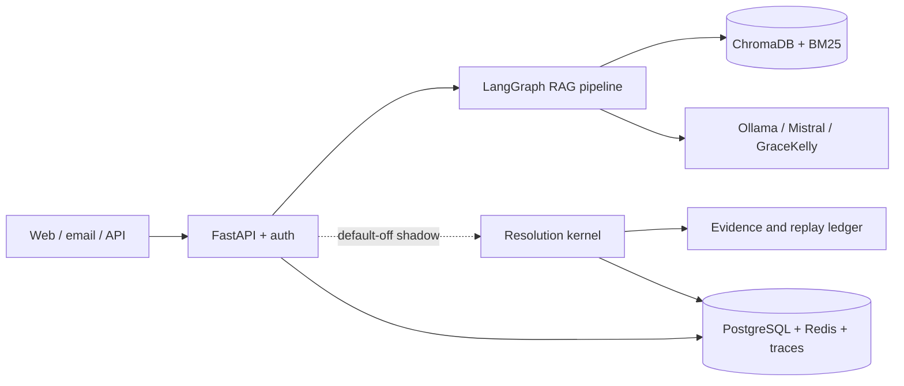

# RAG_new — Verifiable Resolution OS

`RAG_new` is a self-hosted support system that combines a production-style RAG
runtime with a deterministic resolution kernel for versioned procedures,
evidence, policy decisions, governed actions, and verified business outcomes.

The first product wedge is multilingual logistics and air-cargo support. The
inherited chat runtime remains the compatibility baseline while the new
shipment-status journey is introduced behind default-off feature flags.

> **Current status:** start with [`CURRENT_STATE.md`](CURRENT_STATE.md), then
> [`ROADMAP.md`](ROADMAP.md). The active plan is
> [`plan_06_09_26.md`](plan_06_09_26.md). The resolution journey is wired
> into synchronous `/api/ask` as a read-only shadow, but it still uses a
> fixture TMS and the repository has zero approved real shipment-bound cases.
> Fixture measurements are not production evidence.

## Architecture



The application is a modular monolith:

- `api/` owns HTTP routes, authentication boundaries, limits, and correlation;
- `agent/`, `ingestion/`, `vectordb/`, and `llm/` implement the inherited RAG path;
- `resolution/`, `knowledge/`, `actions/`, and `services/session.py` implement
  deterministic resolution and durable turns;
- PostgreSQL is the durable authority; ChromaDB is a rebuildable retrieval
  projection; Redis is an optional cache;
- `evaluation/`, `monitoring/`, and `tracing/` provide quality and operational
  evidence.

The full design, invariants, and decision register are in
[`docs/architecture/README.md`](docs/architecture/README.md).

## Quick start

For this workspace, run the service, models, containers and full test suite on
the Mac. Windows is for editing and focused checks; do not install or launch
WSL, Docker or a local VM here.

Requirements on the runtime host: Python 3.11+, PostgreSQL, Redis, and either an Ollama model or a
configured external provider. The complete walkthrough is
[`docs/QUICKSTART.md`](docs/QUICKSTART.md).

```bash
python -m venv .venv
. .venv/bin/activate
pip install --require-hashes -r requirements.lock
cp .env.example .env
alembic upgrade head
python main.py
```

To bring up the application together with PostgreSQL and Redis instead of
installing them yourself, use the checked-in `docker-compose.yml` on the Mac:

```bash
cp .env.example .env
docker compose up -d
```

Repository defaults use the owner-oriented `local-first` Ollama profile with
`qwen2.5:7b`. External users can select `external-mistral`, remote embeddings,
and an empty `RAG_RERANKER_MODEL` to avoid local model-hub downloads.
Optional provider keys belong only in the local `.env`;
no API keys ship in this repository.

Open `http://localhost:8000/static/login.html` or
`http://localhost:8000/static/chat.html`. Interactive OpenAPI documentation is
available at `http://localhost:8000/docs`.

## Main runtime surfaces

| Surface | Purpose |
|---|---|
| `POST /api/ask` | Synchronous question answering; optional resolution shadow |
| `POST /api/ask/stream` | Direct SSE answer path; it currently bypasses the shadow |
| `POST /api/upload` | Authenticated document ingestion |
| `/api/agent/*` | Escalated-ticket and copilot workflows |
| `/api/admin/*` | Traces, evidence, audit, providers, and review queues |
| `/api/analytics/*` | Quality, topic, resolution, and cost analytics |
| `/api/health/live`, `/api/health/ready` | Liveness and dependency-aware readiness |
| `/metrics` | Prometheus exposition |

Authentication, endpoint details, limits, and all environment variables are
documented in [`docs/CONFIGURATION.md`](docs/CONFIGURATION.md). FastAPI's
generated OpenAPI schema is the endpoint-level source of truth.

## Documentation

[`docs/README.md`](docs/README.md) is the documentation map. The maintained
entry points are:

- [Quickstart](docs/QUICKSTART.md)
- [Configuration](docs/CONFIGURATION.md)
- [Architecture](docs/architecture/README.md)
- [Deployment](docs/DEPLOYMENT.md)
- [Operations and evaluation](docs/OPERATIONS.md)
- [Runbook](docs/runbook.md)
- [Evidence index](EVIDENCE_INDEX.md)

Superseded plans, task specifications, session handoffs, research snapshots,
and legacy code are retained under [`archive/`](archive/README.md). They are
historical evidence, not current guidance. Demo knowledge-base inputs live in
[`demo/docs/`](demo/docs/).

## Web UI

- `/static/chat.html` - main chat UI with citations and streaming
- `/static/login.html` - password and OIDC login
- `/static/admin.html` - traces, evidence, audit, provider, and KB administration
- `/agent` and `/static/agent.html` - agent copilot
- `/static/analytics.html` - product analytics
- `/static/metrics.html` - operational metrics
- `/static/widget.html` - embeddable support widget

## Accessibility

Axe/Lighthouse verification 2026-05-03 completed with `38 passed` for the
scanned pages and rendered templates. Lighthouse mobile `/static/chat.html`:
performance `99`, accessibility `100`, best-practices `96`, SEO `90`. The
detailed record is
[`docs/a11y/axe-audit-2026-04-21.md`](docs/a11y/axe-audit-2026-04-21.md).

## Development and verification

Install development dependencies from the locked set:

```powershell
pip install --require-hashes -r requirements-dev.lock
```

Focused Windows test workflow:

```powershell
python -m pytest tests/test_docs_hygiene.py -q -p no:schemathesis --basetemp=.tmp/pytest-docs
```

Static checks (Windows):

```powershell
ruff check .
```

Full checks and database integration (Mac, from its checkout):

```bash
pre-commit run --all-files
python -m pytest tests -q --ignore=tests/integration -p no:cacheprovider
python -m pytest tests/integration -q
```

Several integration modules require a real disposable PostgreSQL database.
Heavy model runs, the full suite, and Docker workflows are kept off the
resource-constrained Windows laptop; see `CURRENT_STATE.md` for the current
execution boundary.

Mypy is blocking only for the named scope synchronized across CI and local
gates. It is not a repository-wide `--strict` claim. See the configuration in
`pyproject.toml` and the guard in `tests/test_precommit_config.py`.

## Repository map

```text
api/             HTTP application and routers
agent/           LangGraph RAG pipeline
resolution/      Resolution contracts, domain, adapters, and composition
knowledge/       Temporal knowledge authority
actions/         Governed side effects and reconciliation
services/        Durable session service
ingestion/       Loaders and indexing pipeline
vectordb/        Hybrid retrieval and ChromaDB projection
evaluation/      Quality datasets, benchmarks, and reports
monitoring/      Metrics and alerts
tracing/         Trace persistence and OpenTelemetry
static/          Browser interfaces
tests/           Unit and integration suites
docs/            Maintained documentation and evidence
demo/            Reproducible demo inputs
archive/         Superseded documents, tasks, and legacy code
```

## License

MIT. See [`LICENSE`](LICENSE).
