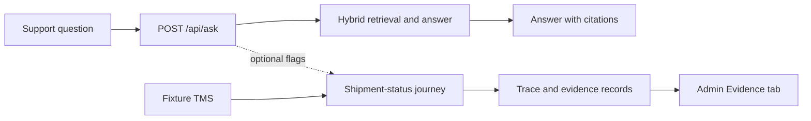

# RAG assistant

RAG assistant (the `RAG_new` repository) is a support answering service that
answers questions from a company's documents, cites its sources, and offers a
hand-off to an operator. It runs on the owner's Windows laptop under the
`codex-only` profile: every language-model call goes to OpenAI's GPT-6-Astra
through Codex, so questions and retrieved passages leave the machine; only
embedding and ONNX reranking run locally, without Ollama. Until 2026-11-03 it
ran on one iMac with 8 GB of memory, using Qwen3-4B-Instruct-2507 (`q4_K_M`)
on the CPU through Ollama.

Retrieval combines BM25 and BGE-M3, with 14 candidates each, reciprocal rank
fusion (RRF), and `bge-reranker-v2-m3` as INT8 in ONNX Runtime on the CPU,
keeping five chunks. The V4 answer prompt uses a 3,584-token window. This is
the measured **package**, including a 1,024 MiB host prompt-cache cap; the
retrieval and window settings are code defaults since `6c52b06`. Under
`codex-only`, a query transformation and one batched document grade run at
`low` effort and the answer at `xhigh`. See
[`CURRENT_STATE.md`](CURRENT_STATE.md) for the runtime and records.

An optional shipment-status journey records the source facts,
policy decision, claims, and replay receipt behind the synchronous `/api/ask`.
Reviewers can inspect that record in the admin Evidence tab.

The journey uses a fixture TMS and is off by default. See
[`CURRENT_STATE.md`](CURRENT_STATE.md) for the current gate,
[`ROADMAP.md`](ROADMAP.md) for frozen work, and
[`PLAN.md`](PLAN.md) for the plan.

The [three-minute walkthrough](demo/phase-e-demo.mp4) follows a real
`/api/ask` request into the admin Evidence view. It shows a fixture-sourced
stale-data escalation; the [recording notes](demo/phase-e-screencast.md)
describe the sequence and its limits.

## Measured results

### The product under `codex-only`

The web chat (`/api/ask/stream`) on the owner's laptop answered stage 5в's
300 questions, 100 each from WixQA, ConditionalQA and aircargo. Its answers
are paired with GPT-6-Astra's answers to the package's saved contexts on the
same ids (stage 5в's Codex arm). "Answered good" counts answers the judge
rates good (M1, without reference answers) whose sent context holds the
answer. "Gold in the sent context" needs no judge; it covers the 180
questions with gold evidence, WixQA's 100 and ConditionalQA's 80 answerable.

| Measurement | Stage 5в's Codex arm → the product | Reading | Record (date) |
|---|---|---|---|
| Answered good (n = 300) | 268/300 → 279/300 | Rise detected; registered decision: holds | [Stage 6 item 0](docs/evidence/codex-only-quality-record.md), 2026-11-06 |
| Answered good per base (n = 100 each) | WixQA 87 → 89; ConditionalQA 81 → 92; aircargo 100 → 98 | ConditionalQA's rise detected; the others not | [Stage 6 item 0](docs/evidence/codex-only-quality-record.md), 2026-11-06 |
| Gold in the sent context (n = 180) | 125/180 → 116/180 | Change not detected | [Stage 6 item 0](docs/evidence/codex-only-quality-record.md), 2026-11-06 |
| Whole answer on the laptop (n = 300) | Median 66.0 s; p90 83.3 s; none over 180 s | Under the owner's own load | [Stage 6 item 0](docs/evidence/codex-only-quality-record.md), 2026-11-06 |

The registered outcome is **holds: publish these numbers as product quality
under `codex-only`**. The comparison is in-sample. Contexts, release code and
the call framing change together, so neither reading isolates a cause, and
"no detected fall" does not establish equivalence.

### The package on the iMac

These measurements cover the web chat (`/api/ask/stream`) on the package.
M1 is the judge's answer-quality rating without reference answers: good,
faithful but partial, or bad. The quality arrows compare saved V4 answers
**before the package** with new answers on the same question ids.

aircargo is the project's own corpus of 201 real documents; its
questions were written by an agent. WixQA asks support questions, while
ConditionalQA tests conditions, refusals, and evidence across sections.
MultiHop-RAG asks questions requiring evidence from several documents, so
the bases probe different demands.

| Measurement | Before the package → package, or package timing | Reading | Record (date) |
|---|---|---|---|
| aircargo M1 | Good 63/100 → 73/100; bad 17/100 → 13/100 | Good gain detected; bad change not detected | [Item 6](docs/evidence/stage4-item6-final-aircargo-record.md), 2026-10-31 |
| aircargo first word (n = 30) | Median 89.3 s; p90 255.6 s | Separate speed run | [Item 7](docs/evidence/stage4-item7-final-speed-record.md), 2026-10-31 |
| aircargo whole answer (n = 30) | Median 170.2 s; p90 338.8 s | Excludes subsequent suggestions | [Item 7](docs/evidence/stage4-item7-final-speed-record.md), 2026-10-31 |
| WixQA M1 | Good 40/100 → 30/100; bad 51/100 → 59/100 | Good fall detected; bad change not detected | [Stage 5](docs/evidence/stage5-final-external-record.md), 2026-11-02 |
| ConditionalQA M1 | Good 35/100 → 38/100; bad 57/100 → 53/100 | Neither change detected | [Stage 5](docs/evidence/stage5-final-external-record.md), 2026-11-02 |
| WixQA + ConditionalQA M1 bad | 108/200 (54%) → 112/200 (56%) | Change not detected; registered decision: holds | [Stage 5](docs/evidence/stage5-final-external-record.md), 2026-11-02 |
| MultiHop-RAG (n = 100) | NOT_EVIDENCE | Judge bridge stability failed; advisory only | [Stage 5](docs/evidence/stage5-final-external-record.md), 2026-11-02 |

Stage 5's registered outcome is **holds: publish the package's numbers**.
The decision reads only the pooled WixQA + ConditionalQA M1 bad share.
**WixQA's detected fall in good answers is outside that decision and is the
main caveat.** MultiHop-RAG supplies no admitted old-versus-new result because
its judge bridge failed. The records read the whole package, without
attributing the outcome to any one change. Earlier experiments and decisions
are in the [evidence index](EVIDENCE_INDEX.md).

## How the numbers are made

A [specification](docs/specs/) is registered before the first request.
Quality comparisons pair the same question ids and use cluster bootstrap
intervals alongside Newcombe intervals: "detected" means both intervals
exclude zero in the same direction. "Not detected" does not mean "no
difference". The LLM judge is `claude-opus-5-5`; bridges re-grade kept replies
to check its stability. Records bind each number to its corpus SHA, code SHA,
and configuration; the [evidence index](EVIDENCE_INDEX.md) links the records
and artifact checks. No person grades the answers (owner's decision D11).

## Design



The versioned `ResolutionContract` defines the journey's required evidence and
outcomes. The read-only shadow links claims to source facts and policy decisions;
its trace includes the evidence age and replay receipt. The Evidence tab shows
these records alongside the answer. Operators can open a known trace ID in the
Traces tab or at `/static/admin.html?trace_id=<id>`. The legacy answer path
remains active when the journey flags are off. See the
[resolution evidence walkthrough](EVIDENCE_INDEX.md) and
[configuration](docs/CONFIGURATION.md). The
[reviewer contract bundle](resolution-contracts/README.md) contains the JSON
Schema and complete shipment-status contract examples.

The application is a modular monolith:

- `api/` owns HTTP routes, authentication boundaries, limits, and correlation;
- `agent/`, `ingestion/`, `vectordb/`, and `llm/` implement the inherited RAG path;
- `resolution/`, `knowledge/`, `actions/`, and `services/session.py` implement
  deterministic resolution and durable turns;
- PostgreSQL is the durable authority; ChromaDB is a rebuildable retrieval
  projection; Redis is an optional cache;
- `evaluation/`, `monitoring/`, and `tracing/` provide quality and operational
  evidence.

The full design, invariants, and decision register are in
[`docs/architecture/README.md`](docs/architecture/README.md).

## Limitations

- Shipment-status is the only wired resolution journey, and its TMS is a fixture.
- The 100 approved journey labels are on agent-written questions, with no
  shipment-bound support requests. There is no measured verified-resolution
  precision, verified-resolution yield (VRY), or cost per resolution; see the
  [admission analysis](docs/evidence/a6-journey-admission-and-clarification.md).
- Quality is graded by one judge model. The bridges check stability and supply
  no human validation; relevance checks also use model references only.
- Each external base has 100 questions, drawn in stage 2 and reused here, so
  they are not an independent test set.
- Speed was measured on one shared iMac, idle for the run, on one day with
  30 questions. It measures neither throughput nor concurrency; the exact
  intervals for p90 have no finite upper bound. See [item 7's
  caveats](docs/evidence/stage4-item7-final-speed-record.md#what-it-does-not-say).
- No SLO has been named. Item 7's proposals await the owner's decision.
- Graph retrieval, contract-shaped answers, and clarification projection require
  explicit flags; the graph arm failed its default-on gate.
- The local Compose setup runs one web replica. It is a development setup, not
  a measured production deployment.
- No service is kept running between measurement runs yet; see
  [`CURRENT_STATE.md`](CURRENT_STATE.md).

Answer V6 (stage 5b) was not adopted: the pooled M2 agreement with the
reference fell, a detected harm ([record](docs/evidence/answer-prompt-v6-record.md)).

## Quick start

For this workspace, run the service, models, containers and full test suite on
the Mac. Windows is for editing and focused checks; do not install or launch
WSL, Docker or a local VM here.

Requirements on the runtime host: Python 3.11+, PostgreSQL, Redis, and either an Ollama model or a
configured external provider. The complete walkthrough is
[`docs/QUICKSTART.md`](docs/QUICKSTART.md).

```bash
python -m venv .venv
. .venv/bin/activate
pip install --require-hashes -r requirements.lock
cp .env.example .env
alembic upgrade head
python main.py
```

To bring up the application together with PostgreSQL and Redis instead of
installing them yourself, use the checked-in `docker-compose.yml` on the Mac:

```bash
cp .env.example .env
docker compose up -d
```

Repository defaults use the owner-oriented `local-first` Ollama profile with
`qwen3:4b-instruct-2507-q4_K_M` (Qwen3-4B-Instruct-2507). External users can select `external-mistral`, remote embeddings,
and an empty `RAG_RERANKER_MODEL` to avoid local model-hub downloads.
Optional provider keys belong only in the local `.env`;
no API keys ship in this repository.

Open `http://localhost:8000/static/login.html` or
`http://localhost:8000/static/chat.html`. Interactive OpenAPI documentation is
available at `http://localhost:8000/docs`.

## Main runtime surfaces

| Surface | Purpose |
|---|---|
| `POST /api/ask` | Synchronous question answering; optional resolution shadow |
| `POST /api/ask/stream` | Direct SSE answer path; it currently bypasses the shadow |
| `POST /api/upload` | Authenticated document ingestion |
| `/api/agent/*` | Escalated-ticket and copilot workflows |
| `/api/admin/*` | Traces, evidence, audit, providers, and review queues |
| `/api/analytics/*` | Quality, topic, resolution, and cost analytics |
| `/api/health/live`, `/api/health/ready` | Liveness and dependency-aware readiness |
| `/metrics` | Prometheus exposition |

Authentication, endpoint details, limits, and all environment variables are
documented in [`docs/CONFIGURATION.md`](docs/CONFIGURATION.md). FastAPI's
generated OpenAPI schema is the endpoint-level source of truth.

## Documentation

[`docs/README.md`](docs/README.md) is the documentation map. The maintained
entry points are:

- [Quickstart](docs/QUICKSTART.md)
- [Configuration](docs/CONFIGURATION.md)
- [Architecture](docs/architecture/README.md)
- [Deployment](docs/DEPLOYMENT.md)
- [Operations and evaluation](docs/OPERATIONS.md)
- [Runbook](docs/runbook.md)
- [Evidence index](EVIDENCE_INDEX.md)
- [Current state](CURRENT_STATE.md) and [the plan](PLAN.md) (in Russian)

Superseded plans, audits, task specifications, session handoffs, research
snapshots and legacy code are retained under [`archive/`](archive/README.md). They are
historical evidence, not current guidance. Demo knowledge-base inputs live in
[`demo/docs/`](demo/docs/).

## Web UI

- `/static/chat.html` - main chat UI with citations and streaming
- `/static/login.html` - password and OIDC login
- `/static/admin.html` - traces, evidence, audit, provider, and KB administration
- `/agent` and `/static/agent.html` - agent copilot
- `/static/analytics.html` - product analytics
- `/static/metrics.html` - operational metrics
- `/static/widget.html` - embeddable support widget

## Accessibility

Axe/Lighthouse verification 2026-05-03 completed with `38 passed` for the
scanned pages and rendered templates. Lighthouse mobile `/static/chat.html`:
performance `99`, accessibility `100`, best-practices `96`, SEO `90`. The
detailed record is
[`docs/a11y/axe-audit-2026-04-21.md`](docs/a11y/axe-audit-2026-04-21.md).

## Development and verification

Install development dependencies from the locked set:

```powershell
pip install --require-hashes -r requirements-dev.lock
```

Focused Windows test workflow:

```powershell
python -m pytest tests/test_docs_hygiene.py -q -p no:schemathesis --basetemp=.tmp/pytest-docs
```

Static checks (Windows):

```powershell
ruff check .
```

Full checks and database integration (Mac, from its checkout):

```bash
pre-commit run --all-files
python -m pytest tests -q --ignore=tests/integration -p no:cacheprovider
python -m pytest tests/integration -q
```

Several integration modules require a real disposable PostgreSQL database.
Heavy model runs, the full suite, and Docker workflows are kept off the
resource-constrained Windows laptop; see `CURRENT_STATE.md` for the current
execution boundary.

Mypy is blocking only for the named scope synchronized across CI and local
gates. It is not a repository-wide `--strict` claim. See the configuration in
`pyproject.toml` and the guard in `tests/test_precommit_config.py`.

## Repository map

```text
api/             HTTP application and routers
agent/           LangGraph RAG pipeline
resolution/      Resolution contracts, domain, adapters, and composition
knowledge/       Temporal knowledge authority
actions/         Governed side effects and reconciliation
services/        Durable session service
ingestion/       Loaders and indexing pipeline
vectordb/        Hybrid retrieval and ChromaDB projection
evaluation/      Quality datasets, benchmarks, and reports
monitoring/      Metrics and alerts
tracing/         Trace persistence and OpenTelemetry
static/          Browser interfaces
tests/           Unit and integration suites
docs/            Maintained documentation and evidence
demo/            Reproducible demo inputs
archive/         Superseded documents, tasks, and legacy code
```

## License

MIT. See [`LICENSE`](LICENSE).
