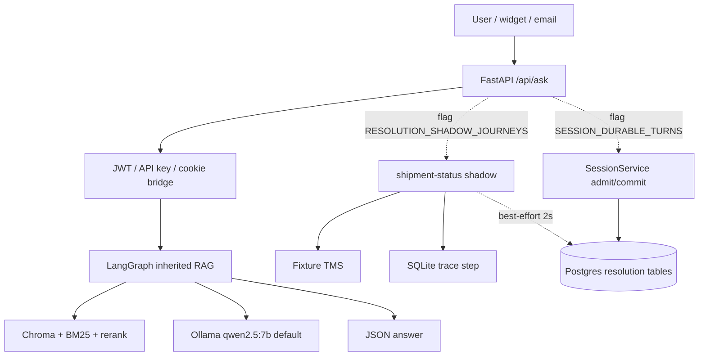

# First-party limited-assurance technical assessment of RAG_new

**Document ID:** RAG-NEW-AUD-2026-08-27<br>
**Title:** Limited-assurance assessment of current state<br>
**Version:** 1.3 (v1.2 issuance + subsequent-events addendum)<br>
**Supersedes:** 1.2 document version; the original opinion keeps its 2026-08-27 cutoff<br>
**Cutoff / fieldwork:** 2026-08-27; Appendix L records subsequent local events through source-state HEAD `355f052` on 2026-08-29<br>
**Classification:** Internal — owner-confidential (repository is private)<br>
**Language of record:** Russian. English executive summary is informative, not a second opinion.<br>
**Distribution:** Julia Edomskikh (owner). Not a certification, not a third-party attestation.<br>
**Independence:** First-party (assessor is an agent in the owner workspace). Not independent under ISO 19011 / ISAE 3000.

| Field | Value |
|---|---|
| Subject | `D:\RAG_new`, git `master` |
| HEAD examined | `bd8229775939e14c35438dbee8fcfeba9f69aff1` |
| `origin/master` | `04fbe4bf9d2409af65d06b1f0dbefc481338fe9b` (HEAD **ahead 3**) |
| Freeze baseline | tag `freeze-2026-08-23` = `26866e9` |
| Remote | `https://github.com/brownjuly2003-code/RAG_new.git` (private) |
| Prior audit of record | [`audit_final_23_08_2026.md`](audit_final_23_08_2026.md) on `26866e9` |
| Working tree at cutoff | **dirty** (see §6) |
| Assessor | Grok 4.6, first-party agent in the owner workspace |
| Intended user | Owner / future agent sessions / a third-party engineer reading cold |

> **v1.3 subsequent-event notice.** Sections 1–23 and Appendices A–K preserve
> the 2026-08-27 fieldwork and must be read at that cutoff. Appendix L records
> later local remediation through 2026-08-29. It is not a new audit, does not
> recompute the scores, and does not convert open owner gates into decisions.

This document follows the *shape* of ISO 19011:2018 (audit principles), IEEE 1028-2008 (software reviews and audits), IIA/ISACA five-component findings, and ISO/IEC 25010:2023 (product quality model). It is **not** an accredited audit under ISO/IEC 17021, **not** an ISAE 3000 assurance report, and **not** a penetration test.

---

## Contents

1. [English executive summary](#1-english-executive-summary)
2. [Краткий вывод для владельца](#2-краткий-вывод-для-владельца)
3. [Engagement: objectives, scope, criteria](#3-engagement-objectives-scope-criteria)
4. [Independence, assurance, materiality](#4-independence-assurance-materiality)
5. [Methodology and evidence hierarchy](#5-methodology-and-evidence-hierarchy)
6. [Subject identity (git and working tree)](#6-subject-identity-git-and-working-tree)
7. [Opinion](#7-opinion)
8. [ISO/IEC 25010 quality model](#8-isoiec-25010-quality-model)
9. [Follow-up of prior findings FIN-01…FIN-16](#9-follow-up-of-prior-findings-fin-01fin-16)
10. [Findings register](#10-findings-register)
11. [Positive findings](#11-positive-findings)
12. [System under assessment](#12-system-under-assessment)
13. [Request path (as implemented)](#13-request-path-as-implemented)
14. [Resolution kernel seam](#14-resolution-kernel-seam)
15. [Data and measurement](#15-data-and-measurement)
16. [RAG quality (secondary evidence)](#16-rag-quality-secondary-evidence)
17. [Security and tenancy](#17-security-and-tenancy)
18. [Verification system (tests, types, CI)](#18-verification-system-tests-types-ci)
19. [Operations and deployment](#19-operations-and-deployment)
20. [Process and documentation](#20-process-and-documentation)
21. [Risk register](#21-risk-register)
22. [Management action plan](#22-management-action-plan)
23. [Limitations, residual risk, subsequent events](#23-limitations-residual-risk-subsequent-events)
24. [Appendices](#24-appendices) (A glossary · B claim matrix · C reproduction · D rubric · E plan conformity · F standards · G checklist · H history · I v1.2 addendum · J owner response · K extra commands · L v1.3 subsequent events)

---

## 1. English executive summary

**Opinion (limited assurance).** On 2026-08-27, `RAG_new` is a disciplined modular monolith that *can* run a read-only shipment-status resolution journey beside `/api/ask`, and *does not* do so in the default configuration. The inherited RAG path remains the product a user receives. The resolution kernel is wired as a shadow, not as the owner of the HTTP response. Phase 0 and Phase A of `plan_23_08_2026.md` are complete in code. Phase B is blocked by corpus structure, not by missing labels. The only published *measured* resolution-adjacent number (admission recall **0.0000** on 100 agent-authored cases) exists in three **unpushed** commits plus an **untracked** capsule. That is a recurrence, in miniature, of the unique-copy risk the 23 August audit called FIN-03.

**What changed since 23 August (HEAD `26866e9`, no remote, no CI, zero production imports of the kernel).** A private remote and freeze tag exist. CI on `origin/master` (`04fbe4b`) is green — run [32880095361](https://github.com/brownjuly2003-code/RAG_new/actions/runs/32880095361), all 11 CI jobs success (this session, GitHub API). `/api/ask` imports `resolution` and `services.session`. An Evidence tab exists. One hundred air-cargo cases carry journey labels. A Russian admission vocabulary exists. Those are real closures, not documentation theatre.

**What a third party would still be wrong to believe.** That the default service “is” a Verifiable Resolution OS. That 100 cases are real labelled support traffic. That `actions/` and `knowledge/` participate in the public write path. That the A.6 number is on `origin/master`. That CI has seen `bd82297`.

**Material issues (see register).** F-01 unique copy of A.6 evidence (Critical, durability). F-02 corpus cannot measure resolution (High, measurement). F-03 default flags hide the Phase A thread (High vs. the Phase A demo claim; Medium vs. the documented “off by default” contract). F-04 `/api/ask` ignores `CLARIFICATION_REQUIRED` (High if the product claim is “kernel decides”; accepted if the claim remains “shadow only”).

**Intended use assumed in scores:** Mode B of the 23 August plan — one engineer plus agents, local self-host, proof of engineering maturity, not an enterprise production deployment. Scores against a hosted multi-tenant production bar would be lower, mainly on security, tenancy, and replica topology.

**Composite professional judgement (rubric in Appendix D):** shippable system **6.3 / 10** (was 5.5 on 23 Aug); engineering base **8.3 / 10**; portfolio artefact **4.5 / 10**. These are ordinal judgements, not a certified maturity level (CMMI/TMMI). The ISO 25010 mean in §8 is a different scale and is not averaged into 6.3.

**Single next actions, in order of leverage:** (1) commit the A.6 capsule and status docs; (2) owner decision to push `bd82297`; (3) owner answer to Q2b — can ~100 real requests that *name a shipment* be obtained?; (4) only then T-03 if the product should show clarification on `/api/ask`.

---

## 2. Краткий вывод для владельца

За четыре дня после аудита записи ядро получило швы в `/api/ask` и в admin UI. Это не перепись документов. Фазы 0 и A в коде закрыты. Фаза B упёрлась не в «надо разметить», а в жанр корпуса: 100 агентских вопросов *о* air-cargo, 0 обращений *внутри* него, 0 id отправления.

Единственное измеренное число (admission recall 0.0000) честное — и сидит на трёх локальных коммитах плюс untracked-капсуле. Пока нет push, это снова единственная копия.

Дефолтный продукт — унаследованный RAG. Shadow и durable turns выключены. T-03 не сделан: даже с включённым shadow пользователь не видит `CLARIFICATION_REQUIRED`.

**Что решать вам, а не агенту:** push A.6; Q2b (реальные обращения с id — да / нет / later); публиковать ли clarification на HTTP.

**Чего не делать:** писать ещё фикстурные сценарии «чтобы B.3 позеленел»; подгонять русский словарь под корпус; unfreeze G9+ / REL-03D / GraphRAG.

---

## 3. Engagement: objectives, scope, criteria

### 3.1 Objectives

1. Establish the identity of the system at cutoff (commit, tree, remote, drift).
2. Determine what a user of default `/api/ask` actually receives.
3. Determine what the resolution kernel observes, persists, and can change.
4. Follow up FIN-01…FIN-16 from the 23 August audit of record.
5. Separate *code-complete* from *measured* from *durable* (on remote + CI).
6. Give the owner a risk-ranked action plan that does not restart frozen streams.

### 3.2 In scope

- Git identity, working tree, freeze tag, remote URL.
- Production Python packages, FastAPI routers, settings defaults, feature flags.
- Resolution / knowledge / actions / session seams and their callers.
- Checked-in corpora, manifests, admission report as quoted in the A.6 capsule.
- Authn/z defaults, cookie Origin gate, pip-audit ignore policy as code.
- Test inventory (static), mypy/coverage configuration, CI workflow *text*.
- Root documentation hygiene and the live routing surface.
- Helm `values.yaml` and `docker-compose.yml` as *declared* topology.

### 3.3 Out of scope (non-objectives)

- Penetration test, secret scanning of `.env`, live LLM/Ollama/Mistral calls.
- Reperformance of GitHub Actions on `bd82297` (not pushed; latest green CI is `04fbe4b` / run 32880095361).
- Live `/api/ask` against a running app (no local server started).
- Full pytest on this Windows host (project rule: heavy suite is iMac/CI; a11y test hangs locally).
- PostgreSQL round-trip on this host.
- Helm install onto a cluster.
- Market/buyer research (moat score 4.0 retained from 23 Aug; not re-researched).
- Legal, privacy-impact, or SOC 2 mapping.
- Source `RAG_Support_Assistant` except as lineage.

### 3.4 Criteria (what “should” looks like)

| ID | Criterion | Source |
|---|---|---|
| C-PLAN | Mode B plan, phases 0–E, stop-list | `plan_23_08_2026.md` |
| C-SLICE | A slice counts only if (a) observable `/api/ask` or UI + E2E, (b) real labelled cases increase, or (c) a published number with corpus SHA + code SHA + config | `CLAUDE.md`, `CURRENT_STATE.md` |
| C-EVID | Evidence class `synthetic` / `fixture` / `agent_labelled` / `real_labelled` / `measured`; skipped run = `NOT_EVIDENCE` | `EVIDENCE_INDEX.md`, ADR culture |
| C-FLAG | Shadow and durable turns off by default; unknown journey fails at startup | `config/settings.py` |
| C-ISO25010 | Product quality characteristics used as the scoring frame | ISO/IEC 25010:2023 |
| C-PRIOR | FIN-01…FIN-16 remain the follow-up set until closed or accepted | `audit_final_23_08_2026.md` |
| C-ADR8 | Inherited CI-red disposition, chromadb CVE ignore with review date 2026-09-24 | `docs/adr/0008-inherited-ci-red-disposition.md` |

---

## 4. Independence, assurance, materiality

**Independence (ISO 19011 principle — qualified).** The assessor is an AI coding agent operating in the owner’s workspace under owner instructions, on the same day as MyFlow slice T-05 was rewriting status docs. This is a **first-party technical assessment**, not an independent third-party audit. Objectivity is pursued by preferring primary artefacts (git, source, JSON manifests) over narrative docs, and by marking secondary claims.

**Assurance level: limited.** Procedures were inspection, tracing of imports, static counts, and follow-up of a prior audit. There was no reperformance of CI, no live pipeline run, no independent interview of a second party. Limited assurance supports *negative* wording: “nothing came to our attention that the following recorded claims are false,” not a positive certification that the system is fit for production.

**Due professional care.** Where a command failed or was out of policy (full pytest, `gh run list` timeout), the claim that *would have* come from it is either omitted or labelled secondary.

**Confidentiality.** The remote is private. This file lives under `docs/audits/`. It contains no secrets. It does name a LAN host from existing ops docs (`192.168.1.133`) already on disk.

**Materiality.** A matter is material if it would change a reasonable owner’s decision among: push, publish, enable shadow in default, approve labels, start Phase C, or unfreeze a frozen stream. Cosmetic doc drift below the routing surface is not material unless it misroutes an agent (C-SLICE).

**Subsequent events.** None after cutoff. The dirty tree *is* the cutoff state, not a subsequent event.

---

## 5. Methodology and evidence hierarchy

ISO 19011: conclusions from evidence, not from the repository’s self-description.

| Tier | Meaning | Used for |
|---|---|---|
| **P — Primary** | Observed this session: git objects, file bytes, grep, JSON, line counts | Identity, wiring, flags, corpus manifest, LOC, test-function counts, `.gitignore` |
| **S — Secondary** | Project record not re-executed this session | Q1 faithfulness 0.8406; CURRENT_STATE’s older CI run 32874107015 (2234 / 76.04%) |
| **N — Narrative** | Status markdown agreeing with P/S | Routing only after P confirmed |

**Procedures performed**

1. Inspection of root routing docs, then source listed in §3.2.
2. `git rev-parse`, `git status`, `git log origin/master..HEAD`, `git log freeze-2026-08-23..HEAD` (28 commits).
3. Import grep: `from (resolution\|knowledge\|actions)|services\.session` under `api/`.
4. Physical line counts over `*.py` excluding `__pycache__`.
5. Regex count of `^(async )?def test_` under `tests/`.
6. Read of settings, auth, composition, conversation ask-return, cookie Origin, ADR 0008 header, manifest, corpora scenario_id list.
7. Follow-up table against FIN-01…FIN-16 with new status.
8. Working-tree inventory including `.myflow/` (untracked).
9. v1.2: `python scripts/journey_admission_report.py`; in-process T-06/T-09; jsonl parse vs manifest; hashlib of corpus and capsule; `gh run list` / `gh run view` / job logs; `/chat` vs `/ask/stream` call graph.

**Procedures not performed** (and therefore not claimed): live `/api/ask`, local pip-audit, PyPI re-fetch of chromadb, browser E2E, second independent reviewer.

**Sampling.** Not statistical. Coverage was risk-based: public request path, kernel seams, measurement artefacts, auth defaults, CI config text, durability of A.6. Scripts under `scripts/` were inventoried, not reviewed line by line.

---

## 6. Subject identity (git and working tree)

Primary.

```
HEAD:          bd8229775939e14c35438dbee8fcfeba9f69aff1
origin/master: 04fbe4bf9d2409af65d06b1f0dbefc481338fe9b   # B.1 labels
ahead:         3
tag:           freeze-2026-08-23 → 26866e9
remote:        origin https://github.com/brownjuly2003-code/RAG_new.git
```

Unpushed (all `feat` on resolution/evaluation):

| SHA | Slice | Content |
|---|---|---|
| `6651964` | T-01 | Admit before id extract |
| `36d4269` | T-02 | Score admission on 100 labelled cases |
| `bd82297` | T-08 | Russian half of admission vocabulary, as a translation |

Working tree at cutoff:

| Path | Git | Role |
|---|---|---|
| `CURRENT_STATE.md` | modified | Live entry; describes A.6 |
| `ROADMAP.md` | modified | A.6 + three-reason block on B |
| `EVIDENCE_INDEX.md` | modified | A.6 row |
| `BACKLOG.md` | modified | T-03/T-04/T-06/T-07/T-09 |
| `docs/evidence/a6-journey-admission-and-clarification.md` | **untracked** | Capsule of the measured number |
| `.myflow/` | **untracked; not in `.gitignore`** | MyFlow v2.2 ledger; T-05 `EXECUTING_SLICE` |

A checkout of `origin/master` does **not** contain T-01/T-02/T-08 or the capsule. A `git reset --hard origin/master` destroys the measured number’s narrative and leaves the three commits only in local reflog until GC. This is F-01.

`.gitignore` lists `.autopilot/` and does not list `.myflow/` (F-06).

---

## 7. Opinion

Against C-PLAN mode B and C-SLICE, nothing came to our attention to contradict the following:

1. Phase 0 is complete in the pushed history (remote, freeze, pricing snapshot, eval skip=`NOT_EVIDENCE`, Origin fail-closed, mypy/coverage widened, root ≤ 9 md).
2. Phase A is complete in code on `HEAD`: shadow, persist, durable turns, Evidence tab, admission gate. Flags default **off** (`config/settings.py` lines 209–220 and 1073–1076).
3. Phase B.1 is complete as *agent labelling*. `real_labelled_count` is 0. `binds_shipment_count` is 0. B.2/B.3/B.5 cannot run on this corpus (F-02).
4. The default HTTP product is the inherited RAG path. The kernel does not own the response (F-03, F-04).
5. `api/` imports `resolution` and `services.session`. `api/` does **not** import `actions` or `knowledge` (F-07).
6. CI on `origin/master` `04fbe4b` is **primary**: run 32880095361, 11/11 jobs success. Unit 3.13 log: **2247 passed, 25 skipped, coverage 76.13%**. Integration 3.13 log: **62 passed, 1 skipped**. CI on `bd82297` is **not in evidence** (unpushed). `CURRENT_STATE.md` still quotes older run 32874107015 / 2234 / 76.04%.

**Opinion sentence.** `RAG_new` at cutoff is a *shadow-capable* RAG service with a high-quality unused write-kernel and a measurement programme that has honestly scored zero on a corpus that cannot support a resolution metric. It is not, in the default configuration, a Verifiable Resolution OS in production.

---

## 8. ISO/IEC 25010 quality model

Scale 1–5 against **intended use** (mode B, local self-host, one journey, flags off unless set). 3 = largely achieved for that use. Not a certification score.

| Characteristic | Score | Basis (tier) | Main findings |
|---|---:|---|---|
| Functional completeness | 3 | P: shadow exists, default path is RAG, T-03 absent | F-03, F-04, F-07 |
| Functional correctness | 3 | P+S: A.4 byte-identity claimed with E2E tests in tree; admission FP=1 on 100 | F-08, F-09 |
| Functional appropriateness | 2 | P: corpus is knowledge Q&A; kernel is case resolution | F-02 |
| Performance efficiency | 3 | S: no new live load test; shadow bounded to 2 s persist | — |
| Compatibility | 3 | P: compose + helm declared; 1 replica by design | F-20 |
| Interaction capability | 3 | P: Evidence tab exists; empty decline is blank | F-05 |
| Reliability | 3 | P: shadow cannot fail the ask; persist is best-effort | F-05 |
| Security | 3 | P: Origin fail-closed; API-key→admin; JWT without iss/aud | F-14, F-15, F-16 |
| Maintainability | 3 | P: tests>prod LOC; `conversation.py` 2331 lines; root hygiene | F-13, P-04 |
| Flexibility | 2 | P: single replica, in-process session, Chroma not under RLS | F-20, FIN-09 |
| Safety | 3 | P: streaming off; irreversible tools confirmation-gated in graph (legacy) | FIN-04 dormant |

Mean of 11 characteristics: **2.8 / 5** (linear map to 0–10 would be 5.6). That map is **not** used as the mode-B composite. ISO 25010 scores the product. Appendix D scores fitness for the owner’s stated mode-B goal (**6.3**). Process honesty is in D, not in 25010. Do not average the two.

---

## 9. Follow-up of prior findings FIN-01…FIN-16

Follow-up language: **Closed** / **Closed with residual** / **Open** / **Accepted risk** / **Superseded**.

| Prior ID | 23 Aug | 27 Aug disposition | Residual |
|---|---|---|---|
| FIN-01 split-brain | P0, 0 imports | **Closed with residual** | Shadow+session wired. Flags off. `actions`/`knowledge` not in `api/`. T-03 not done. See F-03, F-04, F-07 |
| FIN-02 path inversion | P0 | **Open, contained** | G1–G8 frozen. Corpus still cannot feed them real cases. F-02 |
| FIN-03 unique copy / dead CI | P0 | **Closed with residual** | Remote+CI exist on pushed state. A.6 unique copy recurred. F-01 |
| FIN-04 SSE fail-open | P0 if streaming on | **Accepted risk (dormant)** | `STREAMING_ENABLED` default `false` (`settings.py:675-677`) |
| FIN-05 three streams, no WIP | P1 | **Closed** | ROADMAP freeze + WIP 1 |
| FIN-06 process load | P1 | **Closed with residual** | 9 root md + guard. BACKLOG tail still misroutes. F-12 |
| FIN-07 lying gates | P1 | **Closed** | Kernel in mypy+coverage; README corrected |
| FIN-08 Mistral prices | P1 | **Closed** | Snapshot 2026-08-24 + contract test |
| FIN-09 tenant boundary / Chroma | P1 | **Open, deferred to Phase D** | ADR 0007 reserved, not written |
| FIN-10 quality plateau | P1 | **Open, deferred to Phase C** | Secondary Q1 numbers unchanged |
| FIN-11 eval stubs | P1 | **Closed with residual** | skip=`NOT_EVIDENCE`; `expected_copy` tagged; no single release manifest |
| FIN-12 auth/tenancy | P1 external | **Closed cheap item; rest accepted for mode B** | Origin fail-closed. F-14, F-15 |
| FIN-13 data | P2 finding / plan peak | **Open, worse than labelled** | Not “unlabelled” — wrong genre. F-02 |
| FIN-14 plans vs capacity | P2 | **Closed** | Mode B plan executed 0 and A |
| FIN-15 Helm ≠ production | P2 | **Accepted risk** | No deployment target |
| FIN-16 god-modules | P2 | **Open, worse** | `conversation.py` 1671 → 2331. F-13 |

Net: 7 closed or accepted as designed, 5 closed-with-residual, 4 open. The material open set is **data (F-02)**, **default invisibility of the thread (F-03/F-04)**, and **durability of A.6 (F-01)**.

---

## 10. Findings register

### Classification

| Code | ISO 19011 analogue | Use here |
|---|---|---|
| NC | Nonconformity vs a written criterion | Fails C-PLAN / C-SLICE / C-EVID / C-FLAG / C-ADR8 |
| OBS | Observation | Fact that is a risk without breaching a written “shall” |
| OFI | Opportunity for improvement | Hygiene, latent defect |
| AR | Accepted risk | Written, dated, owner-visible |

Severity: **Critical** (unique evidence loss or false external claim) · **High** (blocks a stated phase gate) · **Medium** (material weakness, compensating control) · **Low** · **Info**.

Each finding uses the IIA 5C set: Condition, Criteria, Cause, Consequence, Corrective action. Evidence is file:line or SHA. Reproduction is included when the defect is behavioural.

---

### F-01 — Unique copy of the only measured number

| | |
|---|---|
| ID / class / sev | F-01 · NC vs C-EVID durability · **Critical** |
| Condition | Admission recall 0.0000 lives in unpushed `6651964`/`36d4269`/`bd82297` plus untracked `docs/evidence/a6-journey-admission-and-clarification.md`. Four status files are modified, not committed. |
| Criteria | C-EVID: a published number is evidence only with provenance that another party can check out. FIN-03 closure assumed remote holds the work. |
| Cause | Slice A.6 landed locally; MyFlow T-05 was still `EXECUTING_SLICE` on docs at cutoff; owner push is gated. |
| Consequence | Disk loss or `git reset --hard origin/master` removes the narrative of the only `measured` number. Remote CI has not seen the gate. |
| Corrective | Commit capsule + four docs. Owner push. Do not treat the number as published until it is on `origin/master`. |
| Evidence (P) | `git status -sb` ahead 3, untracked capsule sha256 `4489acd2…`; `.myflow/state.json` `current_task: T-05`; admission re-run on `bd82297` |
| Owner / window | Owner (push) + whoever finishes T-05 · hours |

---

### F-02 — Corpus cannot measure resolution (three independent reasons)

| | |
|---|---|
| ID / class / sev | F-02 · NC vs C-PLAN Phase B gate · **High** |
| Condition | Manifest: 100 cases, `evidence_class: agent_labelled`, `real_labelled_count: 0`, `binds_shipment_count: 0`, `expected_terminal: verified` 100/100, journeys 66/17/11/6. After Russian vocabulary, admission TP=0, FP=1, FN=6, recall 0.0000. |
| Criteria | Phase B gate: 100 `real_labelled` with VR/VRY/`pass^k`. Brief §15 NO-GO if 100 cases do not reflect real requests. C-EVID: `agent_labelled` is a proposal. |
| Cause | Questions were agent-authored over real documents (`case_source`), not sampled from traffic. They ask *about* work. The journey needs a shipment the source holds. Language was a real barrier and **not** the binding one (both-cues 0→1, that 1 is a false positive). |
| Consequence | B.2 has nothing to fixture. B.3 metrics are undefined. Approving labels does not mint `real_labelled` cases. More synthetic scenarios repeat FIN-02. |
| Corrective | Owner Q2b: obtain ~100 real requests that name a shipment, **or** record in `CURRENT_STATE.md` and README Limitations that resolution is measured on 17 synthetic + fixture TMS. Do not extend the fixture TMS “to cover” these 100. |
| Evidence (P, S) | `evaluation/curated_cases_aircargo.manifest.json` lines 3–21; capsule A.6 table (S, untracked); 17 `scenario_id` in `evaluation/resolution/corpora/v0.1/shipment-status.json` (P) |

---

### F-03 — Default configuration hides Phase A

| | |
|---|---|
| ID / class / sev | F-03 · OBS vs documented C-FLAG; **High** vs an unstated “demo from `docker compose up`” · **Medium** vs written flags |
| Condition | `RESOLUTION_SHADOW_JOURNEYS` default `""` → empty tuple. `SESSION_DURABLE_TURNS` default `"false"`. `_run_resolution_shadows` then returns the legacy object unchanged. |
| Criteria | C-FLAG explicitly wants off-by-default. C-PLAN Phase A gate is an E2E with the flag on. README 3-minute demo is Phase E, not now. |
| Cause | Correct fail-safe. The remaining gap is communication: “Phase A done” is easy to read as “the product shows evidence.” |
| Consequence | A reviewer running defaults sees August-18 RAG. Shadow cost is zero; so is the demonstration. |
| Corrective | Keep defaults. State in README Limitations in one sentence. Optional: a documented `compose` override profile `shadow=shipment-status` without changing production defaults. |
| Evidence (P) | `config/settings.py:209-220`, `1073-1076`; `api/routers/conversation.py:181-182`, `1251-1261` |

---

### F-04 — `/api/ask` does not act on `CLARIFICATION_REQUIRED`

| | |
|---|---|
| ID / class / sev | F-04 · OBS (in scope of T-03, not a broken C-FLAG) · **High** if the claim is “kernel decides”; else Medium |
| Condition | After admit-without-id the loop finishes `CLARIFICATION_REQUIRED` / `SHIPMENT_ID_REQUIRED` (`shipment_status.py:937-943`). The HTTP handler still returns `response.model_dump()` of the legacy answer (`conversation.py:1262-1265`). No flag for this behaviour exists. |
| Criteria | C-SLICE (a): observable `/api/ask` change. Plan A was shadow-only; T-03 is the queued (a). |
| Cause | Phase A deliberately did not take ownership of the answer. T-01 made clarification a decision, not a default, which is why T-03 is now worth doing. |
| Consequence | Russian traffic can now be *classified* and still answered as RAG. Evidence tab can show a terminal the user never saw. |
| Corrective | T-03 behind a new flag, default off, E2E on a Russian no-id status question; A.4-style byte identity with flag off. Do not couple T-04 into the same slice unless extracting shadow helpers from `conversation.py` (F-13). |
| Evidence (P) | `resolution/application/shipment_status.py:929-943`; `api/routers/conversation.py:1251-1265`; `BACKLOG.md` T-03 |

---

### F-05 — Declined journeys write nothing (empty Evidence is ambiguous)

| | |
|---|---|
| ID / class / sev | F-05 · OBS · **Medium** |
| Condition | `observe()` returns `None` on `CANCELLED` + `NOT_IN_JOURNEY` before the sink (`resolution/composition.py:101-105`). Shadow-disabled, declined, and sink failure are indistinguishable in the tab. |
| Criteria | A.3 tab is the human-readable contract. Blank is not a listed terminal. |
| Cause | Decline is designed to be free (no source/policy, no persist). |
| Consequence | After T-08, most Russian non-journey traffic produces the same blank as a broken producer. |
| Corrective | T-04: record a minimal admission outcome, then distinguish three states in API/UI, without touching the answer. |
| Evidence (P) | `resolution/composition.py:95-111`; `BACKLOG.md` T-04 |

---

### Medium / Low / Info (compressed 5C)

| ID | Sev | Class | Condition | Corrective |
|---|---|---|---|---|
| **F-06** | Med | NC vs secret-hygiene | `.myflow/` untracked and absent from `.gitignore`; `.autopilot/` is ignored. `git add .` would commit agent kitchen. | Add `.myflow/` to `.gitignore` or an explicit track decision. |
| **F-07** | Med | OBS | `api/` has 0 `from actions` / `from knowledge`. Graph `create_ticket` is the legacy tool. Slice F remains test-proven. | Do not claim “kernel wired” for writes. Governed ticket is a later slice, not a freeze-break. |
| **F-08** | Low | OBS | T-06 reproduced this session: `ShipmentStatusShadowLoop._is_admitted(('This concerns air', 'waybill status.')) is True`. Test `test_shipment_specific_phrase_cannot_cross_message_boundaries` uses a different pair. | T-06; add that exact tuple as a regression. Latent until multi-turn real traffic. |
| **F-09** | Low | OBS | T-09 reproduced: `_validate_russian_paradigm('авиа  накладн', ('а','ы','е'))` does **not** raise. Line 146 checks `"  " in stem_token` **after** `stem.split()`, which has already collapsed the gap. | T-09. Latent. |
| **F-10** | Low | OBS | T-07: `reproducible_from_head` does not pin corpus/manifest; `rev-parse HEAD` and `HEAD:path` resolve separately. | T-07. On a clean tree the printed SHA matched; that is not the guarantee. |
| **F-11** | Low | NC vs C-ADR8 freshness | ADR 0008 line 3: “Accepted, not yet implemented.” Implementation is `0fdb29c` / `af0d4fd`. | One-line status fix. |
| **F-12** | Low | OFI | `BACKLOG.md` below 2026-08-27 still names REL-03D as next local candidate. | Banner: “historical; live queue is the 2026-08-27 block.” |
| **F-13** | Med | OFI / FIN-16 | `conversation.py` 2331 lines (+660). Shadow, turns, persist, cooldown, legacy ask colocated. | If T-03 touches it, extract `api/resolution_shadow.py` and `api/durable_turns.py` *in that slice*, not as a freeze-breaking refactor. |
| **F-14** | Med* | AR in mode B | `X-API-Key` → `{sub: api-key-user, role: admin, tenant: default}` (`auth/dependencies.py:64`). | External/multi-tenant: scoped key. Mode B: keep, document. |
| **F-15** | Med* | AR in mode B | Access JWT claims `sub, role, tenant, exp, type` only (`jwt_handler.py:25-31`). Widget token already has `aud`/`iat`. Default `JWT_SECRET`. | Conditional track. Fail-closed secret in any shared deploy. |
| **F-16** | Info | AR dated | chromadb 1.5.9 CVE-2026-45830/45833/45831 ignored by id. Review **2026-09-24**. No fix version as of 2026-08-24 (S). | Calendar review. Do not pull Phase D forward solely for CVEs (ADR 0008). |
| **F-17** | Med | OBS | Integration job as Postgres superuser: RLS inert unless a test uses a NOBYPASSRLS role. CI-RED-1 was this class. | App role for the job, not this week. |
| **F-18** | Low | OBS | `_run_resolution_shadows` is called only from `ask` (`conversation.py:1252`). `POST /chat` **does** run it: `chat` is `return await ask(...)` (lines 1268–1275). `POST /ask/stream` does **not** call it; SSE is the path without shadow. v1.1 stated `/chat` was a sibling — **withdrawn**. | Document stream-path gap; do not duplicate the helper on `/chat`. |
| **F-19** | Low | OFI | `docs/architecture/README.md` “Proposed implementation baseline”, updated 2026-08-21. Banner exists; file still reads as runtime. | One-line “not the live path.” |
| **F-20** | Info | AR | Helm `replicaCount: 1` by design (`deploy/helm/values.yaml:1-6`). In-process session/confirm. | Unfreeze only with a design partner (ROADMAP). |
| **F-21** | Low | OFI | `CURRENT_STATE.md` quotes CI run 32874107015 / unit 2234 / cov 76.04%. Origin tip run 32880095361 is 2247 / 76.13%. Working-tree file is already dirty for A.6; this is a second staleness. | When committing A.6 docs, point HEAD and CI numbers at 32880095361 (B.1) and say A.6 is unpushed. |

\*Severity rises to High on any internet-exposed multi-tenant deploy.

---

## 11. Positive findings

These are not consolation. They are controls that already work.

| ID | Control | Evidence (P unless noted) |
|---|---|---|
| P-01 | Kernel has a production caller that cannot fail the ask | `conversation.py:157-204`, `1251-1261`; import grep |
| P-02 | Slice rule (a)/(b)/(c) is written and was applied (A.1 held until A.5; B.1 not counted as (b); A.6 is (c) with a zero) | `CLAUDE.md`; `EVIDENCE_INDEX.md` |
| P-03 | Admission vocabulary is a translation, not fitted to the scored corpus | T-08 commit message + capsule (S) |
| P-04 | Root routing surface ≤ 9 md, enforced | `tests/test_docs_hygiene.py` `ALLOWED_ROOT_DOCS`, `MAX_ROOT_DOCS = 9` |
| P-05 | Unknown shadow journey fails at startup | `settings.py:214-219` |
| P-06 | Eval skip is `NOT_EVIDENCE`, not PASS | `scripts/eval_gate.py:294-298` |
| P-07 | Copied reference answers tagged `expected_copy` | `evaluation/ragas_eval.py:446-452` |
| P-08 | Cookie Origin fail-closed on unsafe methods | `api/app.py:2170-2174` |
| P-09 | Mistral prices pinned to dated snapshot | `config/providers.yml:73`, `pricing_snapshot.json` |
| P-10 | Evidence classes cannot be self-upgraded in the file | `tests/test_aircargo_labels.py` (`evidence_class` derived from `approved_by`) |
| P-11 | CI workflow text includes kernel packages in mypy and coverage on unit 3.13 | `.github/workflows/ci.yml`; `pyproject.toml` `source` and `fail_under = 72` |
| P-12 | Fixture TMS is named a stand-in in composition | `resolution/composition.py:55-58` |

---

## 12. System under assessment

Two layers, one process.



Dashed = off by default. Solid = default product.

**Lineage.** Fork of `RAG_Support_Assistant` at `bd07179` against brief `D:\New_steps\rag.md`. Mode B: one owner + agents, not a platform company.

**Physical size (P, 2026-08-27, `*.py` minus `__pycache__`).** 532 files, 154 150 lines. `tests/` 77 486 > all production packages. Hot files: `agent/graph.py` 4 143; `api/routers/conversation.py` 2 331; `api/app.py` 2 196; `resolution/application/shipment_status.py` 1 363; `config/settings.py` 1 482; `db/models.py` 1 449.

**Migrations.** Alembic head **031** (`durable_session_turns`). Resolution 024–030. Retrieval remains outside Postgres.

**Inventory by package** is unchanged from v1.0 of this file (same counting script, same cutoff). Omitted here to avoid a second unreferenced table; the count is primary evidence for F-13 and maintainability, not a directory listing.

---

## 13. Request path (as implemented)

**Default (flags off) — this is the product.**

1. `POST /api/ask` authenticates (`auth/dependencies.py`).
2. LangGraph pipeline in `agent/graph.py`.
3. Hybrid retrieval, generate with `OLLAMA_MODEL_NAME` default `qwen2.5:7b` (`settings.py:318-319`).
4. `_run_resolution_shadows`: `journeys` empty → return the same response object (`conversation.py:181-182`).
5. JSON body, no durable turn.

**Shadow on** (`RESOLUTION_SHADOW_JOURNEYS=shipment-status`), after the legacy answer, before `JSONResponse`:

1. Observers cached on `(id(retriever), journeys)` (`conversation.py:65-83`).
2. `ShipmentStatusShadowLoop.run`: admit → extract id → fixture lookup → policy → terminal (`shipment_status.py:929+`).
3. Not admitted → `None` from `observe` (F-05).
4. Admitted, no id → `CLARIFICATION_REQUIRED` recorded, HTTP unchanged (F-04).
5. Sink writes `resolution_shadow` onto the answer’s trace.
6. `_persist_shadow_evidence`: 2.0 s timeout, exceptions swallowed (`conversation.py:123-155`).

Shadow exception handling in `_run_resolution_shadows` returns the legacy response (`conversation.py:199-200`). This control was inspected, not runtime-fault-injected in this engagement.

SSE remains fail-open **if enabled** (FIN-04, accepted dormant). Re-verified: `conversation.py:2174-2176` still does `quality_score or 50`, `quality_source or "llm"`, `route or "auto"` on the stream fallback. Tokens are yielded from the generator starting ~1289 before those terminal fields. Default `STREAMING_ENABLED=false` (`settings.py:675-677`). `/ask/stream` does not call `_run_resolution_shadows`.

---

## 14. Resolution kernel seam

**Wired**

| Component | Call site | Flag | Default |
|---|---|---|---|
| `build_shadow_observers` | `conversation.py:75-81` | `RESOLUTION_SHADOW_JOURNEYS` | off |
| `run_legacy_ask_shadow` | `conversation.py:187-198` | same | off |
| `persist_shipment_shadow` | `conversation.py:126-155`, `1261` | same | off |
| `evidence_view` | `api/routers/admin_ops.py:217` | admin | endpoint live |
| `SessionService` | `conversation.py:253`, `357` | `SESSION_DURABLE_TURNS` | false |

**Not wired from `api/`:** `ActionGateway`, governed `create_ticket`, knowledge control plane, `customs_docs` / `exception_escalation` loops, REL-03D body replay.

**Admission rules (P).** Admit if: (1) shipment reference regex, or (2) truncated `SHP-`/`AC-`, or (3) domain noun AND status cue. English: token or regular plural. Russian: stem + finite endings, translation of the English set. Else `CANCELLED` / `NOT_IN_JOURNEY`. Then, if no id: `CLARIFICATION_REQUIRED`.

Operator precedence in `_is_admitted` (`shipment_status.py:1160`) is `A or (B and C)`, which matches the written rule.

**Admission score (P, re-run this session).** Command: `python scripts/journey_admission_report.py`. Output matched the untracked capsule. Corpus sha256 of the jsonl bytes independently hashed to the same digest. The single admitted case is `aircargo-trade-compliance-hold` (`exception_escalation`, «Когда нельзя снимать compliance hold по авиагрузовой отправке?»).

| | EN-only `36d4269` | +RU `bd82297` |
|---|---:|---:|
| Corpus sha256 | `3737d694362d1867ca3d5983e3765d02c01110d2409145ba7e0f05c021d9c720` | same |
| `contains_both_domain_noun_and_status_cue` | 0 | 1 |
| TP / FP / FN / TN | 0 / 0 / 6 / 94 | 0 / 1 / 6 / 93 |
| Recall | 0.0000 | 0.0000 |
| Precision | undefined | 0.0000 |

The FP is `aircargo-trade-compliance-hold`, labelled `exception_escalation`. None of six `shipment_status` labels admitted — they are meta-questions, not “where is AC-…”.

---

## 15. Data and measurement

Primary source: `evaluation/curated_cases_aircargo.manifest.json`.

| Field | Value |
|---|---|
| Documents | 201 real, copied 2026-05-30 from `D:/TestRag/corpus` (note in manifest) |
| Questions | 100, agent-authored (`case_source`) |
| `evidence_class` | `agent_labelled` |
| `approved_batches` | `[]` |
| `binds_shipment_count` | **0** |
| `expected_terminal` | `verified` 100/100 |
| Journeys | out_of_scope 66, exception_escalation 17, customs_docs 11, shipment_status 6 |
| Root cause | `no_contract_for_intent` 66, `no_shipment_binding` 34 |
| dataset_sha256 | `3737d694362d1867ca3d5983e3765d02c01110d2409145ba7e0f05c021d9c720` |

Synthetic kernel corpus: 17 scenarios (`case-01`…`case-17`), `evidence_class: synthetic_local`. Verified-resolution yield **1/17** is S (index/capsules), not re-graded here. G8 artefacts remain `business_claimable=false` / `deployment_authorized=false` by design.

Judge calibration: 10 routes. B.4 (≥40 double-annotated) not started.

Fixture TMS: `resolution/adapters/fixtures/shipment-status-v0.1.json`. A.3 corrected extractor `SHP-` vs fixture `AC-`. Numbers through it must say `fixture`.

**What a measurable resolution corpus requires** (unchanged, still correct): identifier the source actually holds; shipment state at request time; actual outcome. Roughly one third should not end `verified`, or safety paths stay unmeasured.

---

## 16. RAG quality (secondary evidence)

Not re-run. Authoritative live run in-tree: Q1 A/B 2026-07-18, Mac, 100 aircargo, external-mistral (`archive/docs/operations/2026-07-18-q1-context-precision-ab-results.md`).

| Metric | Prod baseline | Plan floor | Result |
|---|---:|---:|---|
| context_precision (script) | 0.5768 | 0.63 | miss |
| context_recall | 0.980 | — | — |
| keyword FULL/PART/MISS | 97/2/1 | — | — |
| faithfulness (judge) | 0.8406 | 0.90 | miss |
| answer_relevancy | 0.8900 | — | — |

All 7 arms NO-SHIP. The only arm with Δprec ≥ +0.05 (`k3-grade` +0.071) drops FULL 97→92 and MISS 1→3. Retrieval is exhausted; Phase C (generator, NLI second judge, claim compilation) is the remaining lever. Default generator remains `qwen2.5:7b`.

`data/evaluation/benchmark_results.json` is a 12-case demo baseline in git. It is not a quality claim.

---

## 17. Security and tenancy

**Closed since 23 Aug (P):** Origin fail-closed (`api/app.py:2173-2174`); kernel in type/coverage gates; CVE ignores by id with 2026-09-24 review.

**Open, severity depends on exposure**

| Control gap | Locus | Mode B | Exposed multi-tenant |
|---|---|---|---|
| API key = admin/default | `dependencies.py:64` | AR | High |
| Access JWT without iss/aud/iat/jti | `jwt_handler.py:25-31` | AR | High |
| Anonymous admin if env set | `dependencies.py:11-50` | explicit only | forbid |
| Default JWT secret | `jwt_handler.py:11` | local | fail-closed |
| Legacy sessions/messages without forced RLS | pre-024 | AR | High |
| Retrieval isolation application-level | `vectordb/` | AR until D | ADR 0007 |
| Integration superuser | CI | F-17 | Medium |
| SSE fail-open | conversation streaming | dormant | do not enable |
| Shadow persist best-effort | 2 s timeout | AR; trace is UI source of truth | OK for shadow |

No live exploit was attempted. These are design observations.

---

## 18. Verification system (tests, types, CI)

**Static inventory (P).** 268 `test_*.py` files; 2084 `def test_` / `async def test_`; 14 integration files / 63 integration functions. Origin CI unit log **2247 passed** (P) is compatible with parametrize expanding those 2084 functions (plus B.1 cases added after the 2234 figure).

**MyPy (P).** Blocking command in `ci.yml:136-137` includes `actions cache integrations knowledge resolution services`. Second command uses `--follow-imports=skip` for api+vectordb. Scope synced by `test_mypy_strict_scope_is_synced_across_gates`. Out of scope remains parts of `agent/`, `scripts/`, `alembic/`, `archive-legacy/`. README no longer claims whole-tree `--strict`.

**Coverage (P config, S measurement).** `fail_under = 72`; source includes kernel packages. Recorded unit coverage 76.04% (S). Unit job does not cover Postgres adapters: `actions/postgres.py` 0% etc. (S, from `pyproject.toml` comment). Do not delete them from source.

**This host vs CI (P policy + S).** a11y Chrome test hangs locally — deselect. Postgres integration not run here. A.6 not on remote CI.

**CI on origin (P, this session).** `gh run list` + `gh run view`:

| Field | Value |
|---|---|
| Run | [32880095361](https://github.com/brownjuly2003-code/RAG_new/actions/runs/32880095361) |
| Workflow | CI |
| SHA | `04fbe4bf9d2409af65d06b1f0dbefc481338fe9b` (origin/master, B.1) |
| Jobs | helm, test-unit 3.11, test-unit 3.13, test-integration 3.11, test-integration 3.13, pre-commit, security (pip-audit), regression-eval, migrations, lint, type-check — **all success** |
| Unit 3.13 log | `2247 passed, 25 skipped` · `Required test coverage of 72.0% reached. Total coverage: 76.13%` |
| Integration 3.13 log | `62 passed, 1 skipped in 54.59s` |
| Sibling run | 32880095380 docs-site `build` success, `deploy` skipped (private repo) |

`CURRENT_STATE.md` still cites run **32874107015**, unit **2234**, coverage **76.04%** — an earlier green run, not the tip of origin. The 13-test delta (2234→2247) is consistent with B.1 (`test_aircargo_labels.py` and related). Docs drift, not a red gate. CI on `bd82297` still does not exist.

---

## 19. Operations and deployment

Declared model: local self-host, no Hugging Face Space.

`docker-compose.yml`: ollama + `qwen2.5:7b` pull, postgres 16, redis 7, jaeger, app `127.0.0.1:8000`, celery `--concurrency=1`. Comment forbids a second web replica until session/confirm state is externalised.

Helm: `replicaCount: 1`, backup encryption off, no NetworkPolicy/PDB/digest pin/SBOM. Chart name still `rag-support-assistant` (Phase E / Q4). CI lints the chart (workflow text, P).

Live Trust Foundation DoD (TEN/OPS/ING remainder) frozen.

Heavy hardware named in plan: iMac `julia@192.168.1.133`, 8 GB. Windows laptop = focused gates only.

---

## 20. Process and documentation

**Working controls.** Two-file onboarding. Root md cap tested. Evidence index with classes. WIP 1 except A∥B. Frozen streams have unfreeze conditions, not “when there is time.”

**Friction at cutoff.** Dirty tree vs HEAD (F-01). MyFlow T-05 in `EXECUTING_SLICE` (`gate_green_at: null`). `BACKLOG.md` historical tail (F-12). Architecture README dated 2026-08-21 (F-19). A reader of clean `origin/master` sees B.1 as the tip, not A.6.

---

## 21. Risk register

Likelihood (L) and impact (I) after existing controls, ordinal:

| Scale | Likelihood | Impact |
|---|---|---|
| L | rare in this repo’s operating mode | — |
| M | plausible this quarter without extra controls | reversible project damage |
| H | default path or already observed | — |
| C (impact only) | — | unique evidence loss, false external claim, or security incident |

Residual assumes F-01 unfixed.

| Risk | L | I | Residual | Findings |
|---|---|---|---|---|
| Loss of A.6 unique evidence | M | C | **High** | F-01 |
| Phase B treated as “in progress” while NO-GO has fired | H | H | **High** | F-02 |
| External reader believes default product is the kernel | H | M | **Medium** | F-03, F-04 |
| False Evidence blank interpreted as “shadow off” | M | M | Medium | F-05 |
| Accidental commit of `.myflow/` | L | M | Medium | F-06 |
| CURRENT_STATE CI figures mis-cite origin tip | H | L | Low | F-21 |
| Future integration test passes because RLS is inert | M | M | Medium | F-17 |
| Internet deploy with API-key admin + default JWT secret | L (no target) | C | Low today / Critical if exposed | F-14, F-15 |
| chromadb CVE exploited | L | M | Accepted until 2026-09-24 | F-16 |
| conversation.py becomes unreviewable | M | M | Medium | F-13 |
| Agent unfreezes REL-03D from BACKLOG tail | L | M | Low | F-12 |

---

## 22. Management action plan

RACI: **A** = accountable owner (Julia), **R** = doing (agent unless noted), **C** = consulted.

| # | Action | Findings | R/A | Window | Done when |
|---|---|---|---|---|---|
| 1 | Commit A.6 capsule + four status docs; refresh CI numbers (F-21) | F-01, F-21 | R agent / A owner | same day | `git status` clean for those paths; CURRENT_STATE cites 32880095361 |
| 2 | Push `bd82297` or record “do not push” | F-01 | **A owner** | same day | `origin/master` = HEAD **or** written refusal |
| 3 | `.gitignore` `.myflow/` | F-06 | R agent | same slice as 1 | pattern present |
| 4 | Answer Q2b in `CURRENT_STATE.md` | F-02 | **A owner** | this week | “real traffic / synthetic forever / date” |
| 5 | T-03 clarification flag + E2E | F-04 | R agent / A owner | after 2 | rule (a) test; flag default off |
| 6 | T-04 admission outcome in producer | F-05 | R | after 5 | three UI states |
| 7 | ADR 0008 status line | F-11 | R | opportunistic | “Accepted, implemented `af0d4fd`/`0fdb29c`” |
| 8 | BACKLOG historical banner | F-12 | R | opportunistic | live queue unambiguous |
| 9 | T-06, T-07, T-09 | F-08–F-10 | R | not instead of 5 | regressions for the exact repros |
| 10 | 2026-09-24 chromadb CVE review | F-16 | A owner | calendar | upgrade or re-accept |

**Stop-list (unchanged):** G9+, REL-03D, GraphRAG, MCP, vector-DB swap without Phase D numbers, model swap without Phase C, microservices/Kafka/OPA, god-module refactor as its own slice, more synthetic scenarios to “green” B.3.

If Q2b = no: skip B.2/B.3/B.5, write Limitations, proceed to C and E with synthetic+fixture labelled as such. That is a valid mode B path only if written down.

---

## 23. Limitations, residual risk, subsequent events

1. Limited assurance, first-party agent, dirty tree coinciding with T-05 docs work.
2. Q1 RAG metrics remain secondary (July Mac run, not re-executed). Vendor chromadb “no fix version” last re-checked in-repo on 2026-08-25 (CI comment), not re-fetched from PyPI this session.
3. No live `/api/ask`, no Postgres on this host, no local pip-audit execution, no vendor price re-fetch on 27 Aug (snapshot date 24 Aug).
4. Moat 4.0 not re-researched.
5. Residual risk after *code* work without Q2b: the product can be a better shadow and still have no resolution metric on real traffic.
6. Residual risk after Q2b=no without README Limitations: portfolio readers will quote “100 real cases.”
7. v1.2 fieldwork (same day): admission report re-run; T-06/T-09 reproduced; GitHub Actions logs read; F-18 `/chat` claim withdrawn. Subsequent events: none beyond that addendum.

**Re-assessment trigger:** push of `bd82297`, owner Q2b answer, T-03 merge, or 2026-09-24 CVE review — whichever first.

---

## 24. Appendices

### A. Glossary

| Term | Meaning in this document |
|---|---|
| Shadow | Read-only observer of `/api/ask`; must not change the legacy response |
| Wired | A production module imports and calls it on a live request path |
| Slice (a)/(b)/(c) | Acceptance rule in `CLAUDE.md` |
| `agent_labelled` | Agent proposed labels; no human `approved_by` |
| `real_labelled` | Human-approved labels **and** cases from real traffic — currently 0 |
| `measured` | Number from a run that happened, with SHA provenance |
| `NOT_EVIDENCE` | Skipped, self-judged, or expected-copy; never a pass |
| Mode B | 23 Aug plan: proof of engineering maturity, 1 person + agents |
| Fixture TMS | Checked-in JSON stand-in, not a transport system |

### B. Claim → evidence matrix (material claims only)

| Claim | Tier | Pointer |
|---|---|---|
| HEAD `bd82297`, ahead 3 of origin | P | git |
| Capsule A.6 untracked | P | `git ls-files --others` |
| `api/` imports resolution + session, not actions/knowledge | P | grep |
| Flags default off | P | `settings.py:209-220`, `1073-1076` |
| Shadow called at ask return | P | `conversation.py:1252` |
| Decline returns None before sink | P | `composition.py:101-105` |
| API key → admin/default | P | `dependencies.py:64` |
| Origin missing → reject cookie promotion | P | `app.py:2173-2174` |
| Manifest 0 bindings / 0 real_labelled | P | manifest JSON |
| 17 synthetic scenarios | P | `scenario_id` count |
| Admission recall 0.0000, FP=`aircargo-trade-compliance-hold` | P | `python scripts/journey_admission_report.py` + `_is_admitted` loop |
| Corpus sha256 `3737d694…` | P | hashlib of jsonl bytes + report + manifest |
| jsonl 100 rows; journeys 66/17/11/6; binds 0; latin 33/67 | P | parse jsonl |
| T-06 True on `('This concerns air','waybill status.')` | P | in-process call |
| T-09 validator accepts `'авиа  накладн'` | P | `_validate_russian_paradigm` |
| CI 11/11 on `04fbe4b` | P | run 32880095361 |
| Unit 2247 passed / 25 skipped / cov 76.13% | P | job 97907199064 log |
| Integration 62 passed / 1 skipped | P | job 97907199089 log |
| `/chat` delegates to `ask` | P | `conversation.py:1268-1275` |
| `/ask/stream` has no shadow call | P | grep `_run_resolution_shadows` |
| SSE fallback `quality or 50` / `route or "auto"` | P | `conversation.py:2174-2176` |
| pip-audit ignores in 4 places + test guard | P | `.pre-commit-config.yaml`, `ci.yml`, `local-gate.ps1`, `autopilot.ps1`, `EXPECTED_PIP_AUDIT_IGNORES` |
| Root 9 md; CURRENT_STATE 139 lines; AGENT_STATE 91 | P | glob + line counts |
| Calibration routes = 10 | P | `evaluation/calibration/labelled_routes.jsonl` |
| ADR 0007 file absent (number reserved) | P | `docs/adr/` listing |
| CURRENT_STATE CI figures stale vs origin tip | P | 32874107015 / 2234 / 76.04% vs 32880095361 / 2247 / 76.13% |
| Faithfulness 0.8406 | S | Q1 ops note 2026-07-18 |
| chromadb no fix version on PyPI today | S | last in-repo check 2026-08-25 |

### C. Reproducibility of *this* assessment

```text
cd D:\RAG_new
git rev-parse HEAD
git rev-parse origin/master
git status -sb
git log --oneline origin/master..HEAD
git log --oneline freeze-2026-08-23..HEAD

# Primary greps used
# api/ imports of resolution|knowledge|actions|services.session
# RESOLUTION_SHADOW_JOURNEYS and SESSION_DURABLE_TURNS in config/settings.py
```

A third party **cannot** reproduce the admission table from `origin/master` alone. They need `bd82297` (or they re-run `python scripts/journey_admission_report.py` on that SHA). The capsule is untracked; the command on that SHA is sufficient. That sentence is the operational form of F-01.

### D. Composite score rubric (shippable under mode B)

Weights sum to 1.00. Inputs are 0–10 ordinal judgements from fieldwork.

| Factor | Weight | Score | Contribution |
|---|---:|---:|---:|
| Reviewer can see the claimed thread without reading capsules | 0.20 | 5.0 | 1.00 |
| Published numbers are true and durable | 0.20 | 6.5 | 1.30 |
| Unique work is on remote + CI | 0.15 | 6.5 | 0.98 |
| Security vs local-first intended use | 0.10 | 7.5 | 0.75 |
| RAG quality vs own floors | 0.15 | 6.0 | 0.90 |
| Process prevents path inversion | 0.10 | 8.0 | 0.80 |
| Kernel completeness vs public claim | 0.10 | 6.0 | 0.60 |
| **Composite** | **1.00** | | **6.33 → reported 6.3** |

Reported **6.3** (one decimal, no uplift). Gate honesty is already inside the 0.10 process weight (8.0). 23 Aug comparable judgement was 5.5; the delta is remote+CI+wiring, not quality floors or real cases.

Engineering base **8.3** is unchanged in method: code/test discipline of the kernel, minus conversation.py growth. Portfolio **4.5** = private remote exists, public artefact does not.

These scores are not ISO 25010, not CMMI, and not a valuation.

### E. Conformity snapshot vs the owner’s own plan

| Phase | Plan gate | Conformity at cutoff |
|---|---|---|
| 0 | remote, CI known, root md cap, pricing, eval skip | **Conform** on pushed state; A.6 not pushed |
| A | E2E ask + evidence + replay receipt | **Conform** in code with flags on; **not** default UX |
| B | 100 `real_labelled` | **Nonconform** — structural (F-02) |
| C | faithfulness ≥ 0.90 and precision ≥ 0.63 or NO-SHIP report | **Not started** (Q1 already NO-SHIP on retrieval arms) |
| D | ADR 0007 with a table | **Not started** |
| E | public repo, numbers in README, 3-min demo | **Not started** |

### F. Standards crosswalk (what was applied, what was not claimed)

| Standard | Applied as | Not claimed |
|---|---|---|
| ISO 19011:2018 | Principles: evidence-based, fair presentation, due care, confidentiality; documented scope/criteria/findings | Accredited management-system audit |
| IEEE 1028-2008 | Software audit roles, entrance criteria, recorded anomalies, limited vs full examination | Formal IEEE audit record with signed attendees |
| IIA / ISACA 5C | Condition, criteria, cause, consequence, corrective action on material findings | Internal-audit function or SOX opinion |
| ISO/IEC 25010:2023 | Characteristic table in §8 | Certified product quality evaluation (25040) |
| ISAE 3000 (rev.) | Limited-assurance *wording* and independence disclosure | Assurance engagement by a professional accountant |
| ISO/IEC 27001 | Security observations mapped to controls informally | ISMS certification |
| ISO/IEC 17021 | — | Conformity-assessment body |

### G. Issuance quality checklist (this report)

- [x] Document control: id, version, cutoff, classification, distribution
- [x] Independence limitation stated on page 1
- [x] Assurance level: limited; procedures performed and not performed listed
- [x] Criteria cited (C-PLAN … C-ADR8); findings point back to them
- [x] Evidence tiers P/S/N; Q1 remains secondary; CI logs on origin are primary (v1.2)
- [x] Prior-audit follow-up with closed / residual / open / accepted
- [x] Material findings in 5C; compressed register for the rest
- [x] Opinion in negative limited-assurance form
- [x] Action plan with owner vs agent split (push and Q2b are owner)
- [x] Scoring arithmetic shown; no unexplained uplift
- [x] Reproduction of *this* assessment, including what `origin/master` cannot reproduce
- [x] False finding F-18 (`/chat` sibling) withdrawn after reading `return await ask`
- [x] Admission number promoted P by re-running the report
- [x] Origin CI promoted P from GitHub job logs (2247 / 76.13% / 62)
- [ ] Independent second reviewer (not performed — first-party limitation; v1.2 is a same-assessor discrepancy pass, not independence)
- [ ] Live `/api/ask` against a running process (still out of scope)

### H. Document history

| Ver | Date | Event |
|---|---|---|
| 1.0 | 2026-08-27 | Working paper: technical state slice |
| 1.1 | 2026-08-27 | Issuance: ISO 19011/IEEE 1028/IIA 5C/ISO 25010 frame, evidence tiers, limited-assurance opinion, action plan, disclosed scoring |
| 1.2 | 2026-08-27 | Closed closable evidence gaps: admission re-run, T-06/T-09 repro, GitHub Actions logs, F-18 withdrawn, F-21 added. Q1 metrics and live `/api/ask` remain out of scope. |
| 1.3 | 2026-08-29 | Added a subsequent-events reconciliation of local remediation through `355f052`; original fieldwork, opinion, and scores were not reissued. |

v1.1 did not add fieldwork. v1.2 does. v1.3 records subsequent events rather
than new audit fieldwork. The assessor does not assign this report a numeric
quality score; “9.8/10” is not a claim in the document.

### I. Fieldwork addendum v1.2 (what was closable)

| Gap in v1.1 | v1.2 disposition |
|---|---|
| Admission table quoted from untracked capsule | **Closed.** Report re-run; bytes match capsule; jsonl sha256 match |
| T-06 / T-09 “reproduced” only by backlog | **Closed.** In-process calls this session |
| CI numbers from CURRENT_STATE | **Closed as P on origin tip**; CURRENT_STATE itself is stale (F-21) |
| `gh run list` timeout in v1.0/v1.1 | **Closed.** Runs 32880095361 (CI) and 32880095380 (docs-site) |
| `/chat` assumed sibling of `/ask` | **Withdrawn.** `chat` → `ask`. Stream path is the real gap |
| SSE fail-open not re-read | **Closed.** Lines 2174–2176 still present |
| pip-audit four-site claim | **Closed.** hook, ci.yml, local-gate, autopilot + `EXPECTED_PIP_AUDIT_IGNORES` |
| Manifest vs jsonl | **Closed.** 100/100, journeys and binds match |
| Calibration “10” | **Closed.** 10 non-empty lines in `labelled_routes.jsonl` |
| ADR 0007 | **Closed.** File absent; 0008 text reserves the number |
| Root hygiene live | **Closed.** 9 md; CURRENT_STATE 139 ≤ 150; AGENT_STATE 91 ≤ 120 |
| Independent second reviewer | **Open.** Structural first-party limit |
| Live `/api/ask` | **Open.** No server started (project: heavy runtime not on this laptop) |
| Q1 live RAGAS re-run | **Open.** Mac/Colab; numbers stay secondary |
| PyPI chromadb latest today | **Open.** Last in-repo check 2026-08-25 |

### J. Owner response (blank at the v1.2 cutoff)

| Finding | Owner disposition (accept / remediate / defer) | Date |
|---|---|---|
| F-01 push A.6 | | |
| F-02 Q2b real traffic vs synthetic-forever | | |
| F-04 T-03 yes/no | | |
| F-06 `.myflow/` ignore | | |

Later technical remediation does not imply an owner disposition. Owner-only
gates that remain open are identified in Appendix L.

### K. Extra reproduction commands (v1.2)

```text
python scripts/journey_admission_report.py
gh run list --repo brownjuly2003-code/RAG_new --limit 3
gh run view 32880095361 --repo brownjuly2003-code/RAG_new
```

Capsule sha256 at cutoff (untracked file): `4489acd258fdfb96c7734b7b9c495b7ad66f33094d622032ef239d440accc244`.

### L. Subsequent-events addendum v1.3 (2026-08-29)

**Scope.** This is a reconciliation of local remediation after the v1.2
cutoff, not a re-audit. The source-state HEAD before this file's own commit is
`355f052`; `origin/master` remains `04fbe4b`. Commits after `origin/master`
through `355f052` have not been pushed or seen by remote CI.

| Finding | Status at the v1.3 addendum | Evidence |
|---|---|---|
| F-01 | **Open at the remote-durability boundary.** The capsule and status documents are committed locally, but owner-authorized push has not occurred. | `ad8eed8`; local branch remains ahead of `origin/master` |
| F-02 | **Open / phase-B blocker.** The corpus still has 0 real-labelled, shipment-bound requests; approving the existing labels cannot repair the corpus genre. | `CURRENT_STATE.md` §1; `ROADMAP.md` Phase B |
| F-03 | **Accepted design condition; disclosure refreshed.** Defaults remain off. README now distinguishes shadow-only, opt-in clarification, and direct SSE. | `355f052` |
| F-04 | **Closed locally.** Only `CLARIFICATION_REQUIRED` may be projected when both allowlists name `shipment-status`; defaults remain off. | `7ce0d66` |
| F-05 | **Closed locally.** Evidence distinguishes disabled, declined, and producer-failure outcomes. | `e809d37` |
| F-06 | **Closed locally.** `.myflow/` is ignored without altering its runtime contents. | `4854d89` |
| F-08 | **Closed locally.** Multi-word admission phrases cannot cross message boundaries. | `62e9883` |
| F-09 | **Closed locally.** Noncanonical stem spacing is rejected. | `1a7ef71` |
| F-10 | **Closed locally.** Admission-report provenance pins code, corpus, and manifest to one snapshot. | `491860d` |
| F-11 | **Closed locally.** ADR 0008 and the backlog record both implemented CI dispositions. | `cddc205` |
| F-12 | **Closed in the current routing surface.** The historical backlog tail is explicitly superseded by `CURRENT_STATE.md` and `ROADMAP.md`. | `BACKLOG.md` top banner |
| F-18 | **Documentation corrective closed; behavioural gap remains conditional.** `/api/chat` delegates to `/api/ask`; direct SSE runs neither the resolution shadow nor clarification projection. | `355f052`; `ROADMAP.md` conditional track |
| F-21 | **Closed locally.** `CURRENT_STATE.md` cites origin SHA `04fbe4b`, run `32880095361`, 2247 unit passes, 76.13% coverage, and 62 integration passes. | `d01c0dd`, `820116c` |
| F-07, F-13, F-17, F-19 | **Open residuals.** No frozen stream was restarted during this closeout. | Current tree and `ROADMAP.md` |
| F-14, F-15, F-20 | **Accepted conditional risks, unchanged.** Severity rises only with an external/multi-tenant deployment or design-partner trigger. | `ROADMAP.md`; original register |
| F-16 | **Accepted until dated review.** Re-check the three chromadb CVEs on 2026-09-24. | ADR 0008; `CURRENT_STATE.md` |

**Plan status:** not complete. Phases 0 and A are done; B.1 is done;
B.2/B.3/B.5 remain blocked on real shipment-bound traffic; B.4 still needs
at least 40 double-annotated routes; phases C–E remain future work. The empty
local corrective queue after T-09 is not equivalent to plan completion.

---

*End of RAG-NEW-AUD-2026-08-27 v1.3. This assessment does not certify fitness for purpose. It records the 2026-08-27 fieldwork plus the explicitly delimited subsequent events above, at limited assurance.*
