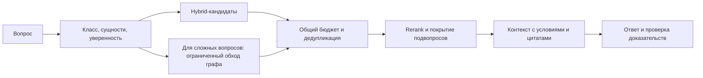

# Аудит RAG_new — 30.09.2026

**Объект:** рабочее дерево `D:\RAG_new`, HEAD `32b526b`. **Статус:** аудит кода, конфигурации и воспроизводимости сохранённых экспериментов; новые модельные A/B не проводились. [План работ](../specs/plan_30_09_26.md).

## 1. Вывод

У проекта есть хорошая инженерная основа: модульный монолит, постоянное хранение в PostgreSQL, восстанавливаемый поисковый индекс, ограничения tenant, тесты и проверяемые артефакты экспериментов. Главный риск для следующего этапа — оптимизация поиска по метрике, которая недостаточно отражает смысловую релевантность. Второй риск — перенос результатов отдельного retrieval-скрипта на пользовательский `/api/ask` без проверки всего пути запроса.

Повышать качество целесообразно в таком порядке:

1. Откалибровать оценку релевантности людьми и подготовить новые вопросы с размеченными фактами и источниками.
2. Сделать включение графа, его версию и фактический маршрут запроса наблюдаемыми.
3. Для сложных вопросов сохранять доказательства из нескольких источников; затем улучшать обход и ранжирование графа при фиксированном вычислительном бюджете.
4. Проверять итоговый контекст и ответ, включая полноту, цитаты, latency и стоимость.

**Оснований включать граф по умолчанию сейчас нет.** На дополнительном наборе сложных вопросов опубликованный графовый вариант снизил recall с 0.5000 до 0.4000 и число FULL с 4 до 1. Его проверка генерации имеет статус `not_evidence`. Это ограничения имеющихся результатов, а не доказательство бесполезности графового подхода.

## 2. Область и методика

Изучены актуальные документы состояния, маршрут `/api/ask`, классификация запросов, hybrid/graph retrieval, построение и загрузка графа, сборка контекста, оценка качества и соответствующие тесты. Архитектурные проектные документы отделялись от реализованного поведения. Код приложения и настройки не менялись.

На старте уже были изменены `CURRENT_STATE.md`, `ROADMAP.md` и присутствовал незакоммиченный `demo/phase-e-raw.webm`. Эти изменения сохранены. Файлы аудита и плана помещены в `docs/`: [правила проекта](../../../CLAUDE.md) и [тест гигиены документации](../../../tests/test_docs_hygiene.py) ограничивают корень девятью Markdown-файлами.

| Измеренная характеристика | Результат и граница измерения |
|---|---|
| Активные tracked Python-файлы | 666; исключены `archive/` и скрытые пути |
| Тестовые модули | 347 файлов `tests/**/test_*.py`; это не число выполненных тестов |
| Крупные файлы | `agent/graph.py` — 4265 строк; `api/app.py` — 2196; `api/routers/conversation.py` — 2616; `vectordb/_base_manager.py` — 1676 |
| Корпус AirCargo | 201 файл по manifest; 5589 чанков в опубликованных экспериментах, новый индекс не строился |
| Набор H | 100 вопросов; по sidecar: 99 `single_hop`, 1 `multi_hop` |
| Дополнительный Hm | 15 вопросов: 10 `multi_hop`, 5 `aggregation`; отдельного `global`-набора нет |
| Journey-разметка H | Проверка подтверждает 100 `real_labelled`, 0 `agent_labelled`; сами вопросы написаны агентами по реальным документам |

Проверка journey-разметки не означает наличие человеческой оценки релевантности найденных документов. H содержит 66 `out_of_scope`, 11 `customs_docs`, 17 `exception_escalation`, 6 `shipment_status`; ни один кейс не привязан к конкретной shipment. На таком наборе нельзя подтвердить качество реального завершения support-задач, включая VRY/VR.

## 3. Что действительно известно о precision

### 3.1. Текущая «линейка» — лексический proxy

В [evaluation/ragas_eval.py:194](../../../evaluation/ragas_eval.py#L194) `context_precision` вычисляет для каждого документа долю найденных подстрок из слов вопроса и `expected_keywords`, затем усредняет с весом `1/rank`. Это не стандартный precision@k. Название файла не превращает эту функцию в семантическую оценку RAGAS. `context_recall` в строке 246 также оценивает покрытие ключевых слов.

Следствия: дополнительный текст может повысить значение за счёт совпадений; удаление документов может повысить среднюю оценку одновременно с потерей необходимых фактов. Для ответов про таможню, исключения и документы такая потеря критична для качества ответа.

[P2: слепая оценка релевантности](../../../docs/evidence/p2-blinded-relevance-judgment.md) проверяет проблему независимо от предположений о коде. Два LLM-судьи оценили все 115 вопросов. На H согласие судей высокое: ordinal Krippendorff α = **0.8566**. Но корреляция по вопросам между официальной метрикой и сопоставимой оценкой судей низкая: Kendall τ_b = **0.1561**, CI95 **[0.0197; 0.2880]**. Зарегистрированный вердикт: **`RULER_DOES_NOT_TRACK`**. Человеческие оценки ещё не получены; согласие двух LLM не гарантирует правильность их общей оценки.

| H, неизменный сохранённый пул P2 | Официальная метрика | Judged precision | Judged FULL/PART/MISS |
|---|---:|---:|---|
| Top-5 | 0.5067 | 0.6080 | 93/6/1 |
| P1 held-out cut | 0.5372 | 0.6900 | 90/9/1 |

Даже семантическая оценка precision выросла при сокращении контекста, но FULL уменьшился. На Hm официальный показатель 0.2527 и judged precision 0.8400 относятся к разным шкалам; разность между ними не является улучшением поиска. Официальный порог **0.63** остаётся порогом старой метрики до отдельного решения о замене; переносить его на judged precision нельзя.

### 3.2. Нельзя смешивать baseline до и после расширения контекста

| Эксперимент / набор | Вариант | Лексический precision | Лексический recall | FULL/PART/MISS |
|---|---|---:|---:|---|
| GR3 / H, без production expansion | Hybrid | 0.5067 | 0.9050 | 87/7/6 |
| GR3 / H, тот же режим | G1, структурная ветка | 0.5475 | 0.9200 | 88/8/4 |
| GR3 / H, тот же режим | G2, с entity-веткой | 0.5487 | 0.9250 | 89/7/4 |
| GR3 / Hm | Hybrid | 0.2527 | 0.5000 | 4/7/4 |
| GR3 / Hm | G1 и G2 | 0.2678 | 0.4000 | 1/10/4 |
| P1b / H, production expansion | Top-5, контроль | 0.5768 | 0.9800 | 97/2/1 |
| P1b / H, тот же expansion | `rel_0.2+exp` | 0.5975 | 0.9700 | 96/2/2 |
| P1b / H, тот же expansion | `p1_cv+exp` | 0.6062 | 0.9550 | 94/3/3 |
| P1b / Hm, production expansion | Top-5, контроль | 0.3263 | 0.7333 | 7/8/0 |

Здесь FULL/PART/MISS — категории покрытия из соответствующего эксперимента, не факт успешного решения пользовательской задачи. В таблице P2 выше использована другая, judged-оценка.

Источники: [GR3](../../../docs/evidence/gr3-graph-lane-ab.md), [P1b](../../../docs/evidence/p1b-expanded-cut.md). P1b применяет настоящий `HybridRetriever._expand_parents(window=2, max_chars=3600)`. Его вердикт **NO_SHIP**: например, `aircargo-customs-broker-escalation` теряет `customs hold` и `sanctions hit`. Простое сокращение до трёх чанков и адаптивное отсечение уже исследованы. Их повтор без новой гипотезы не является следующей задачей.

### 3.3. Происхождение чисел

- Корпус: [manifest](../../../evaluation/aircargo_corpus.manifest.json), `corpus_sha256 = c8562a64f88f72172f29e30865091be79f08d00ce65fbf675f34de64dcebe343`.
- P1b: code SHA `d1adbbb727d788ce14b4c4dc8676a0bd20b36f86`; [отчёт](../../../reports/p1b/p1b-expanded-cut.json), SHA-256 `6f48bb1957f67235792edb926cf44c4894b56439c9fd423feb6529a7a791bc8b`. Корпус 201/5589, chunk size/overlap 800/200, structural/contextual headers включены, semantic chunking выключен, reranker `BAAI/bge-reranker-v2-m3`.
- P2: code SHA `fa9e598e5bc6446c2c50d7fb9db038f036426c6a`; [отчёт](../../../reports/p2/p2-blinded-judge-glm+sonnet.json), SHA-256 `4c1e60cdad361799a291fa88d0d0c3a35675ad772630a0147615ab30d3a31e7d`; 10 000 bootstrap resamples, seed 20260925, сохранённый top-5 H/Hm.
- GR3: конфигурации H/G1/G2, commit/digest каждого входа, параметры генерации и оборудования находятся в разделах provenance и latency [исходного отчёта](../../../docs/evidence/gr3-graph-lane-ab.md). Его артефакт пересчитан тестом в ходе аудита.

Эти числа получены ранее, на указанных версиях. Прохождение replay-тестов на текущем HEAD подтверждает целостность и воспроизводимость расчётов; оно не превращает их в новое измерение текущего сервиса.

## 4. Приоритетные находки

**P1** ниже означает «устранить до решения о включении улучшенного поиска». **P2** — следующий приоритет качества и сопровождения. Это не шкала критичности уязвимостей.

### F1 · P1 · Критерий успеха допускает ложное улучшение

Подтверждение: реализация метрик и результаты P2/P1b выше. Нужно параллельно измерять человеческую релевантность, покрытие атомарных фактов, полноту всех звеньев multi-hop и итоговую достоверность ответа. Изменение одной метрики не должно автоматически закрывать gate.

### F2 · P1 · Данные недостаточны для настройки сложного поиска и оценки продукта

H почти целиком состоит из single-hop, а Hm содержит только 15 вопросов. H многократно использовался для выбора правил, поэтому его нельзя считать новым независимым holdout. Вопросы из одного документа также зависимы. Человеческое утверждение journey labels от 25 сентября не заменяет разметку relevance и evidence spans.

Нужен новый набор с single-hop, multi-hop, aggregation, неоднозначными и неразрешимыми вопросами; отдельно — реальные обезличенные support-запросы, когда они доступны. Split делать по документу/семейству источников. Старые H/Hm сохранить для диагностики регрессий. Широкие global-вопросы не включать в критерий качества графа до появления отдельного тестового набора.

### F3 · P1 · Включение графа зависит от нескольких независимых условий

В [vectordb/manager.py:996](../../../vectordb/manager.py#L996) graph projection передаётся retriever только при `graph_retrieval == "on"`. Режим `auto` не подключает projection через эту ветку. [ingestion/graph_activation.py](../../../ingestion/graph_activation.py) вычисляет и протоколирует условия auto: минимум 20 000 чанков и доля междокументных сущностей не ниже 0.15. На корпусе 5589 чанков они не выполнены. Это отдельный механизм от отложенного внедрения полноценного GraphRAG framework.

В [agent/graph.py:1295](../../../agent/graph.py#L1295) отключённый по умолчанию model routing возвращает `unknown` и пустые entities. В [выборе стратегии:1538](../../../agent/graph.py#L1538) simple-запрос идёт в vector, а graph требует выбранной стратегии `graph` и сложного класса запроса. Одного `RAG_GRAPH_RETRIEVAL=on` недостаточно.

При вызове [graph retriever:1603](../../../agent/graph.py#L1603) передаются `question_class` и `entities`, но не `categories`. Между тем категория поддерживается в retriever. [Offline harness](../../../scripts/ab_remote_contextual.py#L132) получает категории из labels/tags кейса; это не готовый механизм маршрутизации пользовательского вопроса. Такой источник нельзя переносить в production или выдавать за качество query classifier. В опубликованном прогоне category prefilter не дал совпадений.

### F4 · P1 · Entity graph требует управляемого обновления вместе с корпусом

[ingestion/pipeline.py:380](../../../ingestion/pipeline.py#L380) при наличии graph repository вызывает `replace(build_structural_graph(...))`. [Repository:37](../../../ingestion/structure_graph_repository.py#L37) перед записью удаляет все nodes/edges данного tenant. Поэтому этот путь ingestion заменяет обогащённый граф чисто структурным. Автоматическое извлечение сущностей в этот шаг не встроено.

[entity_graph_loading.py](../../../ingestion/entity_graph_loading.py) проверяет соответствие сохранённого графа текущей структуре, включая hashes содержимого, и отвергает несовпадение. Это полезная защита от устаревшего графа. Риск состоит в потере доступности entity-ветки и незаметном fallback, а не в доказанном использовании устаревших связей. Нужны согласованные версии корпуса/структуры/entities, обновление только изменённых документов и явная причина fallback в trace.

### F5 · P1 · Section coherence может удалять уникальное доказательство

[vectordb/_base_manager.py:637](../../../vectordb/_base_manager.py#L637) группирует уже отранжированные документы по секции, поднимает группы из нескольких чанков и удаляет слабые singleton-секции при относительной силе ≤0.25. Если top-5 лежит в пяти разных секциях, ранги 4–5 могут исчезнуть. Для вопроса, требующего двух регламентов, редкий второй источник может быть обязательным.

Механизм подтверждён кодом; он ещё не доказывает причину всех падений на Hm. Нужен per-case разбор до/после фильтра. Простое резервирование seed уже исследовали в [предыдущем review](../specs/precision-improvement-review.md); следующая гипотеза должна сохранять evidence для подвопросов, а не просто ещё один seed.

### F6 · P2 · Поиск использует только часть связей и слабо ранжирует entity-кандидатов

[structure_graph.py](../../../ingestion/structure_graph.py) строит `contains`, `next`, `same_section`, `cross_ref`, `category`, `mentions`, `co_occurs`. Структурная индексация [projection:505](../../../vectordb/_base_manager.py#L505) и [EntityIndex](../../../ingestion/entity_retrieval.py) используют принадлежность секциям и entity-связи; отдельного обхода `cross_ref` в retrieval-пути нет. Явные ссылки на другой регламент — перспективный источник более точных связей, чем общее совместное упоминание.

EntityIndex использует exact match или top-3 положительных BM25 совпадения, делает до двух переходов с frontier до 50 на уровень, сортирует соседей по сумме частот co-occurrence. Нет оценки связи с исходным вопросом и штрафа за слишком общие узлы. Чанки затем перечисляются по UUID и обрезаются до первых 50 до общего rerank. Порядок UUID обеспечивает воспроизводимость, но не релевантность отбора.

[entity_graph.py:34](../../../ingestion/entity_graph.py#L34) оставляет сущности из двух и более документов. Это полезно для связности, но редкая сущность одного документа отсутствует в entity-ветке; её должен находить обычный поиск или отдельный exact lookup. В [entity_normalization.py](../../../ingestion/entity_normalization.py) лишь пять aliases и шесть stopwords. Нужна проверенная RU/EN-нормализация предметных терминов. `co_occurs` не означает «требует», «запрещает» или «исключение»; использовать его как доказательство такого отношения нельзя.

### F7 · P1 · Стоимость rerank перекрывает стоимость самого обхода

В GR3 на Intel i5-7500 / 8 GiB p95 построения пула составляет 17.7 ms для hybrid и 19.7 ms для G2. При этом rerank p50 около 50 секунд. Полный retrieval p95: **68 472.5 ms → 77 237.7 ms**, delta **+8765.2 ms** при gate ≤200 ms. На Hm delta достигает **+51 189.2 ms**. Entity-ветка увеличивала prerank-пул до 73–90 кандидатов против максимум 40 у hybrid.

Следовательно, ускорение обхода само по себе не решает наблюдаемую задержку. Нужны одинаковые общие бюджеты кандидатов, дедупликация до rerank и измерение каждого этапа. [Runtime `_rerank`:828](../../../vectordb/_base_manager.py#L828) обрабатывает весь merged pool; при ошибке возвращает fallback и не сохраняет численные scores в результате. `RAG_RERANK_BATCH` читается [benchmark-скриптом:843](../../../scripts/ab_remote_contextual.py#L843), а runtime вызывает `predict(pairs)` без явного batch size. Нельзя считать настройку batch в скрипте настройкой API.

Опубликованная задержка относится к указанному Mac, не к неизвестному production-оборудованию. Gate сравнения и абсолютный пользовательский SLO нужно проверять отдельно на целевом устройстве.

### F8 · P1 · Проверка качества ответа после графа не завершена

GR3 generation содержит 297 валидных строк из 300. На одном кейсе в каждом из трёх прогонов parser отклонил ответ судьи `Score: 1.0`. Весь соответствующий результат зарегистрирован как `not_evidence`; значения faithfulness из него не являются пройденным gate. Исправление контракта судьи должно сохранять raw replies и различать отказ парсинга, отсутствие ответа и низкую оценку. Простое исключение неудачных строк создаёт смещение.

Нужна проверка `/api/ask` с реальными retrieval, expansion, упаковкой prompt и цитатами. Streaming имеет отдельный путь; выбранные parity-тесты не доказывают полное равенство всего продукта. Resolution shadow работает с fixture TMS и ограниченными флагами; это не подтверждение исполнения задач в реальной TMS.

### F9 · P2 · Сопровождение и локальная проверка требуют небольших точечных исправлений

- Четыре больших модуля усложняют проверку взаимного влияния routing/retrieval/generation. Следует выделять узкие границы только при следующем необходимом изменении; большое переписывание не входит в критический путь повышения качества.
- Ruff нашёл существующий `I001` в `tests/test_docs_publication.py:3`. Проверка сделана Ruff 0.15.1; в pre-commit указан 0.15.11, поэтому её нельзя выдавать за запуск закреплённой версии.
- `python` в PATH — Anaconda Python 3.14.6 без `fastapi`; для выполненных тестов использован установленный `py -3.13`. Нужно документировать выбранный interpreter/окружение, не чинить код из-за ошибки окружения.
- [archive/docs/windows-test-workflow.md](../windows-test-workflow.md) предлагает полный локальный прогон и расходится с актуальным правилом переносить тяжёлые проверки на Mac. Комментарии graph activation о ещё не построенной ветке тоже устарели.
- Actions по текущим правилам недоступны до начала октября; прошлый зелёный CI не подтверждает текущий HEAD. Полный suite, Docker, UI и production deployment в аудите не проверены.

Тесты tenant enforcement и изоляции API прошли, но это не полноценный security audit. Dev defaults сами по себе не основание объявлять production уязвимым. Исправление persistence Chroma после restart уже есть в истории; для старых collections остаётся предусмотренный rebuild, а не новая найденная ошибка.

## 5. Гипотезы повышения precision и качества графа

Все предложения ниже — проверяемые гипотезы. Ожидаемый процент улучшения по имеющимся данным неизвестен. Каждая меняет один механизм; комбинация допускается только после отдельных ablation.

| ID | Гипотеза и механизм | Контрольный эксперимент | Когда отклонить |
|---|---|---|---|
| H1 | Для multi-hop сохранять релевантное свидетельство по каждому подвопросу; coherence сделать мягким предпочтением, сохранив полезные singleton-источники | Текущий reranked pool + текущая coherence против выбора с ограничением на покрытие подвопросов; одинаковые top-k и токены | Уникальные факты всё ещё исчезают либо разнообразие добавляет нерелевантные источники без роста all-evidence coverage |
| H2 | Обходить проверенные `cross_ref`, чтобы находить недостающий регламент или приложение | На вопросах с размеченной цепочкой сравнить hybrid, entity-only и hybrid + один переход по явной ссылке; второй переход разрешать отдельным вариантом | Новые кандидаты не добавляют нужных доказательств, ведут в неоднозначные ссылки или снижают precision |
| H3 | Улучшить entity-кандидатов: RU/EN aliases, query relevance, штраф за общие узлы, ранжирование чанков до лимита 50 | Отдельно проверить нормализацию, затем degree/IDF penalty, затем отбор по score вместо UUID; rare exact lookup оценить отдельно | Entity linking ошибается чаще, candidate recall падает либо прирост не воспроизводится на новых вопросах |
| H4 | Использовать предсказанную тему как мягкий prior; неопределённость оставлять hybrid | Query-only classifier на существующую таксономию, измерение routing confusion; soft boost против отсутствия категорий при одинаковом пуле | Улучшение существует только при подстановке dataset tags или падает покрытие вопросов на стыке тем |
| H5 | Ограничить общий merged pool, чтобы graph заменял менее полезные кандидаты в рамках бюджета | Сначала baseline и graph при общем лимите 40; варианты лимита выбирать на development, фиксировать Recall@candidate, rerank p95 и дубли | Ускорение достигается потерей обязательного второго источника или улучшения latency нет |
| H6 | Расширять контекст вокруг ответа избирательно, сохраняя условие, исключение и ссылку на источник | Текущий `window=2/max_chars=3600` против сборки extractive evidence из уже найденных секций при равном token budget | Растёт только keyword proxy, теряются отрицания/исключения или итоговый ответ менее точен |
| H7 | Переранжировать покрытие вопроса целиком, а не только похожесть каждого чанка | Reranker scores + покрытие извлечённых подвопросов; сравнить с текущим порядком и с H1 на замороженных пулах | Отбор переобучается на H, увеличивает precision ценой FULL или требует недоступных runtime gold labels |
| H8 | После исправления измерения настроить lexical/vector fusion по типу вопроса | Небольшое заранее заданное сравнение текущего RRF и взвешенного fusion; числовые коды/сокращения отдельно от перефразированных запросов | Выигрыш отсутствует на locked holdout, есть регрессия сложных вопросов или selection использует labels |

H1 и H7 связаны, но различны: H1 меняет постфильтр и защиту источников, H7 — оценку набора кандидатов. Их не следует запускать одновременно первым экспериментом. H6 сохраняет исходные цитируемые фрагменты; генеративное сжатие добавит отдельный риск и здесь не предлагается.

## 6. Как настроить проверяемый графовый профиль

Для изолированного эксперимента с текущим кодом нужны согласованные настройки:

```dotenv
RAG_GRAPH_RETRIEVAL=on
RAG_RETRIEVAL_STRATEGY=graph
MODEL_ROUTING_ENABLED=true
```

Дополнительно требуются корректный classifier, желательно со structured output, опубликованный entity graph того же tenant/корпуса и контролируемая сборка retriever после изменения конфигурации. Это необходимые условия запуска ветки, а не готовая рекомендация включить её в production. Ошибочный `simple` от classifier всё равно направит запрос в vector. `auto` сейчас не заменяет эти условия.

Предлагаемый путь после реализации и проверки H1–H5:



Начальные значения для исследования: один graph hop, общий пул 40, финальный top-5 как контроль. Сравнивать entity quota 5/10 и второй hop только после однопараметрических проверок. Это стартовая экспериментальная сетка, а не установленные оптимумы. Сначала использовать существующие PostgreSQL/проекцию графа; внедрение Neo4j, LightRAG или другого framework не устраняет обнаруженные ошибки измерения и отбора.

В trace нужны: corpus/index/graph version, requested/effective strategy, класс и уверенность, seeds, типы рёбер и путь к каждому graph-кандидату, число кандидатов каждого источника, численные rerank scores, удалённые evidence и причины, времена этапов, итоговые токены и причина fallback. При отсутствующем/несовпадающем graph использовать исправный hybrid с явным статусом. Если evidence недостаточно для ответа, уточнять вопрос или сообщать недостаточность; наличие пути в графе само по себе не доказывает факт.

## 7. Правила оценки следующего изменения

1. **Разметка.** Сначала завершить слепую human-проверку P2, затем разметить новый набор: релевантность 0–3, обязательные атомарные факты, допустимые evidence spans и цепочки между источниками. Противоречия между судьями разбирать. Люди не должны видеть название варианта поиска.
2. **Разделение.** Development и locked holdout разделить по источникам/семействам документов. H/Hm оставить диагностическими. Новый holdout использовать один раз для выбранного варианта, не подбирать по нему thresholds. Размер набора выбрать после пилота по дисперсии и минимально полезному эффекту; 15 сложных кейсов недостаточно для надёжного общего вывода.
3. **Сопоставимость.** Одинаковые corpus SHA, chunking, модели, оборудование, candidate/token budget и production expansion. Сначала отдельные ablation, затем комбинация победителей. Сохранять входы, scores, контексты, raw replies, config и code SHA.
4. **Метрики.** Отдельно precision@5 (число документов с relevance ≥2 в первых пяти позициях, делённое на 5) и precision среди реально отправленных контекстов (деление на их число; пустой результат = 0); graded nDCG@5; recall обязательных evidence в candidate pool; доля вопросов со всеми необходимыми evidence; полнота фактов и корректность цитат в ответе. Указывать долю отказов/уточнений. Для неполностью размеченного корпуса candidate recall ограничивать известными gold evidence и явно отмечать эту границу.
5. **Статистика и решение.** Использовать paired comparison и bootstrap с учётом групп источников. Для полезного прироста precision нижняя граница CI95 должна быть выше нуля; минимальный практический эффект и допустимые non-inferiority margins для полноты/faithfulness заранее зарегистрировать. Не выдавать отсутствие значимости за доказанную эквивалентность. Любая новая потеря критического факта в регрессионных кейсах блокирует внедрение.
6. **Производительность.** Сохранять существующий graph gate delta p95 ≤200 ms до отдельного решения; дополнительно задать абсолютный SLO `/api/ask` на целевом оборудовании, измерять p50/p95, timeouts, токены и стоимость. Более быстрый, но неполный ответ не проходит.
7. **Приёмка.** Новая метрика и её порог требуют отдельного решения после human-калибровки; старые 0.63 не переименовывать. Прогон с невалидным судьёй остаётся `not_evidence`. Достаточность контекста не заменяет проверку конечного ответа и маршрута API.

## 8. Свежая проверка в ходе аудита

Команды выполнялись 30.09.2026 в корне проекта. Полный suite и модели на Windows не запускались.

```powershell
py -3.13 -m pytest tests/test_graph_retriever.py tests/test_entity_graph.py tests/test_entity_retrieval.py tests/test_graph_retrieval_path.py tests/test_graph_activation.py tests/test_parent_expansion.py tests/test_ragas_eval.py tests/test_p2_blinded_judge_artifact.py tests/test_entity_graph_loading.py tests/test_sgr_classifier.py -q -p no:schemathesis --basetemp=.tmp/pytest-audit-asta-py313

py -3.13 -m pytest tests/test_ask_tenant_isolation.py tests/test_tenant_enforcement.py tests/test_resolution_shadow_wiring.py tests/test_streaming_rag_parity.py tests/test_ask_wall_budget.py tests/test_structure_graph_pipeline.py tests/test_structure_graph_persistence.py -q -p no:schemathesis --basetemp=.tmp/pytest-audit-asta-api-20260930

py -3.13 -m pytest tests/test_gr3_artifact.py tests/test_p1b_expanded_cut_artifact.py -q -rs -p no:schemathesis --basetemp=.tmp/pytest-audit-asta-artifacts-20260930

py -3.13 scripts/aircargo_labels.py verify

py -3.13 -m pytest tests/test_docs_hygiene.py tests/test_docs_publication.py -q -p no:schemathesis --basetemp=.tmp/pytest-audit-asta-docs-20260930

ruff check . --output-format concise
```

| Проверка | Результат |
|---|---|
| Retrieval / entities / routing / metrics / P2 | 77 passed, exit 0, 16.47 s |
| Tenant / API / shadow / streaming / graph persistence | 51 passed, exit 0, 2.81 s |
| Replay GR3 и P1b | 23 passed, exit 0, 17.69 s; пропусков нет |
| Journey labels | 100 labelled, 100 real_labelled, 0 agent_labelled, exit 0 |
| Гигиена и публикация документации | 10 passed, exit 0, 1.43 s |
| Ruff 0.15.1 | Exit 1, один `I001` в `tests/test_docs_publication.py:3` |

Итого **161 выбранный тест прошёл**. В каждом pytest-прогоне одно предупреждение Starlette об устаревающем использовании `httpx` в TestClient. Первый запуск через другой `python` не собрал тесты из-за отсутствия `fastapi`; это отдельно локализовано до окружения, затем указанные проверки выполнены через Python 3.13.

Не проверены заново: полный suite на Mac, Docker restore/migrations, UI в браузере, реальные TMS-интеграции, нагрузка production и новые ответы LLM. Аудит не является разрешением на deploy и не изменяет действующие `NO_SHIP`/замороженные направления. Последующие действия и критерии завершения перечислены в [плане](../specs/plan_30_09_26.md).
