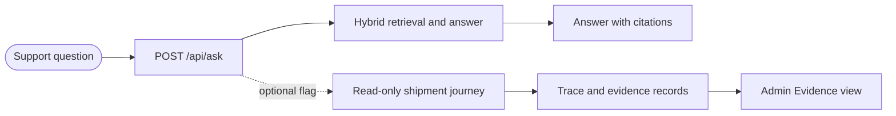

## Proof points

  <article class="q-card">
    <h3 class="q-title">
      Measured retrieval
    </h3>
    

Context precision on a 100-question pool was 0.5067 for hybrid retrieval and 0.5487 for graph G2. The graph arm missed coverage and latency gates and remains off by default.

  </article>

  <article class="q-card">
    <h3 class="q-title">
      Inspectable evidence
    </h3>
    

An optional read-only shipment journey records source facts, policy status, claims, and a replay receipt beside the answer in the admin Evidence view.

  </article>

  <article class="q-card">
    <h3 class="q-title">
      Recorded product walkthrough
    </h3>
    

The three-minute recording follows a real <code>/api/ask</code> request through its trace to a stale-evidence escalation. The shipment source is a fixture TMS.

  </article>

  <article class="q-card">
    <h3 class="q-title">
      Measured limits
    </h3>
    

There is no measured verified-resolution yield or cost per resolution. The shipment journey is off by default; the recorded case escalates rather than verifies a resolution.

  </article>

### One request, two inspectable paths

The [API catalog](/RAG_new/architecture/routes/) is generated from the current
FastAPI routes. The [project overview](/RAG_new/guides/overview/) explains the
journey and its default-off flag.

### Recorded shipment-status request

The [three-minute recording](https://github.com/brownjuly2003-code/RAG_new/blob/master/demo/phase-e-demo.mp4)
asks `What is the status of shipment AC-100001?` and opens its trace in Evidence.
The fixture source is stale, so the journey routes to a human with
`EVIDENCE_STALE`. The recording shows an escalation, not a verified resolution.

## Start here

- [Project overview](/RAG_new/guides/overview/) explains the product, measured results, and limits.
- [Try locally](/RAG_new/guides/quickstart/) covers the local setup path.
- [Graph A/B evidence](/RAG_new/guides/evidence/gr3-graph-lane-ab/) pins the retrieval comparison and its NO-SHIP verdict.
- [API routes](/RAG_new/architecture/routes/) lists the current integration surface.
- [GitHub](https://github.com/brownjuly2003-code/RAG_new) contains the source and demo.

