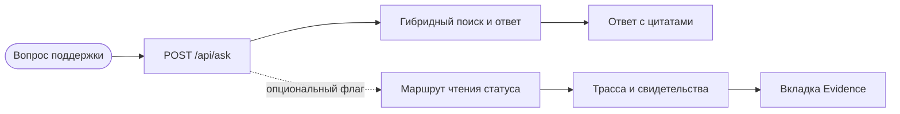

## Доказательства

  <article class="q-card">
    <h3 class="q-title">
      Измеренный поиск
    </h3>
    

Точность контекста на 100 вопросах: 0,5067 у гибридного поиска и 0,5487 у графа G2. Граф не прошёл пороги покрытия и задержки и по умолчанию выключен.

  </article>

  <article class="q-card">
    <h3 class="q-title">
      Проверяемые свидетельства
    </h3>
    

Опциональный маршрут чтения статуса отправки записывает факты источника, состояние политики, утверждения и квитанцию повтора рядом с ответом во вкладке Evidence.

  </article>

  <article class="q-card">
    <h3 class="q-title">
      Демо продукта
    </h3>
    

Трёхминутная запись проводит реальный запрос <code>/api/ask</code> через трассу к эскалации из-за устаревших данных. Источник отправки — фикстура TMS.

  </article>

  <article class="q-card">
    <h3 class="q-title">
      Границы измерений
    </h3>
    

Нет измеренного выхода проверенных решений или стоимости одного решения. Маршрут отправки по умолчанию выключен; записанный кейс заканчивается эскалацией.

  </article>

### Один запрос, два проверяемых пути

Каталог [маршрутов API](/RAG_new/ru/architecture/routes/) создаётся из текущего
кода FastAPI. [Обзор проекта](/RAG_new/guides/overview/) объясняет маршрут
отправки и его флаг, выключенный по умолчанию.

### Записанный запрос о статусе отправки

[Трёхминутная запись](https://github.com/brownjuly2003-code/RAG_new/blob/master/demo/phase-e-demo.mp4)
показывает вопрос `What is the status of shipment AC-100001?` и переход по
трассе во вкладку Evidence. Данные фикстуры устарели, поэтому маршрут передаёт
кейс человеку с причиной `EVIDENCE_STALE`. Это эскалация, а не проверенное решение.

## Начать здесь

- [Обзор проекта](/RAG_new/guides/overview/) — продукт, измерения и ограничения.
- [Запустить локально](/RAG_new/guides/quickstart/) — настройка среды.
- [Сравнение поисковых маршрутов](/RAG_new/guides/evidence/gr3-graph-lane-ab/) — результаты и вердикт NO-SHIP.
- [Маршруты API](/RAG_new/ru/architecture/routes/) — поверхность интеграции.
- [GitHub](https://github.com/brownjuly2003-code/RAG_new) — код и демо.

