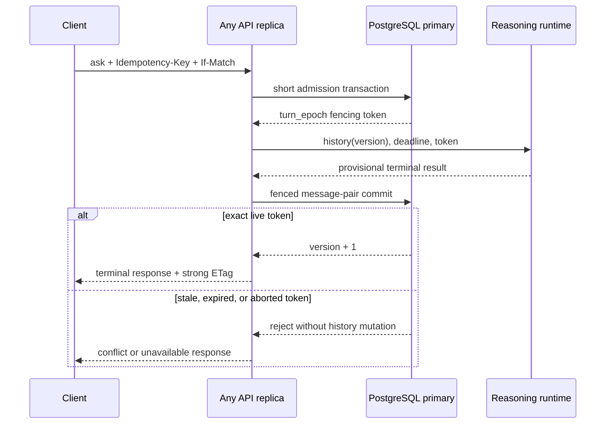

# ADR 0006 — Durable fenced turns for multi-replica sessions

- Status: Accepted for implementation
- Date: 2026-08-23
- Related: `agent/graph.py`, `api/app.py`, `api/routers/conversation.py`,
  `db/models.py`, `rag-remediation-plan-2026-08-03.md` section 3,
  ADRs 0003–0005

## Context

`ConversationSession` currently serializes a turn with a process-local lock and
exposes a process-local `mutation_version`. The API keeps those objects in
`api.app._session_llm_state`. PostgreSQL stores `Session` and `Message` rows,
but `Session` has no durable version and the user/assistant pair is appended in
a transaction separate from pipeline execution. `AskRequest` does not expose a
version precondition.

That contract prevents same-process history races, but two application replicas
can run the same session concurrently, generate from the same history, and
persist pairs in completion order. A timed-out worker can also finish after a
new request. Sticky routing or a process lock would hide, not close, those
failure modes.

This ADR supplies the product consistency/SLA decision required by REL-03. It
does not implement the schema or change runtime behavior.

## Decision

### Consistency and availability contract

The consistency key is `(tenant_id, session_id)`. PostgreSQL primary is the
authority for admission, history version, turn state, and terminal message
commit. Redis and process memory may cache an exact durable version, but may
not admit or commit a turn.

For each consistency key:

- committed turns are linearizable and receive consecutive `session_version`
  values;
- at most one turn is `RUNNING`;
- an accepted `turn_id` produces at most one terminal user/assistant pair;
- a stale, expired, aborted, or superseded worker cannot mutate history,
  pending actions, or terminal state;
- different sessions remain independently concurrent;
- loss of PostgreSQL authority returns `503`; production must not fall back to
  process-local mutation.

The promotion floor is zero lost, duplicate, reordered, or late-committed turns
and zero cross-tenant admission or history access. Coordination overhead,
excluding reasoning/provider time, targets p95 at or below 100 ms and p99 at or
below 250 ms. The operational failure cap remains
`DB_PERSIST_TIMEOUT_SEC` (currently 2 seconds); exceeding it fails closed rather
than returning a successful terminal answer.

### Durable model and fencing

`sessions` gains non-negative `version` and monotonic `turn_epoch`. A new
tenant-owned `session_turns` record carries a tenant-wide unique `turn_id`, so
retrying a server-created first turn can recover the same session. It also
carries:

- client `turn_id` / idempotency key and canonical request digest;
- exact `expected_version` and allocated `turn_epoch` fencing token;
- `RUNNING`, `COMMITTED`, `ABORTED`, or `EXPIRED` status;
- database-clock admission, deadline, and terminal timestamps;
- terminal result digest and committed version when successful.

A unique partial index permits one `RUNNING` row per tenant/session. Admission
briefly locks the `Session` row, rejects a stale expected version, expires an
overdue prior turn, increments `turn_epoch`, and inserts the new turn in one
transaction. The transaction ends before retrieval or LLM work starts. All
deadline comparisons use the PostgreSQL clock.

Terminal persistence is one transaction. It accepts the result only when the
turn is still `RUNNING`, its database deadline has not passed, and both
`expected_version` and `turn_epoch` still match the `Session`. It then inserts
the ordered message pair, increments `Session.version` exactly once, and marks
the turn `COMMITTED`. Timeout or disconnect marks the exact fencing token
`ABORTED` when possible; the terminal predicate remains the safety boundary if
that cleanup cannot run. External effects remain governed by ADR 0004 and bind
their idempotency identity to `turn_id`.

### HTTP contract

Every ask carries an `Idempotency-Key`. A request for an existing session also
carries a strong `If-Match` entity tag returned by the previous terminal
response. A server-created first session starts at version zero and does not
require a prior entity tag.

- A committed response includes `session_version` and a strong
  `ETag: "session:<uuid>:v<version>"`.
- Missing `If-Match` for an existing session returns `428 Precondition
  Required` with recovery instructions.
- A false `If-Match` returns `412 Precondition Failed` and the current ETag,
  without running the pipeline.
- A different live turn already admitted for the same session returns
  `409 Conflict`; callers do not wait behind an unbounded LLM request.
- Repeating the same idempotency key and request digest returns the stored
  terminal result, including when the original response was lost before the
  caller learned its server-created session ID. This replay check precedes the
  normal `If-Match` failure path. Reusing the key with another digest returns
  `409`.
- PostgreSQL timeout or unavailable authority returns `503`; no response is
  labelled successful before the fenced transaction commits.

SSE tokens are provisional presentation data. Only the terminal event after
the fenced commit advances history and carries the new ETag.

### Ownership and implementation order

`SessionService` becomes the only owner of session admission, durable history
load, commit, abort, and replay. `PipelineRunner` owns bounded execution but
cannot mutate session state. `ConversationSession` becomes a compatibility
reasoning wrapper over an explicit history snapshot; API routers stop editing
`_history` and stop inserting `Message` rows directly.

The first implementation slice is **REL-03B: durable session admission
contract**: migration, models, and `SessionService` admission/abort primitives
with real PostgreSQL concurrency tests. It must not wire `/api/ask`, SSE, or
remove the compatibility path in the same slice. Later slices wire sync,
SSE/timeout handling, and finally remove duplicate lifecycle ownership.

## Verification and promotion evidence

Implementation is not complete until all of the following are fresh and
non-skipped:

- two independent database connections prove one admission for concurrent
  requests at the same version and independent admission for different
  sessions;
- stale version, active turn, expired token, disconnect, timeout, process-loss
  simulation, and late worker all fail without a history mutation;
- identical idempotent retry replays one committed result, while digest drift
  is rejected;
- sync and SSE each commit exactly one pair and return the same version/ETag
  semantics;
- a two-replica promotion run executes at least 1,000 contended attempts across
  at least 100 sessions with zero safety-floor violations;
- p95/p99 coordination latency and PostgreSQL timeout/error counts are exported
  in the evidence bundle.

This evidence closes REL-03 only for the tested topology. It does not close
live PostgreSQL migration/restore gates, full release readiness, or canary.

## Alternatives rejected

- **Keep process-local locks or require sticky routing.** A replica failure or
  retry to another replica bypasses the owner and can reorder history.
- **Hold a PostgreSQL transaction or row lock across reasoning.** PostgreSQL
  row locks wait until transaction end, and its documentation explicitly warns
  against long-held transactions. Provider work must stay outside the
  transaction.
- **Use only a session-level advisory lock.** It can coordinate live holders,
  but delayed work still needs a token checked at the authoritative write.
- **Use Redis as the lock authority.** It conflicts with ADR 0003 and creates a
  second correctness authority. Redis remains an optional cache.
- **Allow last-writer-wins.** Completion order is not conversational order and
  can attach confirmations or tool results to the wrong history version.

## Consequences

- (+) Replica count and retry routing no longer change conversation ordering.
- (+) Timeouts and process loss have an explicit stale-writer rejection point.
- (+) HTTP clients can recover deterministically from stale state and lost
  responses.
- (-) Existing clients need idempotency and version-precondition support.
- (-) Every production conversation turn now depends on PostgreSQL primary
  availability and two short transactions.
- (-) Schema, sync, SSE, cache, and compatibility cleanup require separate
  tested slices.

## Primary references

- [RFC 9110: HTTP Semantics](https://www.rfc-editor.org/rfc/rfc9110.html) —
  strong ETags, `If-Match`, and `412` lost-update protection.
- [RFC 6585: Additional HTTP Status Codes](https://www.rfc-editor.org/rfc/rfc6585.html#section-3) —
  `428 Precondition Required` for conditional mutation.
- [PostgreSQL explicit locking](https://www.postgresql.org/docs/current/explicit-locking.html) —
  row/advisory lock lifetime and the long-transaction warning.
- [PostgreSQL `UPDATE`](https://www.postgresql.org/docs/current/sql-update.html) —
  conditional `WHERE` updates and `RETURNING`.
- [PostgreSQL partial indexes](https://www.postgresql.org/docs/current/indexes-partial.html) —
  database-enforced uniqueness over one status subset.
- [The Chubby lock service](https://research.google/pubs/the-chubby-lock-service-for-loosely-coupled-distributed-systems/) —
  lock generations/sequencers as the stale-holder fencing model.
- [Kubernetes API concepts](https://kubernetes.io/docs/reference/using-api/api-concepts/#resource-versions) —
  a production example of durable resource versions rejecting lost updates.

The sources establish mechanisms and failure semantics; the numeric latency and
promotion thresholds above are project decisions made by this ADR, not external
benchmark claims.
