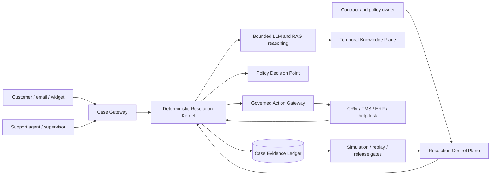

# RAG_new architecture baseline

- Status: Proposed implementation baseline
- Last updated: 2026-08-21
- Audience: product owner, architecture, engineering, security, support operations
- Inputs: source commit `bd071793258391408ed7d3b41883246f0b24bae2` and `D:\New_steps\rag.md`

## Purpose

`RAG_new` is a self-hosted **Verifiable Resolution OS** for complex B2B support. The unit of work is a durable `SupportCase` governed by an immutable `ResolutionContract` version, not a chat message or an LLM answer. A case is resolved only when required evidence is current and authorized, policy permits the path, every material claim is supported, actions are confirmed by their source of truth, and contract postconditions pass.

The first product wedge is multilingual logistics/air-cargo support. The first implementation journey is read-only shipment status and exception explanation. This is narrow enough to verify end-to-end and reuses the inherited 100-case air-cargo corpus without prematurely granting write autonomy.

## Measured baseline

The target was cloned from the clean tracked `HEAD`; source-local `.env`, caches, and 13 untracked files were not copied. The source tree has 942 tracked files, 443 Python files, 230 Python test files, 1,698 statically detected test functions, 23 Alembic migrations, and 10,580,015 tracked bytes.

The strategy brief reports 98,989 tracked Python lines. A fresh physical-line count over the same tracked checkout is 117,776, about 19% higher. The difference is likely counting methodology; sizing in this project therefore uses 117,776 as the measured baseline and treats the old line target as advisory. The principal hotspots remain `agent/graph.py` (4,133 lines), `api/routers/conversation.py` (1,671 lines), and `config/settings.py` (1,415 lines).

## Architecture drivers

1. A probabilistic model may interpret language and propose claims; it must not authorize actions or declare business success.
2. Every production decision must be replayable from immutable version identities: contract, policy, knowledge, connector schema, prompt, model, index, and grader.
3. Tenant isolation is enforced in API authorization, domain ports, repository predicates, and PostgreSQL RLS; no single layer is the only defense.
4. The existing hybrid retrieval baseline stays default until a versioned A/B test demonstrates a safer replacement.
5. External side effects are at-least-once infrastructure with effectively-once product semantics through idempotency, reconciliation, and postcondition checks.
6. An infrastructure error, stale/conflicting evidence, exhausted budget, missing judge, or skipped evaluator cannot produce `verified` or `auto`.
7. The first deployment remains a modular monolith. New services, graph databases, Kafka, OPA sidecars, or a vector-store migration require measured pressure and a separate ADR.

## System context

## Decision register

| ID | Decision | Rationale | Detailed record |
|---|---|---|---|
| D-01 | Start as a modular monolith with explicit ports. | Transactional consistency and safe extraction matter more than independent scaling today. | [ADR 0002](../adr/0002-resolution-kernel-modular-monolith.md) |
| D-02 | Put a deterministic resolution kernel outside `agent/graph.py`. | Case state, policy, confirmation, and postconditions cannot inherit LLM semantics. | [System architecture](system-architecture.md) |
| D-03 | Make PostgreSQL the durable authority; keep Chroma a rebuildable projection. | Contracts, time, evidence, actions, and outcomes need transactions and relational constraints. | [ADR 0003](../adr/0003-postgres-authority-and-retrieval-projections.md) |
| D-04 | Limit LangGraph to bounded reasoning subflows. | It may checkpoint conversational work, but it is not the policy or side-effect authority. | [ADR 0005](../adr/0005-langgraph-reasoning-boundary.md) |
| D-05 | Route every connector call through a governed action gateway. | Typed schemas, scopes, confirmation, idempotency, and postconditions need one enforcement owner. | [ADR 0004](../adr/0004-governed-actions-effectively-once.md) |
| D-06 | Model business-valid and system-known time separately. | Similarity search cannot reliably choose the policy effective for a case date. | [Domain and data model](domain-data-model.md) |
| D-07 | Keep the policy engine behind `PolicyDecisionPoint`. | Typed Python rules fit the MVP; OPA remains an adapter when independent policy distribution is justified. | [System architecture](system-architecture.md#11-policy-decision-point) |
| D-08 | Grade state and postconditions before language quality. | A fluent answer is not evidence that the business outcome occurred. | [Security and reliability](security-reliability.md#9-promotion-gates) |
| D-09 | Migrate by strangler/shadow, preserving existing APIs. | The inherited remediation stream and new product stream can advance without masking each other. | [Migration plan](migration-plan.md) |
| D-10 | Fence same-session turns in PostgreSQL before multi-replica rollout. | Process locks and sticky routing cannot reject stale workers after timeout or replica failover. | [ADR 0006](../adr/0006-durable-multi-replica-session-turns.md) |

## Non-negotiable runtime invariants

- `unverified_auto_rate = 0` for material claims.
- Cross-tenant case, evidence, policy, knowledge, or action access equals zero.
- A write requires a published contract version, policy decision, credential scope, idempotency key, and recorded confirmation when required.
- `verified` requires deterministic postcondition results from a source of truth; LLM output is never a postcondition.
- Retrieved documents, connector descriptions, tool output, and user content are all untrusted input.
- Contract and policy publication is human-approved and version-immutable. AI-generated drafts cannot self-publish.
- Terminal outcomes are explicit: `verified`, `partial`, `clarification_required`, `escalated`, `failed`, or `cancelled`; infrastructure failure never aliases to success.

## Document map

- [System architecture](system-architecture.md): containers, components, ports, state machine, APIs, runtime flows, and observability.
- [Domain and data model](domain-data-model.md): aggregates, relational model, bitemporal knowledge, ledger, outbox, and concurrency invariants.
- [Security and reliability](security-reliability.md): trust boundaries, connector controls, threat model, failure semantics, SLOs, and promotion gates.
- [Migration plan](migration-plan.md): source-to-target seams, staged delivery, compatibility, rollback, and the first milestone.
- [Resolution Contract schema v0.1](resolution-contract-schema-v0.1.md): strict authoring model, canonical identity, fixtures, and compatibility policy.
- [Root implementation plan](../../rag-new-architecture.md): short ordered backlog with verification.

## Research basis

The design follows current primary sources: [LangGraph persistence and interrupts](https://docs.langchain.com/oss/python/langgraph/persistence), [PostgreSQL row security](https://www.postgresql.org/docs/17/ddl-rowsecurity.html) and [range constraints](https://www.postgresql.org/docs/17/rangetypes.html), [MCP authorization](https://modelcontextprotocol.io/specification/2025-11-25/basic/authorization), [OPA decision logs](https://www.openpolicyagent.org/docs/management-decision-logs), [OpenTelemetry semantic conventions](https://opentelemetry.io/docs/specs/semconv/), [NIST AI 600-1](https://www.nist.gov/publications/artificial-intelligence-risk-management-framework-generative-artificial-intelligence), [OWASP GenAI LLM Top 10 2026](https://genai.owasp.org/resource/owasp-genai-llm-top-10-2026/), [mtRAG](https://aclanthology.org/2025.tacl-1.36/), [LaRA](https://proceedings.mlr.press/v267/li25dv.html), and [FaithfulRAG](https://aclanthology.org/2025.acl-long.1062/).
