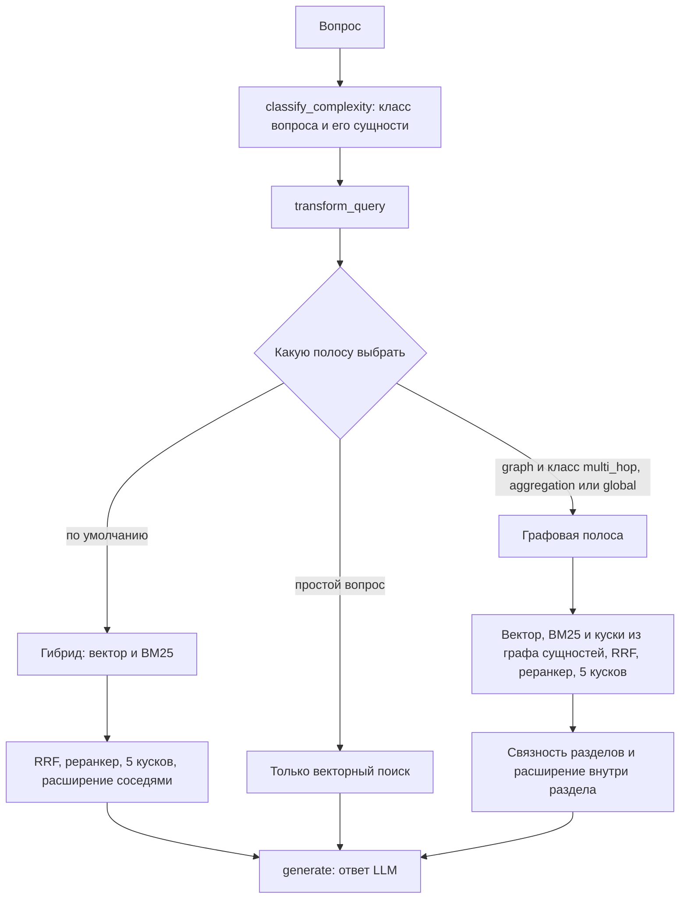

# Графовый поиск в RAG_new простыми словами

- Статус: пояснение для людей, а не спецификация. Требования записаны в
  [`docs/specs/entity-graph-retrieval.md`](../specs/entity-graph-retrieval.md).
- Обновлено: 2026-09-14, по коду коммита `fb35136`.
- Для кого: владелец продукта, аналитики, новые разработчики.
- Что реально работает сейчас: [`CURRENT_STATE.md`](../../CURRENT_STATE.md).

> **Коротко.** В проекте два графа. Первый — граф структуры документов
> (GR-1): документы, разделы, куски текста и соседство между ними. Второй —
> граф сущностей (GR-2): понятия, которые LLM выписала из каждого куска, и
> связи «упоминаются вместе». Оба графа есть в коде, но по умолчанию
> выключены: ответ идёт через обычный гибридный поиск. Граф структуры измерен
> и не прошёл порог (NO-SHIP). Граф сущностей сейчас строится, его замер —
> задача T-26. Пока замер не опубликован, поведение по умолчанию не меняется.

## 1. Зачем нужен граф

Обычный поиск отвечает на вопрос «какие куски текста похожи на мой вопрос».
Это хорошо работает, когда ответ лежит в одном месте. Такие вопросы в проекте
называются `single_hop`.

Труднее, когда ответ собирается из нескольких документов. Примеры условные:

| Класс | Что это | Пример |
|---|---|---|
| `multi_hop` | цепочка: найти одно и от него перейти к другому | «Какой документ заполняет роль, которая принимает опасный груз?» |
| `aggregation` | сбор разбросанного по разным местам | «Какие документы нужны на всех этапах экспорта?» |
| `global` | вопрос обо всём корпусе | «Какие процессы вообще описаны в регламентах?» |

Второй нужный документ может не содержать ни одного слова из вопроса, и
поиск по похожести его не найдёт. Граф — это заранее сохранённые связи между
кусками текста. По ним можно «дойти» до документа, который на сам вопрос не
похож.

## 2. Сначала: как устроен обычный поиск

Ответ проходит цепочку шагов LangGraph в `agent/graph.py`. Это граф шагов
обработки, его не нужно путать с графом знаний:
`classify_complexity` → `transform_query` → `retrieve` → `grade_docs` →
`generate` → проверки ответа.

Шаг `retrieve` по умолчанию выполняет гибридный поиск
(`HybridRetriever.get_relevant_documents` в `vectordb/_base_manager.py`):

1. **Векторный поиск — по смыслу.** Вопрос и куски превращены в векторы,
   берутся ближайшие куски, до 20 (`RAG_RETRIEVAL_TOP_K=20`).
2. **BM25 — по словам,** как классический поисковик: редкие слова вопроса
   весят больше частых. Тоже до 20 кусков.
3. **Склейка RRF** (Reciprocal Rank Fusion). Каждый кусок получает сумму
   `1 / (60 + место)` по всем спискам, где он есть. Место считается с нуля,
   `60` — это настройка `RRF_K`. Кусок, стоящий высоко в обоих списках,
   поднимается наверх. Складываются места, а не оценки, поэтому разные шкалы
   двух поисковиков друг другу не мешают.
4. **Реранкер.** Кросс-энкодер `BAAI/bge-reranker-v2-m3`
   (`RAG_RERANKER_MODEL`) читает пару «вопрос + кусок» целиком и ставит ей
   оценку. Остаются 5 лучших (`RAG_RERANK_TOP_K=5`) — это контекст для LLM.
5. **Расширение соседями** (`RAG_PARENT_EXPANSION=true`). К каждому из пяти
   кусков дописывается соседний текст: до 2 фрагментов с каждой стороны, всего
   не больше 3600 символов. Новых документов при этом не появляется.

## 3. Когда включается графовая полоса

«Полоса» — это один путь поиска внутри ретривера. Какую взять, решает
`_select_retrieval_strategy` в `agent/graph.py`. Условия проверяются по
порядку:

1. `RAG_RETRIEVAL_STRATEGY=vector` — только векторный поиск.
2. `RAG_RETRIEVAL_STRATEGY=factcard` — отдельная полоса карточек фактов.
3. Классификатор счёл вопрос простым (`complexity=simple`) — векторный поиск.
4. `RAG_RETRIEVAL_STRATEGY=graph`, и вопрос `global` либо его класс
   `multi_hop`, `aggregation` или `global` — графовая полоса.
5. Во всех остальных случаях — гибрид.

Чтобы граф реально заработал, нужны три переключателя, и все они по умолчанию
выключены:

| Настройка | По умолчанию | Что делает |
|---|---|---|
| `MODEL_ROUTING_ENABLED` | `false` | Включает классификатор вопросов. Без него класс вопроса `unknown`, а список сущностей пуст (`make_classify_complexity_node`), поэтому условие 4 никогда не выполняется. |
| `RAG_RETRIEVAL_STRATEGY` | `hybrid` | Для графа нужно значение `graph`. |
| `RAG_GRAPH_RETRIEVAL` | `off` | Только при `on` на старте строится граф из кусков корпуса (`vectordb/manager.py`). Если графа нет, графовая полоса молча отдаёт гибридный результат. |

При `RAG_GRAPH_RETRIEVAL=on` к структуре подгружается сохранённый граф
сущностей, если он подходит к текущему графу структуры
(`load_matching_entity_graph`). Если подходящего нет, полоса работает только
со структурой.

Отсюда важное следствие. Даже со всеми переключателями вопрос, который
классификатор назвал `single_hop`, идёт обычным гибридом: графом пользуются
только вопросы, отнесённые к многодокументным классам. Навредить простому
вопросу граф может, только если классификатор ошибся и отнёс его к
многодокументным. Поэтому в отчётах рядом стоят два класса: **размеченный**
(что записано в датасете) и **назначенный** (что решил классификатор).

## 4. Граф 1: структура документов (GR-1)

Строится без LLM, из метаданных кусков: источник, заголовки, категория
(`build_structural_graph` в `ingestion/structure_graph.py`). При
`RAG_GRAPH_RETRIEVAL=on` это происходит прямо на старте ретривера. Для
хранения есть репозиторий PostgreSQL (`ingestion/structure_graph_repository.py`),
а в памяти граф живёт как `networkx.MultiDiGraph`
(`ingestion/structure_graph_projection.py`).

| Узлы | Рёбра |
|---|---|
| `document` — документ | `contains` — документ содержит раздел, раздел содержит кусок |
| `section` — раздел, путь заголовков | `next` — следующий кусок |
| `chunk` — кусок текста | `same_section` — куски одного раздела |
| `category` — категория документа | `cross_ref` — перекрёстная ссылка, найденная в тексте |
| | `category` — документ относится к категории |

Графовая полоса (`get_graph_documents_with_path` в
`vectordb/_base_manager.py`) работает так:

1. Если переданы категории, поиск сужается до документов этих категорий.
   Шаг `retrieve` категорий не передаёт, поэтому в продукте этого сужения нет.
2. Векторный поиск и BM25 — как в гибриде.
3. Для многодокументных классов добавляется третий список из графа сущностей
   (раздел 5).
4. RRF, реранкер, 5 лучших кусков.
5. **Связность разделов** (`_apply_graph_coherence`). Куски группируются по
   разделам. Сила раздела — сумма `1 / (место + 1)` по его кускам. Первыми
   идут куски из разделов, где нашлось больше одного куска, затем куски без
   известного раздела, затем одиночки. Одиночка выбрасывается, если сила её
   раздела не больше 25 % от самого сильного. Смысл простой: если несколько
   найденных кусков пришли из одного раздела, этот раздел скорее всего нужный,
   а случайный одиночный кусок — шум. В итоге остаётся не больше 5 кусков,
   иногда меньше.

   **2026-11-06:** удалены отсев слабых одиночек и перестановка по разделам;
   теперь сохраняются первые `rerank_k` кусков в порядке реранкера.
   В замере S от 2026-10-31 на решающих базах попадания gold в отправленный
   контекст упали с 125 до 99 из 180: H-only 26, S-only 0. Из пяти разных
   разделов старое правило неизбежно удаляло места 4 и 5. S оставлял 3 из 5
   на 90/100 вопросов WixQA, 90/100 ConditionalQA и 102/115 aircargo;
   во всех 35 случаях потери gold относительно H на решающих базах были
   удалённые куски. Правило для одного длинного руководства непригодно для
   произвольных корпусов. Расширение разделов ниже не изменено.
6. **Расширение внутри раздела** (`_expand_graph_sections`). К каждому куску
   дописываются соседи из того же раздела, ближние первыми, пока текст
   укладывается в лимит длины.

Вместе с кусками полоса возвращает «путь»: какие разделы и сущности
использованы и сколько шагов сделано по графу. Он нужен для трассировки и
отчётов.

**Что показали замеры:**

- **GR-1a** — только шаг связности поверх готового пула кандидатов phase C.
  Точность 0.5216 против базовой 0.5067, но простое «оставить 4 куска вместо
  5» дало 0.5214 при тех же FULL/PART/MISS 87/7/6. Выигрыш дало меньшее число
  кусков, а не структура
  ([`gr1a-section-coherence.md`](../evidence/gr1a-section-coherence.md)).
- **GR-1b** — весь графовый путь, новый пул кандидатов с Mac, 2026-09-12.
  Точность 0.5475, полнота 0.9200, FULL/PART/MISS 88/8/4 против 0.5067, 0.9050
  и 87/7/6. Порог для включения по умолчанию — точность 0.63, поэтому
  **NO-SHIP**. К тому же пулы кандидатов у сравниваемых вариантов разные, и
  прирост нельзя честно приписать одной структуре. Фильтр по категориям не
  сработал ни разу, 0 из 100
  ([`gr1b-structure-graph.md`](../evidence/gr1b-structure-graph.md)).

## 5. Граф 2: сущности (GR-2)

Идея: пусть LLM заранее прочитает каждый кусок и выпишет, о чём он. Если два
понятия часто упоминаются вместе, между ними есть связь. Для вопроса находим
его понятия в графе, проходим по связям на один-два шага и забираем куски, где
эти понятия упоминаются.

### 5.1 Извлечение сущностей: один раз на корпус, офлайн

Скрипт `scripts/extract_graph_entities.py`, логика в
`ingestion/entity_extraction.py`.

- **Промпт** (`EXTRACT_PROMPT`) просит выписать из куска регламента от 3 до 12
  сущностей: процессы, роли, документы, системы, типы грузов и операций,
  термины. Общие слова вроде «сотрудник» не брать, писать в именительном
  падеже, единственном числе и строчными буквами, ответить только
  JSON-массивом.
- **Проверка** (`EXTRACT_SCHEMA`, `_entities`): массив не длиннее 12 строк,
  каждая от 1 до 128 символов. Ответ, обёрнутый в markdown-блок кода, тоже
  принимается. Если ответ проверку не прошёл, то при `--on-invalid record`
  кусок записывается в `rejected.jsonl`, а прогон идёт дальше.
- **Нормализация** (`ingestion/entity_normalization.py`): те же правила
  разбиения на слова, что у BM25; синонимы `air waybill` и `авианакладная` →
  `awb`, `house air waybill` → `hawb`, `master air waybill` → `mawb`,
  `бронирование` → `booking`; стоп-слова `сотрудник`, `компания`, `документ` и
  их английские пары; без повторов и не больше 12. Та же нормализация
  применяется к сущностям вопроса, иначе «AWB» в вопросе и «авианакладная» в
  тексте не встретились бы.
- **Кэш**: `entities.jsonl` (кусок → сущности), `rejected.jsonl` и
  `manifest.json`. В манифесте закреплено всё, от чего зависит результат: хеш
  корпуса, хеш набора кусков, модель и хеш её весов, хеш промпта, версия
  нормализации, провайдер. Прерванный прогон продолжается с места остановки.
- **Модель**: локальная `qwen2.5:7b` в Ollama на Mac, веса закреплены по хешу
  `845dbda0…`. Mistral не подошёл: бесплатный тариф отвечал HTTP 429 и не
  сообщает хеш весов. С JSON-схемой в запросе модель дала 8 валидных ответов
  из 8, в бенчмарке около 11 секунд на кусок
  ([`gr2-entity-builder-preparation.md`](../operations/gr2-entity-builder-preparation.md)).

### 5.2 Сборка графа

Код в `ingestion/entity_graph.py`.

- Сущность попадает в граф, только если встречается **минимум в двух разных
  документах**. Понятие из одного документа не может связать документы между
  собой.
- Узел `entity` хранит, в скольких документах встречается сущность.
- Ребро `mentions` ведёт от куска к сущности, которую он упоминает.
- Ребро `co_occurs` соединяет две сущности из одного куска, в обе стороны. Вес
  ребра — в скольких кусках они встретились вместе.

Условный пример: если `mawb` и `опасный груз` упомянуты рядом в 7 кусках, у
ребра между ними вес 7.

### 5.3 Поиск по графу

Код в `EntityIndex.search`, файл `ingestion/entity_retrieval.py`.

1. **Сущности вопроса** выдаёт тот же классификатор `classify_complexity`
   (поле `entities`, до 12 строк), и они проходят ту же нормализацию.
2. **Старт.** Для каждой сущности ищется узел с точно таким же именем. Если
   его нет, берутся до 3 самых похожих имён по BM25.
3. **Шаги по графу, не больше двух.** На каждом шаге собираются ещё не
   посещённые соседи по `co_occurs`. Вес соседа — сумма весов рёбер от всех
   текущих узлов. Дальше идут 50 самых «тяжёлых» соседей.
4. **Сбор кусков.** Сущности перебираются в порядке «старт → шаг 1 → шаг 2», и
   берутся куски, где они упомянуты, без повторов, пока не наберётся 50.
5. **Результат:** куски, найденные стартовые сущности и число реально
   сделанных шагов.

Два шага и 50 кусков — жёсткие пределы. Они не дают полосе утащить полкорпуса
и замедлить ответ.

### 5.4 Как сущности попадают в ответ

- Поиск по сущностям запускается только для вопросов, которые классификатор
  отнёс к `multi_hop`, `aggregation` или `global`.
- Найденные куски становятся **третьим списком** в RRF рядом с векторным и
  BM25. Дальше работают тот же реранкер, связность разделов и расширение. Граф
  сам не отвечает: он только добавляет кандидатов, а реранкер решает, попадут
  ли они в итоговые пять.
- Если граф не собран, полоса молча отдаёт гибридный результат.

## 6. Как проверяют, что граф помогает

**Датасеты.**

- **phase C** — 100 вопросов по корпусу авиагрузов
  (`evaluation/curated_cases_aircargo.jsonl`): 99 `single_hop` и 1
  `multi_hop`. Пользу графа на нём почти не видно, зато хорошо виден вред
  простым вопросам.
- **Бакет многодокументных вопросов** — 15 вопросов над 13 реальными
  документами: 10 `multi_hop` и 5 `aggregation`
  (`evaluation/curated_cases_aircargo_gr_multihop.jsonl`). На нём должна
  проявиться польза.

**Руки (arms)** — варианты поиска, которые сравнивают на одних и тех же
вопросах: `C` — базовый, `G1` — граф структуры, `G2` — граф структуры плюс
сущности. В замерах графовый путь прогоняется для всех вопросов, чтобы увидеть
и пользу, и вред.

**Стенд** `scripts/ab_remote_contextual.py` работает стадиями: `pools`
собирает кандидатов на каждый вопрос, `rerank` применяет реранкер и графовую
обработку, `report` считает метрики. Отчёты без моделей строит
`scripts/ab_context_precision.py`, для GR-2 — режим `--gr2-report`.

**Метрики** считаются по ключевым словам ожидаемого ответа, без LLM-судьи:

- **FULL / PART / MISS** — в итоговых кусках нашлись все ожидаемые ключевые
  слова, только часть или ни одного.
- **Context precision** — насколько каждый кусок «про вопрос»: доля слов
  вопроса и ключевых слов, найденных в куске, причём верхние места весят
  больше (`evaluation/ragas_eval.py`).
- **Context recall** — доля ожидаемых ключевых слов, которые есть хоть где-то
  в контексте.
- Всё считается отдельно по классам вопросов, с числом вопросов в каждом.

**Происхождение (provenance).** У каждого числа есть хеш корпуса, коммит кода и
конфигурация. Число без них доказательством не считается.

**Условия для GR-2** из плана и спеки:

- точность на `single_hop` не хуже, чем у `G1`;
- из графа сущностей не больше 50 кандидатов и не больше 2 шагов;
- 95-й перцентиль времени поиска вырос не больше чем на 200 мс; время поиска по
  сущностям считается только по вопросам, которые реально пошли в эту полосу;
- поведение по умолчанию не меняется, пока отчёт не опубликован.

## 7. Где мы сейчас

- **GR-1** измерен, NO-SHIP.
- **GR-2**: код готов — извлечение, граф, полоса и отчёт. На Mac идёт
  извлечение сущностей из всех 5 589 кусков корпуса. После него задача T-26:
  прогнать `G1` и `G2` на обоих датасетах, построить отчёт и записать капсулу
  с доказательствами. Актуальный прогресс — в
  [`CURRENT_STATE.md`](../../CURRENT_STATE.md).

## 8. Словарик

| Термин | Что значит |
|---|---|
| кусок (chunk) | фрагмент документа, единица поиска |
| полоса (lane) | один путь поиска внутри ретривера: `vector`, `hybrid`, `graph`, `factcard` |
| рука (arm) | вариант поиска в офлайн-сравнении: `C`, `G1`, `G2` |
| пул (pool) | сохранённый список кандидатов на каждый вопрос |
| бакет (bucket) | отдельный набор вопросов одного типа |
| размеченный класс | класс вопроса, записанный в датасете |
| назначенный класс (routed) | класс, который выдал классификатор при ответе |
| шаг (hop) | переход по ребру `co_occurs` к соседней сущности |
| RRF | склейка нескольких списков по местам кусков |
| реранкер | модель, которая заново оценивает пары «вопрос + кусок» |
| капсула | markdown-запись замера в `docs/evidence/` со ссылкой на тест |
| NO-SHIP | замер есть, но включать по умолчанию нельзя |

## 9. Где смотреть в коде

| Что | Где |
|---|---|
| Шаги ответа, выбор полосы, классификатор | `agent/graph.py`: `_select_retrieval_strategy`, `make_retrieve_node`, `make_classify_complexity_node` |
| Гибрид, RRF, реранкер, графовая полоса | `vectordb/_base_manager.py`: `HybridRetriever` |
| Включение графа при сборке ретривера | `vectordb/manager.py` |
| Настройки и значения по умолчанию | `config/settings.py` |
| Граф структуры | `ingestion/structure_graph.py`, `ingestion/structure_graph_projection.py` |
| Извлечение и нормализация сущностей | `scripts/extract_graph_entities.py`, `ingestion/entity_extraction.py`, `ingestion/entity_normalization.py` |
| Граф и поиск по сущностям | `ingestion/entity_graph.py`, `ingestion/entity_retrieval.py` |
| Требования | `docs/specs/entity-graph-retrieval.md` |
| Стенд и отчёты | `scripts/ab_remote_contextual.py`, `scripts/ab_context_precision.py` |
