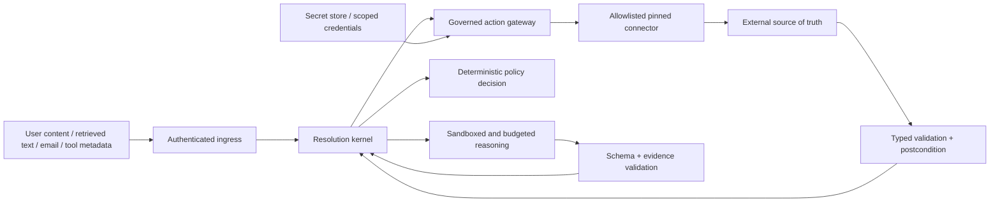

# RAG_new security and reliability architecture

- Status: Proposed implementation baseline
- Last updated: 2026-08-21
- Security posture: fail closed for verification, authorization, tenancy, and external side effects

## 1. Trust boundaries

The LLM boundary, retrieval corpus, connector metadata/output, browser/email channels, and all external services are untrusted. Authentication establishes an actor; it does not make their content, requested action, or connector output safe.

## 2. Security invariants

- Authorization and policy are evaluated outside prompts and model output.
- A model can choose only from action candidates already admitted by the contract; the gateway reauthorizes the exact canonical input.
- Credentials are scoped by tenant, connector, action, environment, and read/write class. They never enter prompts, evidence payloads, or general traces.
- MCP/OpenAPI are adapter protocols, not trust boundaries. Connector manifests are allowlisted, pinned, schema-hashed, and reviewed.
- Inbound bearer tokens are never forwarded to downstream APIs. MCP HTTP adapters validate audience/resource and obtain a separate downstream token.
- Read and write capabilities are separate; high-risk or irreversible actions require human approval until separately promoted.
- Confirmation is explicit, expires, and is bound to the exact canonical action digest. A generic “yes” cannot authorize a changed request.
- Tool output and retrieved documents cannot override contract, policy, system prompt, connector registry, or evaluator configuration.
- Unknown, malformed, stale, conflicting, timed-out, or budget-exhausted inputs cannot produce a verified outcome.

These controls align with the [MCP authorization specification](https://modelcontextprotocol.io/specification/2025-11-25/basic/authorization), which requires resource/audience-bound tokens and prohibits accepting or transiting unrelated tokens.

## 3. Threat model and controls

| Threat | Example | Preventive controls | Detection/recovery |
|---|---|---|---|
| Prompt injection | A policy document instructs the model to call a write tool. | Treat retrieved text as data; no direct connector access; closed action candidates; policy outside LLM. | Injection classifier/signals, action denial reason, adversarial replay. |
| Excessive agency | Model attempts an unapproved cancellation. | Contract step allowlist, risk tier, PDP, scoped credentials, confirmation, kill switch. | Unauthorized-attempt metric and evidence event. |
| Cross-tenant access | Crafted case/evidence ID from another tenant. | Tenant-bearing ports, composite ownership keys, RLS, non-owner runtime role, per-tenant Chroma collection. | Negative tests, tenant-denied audit, zero-tolerance alert. |
| SSRF/connector substitution | Tool metadata points to attacker host. | Private registry, outbound host allowlist, pinned endpoint/schema digest, no dynamic URL from model. | Egress logs and connector-manifest mismatch alert. |
| Token theft/passthrough | User token forwarded to MCP/TMS. | Secret store, separate downstream OAuth client, audience validation, short-lived scopes, log redaction. | Credential audit and revocation playbook. |
| Duplicate/ambiguous side effect | Timeout after remote ticket creation triggers another create. | Durable idempotency identity, connector key, outbox, `outcome_unknown`, reconciliation, postcondition. | Duplicate detector, reconciliation queue age alert. |
| Schema poisoning | Connector changes the meaning/type of a field. | Signed/pinned manifest and schema hash in contract/replay identity; strict validation. | Activation failure, replay impact selection. |
| Stale/conflicting policy | Old customs rule retrieved beside current rule. | Bitemporal/authority eligibility before similarity search; explicit conflicts; fail-closed contract behavior. | Freshness/conflict metrics and owner queue. |
| Data exfiltration through telemetry | Tool result with PII enters span attributes. | Content telemetry off by default; redaction profile; field allowlist; protected evidence reference. | Sampling audit and canary secret tests. |
| Unsafe model/evaluator change | Same model approves its own unsupported answer. | Versioned independent-judge policy, deterministic gates first, human calibration, release manifest. | Drift/replay failure and rollback. |
| Unbounded consumption | Recursive tool/retry path consumes capacity. | Wall/token/call/retrieval/tool budgets, cooperative cancellation, queue isolation, rate limits. | Budget-exhaustion metrics and circuit breaker. |
| Supply-chain compromise | Malicious connector or model package. | Locked hashes, dependency scanning, SBOM/signatures where available, private connector registry, image provenance. | Advisory triage, staged rebuild and rollback. |

The threat inventory is informed by [OWASP GenAI LLM Top 10 2026](https://genai.owasp.org/resource/owasp-genai-llm-top-10-2026/) and the [OWASP Agentic Applications Top 10 2026](https://genai.owasp.org/resource/owasp-top-10-for-agentic-applications-for-2026/). Controls are project requirements; OWASP references do not substitute for project-specific tests.

## 4. Identity, tenancy, and roles

Existing JWT/OIDC/RBAC remains the ingress identity layer. New authorization separates:

- `case:user`: open/read own eligible cases and submit information;
- `case:agent`: view/operate assigned tenant cases and safe evidence summaries;
- `case:supervisor`: inspect evidence, override only contract-declared human gates, and resolve escalations;
- `contract:author`: create drafts;
- `contract:approver`: approve/publish versions, separate from author where policy requires;
- `policy:owner`: manage deterministic policy revisions;
- `action:operator`: reconcile or compensate specific connector classes;
- `audit:reader`: access redacted audit/evidence exports;
- `platform:admin`: operate infrastructure without implicit tenant content access.

Production database roles separate schema owner/migrator, runtime application, read-only operations, and backup/restore. Table owners normally bypass PostgreSQL RLS, so the runtime cannot connect as the owner and protected tables use forced RLS where compatible with maintenance procedures.

## 5. Connector security profile

Every `ActionManifest` declares:

- connector and action stable IDs plus version/schema digest;
- read, reversible-write, or irreversible risk class;
- allowed hosts/transports and authentication mode;
- exact input/output schemas and safe logging fields;
- required tenant/user scopes and credential binding;
- request deadline, retryable error classes, rate/concurrency limits;
- idempotency support and reconciliation lookup;
- confirmation and approval rules;
- deterministic postcondition and optional compensation action;
- data classification, retention, and redaction behavior;
- kill-switch keys by environment, tenant, connector, and action.

Connector discovery may suggest draft manifests but cannot activate them. Dynamic MCP tool lists are treated as untrusted inventory changes and require registry review plus impact replay.

## 6. Failure semantics

| Failure | Case/action result | Forbidden fallback |
|---|---|---|
| PostgreSQL unavailable | Reject/queue no state-changing work; readiness fails. | Process-local case or action truth. |
| Redis unavailable | Bounded local degradation or 503 according to feature. | Unbounded cache or lost durable state. |
| Chroma unavailable/stale | Clarify/escalate/not-verified unless contract uses a validated structured source. | Invent context or use unknown collection. |
| LLM/provider unavailable | Retry within one budget, then clarify/escalate. | Heuristic auto-success. |
| Judge unavailable | Not verified/human when judge is required. | Same-model self-approval or fixed score. |
| Policy engine unavailable | Deny or escalate fail-closed. | Prompt-based allow. |
| Connector rejected request | Record failed/denied result and safe explanation. | Rewrite schema dynamically and retry. |
| Connector timeout after dispatch | `outcome_unknown` then reconciliation. | Treat timeout as failure and create a new action. |
| Postcondition unknown/fails | Partial/escalated/failed per contract. | Report action or case as resolved. |
| Evidence conflict/staleness | Clarify or escalate with conflict bundle. | Ask LLM to pick the convenient source. |
| Replay/evaluator skipped or infra error | Release gate fails. | “Passed with graceful skip.” |
| Client disconnect | Durable work follows contract; no extra history/action mutation. | Launch a second pipeline for parity. |

## 7. Reliability patterns

- Optimistic case versioning prevents lost updates and concurrent confirmation races.
- Transactional outbox couples domain changes to work publication.
- Leases and heartbeats make worker recovery explicit; expired work is reconciled before re-execution.
- Idempotency covers ingress commands, action runs, source-system writes, and history/event append.
- Circuit breakers and bounded retries are per downstream dependency and share the request/case budget.
- Bulkheads separate ingestion, reasoning, replay, and action/reconciliation queues and capacity.
- Postcondition checks and remote reconciliation address ambiguous network outcomes.
- Release manifests bind code, config, model, prompt, contract, policy, knowledge/index, connector, checker, and dataset identities.

LangGraph persistence/interrupts may be used for resumable reasoning, but its own guidance requires idempotent side effects around replay. The authoritative action identity is therefore created by the gateway before any graph-resumable operation.

## 8. Service objectives

Correctness objectives are hard gates:

- cross-tenant evidence/action access: `0`;
- unauthorized or duplicate critical writes: `0`;
- unverified material claims in auto-responses: `0`;
- promoted-contract deterministic path and postcondition compliance: `100%`;
- disclosure/version traceability for production cases: `100%`.

Latency and availability targets are journey-specific and must be based on a measured environment. Initial design budgets, not promises, are:

- synchronous read-only case response: configurable bounded wall deadline with p50/p95 reported by journey;
- asynchronous write acknowledgement: durable acceptance before response;
- reconciliation: queue-age SLO by risk tier with immediate alert for irreversible unknown outcomes;
- recovery: inherited RPO/RTO targets remain unproven until real backup/restore drills close the remediation gate.

Do not publish attractive numeric latency or uptime promises before local-provider, external-provider, PostgreSQL, Chroma, and connector measurements exist.

## 9. Promotion gates

Promotion follows schema/unit -> deterministic scenario -> multi-turn simulation -> adversarial/fault -> repeated trials -> production replay -> shadow -> single-tenant canary -> staged rollout.

A journey may be promoted only when:

1. Contract schema/static validation and every required branch pass.
2. Deterministic state graders reject fluent but logically incorrect outputs.
3. Unsupported/stale/conflicting claims cannot become verified.
4. Policy denial, confirmation, idempotency, timeout, disconnect, and reconciliation tests pass.
5. Cross-tenant and connector-security negative suites pass.
6. Repeated non-deterministic trials satisfy the risk-tier threshold with confidence intervals.
7. VR precision, VRY, eligible coverage, recontact, latency, and cost are reported together.
8. Existing retrieval safety floors are not degraded.
9. The inherited trust/remediation gates required by the journey are green with fresh non-skipped evidence.
10. Rollback and kill switches are tested on the exact release manifest.

An LLM judge evaluates only qualities that deterministic graders cannot, such as clarity and empathy. Its model/provider independence and human calibration are versioned release inputs.

## 10. Backup, restore, and incident response

PostgreSQL backups cover contracts, cases, evidence metadata, policy/action decisions, outbox, and replay manifests. Protected object payloads and Chroma projection manifests have coordinated retention and restore procedures. Chroma itself may be rebuilt from eligible knowledge versions; a restore is not complete until known-case retrieval and evidence resolution pass.

Incident controls include environment/tenant/connector/action kill switches, contract retirement, policy bundle rollback, model/prompt rollback, index manifest rollback, and queue pausing. Existing in-flight actions are reconciled before traffic resumes.

Security incidents produce a correction event and, where policy permits, preserve the original evidence/outcome rather than rewriting history. A corrected customer response is a new case event linked to the superseded outcome.

## 11. Governance and disclosure

[NIST AI 600-1](https://www.nist.gov/publications/artificial-intelligence-risk-management-framework-generative-artificial-intelligence) provides the governance structure: inventory, accountable owner, risk assessment, TEVV, monitoring, incident/correction path, human oversight, and change management. Compliance claims require jurisdiction- and deployment-specific review.

AI interaction disclosure is a versioned channel contract and evidence event, not theme text. Locale, disclosure version, display event, and channel are tested. EU Article 50 applicability and exact wording require legal review for each deployment; architecture supplies traceable enforcement rather than asserting legal compliance by itself.
