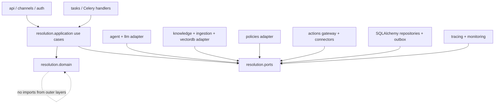
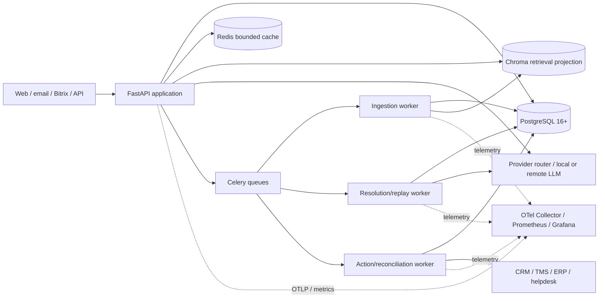
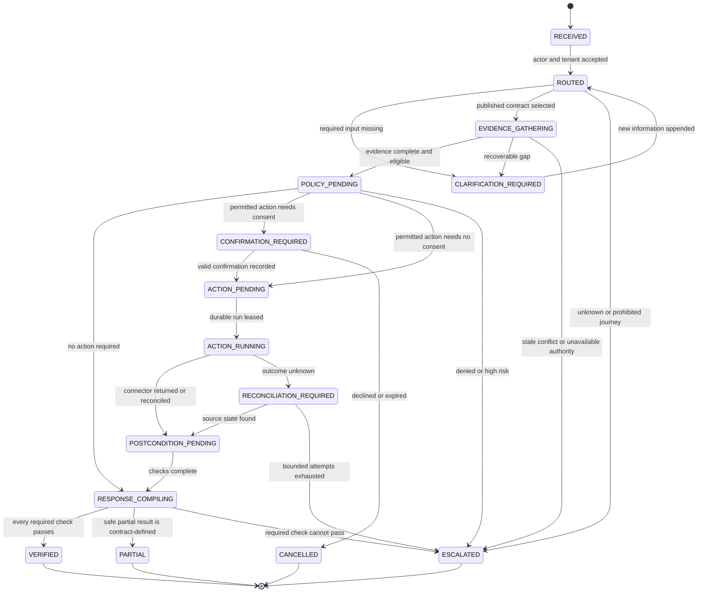
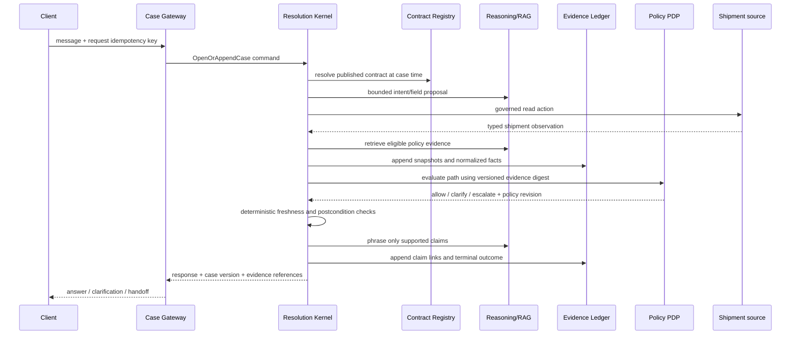
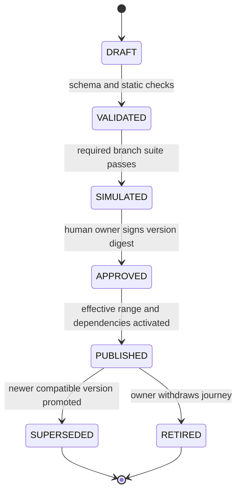

# RAG_new system architecture

- Status: Proposed implementation baseline
- Last updated: 2026-08-21
- Scope: first read-only logistics journey through controlled write autonomy

## 1. Architectural thesis

`RAG_new` separates **language reasoning** from **resolution authority**.

- The LLM proposes intent, extracted fields, retrieval plans, claims, and customer-facing language.
- The resolution kernel owns case state, contract execution, allowed transitions, and terminal outcome.
- The policy decision point owns allow, deny, clarify, confirm, and escalate decisions.
- Source-system adapters and deterministic postcondition checkers establish whether a real-world outcome happened.
- The evidence ledger records the versioned facts behind each decision without storing hidden chain-of-thought.

This separation turns RAG into one replaceable evidence-producing subsystem. It prevents a fluent answer, a high self-score, or a tool response from being confused with verified resolution.

## 2. Scope and non-goals

The architecture covers chat, email, Bitrix, and API cases; contract authoring and publication; temporal knowledge retrieval; governed read/write actions; evidence export; replay; and staged promotion.

The first milestone does not include voice, a general MCP marketplace, arbitrary code generation, refunds/cancellations, a graph database, a foundation-model training pipeline, a microservice split, or automatic publication of AI-authored policies.

## 3. Logical layers and dependency direction



The dependency rule is inward: domain code imports only Python standard-library types and its own value objects. Application services depend on domain types and ports. FastAPI, SQLAlchemy, LangGraph, Chroma, Celery, Redis, provider SDKs, and connector clients are adapters.

### Proposed package ownership

```text
resolution/
  domain/          Case, contract, evidence, action, outcome value objects and invariants
  application/     Commands, queries, orchestration, transaction boundaries
  ports/           Repository, clock, reasoning, knowledge, policy, action and event interfaces
  contracts/       Pydantic authoring models, schema export, safe predicate AST
  postconditions/  Deterministic checker registry and result types

knowledge/         Temporal/authority eligibility, evidence assembly, retrieval adapter
policies/          PolicyDecisionPoint plus typed-rule and optional OPA adapters
actions/           Manifest registry, gateway, dispatcher, reconciliation, connectors
evaluation/
  resolution/      Scenario compiler, state grader, replay, release manifest, metrics
```

Existing `agent`, `vectordb`, `ingestion`, `llm`, `services`, `api`, `tasks`, `tracing`, and `monitoring` packages remain adapters or compatibility paths. New business behavior must not be added directly to `agent/graph.py` or `api/routers/conversation.py`.

## 4. Deployable topology



This is one codebase and one release artifact with role-specific process commands. Worker queues are separated so an expensive replay or ingestion job cannot consume action reconciliation capacity. Redis loss may reduce throughput but cannot erase a case or action. PostgreSQL loss stops state-changing work fail-closed.

Protected large payloads may later use an S3-compatible object-store adapter. The ledger still stores the tenant, digest, encryption/retention metadata, and immutable reference. Local filesystem paths are development adapters, not portable production identities.

## 5. Component contracts

| Component | Owns | Consumes | Must not do |
|---|---|---|---|
| Case Gateway | Authentication, tenant/actor context, channel normalization, request idempotency | API/channel payloads | Choose policy or mark a case verified |
| Contract Registry | Immutable contract versions and lifecycle | Approved authoring payload | Execute arbitrary expressions or overwrite published versions |
| Resolution Kernel | Case transitions, required-input/evidence plan, terminal outcome | Contract, evidence, policy/action/postcondition results | Call provider SDKs or connector clients directly |
| Reasoning Adapter | Intent/field/claim proposals and response phrasing | Bounded typed task | Authorize actions or declare postconditions |
| Knowledge Plane | Temporal/ACL/authority eligibility and retrieval projection | Case time/applicability, query | Ask the LLM to choose the effective policy from an unfiltered mixture |
| Evidence Assembler | Normalized facts, snapshots, claim-support/conflict edges | Knowledge/tool/source-system results | Store chain-of-thought or silently drop conflicting material facts |
| Policy Decision Point | Versioned deterministic decision | Actor, tenant, contract step, risk, evidence digest | Execute the action it authorizes |
| Action Gateway | Manifest enforcement, confirmation, idempotency, dispatch and reconciliation | Authorized action command | Trust tool metadata/output as instruction or invent success after timeout |
| Postcondition Registry | Deterministic business-state checks | Typed source-system observations | Use answer text or LLM confidence as business state |
| Response Compiler | Supported material claims, citations, disclosure and status | Verified claim set and outcome | Add unsupported material facts |
| Simulator/Replay | Scenario execution, state grading, repeated trials, release gates | Versioned release manifest | Read hidden expected output while generating the candidate |

## 6. Core ports

The exact names may change in implementation, but their ownership may not collapse.

```python
class ReasoningPort(Protocol):
    async def run(self, task: ReasoningTask, budget: ReasoningBudget) -> ReasoningProposal: ...

class KnowledgePort(Protocol):
    async def gather(self, request: EvidenceRequest) -> EvidenceBatch: ...

class PolicyDecisionPoint(Protocol):
    async def decide(self, request: PolicyRequest) -> PolicyDecision: ...

class ActionPort(Protocol):
    async def request(self, command: ActionCommand) -> ActionReceipt: ...

class PostconditionChecker(Protocol):
    async def check(self, request: PostconditionRequest) -> PostconditionResult: ...
```

All port payloads carry `tenant_id`, `case_id`, `contract_version_id`, `correlation_id`, and relevant version/digest fields. Adapter exceptions are translated to bounded domain failure types; raw secrets or provider payloads do not cross into domain events.

## 7. Resolution state machine



Every transition is a compare-and-swap against `SupportCase.version`. A duplicate command with the same idempotency key returns the existing result. A concurrent stale command receives a conflict and reloads state; it does not replay an external side effect.

## 8. Read-only journey flow



The source-system read is an action with a manifest and scope even though it has no confirmation. Its freshness and identity become evidence. A response can be `verified` only if the shipment observation and applicable policy evidence satisfy the contract.

## 9. Controlled write flow

1. The kernel computes a typed action proposal from a published contract step.
2. The PDP returns a decision tied to input and evidence digests, actor, risk tier, and policy revision.
3. If confirmation is required, the kernel records a non-secret confirmation challenge and pauses. Confirmation is bound to the exact action digest and expires.
4. The gateway creates or finds `ActionRun` using the tenant-scoped idempotency identity and writes an outbox event in the same transaction.
5. A worker leases the run and calls the pinned connector with a connector-specific downstream token. The caller's bearer token is never passed through.
6. Timeout after dispatch produces `unknown`, not `failed` or `succeeded`. Reconciliation asks the source system for the remote operation/end state.
7. A deterministic checker records the postcondition. Only then may the case become `verified`.

## 10. Contract lifecycle



Published payloads are immutable. Corrections create a new version. Publication checks referenced action manifests, postcondition implementations, policy bundle/revision compatibility, required scenario coverage, locale disclosure, and effective-time overlaps. Natural-language SOP import creates only `DRAFT`.

## 11. Policy Decision Point

The MVP uses typed, allowlisted predicates over a normalized input document. It does not use Python `eval`, generated Python, SQL fragments, Jinja expressions, or arbitrary JSONPath. A policy decision contains:

- `decision_id` and timestamp;
- allow/deny/clarify/confirm/escalate result;
- stable reason codes safe for audit and user explanation;
- policy implementation and data revision;
- input/evidence/action digests;
- matched rule identifiers;
- expiry or re-evaluation condition.

The application depends only on `PolicyDecisionPoint`. OPA becomes useful when multiple deployables require independently distributed/signed bundles and decision-log operations. Its decision IDs, bundle revisions, and masking features fit the port, but an OPA sidecar is deferred until that operational need exists.

## 12. External API direction

Existing `/api/ask`, `/api/ask/stream`, upload, feedback, and agent endpoints remain unchanged during shadow migration. New versioned APIs use case resources:

| Method | Path | Purpose |
|---|---|---|
| `POST` | `/api/v1/cases` | Open a case; requires a request idempotency key. |
| `POST` | `/api/v1/cases/{case_id}/messages` | Append information using expected case version. |
| `GET` | `/api/v1/cases/{case_id}` | Read lifecycle, outcome, pending request, and safe summary. |
| `POST` | `/api/v1/cases/{case_id}/confirmations` | Confirm/deny one exact action digest. |
| `GET` | `/api/v1/cases/{case_id}/evidence` | Export a redacted evidence bundle if actor scope permits. |
| `POST` | `/api/v1/contracts/validate` | Validate a draft without publishing. |
| `POST` | `/api/v1/contracts/{id}/versions/{version}/publish` | Human-approved publication with replay manifest. |
| `POST` | `/api/v1/replays` | Start an impact-selected replay run. |

Commands accept `Idempotency-Key` and, after creation, `If-Match` or an explicit `expected_version`. Responses include `case_version`, `correlation_id`, and terminal/pending status. SSE is a projection of persisted case events; it is never a second execution path.

## 13. Runtime budgets and isolation

Budgets are contract/risk-tier configuration, not scattered literals:

- wall-clock deadline and cooperative cancellation token;
- maximum LLM calls and input/output tokens across retries;
- retrieval candidate and rerank bounds;
- connector deadline, retry class, and reconciliation horizon;
- maximum clarification turns and case age;
- evidence payload and export bounds;
- per-tenant concurrency/rate limits;
- separate queue and worker capacity for ingestion, replay, reasoning, and actions.

Budget exhaustion produces `clarification_required`, `escalated`, `failed`, or `reconciliation_required` according to the contract. It never promotes a case.

## 14. Observability model

One W3C trace links ingress, case command, reasoning tasks, retrieval, policy decision, action dispatch, reconciliation, postcondition, response compilation, and persistence. Low-cardinality metrics carry journey and risk tier; tenant and case IDs remain trace/log fields with access controls rather than Prometheus labels.

Required identity fields are `case_id`, `case_version`, `contract_id/version`, `policy_revision`, `knowledge_snapshot/index_version`, `action_manifest_version`, `model/provider/prompt_version`, `replay_manifest`, and `correlation_id`.

OpenTelemetry GenAI conventions are adopted only with an explicit version and redaction policy. Tool arguments/results are not emitted by default because the conventions warn they may contain sensitive information. Custom `resolution.*` spans and metrics remain stable application contracts even while experimental GenAI attributes evolve.

Core metrics include VR precision, VRY, eligible coverage, clarification burden, escalation reasons, postcondition failures, stale/conflict evidence, unauthorized/duplicate action attempts, reconciliation age, unverified auto rate, case latency by terminal outcome, and cost per verified resolution.

## 15. Evolution boundaries

- A graph database requires a representative query/SLO benchmark and ADR; the logical evidence graph stays relational first.
- A new retrieval lane requires labelled query-corpus outcomes and shadow/replay/canary evidence; complexity classification alone is insufficient.
- A microservice extraction requires a stable port, versioned event contract, independent ownership/SLO need, and failure-mode test.
- Write risk expands one action class at a time. Read-only precedes reversible/idempotent write; irreversible actions remain human-controlled until separately promoted.
- A second domain starts only after the first domain demonstrates useful VRY without worse recontact or critical incidents.

## 16. Open product inputs

Architecture cannot safely invent the domain owner, canonical shipment system, authoritative policy hierarchy, allowed customer segments/regions, recontact window, or business postconditions. Until those are supplied, the project uses ports and fixtures and remains in audit/shadow mode. These are product gates, not implementation ambiguities for an LLM to resolve.
