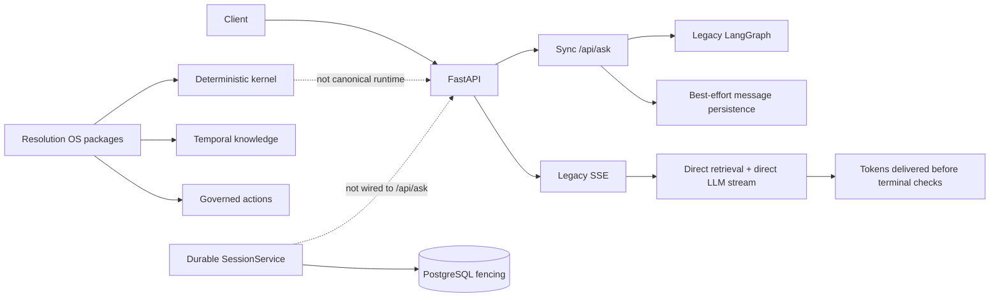
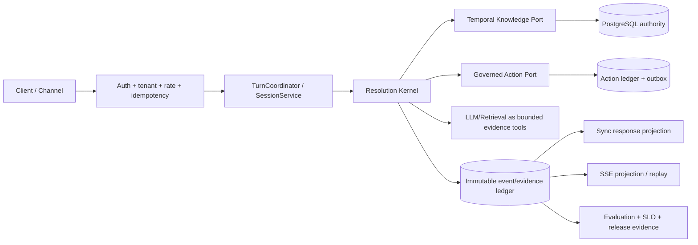

# Глубокий аудит RAG_new

**Дата среза:** 23 августа 2026 года

**Репозиторий:** `D:\RAG_new`, ветка `master`, HEAD `26866e9`

**Статус дерева до аудита:** clean

**Тип аудита:** архитектура, фактические runtime-пути, RAG/LLM-качество, данные и evals, безопасность, tenancy, надёжность, эксплуатация, зависимости, тесты, CI/CD, поддерживаемость и продуктовая актуальность.

## 1. Итог в одном абзаце

RAG_new — сильная и необычно дисциплинированная инженерная база, но пока не единый production-продукт. В репозитории уже есть две ценные вещи: достаточно зрелый классический RAG-runtime и существенно более интересная концепция **Verifiable Resolution OS** — детерминированное разрешение support-кейсов с доказательствами, временной версионностью знаний, управляемыми действиями и replay. Однако публичный `/api/ask`, SSE, durable session lifecycle и новые пакеты `resolution`/`knowledge`/`actions` пока образуют два параллельных контура. Поэтому локально реализованные сильные свойства ещё не являются свойствами продукта, который получает пользователь. Текущая интегральная оценка — **5,8/10 как реально поставляемой системы** и **8,5/10 как архитектурного потенциала**. Проект следует усиливать не добавлением новых RAG-функций, а завершением одного канонического runtime-пути, доказательным shadow/pilot-прогоном и удалением legacy-параллельности.

## 2. Главный вердикт

### Что это сейчас

- Большая Python-платформа с хорошими локальными контрактами, тестами и документацией.
- Локально реализованный и покрытый focused tests RAG-контур на FastAPI/LangGraph/Chroma с гибридным поиском, reranking, grounding, safety, escalation, ingestion lifecycle и наблюдаемостью.
- Отдельно реализованный детерминированный Resolution OS для узкого сценария `shipment-status`.
- Локально сильная, но не завершённая release-инфраструктура: workflow-файлы есть, удалённого Git remote в данном клоне нет, live deployment/canary не доказаны.

### Чем проект может стать

Не очередным «чатом по документам», а **проверяемым оператором разрешения support-кейсов**:

> Входящий вопрос или кейс превращается в воспроизводимое решение, каждое утверждение связано с версией знания и evidence snapshot, каждое внешнее действие проходит policy/confirmation/idempotency, а любой результат можно replay-нуть и объяснить.

Это значительно сильнее обычного RAG и имеет потенциал более чёткой продуктовой дифференциации. Эту гипотезу ещё нужно подтвердить buyer research и pilot willingness. Именно этот клин следует довести до production на одном домене — air cargo / shipment status — прежде чем расширять набор коннекторов и сценариев.

### Что блокирует production сейчас

1. Новый Resolution OS не является каноническим runtime-путём публичного API.
2. Durable `SessionService` не подключён к sync/SSE lifecycle; multi-replica ordering не гарантирован пользователю.
3. Legacy SSE начинает отдавать токены до итоговой safety/grounding-проверки и имеет fail-open defaults.
4. Live quality evidence узкое, часть raw-артефактов не хранится как неизменяемый release evidence; CI regression lane осознанно mock-only.
5. Есть tenancy/auth, cost-accounting и deployment gaps, которые недопустимы для внешнего multi-tenant продукта.

## 3. Методика и границы уверенности

Проверялись:

- текущее состояние Git, история и структура репозитория;
- README, архитектурные документы, backlog и актуальный session handoff;
- фактические импорты и вызовы от публичных API до graph, persistence, retrieval и providers;
- sync и SSE пути, auth/JWT/cookie boundary, RLS, ingestion, vector cache, Helm/Docker;
- lock-файлы, CI/pre-commit gates, coverage и MyPy scopes;
- локальные deterministic и focused tests;
- текущие официальные источники по фреймворкам, моделям, pricing, RAG-evaluation, AI security, MCP и software supply chain.

В аудит **не входят** live-вызовы внешних LLM, миграции production DB, реальный Kubernetes rollout, нагрузочный тест на двух репликах, restore drill, push и удалённый CI. Поэтому документ не утверждает production readiness и явно отделяет локальные доказательства от live/release evidence.

## 4. Измеренный baseline

Старый архитектурный baseline указывал 117 776 строк Python. Фактически сейчас — 146 157 строк, то есть примерно **+24,1%**. Разница больше 10%, поэтому старые оценки размера и сроков следует считать только историческими.

| Показатель | Фактический срез |
|---|---:|
| Tracked files | 1 015 |
| Python-файлы | 515 |
| Python physical LOC | 146 157 |
| Production Python без tests/scripts/archive | 172 файла / 52 251 LOC |
| Test Python | 252 файла / 71 656 LOC |
| Явные test-функции | 1 878 |
| Integration test files | 13 |
| Markdown/MDX | 385 файлов / 71 515 строк / ~4,1 MB |
| Git commits всего | 907 |
| Commits с 23.07.2026 | 383 |
| Git remote | отсутствует |

Методика подсчёта: tracked-файлы брались из Git; Python physical LOC — сумма строк в tracked `*.py` без поправки на blank/comment lines; production cohort — runtime-root пакеты `main`, `api`, `auth`, `agent`, `services`, `resolution`, `knowledge`, `actions`, `db`, `config`, `llm`, `vectordb`, `ingestion`, `evaluation`, `tracing`, `monitoring`, `cache`, `channels`, `tasks`, `utils`, `integrations` без `tests`, scripts, data и archive; test cohort — tracked Python внутри `tests`; documentation cohort — tracked `*.md`/`*.mdx`. Поэтому это воспроизводимая оценка физического объёма, а не semantic SLOC или complexity score.

Крупнейшие production-модули показывают концентрацию ответственности:

| Файл | LOC, примерно | Наблюдение |
|---|---:|---|
| `agent/graph.py` | 4 133 | orchestration, routing, grading и значительная часть policy сведены вместе |
| `api/app.py` | 2 069 | остаётся global runtime owner и compatibility hub |
| `api/routers/conversation.py` | 1 671 | sync, SSE, persistence, fallback и response assembly в одном модуле |
| `db/models.py` | 1 449 | legacy и Resolution OS модели в одном schema-модуле |
| `config/settings.py` | 1 415 | очень широкий конфигурационный surface |
| `vectordb/_base_manager.py` | 1 385 | retrieval algorithm, BM25, reranking и storage plumbing вместе |

Сам размер не является дефектом. Проблема в том, что высокий churn и параллельные compatibility paths делают доказательство поведения дороже каждого следующего изменения.

## 5. Оценка по направлениям

| Направление | Оценка | Почему |
|---|---:|---|
| Дифференциация идеи | **9,0/10** | verifiable resolution, temporal knowledge и governed actions сильнее generic RAG |
| Целевая архитектура | **8,5/10** | хорошие invariants, ports, replay, fail-closed semantics, strangler/shadow design |
| Фактическая runtime-интеграция | **4,0/10** | ключевые новые примитивы не владеют публичным запросом end-to-end |
| Retrieval/generation quality | **6,0/10** | хороший hybrid pipeline и честный live A/B, но evidence пока узкое |
| Resolution evidence | **4,0/10** | локально богато, но synthetic-only и без production promotion |
| Security/tenancy | **6,0/10** | сильные новые RLS-контракты, но legacy tables/API-key/JWT gaps остаются |
| Reliability/operations | **5,0/10** | хорошие контракты и observability, но single replica и live drills не закрыты |
| Tests/CI/governance | **7,0/10** | большой test corpus и хорошие gates, но новые пакеты охвачены не полностью |
| Maintainability | **4,0/10** | god modules, огромные handoff-файлы, высокая скорость накопления состояния |
| Release/product readiness | **4,5/10** | нет единого release truth, remote CI, canary и подтверждённых business outcomes |
| **Итого** | **5,8/10** | сильный фундамент, незавершённый продуктовый контур |

Оценка не усредняет «красивую архитектуру» с production readiness. Наличие класса, схемы или теста даёт кредит инженерной базе, но не даёт кредит runtime-свойству, пока публичный путь его не использует.

## 6. Фактическая архитектура: где расхождение

Текущий handoff прямо фиксирует, что `SessionService` существует, но sync `/api/ask` и SSE к нему не подключены ([`docs/SESSION_HANDOFF.md`](docs/SESSION_HANDOFF.md#L41)). План Resolution OS также честно оставляет production promotion открытым ([`rag-new-architecture.md`](rag-new-architecture.md#L18)). Статический поиск импортов не обнаружил использования production-пакетов `resolution`, `knowledge` и `actions` внутри `api`, `agent` или `services`.

Это архитектурный split-brain: сильнейшие свойства находятся рядом с продуктом, но не внутри его канонической транзакции.

## 7. Что сделано действительно хорошо

### 7.1. Архитектурные invariants

Документы формулируют правильные для enterprise support требования: tenant isolation на нескольких слоях, versioned evidence, effectively-once действия, state/postcondition grading до language quality и migration через shadow/strangler ([`docs/architecture/README.md`](docs/architecture/README.md#L20)). Это редкая зрелость для RAG-проектов.

### 7.2. Детерминированное ядро и temporal knowledge

Resolution kernel, контракты shipment-status, temporal knowledge, projection binding, action manifests и synthetic replay реализованы как отдельные проверяемые primitives. Проект правильно не выдаёт synthetic safety за business или release evidence ([`rag-new-architecture.md`](rag-new-architecture.md#L96)).

### 7.3. Ingestion/index lifecycle

Staging, publish, rollback, manifest и retention уже намного сильнее типичного «загрузили PDF прямо в коллекцию». Это хорошая основа для immutable index identity и replay.

### 7.4. Честная eval-культура

Последний live aircargo A/B на 100 кейсах не «подогнан»: все семь экспериментальных плеч получили **NO-SHIP**, production defaults не менялись. Для baseline зафиксированы `context_precision=0,5768`, `context_recall=0,9800`, `faithfulness=0,8406`, `answer_relevancy=0,8900` ([результат](docs/operations/2026-07-18-q1-context-precision-ab-results.md#L1)). Это хороший пример правильного отказа от плохой оптимизации.

### 7.5. Инженерные gates

- hashed production/dev locks;
- Ruff clean;
- Python 3.11/3.13 jobs, PostgreSQL migrations, Helm, unit/integration, Bandit и pip-audit в workflow;
- coverage threshold 72%;
- документированные исключения advisory, а не тихое подавление;
- mock regression явно помечен как smoke, а не release evidence ([`.github/workflows/ci.yml`](.github/workflows/ci.yml#L289)).

### 7.6. Старые аудиты нельзя копировать как текущий статус

По коду уже закрыты несколько прежних претензий: реальный ASGI body limit, OIDC `email_verified` и issuer/subject binding, bounded Redis fallback, routing с grounding/factuality/knowledge-gap, durable escalation и index publish/rollback. Новый план должен начинаться с актуального split-brain, а не повторять закрытые пункты апреля–июня.

## 8. Приоритетные находки

Шкала приоритетов:

- **P0** — блокирует заявленный release surface или нарушает его основной safety/consistency contract;
- **P1** — должен быть закрыт до внешнего multi-tenant pilot либо при подтверждённом масштабе/режиме;
- **P2** — hardening, maintainability или будущий scale risk, который нужно планировать, но он не блокирует более узкий безопасный профиль.

### F-01 — P0: Resolution OS не подключён к публичному runtime

**Доказательство.** Архитектурный план утверждает локальную готовность ряда slices, но оставляет promotion открытым ([`rag-new-architecture.md`](rag-new-architecture.md#L13)). Handoff прямо говорит, что текущий runtime использует legacy lifecycle ([`docs/SESSION_HANDOFF.md`](docs/SESSION_HANDOFF.md#L68)). В production-дереве API/agent/services отсутствуют импорты `resolution`, `knowledge`, `actions`.

**Риск.** Самая сильная часть репозитория не создаёт ценность и не защищает ответы реального пользователя. Два мира будут расходиться по semantics, telemetry и тестам.

**Что делать.** Выбрать один узкий journey `shipment-status`, подключить его read-only через façade к каноническому `/api/ask`, сохранить контракт старого ответа, а все остальные intents пока направлять в legacy path. Promotion выполнять только shadow → canary → default.

**Definition of Done.** Один входной request получает immutable contract/policy/knowledge/model/index identities, deterministic terminal outcome и replay receipt; результат совпадает в sync и SSE projection.

### F-02 — P0: durable session semantics не являются HTTP semantics

`SessionService` уже реализует admission и fenced terminal commit ([`services/session.py`](services/session.py#L226)), но вызовов из production API нет. Вместо него `_persist_ask_messages` добавляет user/assistant pair best-effort и при любой DB-ошибке включает общий 60-секундный cooldown для всех tenants ([`api/routers/conversation.py`](api/routers/conversation.py#L217)). HTTP `Idempotency-Key`, `ETag`/`If-Match`, `428/412/409/503` всё ещё не подключены ([`docs/SESSION_HANDOFF.md`](docs/SESSION_HANDOFF.md#L74)).

**Риски:** lost response, duplicate turn, out-of-order history, cross-replica race, tenant-wide degradation из-за локального DB fault.

**Что делать.** Сделать `SessionService` единственным владельцем admission/abort/commit; request idempotency и session version должны входить в HTTP-контракт. Cooldown должен быть bounded и partitioned хотя бы по operation/tenant, а не глобальным process flag.

**DoD.** Не менее 1 000 contended attempts, 100 sessions и 2 replicas — именно такой promotion floor уже принят проектом ([`docs/SESSION_HANDOFF.md`](docs/SESSION_HANDOFF.md#L267)); zero duplicate terminal pair, zero stale overwrite, exact replay после потерянного ответа.

### F-03 — P0 перед включением SSE; P1 для sync-only профиля: legacy SSE несовместим с fail-closed обещанием

`STREAMING_ENABLED=false` и `STREAMING_RAG_PARITY=false` по умолчанию — безопасный текущий default ([`config/settings.py`](config/settings.py#L656)). Поэтому дефект не блокирует строго sync-only запуск, пока SSE гарантированно выключен. Но если включить streaming без parity, отдельный путь начинает передавать токены клиенту ([`api/routers/conversation.py`](api/routers/conversation.py#L1248)), а route вычисляет позже по self-eval/эвристике ([`api/routers/conversation.py`](api/routers/conversation.py#L1367)). В fallback используются `quality_score=50`, `quality_source=llm`, `route=auto` при отсутствии значения ([`api/routers/conversation.py`](api/routers/conversation.py#L1535)). Уже отданный unsafe/unsupported текст отозвать нельзя.

**Что делать.** Удалить direct-generation SSE path. Каноническая pipeline должна сначала производить проверенные persisted events/chunks; SSE — только projection этих событий. До финального terminalizer разрешены лишь нейтральные progress events либо буферизованные токены. Любая неизвестная route/quality/safety state должна завершаться `human`/`not_verified`, никогда `auto`.

**DoD.** Sync и SSE дают одинаковые terminal state, citations, policy result и persistence; disconnect/reconnect replay не запускает повторное действие; ни один токен неподтверждённого ответа не покидает trust boundary.

### F-04 — P1: качество измеряется, но release evidence пока недостаточно

Сильная сторона — живой A/B и честный NO-SHIP. Ограничения:

- raw artifacts последнего live-прогона описаны, но не входят в tracked immutable evidence package;
- 25 batch grader-вызовов имели transport errors, после чего успешно перешли в per-document fallback; per-document failures было 0 и зафиксированной деградации качества нет. Остаточный риск — дополнительное время и отсутствие tracked raw transport log, а не доказанная порча оценки;
- aircargo sample — 100 кейсов, а multi-turn, underspecified, unanswerable и non-standalone slices не доказаны;
- [`data/evaluation/benchmark_results.json`](data/evaluation/benchmark_results.json#L1) — старый demo на 12 кейсах с очень слабыми метриками и не должен быть release source of truth;
- [`evaluation/ragas_eval.py`](evaluation/ragas_eval.py#L432) способен подставить `expected_answer`, если фактические answers отсутствуют;
- [`scripts/eval_gate.py`](scripts/eval_gate.py#L274) печатает `PASSED (graceful skip)`. Сейчас этот script не является CI release gate, но его название и поведение опасны для будущей автоматизации.

RAGAS полезен для быстрых reference-free циклов, но сам разделяет retrieval, faithfulness и generation quality, а не заменяет human truth ([EACL 2024](https://aclanthology.org/2024.eacl-demo.16/)). Современные multi-turn benchmarks отдельно показывают трудность поздних turn, unanswerable, underspecified и non-standalone запросов: [mtRAG, TACL 2025](https://aclanthology.org/2025.tacl-1.36/) и [MTRAG-UN, ACL 2026](https://aclanthology.org/2026.findings-acl.503/).

**Что делать.** Один versioned evaluation manifest должен ссылаться на immutable input corpus, raw outputs, retrieval candidates, judge version, human labels, environment и code SHA. Skipped/incomplete/self-judged run всегда `NOT_EVIDENCE`. Автоматического judge калибровать на double-annotated human sample и публиковать disagreement.

### F-05 — P1: CI сильный, но его claim шире фактического охвата

README утверждает: «All production packages are `mypy --strict` clean (CI-enforced)» ([`README.md`](README.md#L94)). Фактические CI-команды не включают корневые пакеты `resolution`, `actions`, `knowledge`, `services`, `cache`, `integrations` ([`.github/workflows/ci.yml`](.github/workflows/ci.yml#L110)). Coverage source включает `resolution`, но пропускает как минимум `actions`, `knowledge`, `services`, `cache`, `integrations` ([`pyproject.toml`](pyproject.toml#L38)).

Независимый локальный **strict-like floor** по пропущенным пакетам использовал команду `python -m mypy actions knowledge resolution services cache integrations --no-incremental --follow-imports=skip --show-error-codes --disallow-untyped-defs --disallow-incomplete-defs` и нашёл шесть ошибок в 40 файлах: пять несовместимых `**dict[str, object]` аргументов в `actions/ticket.py:94` и отсутствующую return annotation в `cache/redis_cache.py:95`. Поскольку это selective scope с `--follow-imports=skip`, шесть ошибок — нижняя граница, а не результат полного `mypy --strict`. Это не доказанные runtime defects, но доказанный разрыв quality gate.

**Что делать.** Синхронизировать три множества: production packages, MyPy scope и coverage source. README должен описывать фактический gate, а не желаемый. Сначала добавить пропущенные пакеты в отдельный informational job, закрыть ошибки, затем сделать blocking.

### F-06 — P1: service authentication и legacy tenancy недостаточны

Legacy `X-API-Key` создаёт identity `api-key-user` с ролью `admin` и tenant `default` ([`auth/dependencies.py`](auth/dependencies.py#L59)). Для automation/integration это чрезмерные и неразделяемые права. Forced RLS есть на новых Resolution OS таблицах, но legacy `sessions`/`messages` всё ещё опираются в основном на application predicates; это прямо отмечено handoff ([`docs/SESSION_HANDOFF.md`](docs/SESSION_HANDOFF.md#L76)).

Access/refresh JWT содержат `sub`, `role`, `tenant`, `exp`, `type`, но не имеют `iss`, `aud`, `iat`, `jti`, rotation/revocation semantics ([`auth/jwt_handler.py`](auth/jwt_handler.py#L22)). Widget token проверяется строже, то есть нужный pattern уже есть. Cookie bridge разрешает unsafe request без `Origin` ([`api/app.py`](api/app.py#L2045)); из-за SameSite это не самый высокий риск, но browser boundary лучше делать fail-closed.

**Что делать.** Ввести service accounts с tenant, scopes, expiry и audit identity; API key оставить только как временный migration adapter. Добавить forced RLS legacy tables, JWT issuer/audience/jti/rotation/revocation, fail-closed Origin для cookie-auth unsafe methods. Проверить все action scopes по deny-by-default матрице.

OWASP отдельно выделяет prompt injection, sensitive-information disclosure, supply chain, excessive agency и vector/embedding weaknesses ([OWASP GenAI Top 10](https://genai.owasp.org/llm-top-10/)); NIST рекомендует управлять такими рисками на всём AI lifecycle, а не только фильтром ответа ([NIST AI 600-1](https://www.nist.gov/publications/artificial-intelligence-risk-management-framework-generative-artificial-intelligence)). Целевая архитектура проекта уже соответствует этому направлению — нужно довести её до runtime.

### F-07 — P1: Mistral cost accounting фактически неверен

Registry prices передаются provider-у, записываются в traces/Prometheus и участвуют в daily paid-cost guard ([`llm/providers/runtime.py`](llm/providers/runtime.py#L221), [`tracing/_base_trace.py`](tracing/_base_trace.py#L450)). Поэтому это не косметические метаданные.

| Model alias | В проекте, input/output $/M | Официально 23.08.2026 | Искажение |
|---|---:|---:|---|
| `ministral-3b-latest` | 0,04 / 0,04 | 0,10 / 0,10 | фактическая стоимость в 2,5 раза выше учёта |
| `ministral-8b-latest` | 0,10 / 0,10 | 0,15 / 0,15 | фактическая стоимость в 1,5 раза выше учёта |
| `mistral-small-latest` | 0,20 / 0,60 | 0,15 / 0,60 | input завышен на 33% |
| `mistral-large-latest` | 2,00 / 6,00 | 0,50 / 1,50 | учёт завышен в 4 раза |

Локальные значения: [`config/providers.yml`](config/providers.yml#L80). Официальный источник: [Mistral API pricing](https://docs.mistral.ai/inference/pricing).

**Что делать.** Исправить registry, добавить dated pricing metadata и contract test против явно подтверждённого snapshot. Для `*-latest` стоимость нельзя считать вечной: нужен owner-reviewed periodic refresh либо pinned dated model IDs.

### F-08 — P1 при подтверждённом масштабе; иначе P2: текущий retrieval/runtime имеет однопроцессный потолок

`vectordb/manager.py` хранит `_retriever_cache`, `_chunks_cache`, `_store_cache` по tenant без quota/LRU ([`vectordb/manager.py`](vectordb/manager.py#L47)). При cold start полный corpus восстанавливается из Chroma для in-memory BM25 ([`vectordb/manager.py`](vectordb/manager.py#L812)). Это удобно и качественно на малом масштабе, но плохо масштабируется по tenants, documents и replicas. В истории проекта уже зафиксирован production-reranker path, превысивший локальный предел памяти 1 GiB.

**Что делать.** Сначала измерить tenant cardinality, corpus distribution, p95/p99 latency, cold-start RAM и recall under filters. Затем сравнить:

- текущий Chroma + bounded cache;
- PostgreSQL + pgvector + FTS/RRF;
- Qdrant dense+sparse/multitenancy.

Не мигрировать по моде. `pgvector` уже поддерживает hybrid search, tenant partitioning и iterative scans ([официальный репозиторий](https://github.com/pgvector/pgvector)); Qdrant — dense+sparse fusion и разные режимы multitenancy ([hybrid search](https://qdrant.tech/documentation/search/text-search/hybrid-search/), [multitenancy](https://qdrant.tech/documentation/tutorials/multiple-partitions/)). Победитель определяется domain recall, isolation, RAM, restore и ops cost.

### F-09 — P1: deployment blueprint не равен production deployment

Helm сознательно задаёт одну replica и выключенный autoscaling ([`deploy/helm/values.yaml`](deploy/helm/values.yaml#L4)), поскольку session continuity ещё process-bound. Backup encryption по умолчанию выключен ([`deploy/helm/values.yaml`](deploy/helm/values.yaml#L104)). Есть non-root, seccomp, dropped capabilities и probes — это плюс. Но не видны NetworkPolicy, PDB, startupProbe, явный ServiceAccount/`automountServiceAccountToken: false`; `readOnlyRootFilesystem` отложен. Docker base `python:3.11-slim` не закреплён digest, apt packages не pinned ([`Dockerfile`](Dockerfile#L1)). SBOM, signing и provenance не обнаружены.

**Что делать.** После canonical session runtime доказать две replicas, добавить fail-closed encrypted backup в production values, restore drill, NetworkPolicy, service-account token opt-out, PDB/startupProbe и read-only FS. Image собирать по digest, выпускать SBOM, подписывать и прикладывать provenance. Актуальный SLSA 1.2 описывает уровни и attestation/provenance ([SLSA 1.2](https://slsa.dev/spec/v1.2/)).

### F-10 — P2: документация и state management стали отдельной системой сложности

385 Markdown/MDX файлов занимают более 71 тыс. строк. `AGENT_STATE.md` — около 678 KB, `docs/SESSION_HANDOFF.md` — около 222 KB. Документации больше, чем production-кода по строкам. Это полезная история, но затрудняет поиск актуальной истины и создаёт риск противоречий. 383 коммита за месяц усиливают этот эффект.

**Что делать.** Оставить три живых документа: `CURRENT_STATE.md`, `RELEASE_EVIDENCE_INDEX.md`, `ROADMAP.md`; старые handoff-срезы переносить в датированные архивы автоматически. Проверять links/status claims CI-скриптом. Не обновлять HEAD/timestamps без изменения смысла.

### F-11 — P2: модульные границы требуют упрощения, но только после runtime convergence

`agent/graph.py`, `conversation.py`, `api/app.py`, `db/models.py` и vector manager остаются change hotspots. Немедленный «большой рефакторинг» опасен: он увеличит diff до закрытия поведения.

**Что делать.** Сначала characterization tests и единый lifecycle, затем извлекать по ownership: `TurnCoordinator`, `AnswerTerminalizer`, `StreamProjection`, `CostRegistry`, schema submodules. Удалять legacy ветку в том же релизном цикле, в котором новый путь стал default; не оставлять постоянные feature-flag forks.

## 9. Актуальность проекта на 23.08.2026

### 9.1. Framework stack

Стек не устарел критически:

| Package | Locked | Актуальный upstream на дату аудита | Решение |
|---|---:|---:|---|
| FastAPI | 0.139.2 | 0.141.1 | обычный patch/minor refresh после gates |
| LangGraph | 1.2.9 | 1.2.11 | небольшой refresh; API в целом актуален |
| LangChain | 1.3.13 | 1.3.16 | небольшой refresh |
| ChromaDB | 1.5.9 | 1.5.9 | latest, но остаётся документированный unfixed advisory |
| Starlette | 1.3.1 | 1.6.0 | обновлять вместе с FastAPI compatibility matrix |
| sentence-transformers | 5.4.1 | 6.0.0 | major upgrade только через retrieval benchmark |

Локальные версии: [`requirements.lock`](requirements.lock). Upstream: [FastAPI](https://pypi.org/project/fastapi/), [LangGraph](https://pypi.org/project/langgraph/), [LangChain](https://pypi.org/project/langchain/), [ChromaDB](https://pypi.org/project/chromadb/), [Starlette](https://pypi.org/project/starlette/), [sentence-transformers](https://pypi.org/project/sentence-transformers/).

Вывод: dependency upgrade не должен становиться главным roadmap. Полезнее quarterly bounded refresh с evals, чем непрерывная погоня за версиями.

### 9.2. LangGraph usage

LangGraph остаётся уместен для bounded orchestration, persistence и interrupts. Его официальные рекомендации требуют оборачивать side effects/API calls в tasks и обеспечивать idempotency при replay ([Functional API](https://docs.langchain.com/oss/python/langgraph/functional-api), [Persistence](https://docs.langchain.com/oss/python/langgraph/persistence)). Целевая архитектура проекта соответствует этому, но legacy direct SSE и best-effort persistence обходят модель.

### 9.3. Models

Локальный default `qwen2.5:7b` ([`config/settings.py`](config/settings.py#L298)) уже не современный baseline: официальный Qwen развился до семейства [Qwen3.8](https://github.com/QwenLM/Qwen3.8). Это не означает «сразу заменить модель». Следует сделать domain benchmark нескольких кандидатов одного hardware-класса и менять default только при улучшении accuracy/faithfulness без нарушения RAM/latency/cost.

Используемые Mistral `*-latest` перечислены на официальной pricing page на дату аудита, но локальный pricing snapshot устарел. Для таких aliases обязательно логировать resolved model/version, иначе replay модели остаётся неполным.

### 9.4. RAG evaluation

В 2026 году простой набор `context_precision + faithfulness + relevancy` необходим, но недостаточен. Нужны отдельные slices:

- answerability/abstention;
- underspecified и clarification-needed;
- non-standalone и later-turn coreference;
- temporal conflict/staleness;
- citation entailment и citation completeness;
- cross-tenant retrieval negatives;
- action correctness/postcondition, а не только качество текста;
- judge disagreement и human calibration;
- cost/latency/recontact/business outcome.

Именно здесь Resolution OS может стать сильнее рынка: проект уже умеет оценивать state и postcondition, остаётся связать это с живым runtime и реальными размеченными кейсами.

### 9.5. MCP

Архитектурные документы ссылаются на MCP authorization `2025-11-25` ([`security-reliability.md`](docs/architecture/security-reliability.md#L40)). Текущая спецификация — `2026-07-28`: stateless core, header-based routing, MRTR, cache hints и усиление authorization ([официальный release note](https://blog.modelcontextprotocol.io/posts/2026-07-28/)). MCP пока правильно исключён из первого milestone. Перед реализацией connector adapter ADR нужно обновить; превращать MCP в trust boundary по-прежнему нельзя.

## 10. Целевой продукт и архитектура

### 10.1. Продуктовый клин

Первый сильный продукт: **Verified Shipment Resolution** для air-cargo support.

Пользователь получает не просто ответ, а:

1. нормализованный state кейса;
2. доказательства и их freshness;
3. применённые версии policy/knowledge/contract;
4. безопасное следующее действие или точный вопрос на уточнение;
5. human handoff с полным evidence packet, если auto-resolution невозможен;
6. replay receipt для аудита и инцидента.

### 10.2. Канонический runtime

Основной принцип: **LLM предлагает и формулирует; deterministic kernel принимает terminal decision; persistence фиксирует решение до его необратимой доставки или действия.**

### 10.3. Что не должно быть целью

- generic multi-domain chatbot;
- marketplace коннекторов до одного доказанного journey;
- микросервисный split ради архитектуры;
- graph database без измеренного query need;
- смена vector DB или LLM по benchmark hype;
- autonomous write actions без owner-approved policy и confirmation;
- новые dashboards до стабилизации canonical event schema.

## 11. План усиления: 90 дней

Оценки предполагают небольшую команду 2–4 инженера и доступ domain owner/security/ops. При одном инженере календарный срок будет ближе к 16–20 неделям. Результат дня 90 — не «готовность всей платформы», а один доказанный `shipment-status` journey в ограниченном canary либо честный `NO-SHIP` evidence package.

Календарная critical path при 2–4 инженерах:

| Дни | Основной поток | Параллельный поток |
|---|---|---|
| 1–5 | этап 0: scope и release truth | buyer/domain discovery |
| 6–20 | этап 1: durable sync | этап 5A: service identity, legacy RLS, cross-tenant negatives |
| 21–30 | этап 2: safe SSE | подготовка gold set и live-evidence schema |
| 31–50 | этап 3: read-only shadow | этап 4 evals + этап 5B security hardening |
| 51–70 | разбор shadow и promotion gates | этап 6 scale/restore/supply chain |
| 71–90 | этап 7: один controlled-action canary, только если gates green | evidence review и rollback drill |
| После дня 90 | этап 8: удалить legacy и выполнить hotspot refactor | расширение только после решения SHIP |

### Этап 0 — Зафиксировать правду и продуктовый scope (3–5 дней)

**Результат:** один release truth и один узкий journey.

- Утвердить `shipment-status` как единственный первый production journey.
- Зафиксировать owner-approved terminal states, clarification policy, stale/conflict rules и запрещённые auto-actions.
- Зафиксировать исходные recontact/handle-time/escalation метрики, провести 5–10 интервью операторов/покупателей и получить явное подтверждение willingness-to-pilot; без этого коммерческая дифференциация остаётся гипотезой.
- Создать короткие `CURRENT_STATE.md`, `RELEASE_EVIDENCE_INDEX.md`, `ROADMAP.md`; архивировать гигантские state logs без потери истории.
- Настроить Git remote/branch protection/required CI либо явно обозначить, что это локальная лаборатория.
- Исправить README claim о MyPy и зафиксировать полный production package inventory.

**Gate:** любой claim «готово» разрешается только ссылкой на immutable artifact с code/data/config SHA.

### Этап 1 — Канонический durable sync lifecycle (1–2 недели)

**Зависит от:** этапа 0.

- Подключить `SessionService.admit_turn` → pipeline → `commit_turn`/`abort_turn` к `/api/ask`.
- Реализовать `Idempotency-Key`, strong `ETag`/`If-Match`, `428/412/409/503` semantics.
- Сохранять exact response/event receipt для replay после lost response.
- Убрать best-effort pair persistence из sync path или оставить только временный adapter с одной authority.
- Partition DB circuit breaker/cooldown; исключить tenant-wide blast radius.

**Gate:** два process instances, 1 000 contended attempts / 100 sessions; zero duplicates, zero stale writes, deterministic replay, PostgreSQL RLS negative tests.

### Этап 2 — Один безопасный streaming path (1–2 недели)

**Зависит от:** этапа 1.

- Перевести SSE на projection persisted canonical events.
- Удалить direct legacy LLM stream и `route=auto` fallback.
- Добавить buffer/terminalizer, disconnect/reconnect, timeout и cancellation ownership.
- Доказать parity terminal state/citations/policy/persistence между sync и SSE.

**Gate:** ни одного пользовательского token event до разрешённого safety state; property/concurrency tests для reconnect и повторной доставки; streaming default не меняется до green canary.

### Этап 3 — Shadow-интеграция Resolution OS (2–3 недели)

**Зависит от:** этапов 1–2 и минимального security gate 5A до любых реальных multi-tenant кейсов.

- Подключить `shipment-status` façade read-only; остальные intents — legacy.
- На одном реальном request собирать legacy и Resolution OS outcome без влияния shadow на пользователя.
- Версионировать contract/policy/knowledge/connector/model/prompt/index/grader identities.
- Сохранять state diff и explainable reason для каждого расхождения.
- Запретить внешние writes до отдельного action phase.

**Gate:** минимум 300–500 representative кейсов и обязательные slices happy/clarify/stale/conflict/timeout/unanswerable/non-standalone/later-turn; zero cross-tenant evidence; все расхождения классифицированы owner-ом.

### Этап 4 — Evaluation как release-система (2–3 недели, можно частично параллельно этапу 3)

- Собрать versioned gold set из реальных, разрешённых к использованию кейсов.
- Сделать двойную human annotation для safety-critical и disputed subset; измерять agreement.
- Разделить retrieval recall/nDCG, citation precision/coverage, factuality, answer usefulness, state/action correctness.
- Добавить multi-turn и unanswerable/underspecified slices по мотивам mtRAG/MTRAG-UN.
- Хранить raw inputs/outputs/retrieval/judges/manifests как immutable evidence.
- `skip`, missing judge, expected-answer copy и self-judged critical result должны hard-fail release lane.
- PR: deterministic smoke; scheduled: live providers; release: live + independent judge + human-calibrated sample.

**Gate:** все thresholds заранее owner-approved; каждый result имеет provenance; нет mock/skipped/stale evidence в release verdict.

### Этап 5 — Multi-tenant security foundation (2–4 недели; 5A до этапа 3)

**5A, дни 6–20, обязательный pre-shadow gate:** service identities вместо shared admin API key — tenant, minimum scopes, expiry и audit actor; forced RLS для legacy sessions/messages; negative cross-tenant API/DB/vector tests под runtime role.

**5B, дни 31–60, параллельно shadow/evals:** JWT `iss/aud/iat/jti`, refresh rotation, revocation и session binding; fail-closed cookie Origin/CSRF contract; action scopes/confirmation/idempotency/postcondition matrix; threat-model tests по OWASP для indirect injection, poisoned document, sensitive-data exfiltration и excessive agency.

**Gate:** zero unauthorized/cross-tenant read or write во всех API/DB/vector/action paths; compromised document не меняет policy/capability.

### Этап 6 — Operability, cost и scale proof (2–4 недели)

- Немедленно исправить Mistral pricing и добавить dated price snapshot tests.
- Ввести per-tenant quotas/LRU для retriever/chunks/store caches; измерить cold-start RAM.
- Провести Chroma vs pgvector vs Qdrant benchmark на реальном corpus и tenant filters.
- Доказать two-replica session/streaming behaviour и выполнить load profile.
- Production Helm: encrypted backup fail-closed, restore drill, PDB, startupProbe, NetworkPolicy, service-account token opt-out, read-only FS.
- Pin image digest; SBOM, signature, SLSA provenance; отдельный rollback drill.

**Gate:** утверждённые p95/p99 latency и cost/case, memory ceiling, successful restore с измеренным RPO/RTO, rollback без потери canonical ledger.

### Этап 7 — Controlled action pilot и canary (2–3 недели)

**Зависит от:** этапов 3–6.

- Начать с одного reversible/low-risk action; dry-run и human confirmation по умолчанию.
- Outbox/idempotency/reconciliation/postcondition обязательны.
- Canary по tenant/intent, мгновенный kill switch и rollback.
- Сравнить не только text quality, но verified resolution rate, recontact, handle time и escalation usefulness.

**Gate:** инвариант `unverified_auto_rate=0`, unauthorized writes=0, duplicate critical writes=0; в canary отчёте — заранее объявленное число eligible auto-cases, observed zero и односторонняя 95% верхняя confidence bound. Business KPI сравнивается с baseline по заранее выбранным sample size, effect size и confidence rule; domain/security/ops owner sign-off обязателен.

### Этап 8 — После дня 90: удаление параллельности и точечный refactor (1–2 недели после canary)

- Удалить legacy sync/SSE persistence/generation paths для promoted journey.
- Разделить hotspot-модули по ownership, не по формальному LOC.
- Включить все production packages в blocking MyPy/coverage/security gates.
- Удалить или переименовать misleading eval scripts и demo artifacts.
- Обновить product/Helm naming: сейчас Chart всё ещё `rag-support-assistant` версии `0.1.0`, `appVersion 0.3.0` ([`deploy/helm/Chart.yaml`](deploy/helm/Chart.yaml#L1)).

**Gate:** один canonical path, feature flags имеют expiry owner/date, documentation generated from current contracts, full relevant CI green.

## 12. Предлагаемые release-gates

Точные business thresholds должен утвердить владелец продукта. Ниже — минимальный инженерный контракт, а не уже достигнутые значения.

| Категория | Gate |
|---|---|
| Safety | Инвариант `unverified_auto_rate = 0`; evidence сообщает заранее объявленный `N` eligible auto-cases, observed zero и одностороннюю 95% верхнюю bound; production monitor срабатывает на первый случай |
| Tenancy | cross-tenant reads/writes/evidence/cache hits = 0 |
| Consistency | duplicate terminal/action writes = 0; stale overwrite = 0 |
| Replay | 100% promoted turns воспроизводятся по immutable identities |
| Evidence | 100% явно сформированных `claim` objects имеют валидный evidence mapping либо abstention; claim-extraction coverage отдельно измеряется на gold set и имеет owner-approved threshold |
| Session | 1 000 contended attempts, ≥100 sessions, ≥2 replicas |
| Evaluation truth | mock/skipped/stale/self-judged critical evidence не может дать PASS |
| Quality | retrieval, citations, answer, state и action оцениваются раздельно по slice |
| Operations | p95/p99, error budget, cost/case, RAM, RPO/RTO и rollback измерены |
| Business | verified resolution, recontact, handle time и escalation usefulness против baseline; sample size, effect size и confidence interval объявлены до canary |

## 13. Первые десять конкретных задач

1. Исправить Mistral pricing и покрыть registry/cost guard snapshot-тестом.
2. Синхронизировать production package inventory, MyPy и coverage scopes; исправить найденные 6 type errors.
3. Зафиксировать HTTP idempotency/version contract для `/api/ask` contract tests.
4. Подключить `SessionService` к sync path и удалить sync best-effort authority.
5. Провести two-replica PostgreSQL contention/replay gate.
6. Перевести SSE на canonical persisted event projection; удалить fail-open defaults.
7. Подключить `shipment-status` Resolution OS в read-only shadow.
8. Создать immutable live-evidence bundle и gold-set governance.
9. Ввести scoped service accounts и forced RLS для legacy sessions/messages.
10. После shadow data — выбрать bounded vector/backend и model experiments, затем canary одного journey.

Пункты 1–2 полезны и малы, но не должны отвлекать от пунктов 3–7: основной риск проекта — интеграционный, а не dependency hygiene.

## 14. Риски самого плана

| Риск | Как снизить |
|---|---|
| Команда продолжит закрывать локальные slices без runtime promotion | каждый milestone обязан завершаться user-visible shadow/canary evidence |
| Огромный refactor задержит ценность | characterization → strangler → удалить legacy; никаких big-bang rewrites |
| LLM/eval метрики станут самоцелью | state/action/business metrics имеют приоритет над fluency |
| Gold set загрязнится synthetic/expected-copy | immutable provenance, human source label, hard-fail release parser |
| `*-latest` нарушит replay | логировать resolved version; для release использовать dated/pinned IDs, где возможно |
| Новый vector DB добавит ops complexity без выгоды | decision только после corpus/tenant benchmark и restore test |
| Security станет последним этапом | tenancy и action boundary входят в каждый slice; этап 5 консолидирует, а не начинает security |
| Документы снова разрастутся | один current state, один evidence index, автоматический archive/link checker |

## 15. Проверки, выполненные в рамках аудита

| Проверка | Результат |
|---|---|
| Focused tests: resolution, kernel, knowledge, actions, session, grounding, safety, streaming, auth | **263 passed**, 1 deprecation warning, 12,72 s |
| `ruff check .` | **All checks passed** |
| Selective strict-like MyPy floor по пропущенным production packages (`follow-imports=skip`) | **≥6 errors / 40 files**, gate gap подтверждён; это не полный `--strict` результат |
| `pip-audit` по hashed lock с текущими documented ignores | **No known vulnerabilities found, 1 ignored** |
| `npm audit --audit-level=high` | **0 vulnerabilities** |
| Custom npm exception gate | **0 vulnerabilities** |
| Git worktree до записи отчёта | clean |

Focused green verification завершает проверку заявленных локальных контрактов, но не заменяет full suite, live integrations или release gate.

## 16. Приоритет решений

### Делать сейчас

- canonical session lifecycle;
- safe SSE convergence;
- read-only shadow одного shipment journey;
- release evidence truth;
- pricing и CI truth gaps.

### Делать следующим

- service identities/RLS/JWT hardening;
- multi-replica/load/restore;
- human-calibrated multi-turn evals;
- один governed action canary.

### Делать только по данным

- смену vector DB;
- смену local model;
- крупный module split;
- дополнительные connectors/channels.

### Не делать до первого доказанного journey

- general MCP marketplace;
- unrestricted autonomous actions;
- microservice decomposition;
- ещё один параллельный runtime;
- расширение продуктового scope на новые домены.

## 17. Заключение

RAG_new не нужно «перепридумывать». Его наиболее сильная версия уже описана и во многом реализована — но расположена за пределами основного пользовательского пути. Лучшее вложение следующих 90 дней: превратить `shipment-status` в один полностью канонический, durable, tenant-safe, replayable и доказанный journey, а после canary удалить его legacy-параллельность. При выполнении всех gates **целевой ориентир** проекта — 8+/10; это не прогноз production readiness, а условная оценка системы, в которой архитектурные обещания подтверждены фактическим runtime behaviour.
