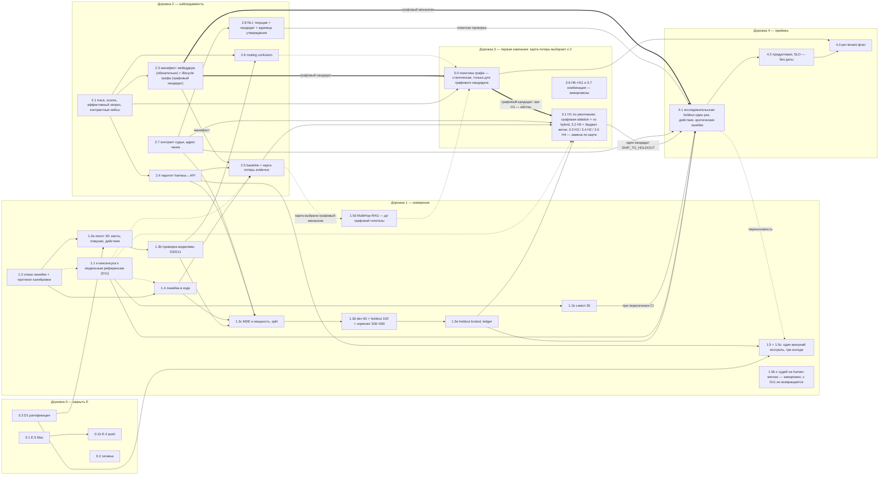

# План повышения качества RAG_new — 03.10.2026

**Статус:** действующий план нити качества после фазы E — редакция 03.10.2026
плана [`plan_final_30_09_26.md`](plan_final_30_09_26.md), который принят и
ратифицирован 30.09.2026 по делегированию Юли и остаётся в репозитории как
история (его шапка — редакции и аудиты 30.09, его §6 — хроника сессии).
Составлена Claude-сессией (Opus 5.5) по поручению Юли 03.10.2026 («Тщательно
изучи проект, нужно обновить план доработки (последний от 30.09) по файлу
D:\Rag_research\2026-10-03_PLAN_INPUT.md»; «Новый план должен быть с датой
сегодня»); HEAD при составлении — `70d272c`. Дополняет
[`plan_06_09_26.md`](../../plan_06_09_26.md) как нить после фазы E; стоп-лист
его §7 сохраняется целиком. Решения D1–D10 (§2) приняты по делегированию 30.09;
D11 — решение самой Юли 03.10 («люди участвовать в процессе не будут»), оно
изменило D2, D3 и D10. Юля вправе пересмотреть любое решение до первого
эксперимента дорожки 3.

**Цель:** один проверенный механизм, который поднимает смысловую точность
отправляемого контекста на locked holdout без потери обязательных фактов и без
роста задержки при равном бюджете кандидатов, доказанный через реальный `/api/ask`.

**Что перенесено.** Весь обязательный текст редакции 30.09 — §0–§5 и §7 —
перенесён дословно; каждое изменённое место названо в §6, других нет. Номера
разделов, слайсов, решений D и пробелов G те же, поэтому ссылки задач MyFlow и
спецификаций на них остаются верными.

**Что изменено 03.10:**

1. Нормализация токенов BM25 записана как исследовательский кандидат **H11 вне
   первой кампании**, с условием возврата: строка G36 в §7, слайс 3.6 в §1,
   граница кампании в §4. Основание — вход исследования лексической ветки
   (`D:/Rag_research/2026-10-03_PLAN_INPUT.md`; его аудит — в §6). Результаты
   исследования остаются в той папке, вне репозитория (решение Юли, ниже).
2. Вместо «фронта готовности» 30.09 — состояние слайсов на 03.10 (§1). В нём
   новый факт: GitHub Actions снова исполняют задания, CI на HEAD красный.
   Исправлено в тот же день: CI зелёный на `45a417a`, прогон 37157492007
   (четвёртая публикация, §6).
3. Хроника сессии 30.09 (§6 прежней редакции) не перенесена; §6 теперь —
   перечень изменений этой редакции.

**Решения Юли 03.10 по этой редакции** — ответы на вопросы её первой
публикации (коммит `028f874`); запись — §2, дополнение 03.10:

1. Порядок работ: сначала фаза E — зелёный CI на HEAD (слайс 0.1b); цепочка
   задач слайса 2.5 — после него (§1, под таблицей состояния). Зелёный CI
   получен 03.10, цепочка 2.5 — следующая работа.
2. Записки об исследовании в репозитории нет: его результаты остаются в
   `D:/Rag_research`. Вместе с запиской снят пункт П4 входа — ссылка на приоры
   второй волны в слайсе 3.6 (§6).
3. Правило «Actions недоступны до октября» удалено из `CLAUDE.md` проекта.

**Решение Юли 03.10 о людях — D11 (§2)**, принято после второй публикации
(коммит `69e46c5`): «запиши все в план. люди участвовать в процессе не будут».
Человеческого труда в плане больше нет — ни оценок и утверждений Юли, ни слепых
проверок, ни второго аннотатора. Их место заняли модели другого поставщика, чем
проверяемая сторона; замены и то, чего план после этого не утверждает, —
таблица под записью D11 (§2). План Юлю не ждёт. За ней остаются решения
владельца: цель развёртывания и SLO, публичность репозитория и Pages,
стоп-лист, новые документы в корпус, список документов, исключённых из отправки
внешним моделям, пересмотр любого решения (строка D11, §2). Восемь вопросов
этих замен были открыты — G38 (§7); к 05.10 все закрыты записями в спеке 1.2,
после D12 — для одной модели.

**Указание Юли 04.10 — D12 (§2):** «ты должен все делать сам». Все работы
плана выполняет Claude-сессия (Opus 5.5); модели других поставщиков не
вызываются ни в какой роли — ни исполнителем, ни ревьюером, ни проверяющей или
референсной моделью, ни судьёй, ни автором исправлений. Где D11 ставил на место
человека «модели другого поставщика», теперь стоит одна модель — Opus 5.5 в
изолированных запросах. Таблицы слайсов ниже читаются с этой поправкой; что
изменено и чего план после этого не утверждает — запись D12 (§2).

**Что не изменено:** состав первой кампании (D8), стоп-лист, пороги и margin
(+0.05, −0.02; 0.63 остаётся на своей линейке — D6, D9), метрики и три исхода
спеки 1.2. Решение D11 изменило в ней одно: кто выставляет и проверяет оценки
и метки — это её пятая редакция (03.10). Числа исследования — лексические
прокси на одном корпусе: не evidence и не срез по правилу (a)/(b)/(c). Редакция
не меняет код и не проходила аудит вторым голосом.

## 0. Что зафиксировано и не пересматривается

- Baseline с production expansion (P1b, `d1adbbb`): H 0.5768 / 0.9800, FULL 97/100;
  Hm 0.3263 / 0.7333, FULL 7/15. Baseline без expansion (GR3, `32de532`):
  H 0.5067 / 0.9050; Hm 0.2527 / 0.5000. Не смешивать.
- Линейка `context_precision` лексическая. P2: α 0.8566, τ_b 0.1561
  [0.0197; 0.2880] → `RULER_DOES_NOT_TRACK`. Порог 0.63 остаётся порогом старой
  линейки до отдельного решения.
- Уже измерено и не повторяется без новой гипотезы: top-k 3, adaptive-k (P1/P1b),
  seed reservation, чистый expansion, query-only control, category prefilter по
  tags (0 совпадений), G1/G2 как третий список (GR3: Hm recall 0.5 → 0.4,
  FULL 4 → 1, p95 +8765 мс).
- `RAG_GRAPH_RETRIEVAL` = `off`. `auto` не подключает projection
  (`vectordb/manager.py:996`, только `on`); пороги auto 20 000 чанков / 0.15
  не выполнены на 5589.
- Стоп-лист: Neo4j/LightRAG/MS GraphRAG, смена vector DB, смена reranker-модели,
  refactor четырёх крупных модулей, новые fixture-кейсы «под гейт».

## 1. Порядок: четыре дорожки, одна нить

WIP = 1. Фаза E — активная нить. Слайсы дорожек 1–2 стартуют **только пока E
заблокирована ожиданием** (очередь Mac, Actions до октября; с 03.10 — решение владельца о публичности и Pages после зелёного CI) и уступают ей,
как только блокировка снята; иное — явное решение Юли. Переключение нити явное:
строка `active: Q-<слайс> while E waits on <что>` в `CURRENT_STATE.md` при входе
и её снятие при возврате к E; ожидание результата незакрытого слайса не
открывает второй слайс той же нити (A11). Дорожка 3 начинается после 1.3e и
зелёного CI на HEAD — инженерной части E (с 03.10, D11; до того — «после
закрытия E или раньше по решению Юли»): публичность и Pages — решение
владельца, план его не ждёт. Роли (GLM-аудит финала №22): *исполнитель* — GLM 5.3
по runbook, кодовые слайсы (2.1–2.4, 2.7, ingestion, 4.3); *агент* — Claude-сессия
по делегированию: документы, черновики набора, карта потерь, аудит 2.6, капсулы
без изменения кода; *референсные и проверяющие
модели* — модели другого поставщика, чем проверяемая сторона: оценки сэмпла,
проверка черновиков набора и ответов (D11); *Юля* — владелец: решения владельца
(перечень — строка D11, §2), в работах
плана не участвует (D11, §2). Таблицы дорожек
ниже — обзор; при расхождении действует таблица слайсов «Нарезка на слайсы».

### Дорожка 0 — закрыть текущее (дни)

| # | Действие | Проверка завершения | Правило слайса |
|---|---|---|---|
| 0.1 | E.5: полный suite на Mac, финальный history scan → капсула. E.4: push, публичность, Pages — когда вернутся Actions (начало октября) | Капсула E.5 в `EVIDENCE_INDEX.md`; зелёный CI на HEAD | E по плану 06.09 (E.5 — подготовка, не (c): числа качества не меняются — Astra-аудит финала №25) |
| 0.2 | Гигиена F9: `ruff check --fix` для I001 (`tests/test_docs_publication.py:3`); Mac-гейт закрепить на pre-commit-версии Ruff 0.15.11; в `docs/windows-test-workflow.md` указать интерпретатор `py -3.13` и правило «полный suite — Mac» | Ruff exit 0 на закреплённой версии | не слайс; в коммит с 0.1 |
| 0.3 | Ратификация Юлей: принять этот план как нить после E (D1 принят по делегированию) — снять пометку «ratification pending» в `ROADMAP.md` и `CURRENT_STATE.md`, закоммитить план и спеку 1.2 | Коммит в `master` — сделан агентом 30.09 по делегированию (`122cfd4`) | — |

### Дорожка 1 — измерение (критический путь; с 03.10 — без участия людей, D11)

| # | Действие | Проверка завершения | Правило |
|---|---|---|---|
| 1.1 | **Линейку проверяют модельные референсы, не человек** (D11, 03.10). Слепой сэмпл 10 кейсов / 50 документов (`reports/p2/human-sample.html`, шкала 0–3) уже оценили [Astra](../evidence/p2-astra-reference-sample.md) и [Opus](../evidence/p2-opus-reference-sample.md); их κ к судьям GLM / Sonnet: Astra 0.8824 / 0.8930 (`54b97d9`), Opus 0.9133 / 0.8950 (`8a1d3b6`). Опубликовать quadratic-κ зарегистрированного консенсуса GLM + Sonnet к каждому референсу с кластерным bootstrap-CI по кейсам. Импорт человеческих оценок (`import_human_grades` в `scripts/p2_blinded_judge.py`) остаётся в коде без применения | Капсула P2 обновлена. Правило заранее: CI κ целиком ≥ 0.7 к каждому референсу → judged precision допустима как рабочая линейка development со статусом `model-cross-checked`; CI пересекает 0.7 → расширить референсный сэмпл до 30 (1.1b) до заявления semantic gain и до приёмки 4.1 — инженерные прогоны и скрининг не ждут, их капсулы `provisional_ruler` (Astra-аудит финала №7); CI целиком ниже 0.7 хотя бы у одного → новый состав судей и пересчёт; порядок ветвей — таблица слайсов и спека 1.2 | (c) |
| 1.2 | Спека метрик в `docs/specs/` ([`semantic-precision-metrics.md`](semantic-precision-metrics.md)): полный список метрик, ответных метрик (`faithfulness`, `answer_fact_coverage`, `citation_correctness`, `abstention_correct`, `action_correct`, `critical_errors`), правило принятия с тремя исходами, MUE/MDE, non-inferiority — по спеке, здесь не дублируется | Спека закоммичена до первого эксперимента дорожки 3 | подготовка |
| 1.3 | Диагностический dev-набор: агент пишет вопросы, evidence spans и обязательные факты по семействам документов; **черновики проверяют две модели двух поставщиков, отличных от поставщика автора черновика** — человек их не утверждает, статус происхождения остаётся `agent_labelled` (D11, 03.10; до того — утверждение Юлей батчами, как T-54). Пилот 30 кейсов (10 single-doc, 10 multi-doc, 4 aggregation, 6 требующих отказа/уточнения; квоты, флаги и поля — таблица слайсов 1.3a/1.3d) → оценка дисперсии → размер dev/holdout. Holdout запирается до дорожки 4. Явно: набор не разблокирует B.2/B.3/B.5 — это не shipment-bound данные | Проверка происхождения labels; split без пересечения семейств | подготовка: правило (b) без человеческого утверждения недостижимо (D11) |

### Дорожка 2 — наблюдаемость и сопоставимость (инженерия, без ожидания Юли)

| # | Действие | Проверка завершения | Правило |
|---|---|---|---|
| 2.1 | Trace каждого `/api/ask`: configured / selected / effective strategy с причиной выбора (в том числе при `unknown` и `simple`), класс и уверенность, `entities`, число кандидатов по источникам, численные rerank scores, документы, удалённые coherence-фильтром, с причиной, время этапов, `graph_version` (штамп corpus/index — в 2.3), токены отправленного контекста, причина fallback. Показать в Evidence tab. Передать `categories` в `get_graph_documents_with_path` (`agent/graph.py:1603`; сигнатура уже принимает) | E2E: ask → trace → admin HTTP; off/on/auto, неизвестный класс, чужой tenant | **(a)** |
| 2.2 | `_rerank` (`vectordb/_base_manager.py:828`) остаётся обёрткой над `_rerank_scored`, возвращающим пары `(Document, score)` с теми же объектами, без мутации metadata (§5); `RAG_RERANK_BATCH` читается при построении retriever (не при импорте модуля); runtime-смена действует после пересборки retriever — документируется; эффективный batch пишется в path | Unit + E2E из 2.1 | в 2.1 |
| 2.3 | Lifecycle графа (F4): штамп версии (corpus SHA + structural hash + entity snapshot id). `_replace_structural_graph` (`ingestion/pipeline.py:384`) не стирает entity-граф молча: либо переизвлечение для изменённых документов, либо сохранение старого снимка со статусом `mismatch` и откатом на structural graph (как сейчас делает загрузчик), не молчаливым hybrid. Покрыть add, update и delete документа, публикацию согласованного снимка corpus/index/entities одной версией и инвалидирование кэшей retriever | E2E: add / update / delete doc → restart → ask при `on` → trace показывает состояние ветки и версию; несовпадение hashes; чужой tenant | **(a)** |
| 2.4 | Паритет harness ↔ API на трёх уровнях: retrieval (id и порядок пула и reranked-списка), отправленный контекст (хэш текста после grading, до prompt и цитат) и эффективный запрос; harness уже переиспользует RRF, coherence и graph expansion, отдельно исполняет только rerank (§5). Baseline — отдельный слайс 2.5 | Паритет на H + Hm | подготовка |

### Дорожка 3 — эксперименты (Mac; один механизм за раз; после 2.1–2.5 и 1.3c; 1.1 — до приёмки)

Первая кампания (D8): карта потерь evidence из 2.5 выбирает **не более двух**
механизмов — по умолчанию 3.1 и 3.2; 3.3–3.5 *заменяют* их, если карта
указывает на entity-ранжирование, cross-ref или категорию, а не дополняют
очередь. Каждый: pre-registered спека в `docs/specs/` → скрининг без генерации
на `agent_labelled` вопросах из dev-семейств → парное сравнение на dev →
капсула `SHIP_TO_HOLDOUT` / `NO_SHIP` / `INCONCLUSIVE` с paired bootstrap по
семействам источников; внешний контроль — один, для итогового механизма
(D7). Порядок по умолчанию по отношению ожидаемой пользы к стоимости:

| # | Гипотеза | Почему в этом месте | Отклонить, если |
|---|---|---|---|
| 3.0 | Политика включения графа — не гипотеза, а pre-registered правило: когда ветка выбирается, какой у неё собственный гейт, ступени shadow → per-tenant → default и откат (детали — таблица слайсов) | Без неё 3.1–3.5 улучшают механизм, у которого нет условия включения; GR-3 показал NO-SHIP-to-default (Hm recall 0.5 → 0.4, FULL 4 → 1, p95 +8 765 мс) | — |
| 3.1 | H1 — сохранять evidence по подвопросам; coherence как мягкое предпочтение вместо удаления singleton при относительной силе ≤0.25 (`_apply_graph_coherence`, `vectordb/_base_manager.py:637`) | Прямо целится в измеренную потерю Hm FULL 4 → 1. Coherence вызывается только графовой веткой (`get_graph_documents_with_path`, `vectordb/_base_manager.py:764`), поэтому H1 — графовый кандидат по конструкции: регистрируются два сравнения — ablation на замороженном пуле графовой ветки (жёсткий отсев ↔ мягкое предпочтение; изолирует механизм) и графовая ветка с H1 против зарегистрированного контроля hybrid при равном бюджете 40 (решает SHIP и гейт ветки 3.0) (Astra-аудит финала №3) | уникальные факты всё ещё исчезают или all-evidence coverage не растёт |
| 3.2 | H5 — бюджет 40 кандидатов + дедупликация до rerank — **настройка бюджета графовой ветки, не самостоятельный механизм** (Astra-аудит финала №3): hybrid при дефолтах уже объединяет vector 20 + BM25 20 с дедупликацией (`config/settings.py:461`, `_rrf_merge`), так что H5 против контроля почти тождествен | Условие p95-гейта ветки 3.0: rerank ~50 с/кейс на i5-7500 при пуле 73–90 против 40 ([GR-3](../evidence/gr3-graph-lane-ab.md)); измеряется внутри графовой ablation (пул 40 против естественного) как равный бюджет кандидатов между руками; слот второго механизма не занимает | падает Recall@candidate по обязательному второму источнику |
| 3.3 | H3 — ранжирование entity-кандидатов: RU/EN aliases, штраф общим узлам, отбор по score вместо UUID до лимита 50; подпункт — exact-lookup редких сущностей (из черновика) | [GR-3](../evidence/gr3-graph-lane-ab.md): G1 − H = +0.0408 precision на H (структурная лента), G2 − G1 = +0.0012 (entity-лента, сработала на 6 из 100 кейсов) — гипотеза, не установленная причинность; подпункты H3 (aliases, штраф, ranking, exact-lookup) проверяются отдельными прогонами | entity linking ошибается чаще; прирост не воспроизводится на dev |
| 3.4 | H2 — один переход по явным `cross_ref` | Нужны размеченные цепочки из 1.3 | новые кандидаты не добавляют нужных evidence |
| 3.5 | H4 — категория из вопроса как мягкий prior | Только после измерения routing confusion классификатора | выигрыш существует лишь при подстановке dataset tags |
| 3.6 | Заморожена в первой кампании вместе с H9 (эмбеддер), H10 (chunking) и H11 (нормализация токенов BM25 — G36, добавлена 03.10) — D8. Вторая волна H6/H7/H8 — только если 3.1–3.5 не закрывают цель. H7 — вне стоп-листа «alternative rerankers» (D4, подтверждено по делегированию 30.09) | — | по критериям аудита §5 |

Комбинация победителей (3.7) в первой кампании заморожена (D8): цель — один
проверенный механизм; в 4.1 идёт один заранее названный кандидат.

### Дорожка 4 — приёмка (один раз)

Две приёмки, не одна (A3, A12). **4.1 исследовательская** на `deproject-mac`:
locked holdout из 1.3e, реальный `/api/ask`, ответы и цитаты, абсолютные
p50/p95, tenant isolation, streaming parity, регрессия на H/Hm. Контракт SHIP —
единый список в спеке 1.2, раздел «Acceptance contract»: первичная метрика
механизма +0.05 с CI95 > 0 на holdout; non-inferiority −0.02 по evidence recall,
fact coverage, faithfulness, полноте ответа и корректности цитат; ни одной
потери критического факта, включая PART-кейсы; delta p95 ≤ 200 мс при равном
бюджете; лексический `context_precision` на H не ниже контроля более чем на
0.02, порог 0.63 печатается рядом (D6); невалидный судья = `invalid`, вне
числителя и знаменателя. Результат — капсула `SHIP_RESEARCH` / `NO_SHIP`.
Дополнено 30.09 (Astra, GLM-аудит финала №10): вердиктов три —
`SHIP_RESEARCH` / `NO_SHIP` / `INCONCLUSIVE`; holdout открывается один раз для
одного заранее названного механизма (G7); обе руки на одном generator fingerprint (G19);
пустая история (G20); отдельно — результаты по `expected_action` и число/тип
критических ошибок, новая критическая ошибка запрещает SHIP (G17); внешний
контроль (D7) — отдельная строка «переносимость», не условие SHIP.
**4.2 продуктовая** — на deployment-цели с абсолютным SLO, которые называет
Юля (D5); без них продуктового SHIP нет. **4.3** — включение per-tenant флагом с
описанным откатом к hybrid, только после 4.2. Условие фазы C по faithfulness
(`ROADMAP.md`) остаётся отдельным гейтом.

### Нарезка на слайсы и граф зависимостей

Слайс — наименьшая единица с собственной проверкой завершения и правилом
(a)/(b)/(c) из `CLAUDE.md` или пометкой «подготовка». **Жёсткая зависимость**
A → B: B нельзя начать, пока A не принят. **Мягкая** A ⇢ B: B выполняется, но
его результат считается предварительным, пока A не закрыт. **Условно-жёсткая** (в графе —
толстая стрелка с подписью «графовый …»): становится жёсткой, когда выбран
графовый кандидат; при H1 по умолчанию — жёсткая (Astra-аудит финала №8).
Порядок внутри одного уровня задаёт WIP = 1, а не зависимость. Номера совпадают с таблицами
дорожек выше; новые слайсы, которых там не было: 1.4, 1.5/1.5b, 2.5, 2.6, 2.7,
2.8, 3.0, 4.2/4.3; 0.1b выделен из 0.1; 1.3e выделен из 1.3c.

| Слайс | Что | Правило | Кто / где | Жёсткие зависимости | Мягкие | Принят, когда |
|---|---|---|---|---|---|---|
| 0.1 | E.5: полный suite на Mac + history scan → капсула | гейт E.5 по правилу E плана 06.09 — подготовка, числа качества не меняются (Astra-аудит финала №25) | исполнитель, Mac | — | — | капсула E.5 в `EVIDENCE_INDEX.md` |
| 0.2 | Гигиена: I001, pin Ruff 0.15.11, `windows-test-workflow.md` | не слайс | Windows | — | — | `ruff check` exit 0; в коммит с 0.1 |
| 0.1b | E.4: push (сделан), зелёный CI на HEAD — инженерная часть; публичность и Pages — решение владельца, остальные дорожки его не ждут (D11, 03.10) | E | агент и исполнитель — CI; Юля — публичность и Pages (gate) | 0.1; Actions доступны | — | зелёный CI на HEAD; публичность и Pages — когда решит владелец |
| 0.3 | D1: ратификация плана — по делегированию Юли, включая D8 (заморозки), D9 (margin), D3 (второй человек) и D10, — коммит плана, спеки 1.2, правок `ROADMAP`/`CURRENT_STATE`/`BACKLOG` и строки об исполнителе в `CLAUDE.md`; пометка «ratification pending» снята | не слайс (процессное) | выполнено агентом 30.09 по делегированию; ревью Юли — постфактум, любое решение можно пересмотреть до первого эксперимента дорожки 3 | — | — | коммит в `master` 30.09 (локальный; push — gate) |
| 1.1 | κ зарегистрированного консенсуса GLM + Sonnet к двум модельным референсам — Astra (OpenAI: поставщик, которого нет среди судей) и Opus (Anthropic, как судья Sonnet, — поэтому контроль, а не независимый голос; порог обязаны пройти оба: свидетельство стороннего поставщика даёт только Astra, но провал к Opus — тоже провал) — на слепом сэмпле 10 кейсов / 50 документов, оценки которого уже опубликованы; quadratic-weighted κ с кластерным bootstrap-CI по кейсам → капсула P2. Человеческих оценок нет и не будет (D11, 03.10): `import_human_grades` и страница сэмпла остаются в репозитории без применения. Протокол калибровки — спека 1.2 (рубрика, единица, ослепление, выборка, CI, ветвление после неопределённого κ, область переноса — G8); в её редакции 03.10 он записан для референсов. Согласие референсов между собой (Astra ↔ Opus 0.9727) печатается как ориентир согласованности — не математический потолок и не основание снижать пороги (G15); второго аннотатора нет, G27 не применяется | (c) | агент; новых запросов к моделям нет — расчёт по опубликованным оценкам | — (протокол в спеке 1.2 записан) | — | капсула с κ и кластерным CI к каждому референсу (10 000 пересэмплирований кейсов, перцентильный интервал, seed 20260925 — константы `evaluation/blinded_judge.py`); ветви читаются по порядку: CI целиком ниже 0.7 хотя бы у одного референса → консенсус как линейка не используется, новый состав судей по правилу спеки 1.2; иначе CI пересекает 0.7 хотя бы у одного → 1.1b; иначе (CI целиком ≥ 0.7 к обоим) → линейка `model-cross-checked`; в капсуле — оговорки: проверка модельная, не человеческая (§4); она не слепа к вероятному исходу (§2); контролей контаминации в сэмпле нет (G38, д) |
| 1.1b | Расширение референсного сэмпла до 30 кейсов: ещё 20 кейсов / 100 документов H, выбранных зарегистрированным seed по тем же квинтилям линейки, оценивают оба референса (судьи консенсуса оценили все 500 документов H в P2). Шаг условный; человеческих часов не требует (D11) | (c) | агент; ≈ 40 запросов к референсам | 1.1 (только если CI κ пересекает 0.7); вопрос д из G38 закрыт | — | капсула с κ на 30 кейсах; к нему один раз применяются те же ветви, что в 1.1; повторно неопределённый κ оставляет линейку `provisional_ruler` — тогда semantic gain не заявляется и holdout для 4.1 не открывается: состав судей один раз перерегистрируется по ветви «ниже 0.7»; не прошёл и он — кампания закрывается без 4.1, дальнейшее решает владелец |
| 1.2 | Спека линейки development ([`semantic-precision-metrics.md`](semantic-precision-metrics.md)); дополнена 30.09 по консультации Astra: протокол калибровки (G8), адрес чанка + `text_sha256` и миграция меток (G16), три исхода и MDE (G13/D9), скрининг, ledger и holdout один раз (G7), контракт 4.1 — действия и критические ошибки (G17), generator fingerprint (G19), одноходовость (G20) | подготовка | зарегистрирована коммитом 0.3, ревью не ждёт; пятая редакция — 03.10 (D11) | — | — | коммит (в 0.3) |
| 1.4 | Линейка в коде: модуль в `evaluation/` считает `precision_at_5`, `sent_precision`, `ndcg_at_5` по judged top-k из P2-артефакта; `evidence_recall_pool` и `all_evidence_coverage` на P2 — `N/A` (в P2 нет gold spans и групп — Astra-аудит финала №16), считаются с первого проверенного моделями gold 1.3b (D11), до того — только unit-тесты на фикстурах; paired bootstrap по семействам с правилом вырожденных разностей (спека) | (c) | исполнитель; Windows focused + Mac-гейт | 1.2 | 1.1 | опубликованные числа development-baseline на P2-артефакте (corpus SHA + code SHA + config) |
| 1.3a | Пилот dev-набора: 30 черновиков (10 single-doc, 10 multi-doc, 4 aggregation, 6 требующих отказа/уточнения — G18) ⊂ будущих 60 dev; исходные секции выбираются случайно с seed, два стиля/генератора вопросов, ≥ 20 % adversarial/unanswerable, поля `question_origin` и `label_origin` (G6); у каждого кейса — evidence spans на источнике с адресом чанка и `text_sha256` (G16), обязательные и критические факты, gold `complexity` (`simple`/не-simple) для 2.6, `expected_action` (ответить / исправить посылку / уточнить / отказаться / передать специалисту), `as_of`, источник полномочий правила и тяжесть ошибки (G17); ловушки пяти типов — ложная посылка, вне корпуса, устаревшее правило, конфликт документов, опасные грузы; пересекающиеся флаги RU→EN, числовые факты, критичные для безопасности; статус `agent_labelled`; реальные support-вопросы включаются отдельно при наличии; здесь же регистрируется список документов, исключённых из отправки внешним судьям (по умолчанию пуст — G31, D10) | подготовка | агент | 0.3 (схема кейса в спеке 1.2 закоммичена); карта семейств документов зарегистрирована (G22: агент строит по источникам и `cross_ref` корпуса из 201 файла; с 03.10 человеческого подтверждения нет — карту регистрирует агент в 1.3b после verify-скрипта, D11) и резерв семейств под holdout — до генерации | предварительная карта потерь по архивам (2.5) — черновики не задерживает | файл набора + verify-скрипт зелёный: квоты, поля, отсутствие пересечения семейств |
| 1.3b | Проверка черновиков пилота моделями (D3 в редакции D11, 03.10; до того — утверждение батчей человеком). Каждый кейс независимо проверяют две модели двух поставщиков, отличных от поставщика автора черновика, по протоколу спеки 1.2 «Label verification»: spans дословно есть в источнике (это проверяет verify-скрипт, не модель), факты следуют из spans, вопрос отвечается по spans, у кейсов отказа и ловушек причина подтверждается по текстам, которые находит контроль, класс и `expected_action` согласованы. Отклонённый кейс один раз исправляет автор черновика, затем проверка повторяется; второй отказ — кейс выбывает. Автор черновика — зарегистрированный генератор кейса (у пилота `gpt-6.1-sol`, OpenAI, поэтому проверяют модели z.ai и Anthropic); если двух подходящих поставщиков нет (квота, сбой), проверка ждёт — кейс с одним проверяющим остаётся `label_check: none`. Здесь же агент регистрирует карту семейств (G22) и резерв holdout; кроме verify-скрипта, их никто не проверяет. Вопрос, оставленный Юле в [капсуле пилота](../evidence/devset-pilot-drafts.md), — добавлять независимые источники или принять независимость на уровне тем с утечкой по `cross_ref` и перекосом резерва — теперь решает агент здесь же, до 1.3c: новые документы в корпус может дать только владелец, поэтому по умолчанию регистрируется второе, утечка и перекос публикуются, область вывода 4.1 сужается до тем и страт, представленных в резерве: страты, по которым в holdout кейсов нет (по данным пилота — претензии, таможня, опасные грузы), капсула 4.1 перечисляет и вывод на них не распространяет; отступление от определения семейства в спеке 1.2 регистрируется в ней до использования | подготовка: правило (b) недостижимо — `real_labelled` даёт только человеческое утверждение (D11) | агент; проверяющие модели (≈ 60 запросов + повторы); Mac — retrieval контроля по кейсам отказа и ловушек (минуты) | 1.3a; проверяющие модели и рубрика зарегистрированы до первой проверки; вопросы а и б из G38 закрыты записью в спеке 1.2 | — | каждый из 30 кейсов либо с пометкой `label_check: model_verified` (происхождение остаётся `agent_labelled`), либо выбыл с причиной; опубликованы доля отклонённых, расхождения проверяющих и число выбывших; карта семейств и резерв зарегистрированы |
| 1.3c | По пилоту: дисперсия парных разностей → сценарный диапазон мощности; для каждой решающей метрики регистрируются n, число кластеров (компоненты графа кейс–семейство), MDE и достижимая мощность — отдельно для MUE +0.05 и для каждой NI-проверки −0.02 (G13); margin −0.02 не ослабляется (D9): недостижимый n → заявленный более крупный MDE (больше независимых семейств дали бы только новые документы, а их может дать только владелец — D11), недоказанный NI = `INCONCLUSIVE`; абсолютные размеры dev и holdout назначаются здесь, до генерации 1.3d (ориентир Astra 60 + 100 — не догма); если по дисперсии пилота n ≈ 100 остаётся, до 4.1 регистрируется, что кампания проверяет только эффекты ≥ опубликованного MDE (при v = 0.10 и n = 100 мощность для +0.05 ≈ 0.35 — GLM-аудит финала №9); максимальный бюджет и решающие критерии фиксируются до результатов holdout; парная дисперсия выбранного механизма уточняется на dev до открытия holdout; разбиение семейств зарегистрировано до любой настройки; до генерации 1.3d — реестр семейств, уже использованных (H/Hm, P1b/P2, просмотренная карта потерь 2.5 — development по определению) и независимого резерва; holdout — только из семейств вне реестра (Astra-аудит финала №13) | подготовка (регистрация n и MDE, числа качества не меняются — Astra-аудит финала №25) | агент, Mac (часы) | 1.3b, 1.4, 2.4, 2.7 | — | капсула с размерами, MDE, мощностью и зарегистрированным split |
| 1.3d | Полный проверенный набор (до 03.10 — «человеческий»; D11) — состав задан **долями**, абсолютные n берутся из 1.3c (GLM-аудит финала №9): dev — 30 % single-doc / 33 % multi-doc / 17 % aggregation / 20 % отказ-уточнение, holdout — 24 % / 40 % / 16 % / 20 % (при ориентире 60 + 100 это 18/20/10/12 и 24/40/16/20); минимумы флагов при этом ориентире, масштабируются с n: RU→EN и числовые факты ≥ 12 в dev и ≥ 20 в holdout, ловушки ≥ 12 / ≥ 20 со всеми пятью типами, критичные для безопасности ≥ 10 в holdout, если правильное поведение дословно задано правилом в корпусе: компетентного человека-проверяющего нет (G18, D11); черновики агента, проверка двумя моделями по D3 в редакции D11, как в 1.3b; отдельно — 300–500 `agent_labelled` вопросов скрининга только из dev-семейств, хранятся отдельно от проверенного набора и в holdout не переходят (G13); все эти черновики до использования проверяет одна модель другого поставщика, чем их автор, отклонённые выбывают, брак > 10 % → переписать генератор и проверить заново (G32 в редакции D11); невыполнимая квота сужает область вывода, а не заполняется фиктивными документами | подготовка: правило (b) без человеческого утверждения недостижимо (D11) | агент; проверяющие модели (≈ 260 запросов на 130 кейсов и 300–500 на скрининг) | 1.3c | — | verify: квоты, split без пересечения семейств; отчёт с реальными размерами и кластерами каждой страты |
| 1.3e | Holdout заперт после проверки моделями (D11; до 03.10 — после утверждения): список id + SHA в капсуле, ни один эксперимент его не читал; development-кейсы в holdout не переходят; holdout открывается ровно один раз — в 4.1 для одного заранее названного механизма; ledger всех dev-конфигураций, включая неудачные, ведётся с первого выбора по данным — с предварительной карты потерь 2.5, не с запирания (Astra-аудит финала №13) — таблица в `docs/evidence/` (дата, механизм, хэш конфига, набор — скрининг/dev/holdout, первичная метрика, CI, вердикт; G28); изменение механизма после просмотра результата требует нового независимого подтверждения (G7) | подготовка | агент | 1.3d | — | капсула с SHA; проверка в verify-скрипте; ledger заведён |
| 1.5 | Внешний бенчмарк (идея Юли 30.09), по [`external-benchmark-candidates.md`](external-benchmark-candidates.md) (рисерч Opus, 29 кандидатов × 10 критериев): **основной — ConditionalQA** (GitHub `haitian-sun/ConditionalQA`, `v1_0/`): retrieval по всем 652 документам gov.uk, вопросы train+dev (test-ответы скрыты), срез 500 = все 105 not-answerable + 395 отвечаемых стратифицированно с seed; `not_answerable` относится к назначенному документу — считается только документно-условный отказ, corpus-level `abstention_correct` не заявляется; evidence размечено людьми на уровне HTML-элементов, у 1 259 вопросов в двух и более секциях одного документа — аналога Hm между документами нет; невыбранные аннотаторами элементы — `unjudged`, не grade 0. Первичная метрика — `all_evidence_coverage` в отправленном контексте на отвечаемых при равном бюджете контекста между руками (иначе expansion поднимает coverage, отправляя почти весь документ); doc-conditioned результат — диагностика с пометкой oracle. Регистрация до прогонов: срез, seed, SHA-256 каждого исходного файла, ревизия Git, версия HTML-преобразования; 339 неоднозначных gold-строк (число подтвердить на закреплённых файлах) хранятся как альтернативы с проверкой секции и смысла, первое совпадение не выбирается; раздельно — разрешение исходного gold и сохранность evidence после ingestion (потеря текста — измеряемая ошибка, порога «≥ 99 %» нет, matching держит spans через границы чанков); gold-элементы, разрезанные чанкингом или поглощённые expansion, регистрируются. Дешёвая линейка на всех 2 623 вопросах (гибрид без rerank и генерации) — только диагностическая метрика candidate recall, не замена CI отправленного контекста; запертые вопросы и их документы (семейства) исключены из просмотра до итогового сравнения (A:267, (x)), полный набор — однократно после фиксации механизма. **Роль в первой кампании (D7): один запертый внешний retrieval-контроль итогового механизма вместе с 1.5c, три исхода; генерация на внешних базах не запускается.** Пилот внешнего контроля (GLM №14, Astra №14): ≈ 50 отвечаемых вопросов ConditionalQA + 40 WixQA (20 ExpertWritten / 20 Simulated) вне решающего среза, обе руки, retrieval-only (≈ 0,5 ночи); по нему до прогона регистрируются отдельно для каждой базы и страты n, кластеры (ConditionalQA — документ, WixQA — набор gold-статей), MDE и сценарная мощность; знаменатель первичной метрики ConditionalQA — 395 отвечаемых, не 500; вопросы пилота в контроль не входят. Ingestion на Mac штатным pipeline в **отдельный tenant / коллекцию**; verify: основной корпус, его SHA и индекс не изменились (№23). Капсула с provenance и лицензией | (c) | исполнитель ingestion; Mac — прогон двух рук после вердикта 4.1 (этап VI) | 0.3, 2.4 (harness принимает внешние датасеты); прогон контроля — после вердикта 4.1 | — | капсула контроля: подтверждение / убедительное противоречие / неопределённо; наружу — агрегаты, атрибуция и provenance без вопросов и текстов; лицензия BSD-2 и принятая оговорка «ONLY NLP research» |
| 1.5b | Валидация relevance-судей на человеческих метках ConditionalQA — **заморожена в первой кампании** (D8; Astra: главный выигрыш 6–12 ч Юли, внешние evidence-метрики считаются без relevance-судьи, внутренняя калибровка 1.1 сохраняется). При возврате с отдельным бюджетом: слепая выборка ≥ 300 пар «вопрос — точный текст чанка» вне сравнительного среза, обе стороны — человеческая оценка по той же шкале 0–3 (невыбранные аннотаторами элементы — `unjudged`; `evidences` — проверка обнаружения evidence, не оценки релевантности); первично quadratic-weighted κ 0–3, бинаризация ≥ 2 выбрана заранее, ≥ 3 — sensitivity, не второй гейт; кластерный CI по документу; контроли контаминации — малый заранее выбранный набор (без evidence / удалён span / подмена / дистрактор), считаются отдельно от естественного κ; 400–500 пар — только после оценки кластеров, CI и бюджета; RusBEIR wikifacts / MIRACL-ru / RuBQ 2.0 — не обязательны. **С 03.10 (D11):** в этом виде слайс не возвращается — человеческой оценки пар не будет; без неё на ConditionalQA остаётся проверка обнаружения evidence по меткам его аннотаторов (чувствительность судьи, без κ 0–3) — отдельным решением (G37) | (c), при возврате | агент, Mac; человеческих часов нет (D11) | 1.5; отдельное решение Юли о бюджете | — | — (с D11 в этом виде не возвращается; прежняя приёмка — капсула κ, при CI κ < 0.7 линейка на бенчмарке `provisional_ruler`) |
| 1.5c | Вторая внешняя база — **WixQA** (HF `Wix/WixQA`, MIT): 400 вопросов — 200 ExpertWritten (реальные обращения, основная страта) + 200 Simulated (синтетические, отдельная страта; R0 §3.2, R0-Sol §2), база знаний 6 221 статья целиком (индексировать `html_content`; сохранность заголовков проверяется относительно закреплённого исходного HTML с публикацией фактических counts, без порога «≥ 3 800»; `feature_request`-статьи остаются в основном индексе, пересчёт без них — отдельная помеченная задача), у 79 вопросов ответ на нескольких статьях. Первичная метрика — хотя бы одна gold-статья в top-5; **решающая страта — ExpertWritten**, Simulated печатается диагностически и в свёртку D7 не входит (Astra-аудит финала №14); все article-id — диагностически, метрика «все статьи обязательны» не заявляется: ручного подтверждения необходимости каждой статьи не будет (D11, 03.10); генерация baseline не запускается. Роль: вторая половина внешнего контроля 1.5 — перенос на реальные вопросы поддержки; ingestion в отдельный tenant / коллекцию, как 1.5 (№23) | (c) | исполнитель ingestion; Mac — по очереди §3 | 1.5 (harness и формат уже есть) | — | капсула контроля WixQA с provenance |
| 1.5d | Третья база, совещательная — **MultiHop-RAG** (609 документов, 2 255 вопросов на 2–4 документа, 301 null; метки GPT-4, половина ответов yes/no → `llm_labelled`; лицензия ODC-BY, тексты СМИ — R0 [S2, S3]; не единственный cross-doc набор — R0-Sol §3) — **заморожена до выбора графовой гипотезы по карте потерь 2.5** (D8); вето на SHIP не имеет, расхождение фиксируется. При возврате: подсрез — inference + null; coverage только на отвечаемых cross-doc кейсах, пустой gold у null ≠ FULL; `title`/`source`/`published_at` вливаются в текст чанка зарегистрированным преобразованием; без генерации `abstention_correct` не считается; наличие обеих статей не доказывает пользу ребра графа — нужна локальная ablation на соответствующих фактах (viii) | (c), совещательный | исполнитель ingestion; Mac | 1.5; карта потерь выбрала графовый механизм | — | капсула baseline с пометкой `llm_labelled` |
| 2.1 | Наблюдаемость маршрута + 2.2 rerank scores и runtime batch — спека §5. Дополнено 30.09 (Astra): исходный и эффективный запрос, тип трансформации (HyDE / rewrite / none) и хэш её config/prompt — по trace воспроизводим фактический вход retrieval, изменение запроса нельзя выдать за эффект coherence или rerank (G4); routing — `configured / selected / effective`, `confidence: null`, пока калибровки нет (G9); 10 контрактных кейсов с фейковым LLM в focused-наборе — источник, цитаты, действие отказа, числовые поля, streaming: детерминированная проверка контракта ответа, не evidence качества модели (G12) | (a) | исполнитель; Windows focused + Mac-гейт | — (0.2 желательно раньше) | — | HTTP-тест ask → trace → evidence зелёный; контрактные кейсы зелёные; Mac-гейт |
| 2.3 | Две части (Astra-аудит финала №4). **Обязательная, до 2.5:** манифест эмбеддера в индексе — id, HF-ревизия (сегодня `SentenceTransformer(model_name)` создаётся без revision, `vectordb/_base_manager.py:333`), размерность, промпты query/doc, нормализация — сверяется при загрузке, совпадение одной размерности не считается совпадением модели (G25, Opus R1 §4.1); несовпадение → отказ загрузки с причиной в trace, прогон на таком индексе — `NOT_EVIDENCE`; нужна и hybrid-руке. **Условная, при графовом кандидате (при H1 — да):** lifecycle графа — спека §5, штамп версии (corpus SHA + structural hash + entity snapshot id) | (a) | исполнитель | 2.1 | — | манифест: подмена эмбеддера той же размерности отвергается тестом, поля манифеста в trace; lifecycle: E2E add doc → restart → ask, статус ветки в trace |
| 2.4 | Паритет harness ↔ API — спека §5; плюс одинаковый эффективный запрос и тип трансформации между harness и API (G4), контрактные кейсы 2.1 проходят и через harness-путь (G12) | подготовка | исполнитель | 2.1 | — | тест паритета на H (100) + Hm (15) с детерминированными фейковыми embedder/reranker из тестового набора (GLM №21); реальное сравнение на 30 кейсах H на Mac до открытия holdout (Astra №21) |
| 2.5 | Новый baseline с production expansion на H + Hm: лексическая и development линейки, тайминги из trace, provenance. **Карта потерь evidence** (G14): для каждого из 100 исторических кейсов — первая наблюдаемая потеря по стадиям индекс → исходный пул → caps/dedup → rerank → coherence/expansion → grading/packing → ответ, либо `unknown` (причину не приписывать); знаменатели и ссылки на артефакты публикуются; предварительная версия по архивам — только стадии индекс → исходный пул → caps/dedup → отправленный контекст (rerank и coherence в архивах не наблюдаемы → `unknown`, №20), до 1.3a, часы агента, не ночи Mac; полная — после 2.1/2.4 с gold. Отдельные строки: RU→EN-страта на текущем эмбеддере (G2) и потери при parent/section expansion (G3). Доказанная потеря на стадии ingestion/индекса (текст gold-span отсутствует в индексе или разрезан так, что matching его не находит) исправляется **до** baseline отдельной кодовой правкой с тестом, baseline затем перезапускается — механизмы не измеряются поверх известной потери ingestion (Astra: G3, консультация A:51). Карта выбирает ≤ 2 механизма дорожки 3 по устранимым потерям и стоимости; доминирование генератора закрывает retrieval-кампанию этим выводом (G1). Provenance фиксирует generator fingerprint (G19) и снимок ingestion / `chunker_version` (G3). Смысловые инварианты реальной модели на dev-кейсах (факт, цитата, действие) — здесь и в 4.1, без точного сравнения строк (G12) | (c) | Mac (baseline); агент (карта) | 2.4, 1.4, 2.3 (манифест) | 1.1 | капсула baseline + карта потерь с выбранными механизмами и обоснованием; обновляется после 1.3d |
| 2.6 | **Условный** (Astra-аудит финала №22): выполняется, если карта выбрала H4 (3.5) или политика 3.0 опирается на класс `simple`; иначе отложен, вердикта нет. Аудит вердиктов маршрутизации при включённом `MODEL_ROUTING_ENABLED`: матрица класс × разметка и `complexity` (`simple`/не-simple) × gold по trace на H + Hm + пилот; цена ошибки `simple` (vector без BM25/rerank, `llm_fast`, пропуск grading) — отдельной строкой; по умолчанию routing выключен и вердикта нет — зафиксировать | (c) | агент, Mac | 2.1, 1.3b | — | капсула confusion matrix по классу и по `complexity` |
| 2.7 | Контракт судей (F8) для обоих потребителей — relevance-судья `evaluation.blinded_judge` (запрос v2 на 1–10 документов, хэш текста в request hash) и generation-судья `scripts/generator_benchmark.py` (~346): строгий парсер; обрезка контекста до 3 000 и ответа до 2 000 символов (~369) снимается либо считается явно — число обрезанных запросов в капсуле, обрезанный запрос помечен `truncated` и вне решающего κ (Astra-аудит финала №20); raw replies с хэшами запросов, различение parse-fail / absent / low; невалидный ответ = `invalid` — вне числителя и знаменателя, считается отдельно, никогда не 0; unit-тесты на архивных ответах P2 (`reports/p2/p2-blinded-judge-glm`, `reports/p2/opus-reference/replies.jsonl`) и GR3 (`reports/gr/gr3-graph-lane-ab.json`; `'Score: 1.0'`). Схема меток — JSON-строки файла набора 1.3a с полями по спеке 1.2 (№21). В схеме запроса и меток — адрес чанка `source_id + source_revision + section_path/offsets + chunker_version` и `text_sha256`, grade дополнительно привязан к `case_id/question_hash`, рубрике и версии судьи; правила миграции меток — спека 1.2 (G16) | подготовка | исполнитель; Windows focused | — | — | оба парсера под тестами; потребители их используют; схема меток с адресом и хэшем |
| 2.8 | Валидация NLI-судьи (запрос Юли 30.09), по рисерчу R2 [`research-nli-judges.md`](research-nli-judges.md): 200 утверждений (80 из C.1b, 120 из C.1a, стратификация по баллу NLI и лексическому пересечению, квоты по типу и языку); сравнить текущий NLI (`MoritzLaurer/mDeBERTa-v3-base-mnli-xnli`, порог 0.5; обрезка до 512 токенов на C.1 не срабатывает — чанки ≤ 313 токенов), LLM-судью и модельный референс — метку большинства трёх моделей разных поставщиков, каждая вслепую размечает все 200 четырьмя метками (ретест 40 — повторный запрос к одной из них, мера её стабильности); человеческой разметки нет (D11, 03.10); первая очередь (G10, Astra): текущая модель, основной кандидат и гипотеза H1 о единице утверждения — остальные модели резерв по конкретному диагностическому результату, полная сетка не прогоняется; кандидаты на тех же утверждениях: `MoritzLaurer/mDeBERTa-v3-base-xnli-multilingual-nli-2mil7` (основной, RU в дообучении, замена id+revision), `cointegrated/rubert-base-cased-nli-threeway` (запасной, другая семья, лицензия в карточке не указана), `KRLabsOrg/lettucedect-v2-mmbert-base` (слот «детектор», zero-shot для RU); «mDeBERTa large-xnli» не существует — при ≤ 4 GiB на Mac `joeddav/xlm-roberta-large-xnli`; MiniCheck/AlignScore/HHEM — только EN, T5-токенизатор даёт 19 % `<unk>` на кириллице; отдельно гипотеза H1 — единица утверждения (склейка вводной строки и вопрос к фрагменту: в C.1a 58 из 81 «не подтверждено» — фрагменты ≤ 3 слов); κ Коэна с кластерным бутстрепом по кейсу, порог — 5-fold GroupKFold, выбор по κ, при ничьей текущая модель. Насыщение 1.0000 на C.1b как дефект судьи не доказано: ответы Qwen3 короткие, 50 из 140 утверждений — дословная подстрока контекста, а опорный LLM-судья — тот же Qwen3-8B с окном 3 000 символов (76 из 100 контекстов длиннее). Попарное согласие трёх референсных моделей публикуется как ориентир согласованности — отдельная рубрика, κ с relevance не объединять (G15 в редакции D11); утверждение без большинства — вне решающего κ, считается отдельно; LLM-судья L (R2 §3.4) регистрируется до разметки с моделью и поставщиком: если его поставщик совпадает с поставщиком одного из трёх голосов, этот голос при оценке L исключается — референс для L есть согласие двух оставшихся, утверждение без их согласия для L вне κ; так же исключается голос поставщика, чей генератор написал утверждение; из R2 §3.3 не применяются разметка Юлей и интервал ретеста 7 дней, флаг AMBIGUOUS заменён на «нет большинства», вопрос R2 о насыщении 1.0 («покажет только человеческая разметка») слайс не закрывает; если генератор приёмки отличается от архивного Qwen3, 40 из 200 единиц заменяются утверждениями этого генератора на dev без роста объёма (G19). Результат — вход ответной проверки 4.1; retrieval-скрининг 3.x он не блокирует | (c) | агент, Mac (≤ 1 ночь); референсные модели — ≈ 640 запросов (200 × 3 + ретест 40) | 2.7; вопросы д, е и з из G38 закрыты | — | капсула κ и порога; выбранная модель, revision и порог зарегистрированы в спеке 1.2 до дорожки 4; судья принят по критериям R2 §5, где κ считается к модельному референсу, не к человеку (D11): out-of-fold κ ≥ 0.6 **и** нижняя CI ≥ 0.4 **и** recall «не поддержано» ≥ 0.7 **и** системная \|Δ\| ≤ 0.05 на C.1a и C.1b; объединение с LLM-судьёй — по правилу R2 (L становится основной метрикой faithfulness при Δκ ≥ 0.10 и P(Δκ > 0) ≥ 0.95, NLI — скрининг); иначе NLI остаётся `provisional_judge` (Astra-аудит финала №20) |
| 3.0 | Политика включения графа (запрос Юли 30.09): pre-registered документ `docs/specs/graph-enablement-policy.md` — правило выбора ветки по классу вопроса и `reason_code` (уверенности у классификатора сегодня нет — её добавление часть спеки), поведение при `unknown`/`simple` (пока accuracy `simple` не доказана в 2.6, `simple` меняет только генератор, не retrieval — отдельная гипотеза), судьба `auto` (пороги 20 000 / 0.15 на корпусе 5 589 недостижимы — переопределить per-tenant или убрать), собственный гейт ветки отдельно от механизмов (recall Hm не ниже hybrid, ни одной потери FULL, p95 в пределах 200 мс при бюджете 40), ступени shadow (граф считает, ответ не меняет, расхождения в trace) → per-tenant → default с критериями перехода и откатом, поведение при `entity_graph_status ≠ matched`. Первая кампания (Astra): статическая политика, model routing выключен (при нём selector даёт `unknown`, `entities=[]` и graph не выбирает — `agent/graph.py:1295`; ветка эксперимента включается явным `RAG_RETRIEVAL_STRATEGY=graph` / параметром harness, не подстановкой gold-класса), `confidence: null` без калибровки — обучаемый routing и R4 вне кампании (G9); ветка рассматривается только для установленной по карте потерь 2.5 группы кейсов, где нужный второй источник или связь отсутствует у контроля, литература (R6) это не заменяет (G11) | подготовка; shadow — (a) с HTTP-тестом | агент спека; исполнитель shadow — только если карта выбрала графовый механизм | 2.1; 2.3 — если карта потерь выбрала графовый механизм; 3.2 (H5) — условие по задержке для ступени per-tenant | 2.6 | спека закоммичена до первого графового эксперимента; shadow-режим под E2E |
| 3.1 | H1 — coherence как мягкое предпочтение (по умолчанию — механизм кампании, если карта потерь 2.5 не указывает иное; второй слот — только по карте). Графовый кандидат по конструкции (coherence только в графовой ветке — Astra-аудит финала №3): регистрируются два сравнения — (1) ablation на замороженном пуле графовой ветки: жёсткий отсев singleton ↔ мягкое предпочтение, изолирует механизм; (2) графовая ветка с H1 против контроля hybrid при бюджете 40 (H5 как настройка) — решает SHIP и гейт ветки 3.0; ветка в руке эксперимента включается явным `RAG_RETRIEVAL_STRATEGY=graph` / параметром harness, не классификатором и не gold-классом | (c); (a) при SHIP | Mac | 2.5 (с картой потерь), 1.3e, 2.3 (манифест и lifecycle), 3.0 (спека) | 1.1 | капсула `SHIP_TO_HOLDOUT` / `NO_SHIP` / `INCONCLUSIVE` по правилу 1.2 — по сравнению (2), результат (1) рядом |
| 3.2 | H5 — бюджет 40 кандидатов + дедупликация до rerank: **настройка бюджета графовой ветки, не механизм и не слот кампании** (№3: hybrid при дефолтах уже даёт пул ≤ 40 с дедупликацией). Измеряется внутри 3.1 как условие гейта 3.0: пул 40 против естественного 73–90 — recall Hm, потери FULL, p95 по протоколу (прогрев исключён, руки чередуются, ≥ 3 повтора на кейс, p95 с bootstrap-CI по кейсам; порог 200 мс сравнивается с верхней границей CI, не с точкой — Astra-аудит финала №21) | (c) внутри 3.1 | Mac | 2.5, 1.3e, 3.0 | 1.1 | строка бюджета в капсуле 3.1: recall Hm не ниже hybrid, ни одной потери FULL, delta p95 ≤ 200 мс при 40 |
| 3.3 | H3 — ранжирование entity-кандидатов — **только по карте потерь** (заменяет 3.1, не дополняет) | (c); (a) при SHIP | Mac | 2.3, 2.5, 1.3e, 3.0 | 1.1 | то же |
| 3.4 | H2 — один переход по `cross_ref` — **только по карте потерь** | (c); (a) при SHIP | Mac | 2.3, 2.5, 1.3e (размеченные цепочки в dev), 3.0 | 1.1 | то же |
| 3.5 | H4 — категория из вопроса как мягкий prior — **только по карте потерь** | (c); (a) при SHIP | Mac | 2.6, 2.5, 1.3e | 1.1 | то же |
| 3.6 | Вторая волна H6/H7/H8, а также H9 (эмбеддер, R1), H10 (chunking, R5) и H11 (нормализация токенов BM25 — G36, добавлена 03.10) — **заморожены в первой кампании** (D8); возврат только с отдельным бюджетом и измеренной причиной по карте потерь, для H11 условие возврата записано в §4 | (c) | Mac | первая кампания закрыта (4.1) | — | капсулы |
| 3.7 | Комбинация победителей — **заморожена** (D8): цель кампании — один проверенный механизм; в 4.1 идёт один заранее названный кандидат; комбинация — новая кампания с новым независимым подтверждением | (c) | Mac | новая кампания | — | капсула комбинации |
| 4.1 | Исследовательская приёмка на locked holdout (открывается один раз — G7): реальный `/api/ask` на `deproject-mac`, пустая история (G20), один заранее названный механизм против контроля на одном generator fingerprint (G19); ответы, цитаты, абсолютные p50/p95, tenant isolation, streaming parity, регрессия H/Hm; проверка ответов двумя референсными моделями двух поставщиков, отличных от поставщика генератора ответа (модели, версии, запрос и рубрика регистрируются до открытия holdout), — вслепую к руке, в перемешанном порядке (G34); критический факт, верность ответа контексту и связь «утверждение — источник» засчитываются, только когда их подтвердили обе модели; человек ответы не проверяет (D11, 03.10); отдельно — результаты по `expected_action` и число/тип критических ошибок: новая критическая ошибка запрещает SHIP, среднее качество её не компенсирует (G17); смысловые инварианты (факт, цитата, действие) вместо точного сравнения строк (G12); контракт — спека 1.2 «Acceptance contract»; повторный прогон на просмотренном holdout — регрессия, не новое подтверждение, включая повтор ответных проверок после смены generator fingerprint (№13) | (c) | Mac (≈ 3 ночи с локальной генерацией); референсные модели — ≈ 400 запросов проверки ответов (100 кейсов × 2 руки × 2 модели) | один кандидат `SHIP_TO_HOLDOUT`, 1.3e, 1.1 с исходом `model-cross-checked` — сразу или после 1.1b (калибровка завершена — №7; на `provisional_ruler` holdout не открывается); вопрос ж из G38 закрыт, 2.7, 2.8 (ответная проверка); 2.3 и 3.0 — для графового механизма, то есть при H1 | — | капсула `SHIP_RESEARCH` / `NO_SHIP` / `INCONCLUSIVE` (последний — «не доказано, не опровергнуто»: дефолт не меняется, кампания закрывается по G26/D9); в капсуле — строка «человек ничего не проверял (D11)»; внешний контроль 1.5 + 1.5c — отдельная строка «переносимость» |
| 4.2 | Продуктовая приёмка на deployment-цели с абсолютным SLO (D5); в план с датой возвращается только после доказанного результата, названной цели и SLO (D8) | (c) | Юля называет цель; исполнитель | 4.1 = `SHIP_RESEARCH`; внешний контроль 1.5 + 1.5c завершён, строка «переносимость» в капсуле (при противоречии — документированное решение Юли после разбора по карте потерь, D7); deployment-цель и SLO названы (Astra-аудит финала №9) | — | капсула с абсолютными p50/p95 против SLO |
| 4.3 | Включение per-tenant флагом с описанным откатом к hybrid — последняя ступень политики 3.0 | (a) | исполнитель; Юля gate | 4.2 = SHIP; 3.0 | — | E2E флаг on/off; гейт 0.63 не тронут |

**Состояние слайсов на 03.10.2026** — заменяет «фронт готовности» редакции
30.09 (Astra-аудит финала №15). Это снимок на дату редакции: HEAD `70d272c` =
`origin/master`, задачи MyFlow T-55…T-70, открытого слайса нет. Четвёртая
публикация (03.10, после зелёного CI на `45a417a`) обновила только строку 0.1b,
строку 2.5 и блок о CI под таблицей; остальные строки — прежний снимок. Живое
состояние ведут [`CURRENT_STATE.md`](../../CURRENT_STATE.md) и
[журнал передачи](../operations/t65-baseline-handoff.md); при расхождении верны
они.

| Слайс | Состояние | Чем подтверждено | Следующий шаг |
|---|---|---|---|
| 0.1, 0.2 | закрыты | T-55, `ff3670c`; [капсула E.5](../evidence/e5-secret-scan.md) | — |
| 0.3 | закрыт 30.09 | `122cfd4` | — |
| 0.1b | **инженерная часть закрыта 03.10: CI зелёный на `45a417a`** | прогон CI 37157492007 на `45a417a`: 11 из 11 заданий прошли; сборка Pages на том же коммите, прогон 37157492017: задание `build` прошло, `deploy` пропущено — репозиторий приватный, ничего не опубликовано. До этого CI был красным от `70d272c` до `df1bf47`; причины и исправления (T-71…T-74) — под таблицей | остаток — публичность и развёртывание Pages, gate Юли; план его не ждёт (D11); следующая работа — цепочка 2.5 |
| 1.1 | **не начат; с 03.10 никого не ждёт (D11)** | модельные референсы опубликованы: [Opus](../evidence/p2-opus-reference-sample.md) (`8a1d3b6`) и [Astra](../evidence/p2-astra-reference-sample.md) (T-56, `54b97d9`); задача T-57 переписана 03.10 — вместо импорта оценок Юли расчёт κ консенсуса к этим референсам | агент: κ с кластерным CI по опубликованным оценкам → капсула; новых запросов к моделям нет; в очереди — после цепочки 2.5 (место выбрал агент — абзац о порядке ниже) |
| 1.1b | условный, не начат | — | только если CI κ пересечёт 0.7 |
| 1.2 | зарегистрирована | коммит 0.3; дополнена 02.10 (T-68: кейсы, которые сбор baseline не смог завершить, — записанные исключения) и 03.10 (перекрёстная ссылка в пункте «Screening tier», §6) | — |
| 1.4 | закрыт, (c) | T-58, `b448ee4`; [капсула](../evidence/semantic-ruler-p2-baseline.md): `precision_at_5` на P2 — H 0.6080, Hm 0.8400; `provisional_ruler`, контексты без expansion | `evidence_recall_pool` и `all_evidence_coverage` — с первого проверенного моделями gold 1.3b |
| 1.3a | подготовлен | T-64, `93b2c42`; [капсула](../evidence/devset-pilot-drafts.md): 30 черновиков `agent_labelled`, квоты 10/10/4/6, 84 черновых семейства | проверка моделями — 1.3b |
| 1.3b | **не начат; с 03.10 никого не ждёт (D11)** | черновики — `evaluation/devset_pilot.jsonl`, карта семейств — `evaluation/document_families.json`; инструмента проверки и поля `label_check` в коде ещё нет, задачи MyFlow нет | агент: зарегистрировать проверяющие модели и рубрику, проверить 30 черновиков, зарегистрировать карту семейств и резерв holdout; до первой проверки — закрыть вопросы а и б из G38; в очереди — после цепочки 2.5 и 1.1 (место выбрал агент). Правило паузы G30 снято (D11): срок 28.10.2026 не действует |
| 1.3c–1.3e | не начаты | — | после 1.3b |
| 1.5, 1.5c | не начаты | — | ingestion — этап IV; прогон контроля — после вердикта 4.1 |
| 1.5b, 1.5d | заморожены (D8) | — | — |
| 2.1/2.2 | закрыты, (a) | T-59, `629f903`; `tests/test_ask_contract_route.py` | — |
| 2.3 | манифест эмбеддера закрыт, (a); lifecycle графа — условный, не начат | T-61, `67e7be1`; `tests/test_ask_embedder_manifest.py` | lifecycle — при графовом кандидате |
| 2.4 | тест паритета подготовлен; реальное сравнение на 30 кейсах H прогнано на Mac 03.10 и **не опубликовано** | T-62, `a9e3b29` (`tests/test_harness_api_parity.py`); раннер — T-66, `c729b23` | T-67: капсула и строка evidence; до публикации — `NOT_EVIDENCE` |
| 2.5 | **в работе:** предварительная карта по архивам опубликована, (c); сборщик baseline подготовлен | T-63, `c9d3b8c`, [капсула](../evidence/evidence-loss-map-prelim.md); T-68, `af93851` | зелёный CI получен 03.10 (условие решения Юли 03.10 выполнено): T-69 (пересудейство судьёй v2; заготовка на ветке `wip/T-69-prep`) → T-67 → T-70 (полная карта; сведения для сверки из входа исследования названы в постановке задачи, §6) → T-65 (baseline на Mac) |
| 2.6 | условный, не начат | — | после 1.3b, если карта выберет H4 или политика 3.0 опирается на `simple` |
| 2.7 | закрыт, подготовка | T-60, `b5481db` | — |
| 2.8 | не начат | зависимость 2.7 закрыта | ≤ 1 ночь Mac и ≈ 640 запросов к референсным моделям (D11) |
| 3.0–3.5 | не начаты | — | после 2.5 с картой и 1.3e |
| 3.6, 3.7 | заморожены (D8); 3.6 дополнен H11 | G36 | — |
| 4.1–4.3 | не начаты | — | — |

По этапам §3 нить находится в этапе II: манифест 2.3, тест паритета 2.4 и
линейка 1.4 готовы; до baseline 2.5 остаются T-69, T-67, T-70 и сам прогон T-65.

**CI на 03.10** (разовая проверка через `gh run view`; прогоны не
перезапускались). Задания исполняются, то есть блокировка «Actions недоступны»
снята; правило о ней Юля 03.10 убрала из `CLAUDE.md` («уже октябрь»). Красное
на утро 03.10 (историческое наблюдение):

- `test-unit` (3.11 и 3.13). 11 тестов артефактов вызывают
  `git show <sha>:<путь>` и получают код 128: в `ci.yml` полная история
  (`fetch-depth: 0`) задана только у одного задания. Ещё один тест,
  `tests/test_gr_multihop_cases.py`, читает файл корпуса из
  `data/uploads/aircargo/`, а `data/*` стоит в `.gitignore`. Все эти тесты
  добавлены после последнего зелёного прогона CI (`386ee10`, 10.09.2026).
- `pre-commit` и `security`. `pip-audit` сообщает новые advisory у `anyio`,
  `oauthlib`, `pyjwt`, `pypdf`, `sentence-transformers`, `urllib3`.
- Сборка Pages: шаг `npm audit`.

**Итог 03.10.** CI был красным от `70d272c` (прогон 37093493571) до `df1bf47`
(прогон 37137697604; сборка Pages — прогон 37137697647): `test-unit` 3.11 и
3.13, `pre-commit`, `security`, в сборке Pages — шаг `Audit npm dependencies`.
Причин оказалось больше, чем в списке выше: к нему добавились дефект продукта
(T-71), хуки пробелов и конца файла (T-72) и advisory без исправленного релиза
(T-74). Исправления:

- T-71, `22bb68a`: плавающие падения 3.13 «trace not found» были дефектом
  продукта. Контекст запроса (срок, бюджет LLM) оставался на потоке общего
  пула и доставался следующему запросу; исправлена изоляция, тест
  `tests/test_request_context_isolation.py`, строка уже в `EVIDENCE_INDEX.md`.
- T-72, `f197481`: 11 тестов артефактов читали историю по SHA, а checkout
  `test-unit` содержал один коммит — заданию дана полная история
  (`fetch-depth: 0`). `tests/test_gr_multihop_cases.py` теперь пропускается
  без корпуса из gitignored `data/uploads`. Хуки `trailing-whitespace` и
  `end-of-file-fixer` переписывали побайтно закреплённый отчёт и документ без
  завершающей строки: `reports/` исключён из хуков, документ исправлен.
  Проверки: `tests/test_github_workflows.py`, `tests/test_precommit_config.py`.
- T-73, `ebc343b`: у шести Python-пакетов есть исправленные релизы — подняты
  полы `anyio`, `oauthlib`, `pyjwt`, `pypdf`, `sentence-transformers`, `urllib3`,
  пересобраны оба lock. `sentence-transformers` ограничен `<6`: ветка 6.x не
  оценивалась. Тест `tests/test_pip_audit_floors.py`. Не проверен
  sentence-transformers из lock с реальными моделями: Mac venv собран не из lock.
- T-74, `45a417a`: из трёх npm-advisory у `dompurify` и `fast-uri` есть
  исправление — подняты полы. У `http-cache-semantics` (GHSA-ch52-4w7c-c8xp,
  high) исправленного релиза нет: одно датированное исключение по id,
  [ADR 0009](../adr/0009-npm-advisory-without-fix.md). Pages теперь выполняет
  `npm run audit:deps`, правила — в ADR. Тесты:
  `tests/test_docs_site_npm_audit_gate.py`, `tests/test_docs_site_npm_audit.py`,
  `tests/test_npm_audit_floors.py`. Исключение добавлено 2026-10-03, истекает
  2026-11-03; пересмотр 2026-10-24 вместе с игнорами ChromaDB (ADR 0008).
  С 2026-11-04 сборка Pages и unit-тесты красные до продления или снятия
  записи — так задумано.

CI зелёный на `45a417a` (push 2026-10-03), прогон 37157492007: 11 из 11
заданий прошли; `test-unit` — 4650 passed, 41 skipped на обеих ногах, покрытие
на 3.13 — 78.89% при пороге 72.0%; `test-integration` — 93 passed, 1 skipped
на обеих ногах. Сборка Pages на том же коммите, прогон 37157492017: задание
`build` прошло (шаги `Audit npm dependencies`, `Type-check docs site`,
`Build`), задание `deploy` пропущено — репозиторий приватный, ничего не
опубликовано.

Это не слайс качества, а условие слайса 0.1b («зелёный CI на HEAD»): чисел
качества здесь нет. Об исполнителе: 03.10 GLM 5.3 второй раз вернул `1310`
(недельный лимит, сброс 2026-10-05 05:56 UTC+8). Повтора не было; по политике
[runbook](../operations/direct-glm-5.3.md) тест T-73 и тесты с ремонтом T-74
написал Codex GPT-6.1-Sol (профиль `cw`), замена раскрыта в сообщениях
коммитов `ebc343b` и `45a417a`.

**Порядок — решение Юли 03.10.2026: сначала фаза E, то есть зелёный CI на HEAD
(0.1b); цепочка 2.5 — после него.** Решение совпадает с правилом начала §1:
фаза E — активная нить, а слайсы дорожек 1–2 уступают ей, как только её
блокировка снята. Условие выполнено 03.10: CI зелёный на `45a417a` (прогон
37157492007). Что из этого следует:

- следующая работа — цепочка 2.5: T-69 → T-67 → T-70 → T-65. Публичность
  репозитория и Pages остаются отдельным gate Юли (0.1b), план его не ждёт;
- первой идёт T-69: её заготовка сохранена на ветке `wip/T-69-prep`, порядок
  возобновления — в [журнале передачи](../operations/t65-baseline-handoff.md).
  Оговорка правила начала остаётся в силе: пока фаза E сама заблокирована
  ожиданием (например, очередью Mac), слайс дорожки 1–2 начать можно, и он
  уступает ей, как только блокировка снята;
- слайсы 1.1 и 1.3b с 03.10 — работа агента и моделей, а не часы Юли (D11, §2).
  Они встают в ту же очередь: после зелёного CI и цепочки 2.5 — сначала 1.1
  (задача T-57), затем 1.3b. Место в очереди выбрал агент: порядок Юли назван
  для инженерных работ, а эти слайсы ими стали. Слайс 1.1 можно поднять выше:
  ему не нужны ни Mac, ни новые запросы к моделям.

Исполнитель GLM получает контекст в запросе; репозиторий читает и патч
применяет ведущий агент (runbook). Ожидание Mac-гейта не открывает второй WIP.

**Критический путь инженерии:** 2.1 → 2.4 → 2.5 с картой потерь → один–два
механизма дорожки 3 → 4.1 → 4.2 (только если владелец назовёт цель и SLO; без даты, план этого не ждёт) → 4.3; 2.3 (манифест эмбеддера — всегда, до 2.5;
lifecycle — при графовом кандидате) и 3.0 — при графовом кандидате, то есть уже
при H1 по умолчанию (Astra-аудит финала №3, №4).
**Критический путь набора и линейки** (до 03.10 — «критический путь Юли»; по
решению D11 это работа агента и моделей): 0.3 → 1.3a → 1.3b → 1.3c → 1.3d →
1.3e (открывает дорожку 3) и 1.1 (открывает 4.1); объём запросов — §3. Задержка
1.1 и 1.3b сдвигает дорожку 3, но не инженерию 2.1, 2.3, 2.4, 2.7 и карту по
архивам; 2.5 baseline ждёт 1.4, а 1.4 — коммита спеки 1.2 в 0.3 (Astra-аудит
финала №15); 2.6 ждёт 1.3b.

**Что считается semantic gain:** только результат 3.x или 4.1 на линейке 1.4
после закрытия 1.1 с CI κ целиком ≥ 0.7 к каждому модельному референсу, а на
expanded-контекстах и новых классах вопросов — ещё и после референсной
подвыборки (спека 1.2, «Scope»; строки слайса у неё пока нет — G38, г). До
этого капсулы 3.x помечаются `provisional_ruler`. С 03.10 (D11) это прирост на
линейке, проверенной моделями (`model-cross-checked`), а не человеком: каждая
капсула говорит это прямо, статус `human-validated` в плане не применяется.
С 05.10 (D12, восьмая редакция спеки 1.2) новые тексты оценивает один судья,
Opus 5.5: результат 3.x на его оценках — прирост «на линейке `single_judge`»,
и только после того, как повторная оценка подвыборки тем же судьёй (stability
retest в 2.5) дала CI κ целиком ≥ 0.7; `model-cross-checked` к таким
результатам не применяется, с числами консенсуса они не сравниваются. Правила
4.1 переписываются до открытия holdout.
Скрининг на `agent_labelled` вопросах ранжирует кандидатов и semantic gain не
даёт. Лексическая линейка и гейт 0.63 ни одним слайсом не меняются.

## 2. Точки решения — приняты 2026-09-30 по делегированию

D1–D10 приняты 30.09 по делегированию; D11 — решение самой Юли от 03.10.2026;
D12 — её указание от 04.10.2026.
Заголовок раздела сохранён: на него ссылаются другие файлы.

| # | Вопрос | Решение | Что осталось за Юлей |
|---|---|---|---|
| D1 | Принять план как нить после E | **Принят по делегированию**; ратификация Юлей — шаг 0.3 до старта дорожки 3; в `ROADMAP.md` и `CURRENT_STATE.md` стоит пометка «ratification pending» | — (ратифицировано по делегированию 30.09; пересмотр возможен до первого эксперимента дорожки 3) |
| D2 | Проверка линейки на сэмпле 10 кейсов P2 (до 03.10 — «человеческая оценка») | **Изменено 03.10 решением D11** (прежняя формулировка — редакция 30.09: оценка не делегируется, решает человеческий κ). Человеческой оценки сэмпла не будет. Модельная оценка человеческой не становится — поэтому статус `human-validated` из плана снят, а линейку проверяют модельные референсы. Рабочая линейка development: зарегистрированный P2 lower-median консенсус GLM + Sonnet (α 0.8566). Правило: публикуется quadratic-κ консенсус ↔ каждый из двух референсов — Astra (OpenAI: поставщик, которого нет среди судей) и Opus (Anthropic, как судья Sonnet: контроль, не независимый голос) — с кластерным bootstrap-CI по кейсам; порог обязаны пройти оба референса, ветви читаются по порядку: CI целиком ниже 0.7 хотя бы у одного → консенсус как линейка не используется: development-результаты на нём пересчитываются на новом составе судей (человеческих оценок для пересчёта нет), и до того ни один не считается semantic gain; новый состав называется до сравнения его оценок с референсом и проверяется этим правилом один раз — на новом референсном сэмпле по зарегистрированному seed, с референсом от поставщика вне состава; иначе CI пересекает 0.7 хотя бы у одного → расширение референсного сэмпла до 30 кейсов (1.1b), к κ на 30 кейсах те же ветви применяются один раз; иначе (CI целиком ≥ 0.7 к обоим) → линейка `model-cross-checked`. Область `model-cross-checked` — данные сэмпла (классы вопросов, невыделенные контексты P2); для новых классов и expanded-контекстов — референсная подвыборка ≥ 10 кейсов на класс до любого semantic gain; повторно неопределённый κ после 1.1b оставляет линейку `provisional_ruler` — тогда semantic gain не заявляется и holdout для 4.1 не открывается: состав судей один раз перерегистрируется по ветви «ниже 0.7»; не прошёл и он — кампания закрывается без приёмки 4.1, дальнейшее решает владелец (A1; до 03.10 «решение Юли» стояло сразу после повторно неопределённого κ). Продуктовый gate 0.63 не тронут | — (D11: оценка 50 документов с Юли снята) |
| D3 | Проверка кейсов dev-набора и holdout (до 03.10 — «утверждение батчей») | **Изменено 03.10 решением D11** (прежняя формулировка — редакция 30.09: утверждение остаётся человеческим, Юля или назначенный ею человек). Черновики пишет агент со статусом `agent_labelled`; человек их не утверждает. Каждый кейс независимо проверяют две модели двух поставщиков, отличных от поставщика автора черновика, по протоколу спеки 1.2 («Label verification»): подтверждён обеими → пометка `label_check: model_verified`; отклонён → одно исправление и повторная проверка обеими; второй отказ → кейс выбывает; доля отклонённых, расхождения проверяющих и число выбывших публикуются. Модель человеком не становится: статус происхождения остаётся `agent_labelled`, `real_labelled` этим планом не присваивается, число реальных размеченных кейсов не растёт — 1.3b и 1.3d по правилу слайса считаются подготовкой, не (b). Human–human κ и аудит делегированных кейсов сняты вместе со вторым человеком (G15). Разбиение по семействам регистрируется до любого использования данных для настройки (1.3c); кейсы, которые видел development, в holdout не переходят; holdout запирается после проверки (1.3e) и открывается один раз (G7) | — (D11: утверждение батчей и карты семейств с Юли снято) |
| D4 | H7 и стоп-лист «alternative rerankers» | H7 — правило отбора по scores существующего reranker, не смена модели → **вне стоп-листа**; остаётся во второй волне (3.6) | — (подтверждено по делегированию 30.09: H7 вне стоп-листа, вторая волна) |
| D5 | Целевое железо и абсолютный SLO | `deproject-mac` — единственный измеренный хост, **не** объявляется целевым железом (решение владельца); абсолютные p50/p95 публикуются в каждой капсуле. Абсолютный SLO **не регистрируется** до появления deployment-цели (условие разморозки «a real deployment» в `ROADMAP.md`); действует относительный gate delta p95 ≤ 200 мс при равном бюджете, плюс поэтапные тайминги из trace — для исследовательской приёмки 4.1; продуктовая приёмка 4.2 без deployment-цели и SLO невозможна (A12) | Назвать deployment-цель и SLO — условие 4.2 (на 30.09 цели нет: 4.2 без даты, решено по делегированию) |
| D6 | Нужен ли проход 0.63 на лексической линейке для продуктового SHIP | **Не требуется**: ни одна измеренная рука его не прошла, а линейка не отслеживает смысл (P2); в контракт входит non-inferiority −0.02 к контролю на ней, порог печатается рядом. Условие фазы C по faithfulness (≥ 0.90, `ROADMAP.md`) остаётся отдельным гейтом и в 4.1 входит как NI плюс абсолютное значение. При недостаточной мощности NI не «проходит по умолчанию» — исход `INCONCLUSIVE`, включение не разрешается (D9) | — (подтверждено по делегированию 30.09: 0.63 не условие SHIP, печатается рядом, NI −0.02 к контролю остаётся) |
| D7 | Внешний академический бенчмарк (идея Юли 30.09) | **Принят как второй, не главный, набор** — все три базы с ролями (ConditionalQA 1.5: структурный evidence-контроль, отказы, многосекционность; WixQA 1.5c: перенос на реальные вопросы поддержки; MultiHop-RAG 1.5d, `llm_labelled`, совещательная: cross-doc диагностика). **Правило пересмотрено 30.09 по консультации Astra (принято предложение Sol (iv)):** SHIP решается по нашему holdout; вместо «−0.02 и знак на каждом эксперименте» — **один запертый внешний retrieval-контроль итогового механизма** на ConditionalQA + WixQA с тремя исходами: *подтверждение* — точечный эффект ≥ 0 и нижняя CI95 ≥ −0.02; *убедительное противоречие* — верхняя CI95 < −0.02; иначе *неопределённо*. Свёртка двух баз (GLM-аудит финала №11, Astra №14): базы печатаются раздельно, у каждой своя первичная метрика, знаменатель, кластер и сценарий мощности; для WixQA решает страта ExpertWritten; *подтверждение* — на обеих; *убедительное противоречие* хотя бы на одной запрещает заявление о переносимости; иначе — неопределённо. Неопределённость ≠ внутренний NO_SHIP; противоречие переводит переход к 4.2/4.3 в явное решение Юли после обязательного разбора по карте потерь (оговорка GLM-аудита к D7) с объяснением в капсуле; настройка по внешнему результату расходует контроль. Внутренние обязательные NI сохраняются; n и MDE внешнего контроля назначаются по пилоту ≈ 50 вопросов ConditionalQA (слайс 1.5), до прогона. Из принятия трёх баз не следует три прогона на каждый эксперимент: генерация на внешних базах не запускается, 1.5d заморожена до графовой гипотезы, 1.5b — до отдельного бюджета. Graph-лента на внешних базах может не иметь смысла — оговаривается в капсуле. Стоимость: ingestion 1–2 ночи один раз, две retrieval-руки на 500 + 400 вопросов ≈ 6 ночей. Лицензия ConditionalQA: BSD-2 в репозитории, README требует «ONLY NLP research» — оговорка принята Юлей 2026-09-30 (исследовательское использование внутри приватного репозитория; наружу — агрегаты, атрибуция и provenance без вопросов, evidence-строк, срезов, чанков и эмбеддингов; согласие рецензентов — не юридическое подтверждение) | — |
| D8 | Состав первой кампании (консультация Astra 30.09; по делегированию Юли «прими решения сам, нужен очень качественный результат») | Новых слайсов нет — все 21 дыра закрыты правками слайсов, спеки 1.2, §3 и §4. Схема: широкий retrieval-скрининг без генерации на 300–500 `agent_labelled` вопросах из dev-семейств → карта потерь evidence (2.5) выбирает ≤ 2 механизма → один заранее названный кандидат → holdout один раз (4.1) → один внешний контроль. **Заморожено в первой кампании:** 3.3–3.5 как обязательная последовательность (заменяют по карте потерь, не дополняют), 3.6 (H6–H8), H9 эмбеддер (R1 — справочно) и H10 chunking (R5), 3.7 комбинация, полная 1.5b и RusBEIR/MIRACL/RuBQ, 1.5d до графовой гипотезы, генерация на внешних базах, R3/R4/R6 как обязательные рисерчи и обучаемый routing, полная сетка моделей 2.8, HyDE-ablation, большой closed-book прогон Qwen3, 4.2/4.3 как обещание даты. **Не урезается:** provenance, gold критических фактов, проверка точного отправленного контекста, изоляция holdout, проверки критических ошибок. Возврат замороженного — отдельный бюджет и измеренная причина по карте потерь | — (подтверждено по делегированию 30.09, D10) |
| D9 | Мощность и margin −0.02 на малом наборе (G13) | **−0.02 не ослабляется.** MUE остаётся +0.05; MDE и достижимая мощность публикуются отдельно для каждой решающей метрики и дизайна (n, число кластеров, CI); если MDE выше MUE, исследование рассчитано на обнаружение более крупных эффектов; широкий CI не доказывает ни равенства, ни провала; недоказанный обязательный NI → `INCONCLUSIVE`, включение механизма не разрешается. Перенос мощности между стадиями (скрининг → отправленный контекст → ответ) запрещён — они измеряют разные величины. Иллюстрация Astra/Sol: при n = 100 и дисперсии парной разности 0.10–0.20 MDE ≈ 0.09–0.125; +0.05 при v = 0.10 требует ≈ 314 независимых пар, NI −0.02 при истинном нуле ≈ 1 960. Кластеры — компоненты графа кейс–семейство, не произвольный коэффициент. После `INCONCLUSIVE` или `NO_SHIP` в 4.1 (G26): капсула с полным ledger, кампания закрывается записью в `ROADMAP.md`, дефолт не меняется; вторая кампания — новые независимые семейства и новый holdout, просмотренный holdout остаётся регрессионным набором | — (подтверждено по делегированию 30.09, D10) |
| D10 | Остаток второго прохода — пауза (G30), внешние судьи (G31), проверка черновиков скрининга (G32), второй человек (D3/G15); подтверждение D8/D9 | **Принято 30.09 по делегированию Юли** («все решения сделай за меня, исходя из максимального качества финального продукта»); **три пункта изменены 03.10 решением D11** (прежние формулировки — редакция 30.09). *Пауза (G30):* снята — правило «4 недели после коммита 0.3 без старта 1.3b → `paused`» страховало от ожидания человеческих часов, которых в плане больше нет; срок 28.10.2026 не действует. Остаётся проверка при любом возобновлении работы над набором: сверяется corpus SHA — изменился → карта семейств и зависимые метки `needs_review`; зарегистрированные спеки, семейства и заморозки остаются в силе. *Внешние судьи (G31):* консенсус GLM 5.3 + Sonnet остаётся, как в P2 (качество линейки важнее экономии); наружу уходят только тексты чанков и вопросы — без tenant-метаданных, путей и имён файлов; с 03.10 тем же поставщикам и OpenAI (поставщик референса Astra) уходят также ответы системы и утверждения из них, потому что вместо человека их проверяют модели (2.8, 4.1), и черновики кейсов dev и holdout целиком — вопрос, тексты spans, факты, эталонный ответ, класс и `expected_action`, а у кейсов отказа ещё тексты пула контроля (1.3b, 1.3d): источник называется псевдонимом, не именем файла; gold holdout тем самым уходит проверяющим до запирания — экспериментом это не считается, капсула 1.3e это указывает; список документов, исключённых из отправки, регистрируется в 1.3a (по умолчанию пуст, пополняет Юля); объём вызовов и число текстов публикуются в капсуле, сырые тексты в капсулы не попадают. *Черновики скрининга (G32):* все черновики до использования проверяет одна модель другого поставщика, чем их автор; отклонённые выбывают; брак > 10 % → генератор переписывается, проверка повторяется. *Второй человек (D3/G15):* не привлекается, как и первый; human–human κ и делегирование утверждений сняты; ориентир согласованности — согласие референсных моделей; межэкспертная воспроизводимость не заявляется (§4). *D8 и D9* подтверждены как окончательные | — (список исключений пуст; пополнить его может только владелец — это решение, а не труд) |
| D11 | Участие людей в работах плана | **Решение Юли 03.10.2026: «люди участвовать в процессе не будут».** Человеческого труда в плане нет: ни оценок и утверждений Юли, ни слепых проверок, ни второго аннотатора. Что чем заменено и чего план после этого не утверждает — запись под таблицей. Замены подобрал агент, исполняя решение; Юля их не выбирала, второй голос их не аудировал | Решения владельца — они не труд, и план их не ждёт: цель развёртывания и SLO (D5 → 4.2/4.3), публичность репозитория и Pages (0.1b), стоп-лист, новые документы в корпус, список документов, исключённых из отправки внешним моделям, пересмотр любого решения |
| D12 | Кто выполняет работы и проверки плана | **Указание Юли 04.10.2026: «ты должен все делать сам»** (в начале сессии: «Работай сам - все делай сам… тебе все нужно делать самому»; о вызове проверяющей модели: «А причем тут glm???»). Все работы плана выполняет Claude-сессия (Opus 5.5): код, тесты, документы, проверки. Модели других поставщиков не вызываются ни в какой роли — ни исполнителем (GLM 5.3, Codex), ни ревьюером, ни проверяющей или референсной моделью, ни судьёй, ни автором исправлений. Там, где D11 ставил на место человека «модели другого поставщика», теперь одна модель — Opus 5.5 в изолированных запросах без состояния и без инструментов. Правило двух поставщиков подобрал агент, исполняя D11; формулировкой Юли оно не было. Что изменено и чего план после этого не утверждает — запись D12 под таблицей | Вернуть голос другого поставщика — её решение; план его не ждёт |

**Запись D12 (04.10.2026).** Указание меняет исполнение, не цели: состав
кампании (D8), пороги и margin (D6, D9), метрики и три исхода прежние.

- *Исполнитель.* Кодовые слайсы пишет и проверяет сессия; гейты — на Mac, как
  раньше. Строка «Executor: GLM 5.3» в `CLAUDE.md` проекта не менялась: это
  файл владельца, расхождение названо в журнале сессии.
- *1.3b и 1.3d — проверка черновиков.* Один проверяющий, Opus 5.5 (Anthropic;
  автор черновиков пилота — модель OpenAI): рубрика `label-verification/v2`
  спеки 1.2. Статус подтверждённого кейса — `single_model_verified`;
  `model_verified` остаётся словом для проверки двумя поставщиками и этой
  работе не присваивается. Отклонённый кейс один раз исправляет сессия — та же
  модель, что проверяет; второй проход поэтому проверяет согласованность
  исправления, а не даёт независимый голос, и такие кейсы считаются отдельно.
  В той же версии рубрики: три флага, которые скрипт вычисляет из метки
  (`numeric`, `ru_to_en`, `adversarial_unanswerable`), проверяющему не
  отправляются и им не оцениваются; «исправление», не изменившее метку, не
  принимается (повторный запрос был бы второй попыткой той же проверки); у
  объявленного выбывания второе основание — `repair_not_possible` с причиной
  в одну фразу, когда вопрос нельзя исправить, не меняя его.
  *Записано 05.10 (десятая редакция):* для 1.3d — рубрика
  `label-verification/v3`: тот же промпт по чистому маршруту (ниже).
  Черновики 1.3d пишет та же модель, что их проверяет, — каждый в отдельном
  запросе без состояния; статус такого кейса — `single_model_self_checked`,
  и это проверка согласованности метки с её источниками, а не чужой взгляд.
  Исправление по v3 пишет отдельный запрос без состояния по
  зарегистрированному промпту, а не сессия, ведущая план; исправленный кейс
  получает тот же статус `single_model_self_checked`: автор его метки —
  проверяющая модель.
  Выбывший кейс заменяется по зарегистрированному порядку (вопрос в из G38).
  30 кейсов пилота проверяются по v3 заново, оба набора вердиктов
  публикуются рядом. Запросы 1.3b ушли по прежнему маршруту: проба показала,
  что такой запрос несёт, кроме промпта, файл инструкций владельца и вывод
  двух хуков; вердикты остаются опубликованными, в капсуле T-78 это сказано.
- *Судьи релевантности (2.5 и дальше).* Новые оценки ставит один судья, Opus
  5.5; прогон помечается `single_judge`. Опубликованные числа консенсуса GLM +
  Sonnet (P2, 1.1, 1.4) остаются как есть; число одного судьи с ними не
  сравнивается как дельта. Правило записывается в спеку 1.2 до первой оценки
  слайса 2.5. *Записано 05.10 (восьмая редакция):* судья — тот же маршрут и те
  же аргументы, какими Opus оценивал референсный сэмпл P2 (κ к консенсусу
  0.9604, CI95 [0.9087, 1.0000] — число опубликовано до правила, выбор судьи к
  нему не слеп); вместо референсной подвыборки для expanded-контекстов —
  повторная оценка 10 кейсов на подмножество тем же судьёй в другом слепом
  порядке, κ двух проходов с порогом 0.7 (вопрос г из G38); повтор показывает
  устойчивость одной модели, вторым голосом он не является. Инструмент
  судейства baseline маршрутов к GLM и Sonnet больше не держит.
  *Изменено 05.10 (десятая редакция), до первой оценки:* аргументы
  референсного сбора P2 не используются — запрос с ними несёт, кроме
  промпта, файл инструкций владельца и вывод хуков. Судья спрашивается по
  чистому маршруту (`evaluation/isolated_request.py`) с тем же системным
  промптом; κ 0.9604 описывает модель на прежнем маршруте и остаётся
  ориентиром, а не измерением нового. Добавлены контроли загрязнения из
  подтверждённых gold spans (вопрос д из G38): вырезанный span и чужой
  документ, с двумя границами грубого сбоя.
- *2.8 и 4.1.* Референс NLI-судьи и проверка ответов holdout были расписаны на
  модели двух–трёх поставщиков. Их правила переписываются в спеке 1.2 до
  регистрации 2.8 и до открытия holdout; до тех пор эти слайсы не начинаются.
  *Записано 05.10 (десятая редакция, раздел «Checks by one model in slices
  2.8 and 4.1»):* одна модель на месте двух–трёх. Каждый запрос к ней —
  отдельный процесс по чистому маршруту: без файла инструкций, памяти,
  хуков, скиллов и инструментов, из пустой папки; при каждом ответе хранится
  запись о сессии, и ответ без неё не читается. В 2.8 метка референса —
  согласие двух проходов; нестабильные утверждения стоят вне решающих чисел;
  граница устойчивости и контроль разметчика считаются до того, как к меткам
  присоединён вывод судей; статус принятого судьи —
  `single_model_referenced`; LLM-судья L не запускается. В 4.1 ответ
  проверяют четыре вида запросов — опора на контекст, действие, факты в
  ответе (без контекста) и факты в контексте (без ответа) — в двух проходах;
  расхождение решает третий проход, одинаково для обеих рук; вердикт есть,
  когда совпали два валидных прохода из трёх, иначе кейс выходит из метрики
  и против ответа не засчитывается; критические ошибки выводит скрипт из
  вердиктов; `faithfulness` решает
  слепая проверка при любом исходе 2.8; до holdout проверки целиком
  репетируются на dev-прогоне. Holdout открывается на линейке `single_judge`
  с пройденным stability retest, опубликованными контролями и пройденной
  репетицией; слово `model-cross-checked` для этого больше не требуется.
  Проходы одной модели — не голоса, и капсулы это говорят. Правила подобрал
  агент, исполняя D12; другой поставщик их не аудировал — черновик начисто
  дважды читали отдельные сессии той же модели. Второе чтение, всего файла
  по чистому маршруту, дало 20 замечаний, три блокирующих; все внесены до
  первого запуска: проверка идёт этапами, и до последнего вердикты не
  показываются; запрос «факты в контексте» решает критические факты и в
  dev-сравнениях без ответов; вторая попытка любой проверки берёт новую
  выборку; модель, снятая поставщиком, останавливает работу до решения
  владельца — замену агент не выбирает. Затем один закрытый запрос по тому
  же маршруту сверил исправленный текст с этими 20 замечаниями: 17 сняты,
  3 нет (запрос `gold_error`, которому нужен вердикт третьего прохода;
  какой руке засчитывается потерянная пара; выборка второй попытки в
  следующих прогонах), и названы 12 мест, где правка противоречила другому
  правилу или читалась двояко, одно блокирующее — какие кейсы остаются без
  результата при пропавшем вердикте. Эти 15 тоже внесены; после этого текст
  никто не читал, следующий его читатель — код, который по нему пишется.
- *Сколько запросов это стоит.* 4.1: на ответ четыре вида запросов в двух
  проходах, то есть до 16 на кейс с фактами для двух рук — меньше там, где
  запросы рук совпадают, больше на третьих проходах. 2.8: два прохода на
  утверждение и от 20 контрольных единиц. Судья: запрос на кейс и запрос на каждый кейс
  повтора. Часы и расход подписки считаются в 1.3c вместе с размерами
  наборов.
- *Чего план после D12 не утверждает.* Статусы `model-cross-checked` и
  `model_verified` для работ, сделанных после 04.10; независимость по
  поставщику шире, чем «автор черновика — не проверяющий» на неисправленных
  кейсах пилота — у кейсов 1.3d нет и её: черновик и проверка одной модели;
  обнаружение ошибки, которую Opus делает систематически, — её не
  видит никто (G37 становится острее, не слабее).
- *Что успело уйти.* До указания 04.10 по рубрике v1 ушли два запроса — по
  одному к GLM 5.3 и к Opus 5.5, кейс T64-01. Они не evidence, в репозиторий
  не входят и в счёт проверки не идут.

**Дополнение 03.10.2026.** В первой и второй публикациях этой редакции новых
решений D не было и формулировки D1–D10 не менялись. Третья публикация добавила
D11 и изменила им D2, D3 и D10 — запись ниже. По поручению Юли в план внесён
вход исследования лексической ветки (§6). H11 присоединён к замороженному по
D8: правило возврата D8 то же, условие для H11 записано в §4. Как и в редакции
30.09, Юля вправе пересмотреть любое решение до первого эксперимента дорожки 3;
пересмотр D8/D9/D10 после начала кампании — новая регистрация, не правка.

**Решения Юли 03.10.2026** — ответы на вопросы первой публикации этой редакции
(коммит `028f874`). В таблицу D они не входят: состав кампании, пороги и
правила измерений они не меняют.

1. *Порядок работ* («зафиксируй по твоей рекомендации»). Сначала фаза E —
   зелёный CI на HEAD (0.1b); цепочка 2.5 (T-69 → T-67 → T-70 → T-65) — после
   него. Следствия — §1, под таблицей состояния.
2. *Форма публикации исследования* («убери, плиз»). Записки в репозитории нет:
   результаты исследования остаются в `D:/Rag_research`. В репозитории от них —
   только то, что вносят П1 и П3: два сравнения-основания в строке G36 и тот же
   пример в спецификации метрик. Вход оставлял выбор формы владельцу (его §6,
   пункт 2). В `028f874` агент исполнил рекомендацию входа и
   добавил записку `docs/specs/research-lexical-lane.md`; Юля выбрала другой
   вариант. Записка удалена, ссылки на неё сняты — в этом плане, в пункте
   «Screening tier» спецификации метрик, в `CURRENT_STATE.md`, `ROADMAP.md`,
   журнале передачи и постановке задачи T-70. Вместе с запиской снят пункт П4
   входа: его единственным местом была ссылка на записку в слайсе 3.6 (§6).
   G36 и H11 остаются — их основание сам вход, а не записка.
3. *Правило «Actions недоступны до октября»* («удали, уже октябрь»). Пункт
   удалён из `CLAUDE.md` проекта. Состояние CI ведёт `CURRENT_STATE.md`.

**Решение Юли 03.10.2026 о людях — D11.** После второй публикации агент
предложил, как распределить часы Юли на оценки D2 и утверждения D3. Ответ:
«запиши все в план. люди участвовать в процессе не будут».

*Прочтение.* Человеческого труда в работах плана нет вообще — не только второго
человека, но и оценок, утверждений и слепых проверок самой Юли. Агент назвал
это прочтение Юле до правки («людей в процессе нет вообще — ни ваших оценок, ни
утверждений, ни второго человека»); следующим сообщением она попросила записать
лог сессии и прочтение не оспорила. То же она отвечала 30.09 на пункты «за
мной»: «я просила все сделать за меня». Если верно узкое прочтение — «без
второго человека» — возвращаются формулировки D2, D3 и D10 редакции 30.09.

*Принцип замены.* Модель человеком не становится — это правило D2 и D3 редакции
30.09 сохранено. Поэтому замена не называет модельную проверку человеческой:
она меняет слова, которыми план описывает результат. Там, где модель проверяет
модель, проверяющая берётся у другого поставщика, чем проверяемая сторона
(z.ai — GLM; Anthropic — Sonnet и Opus; OpenAI — Astra и Sol; локальные модели —
отдельная группа). Где проверяющих моделей две, они от двух разных поставщиков.
Спорное решается в осторожную сторону: засчитано только то, что подтвердили обе
модели.

| Что делал человек (редакция 30.09) | Где | Что вместо этого | Чего план больше не утверждает |
|---|---|---|---|
| Юля вслепую оценивает 10 кейсов / 50 документов; решает κ человек ↔ консенсус | 1.1, 1.1b, D2 | κ консенсуса к двум модельным референсам (Astra, Opus) на том же слепом сэмпле; расширение до 30 кейсов — теми же референсами | `human-validated`. Статус линейки — `model-cross-checked`: это согласие моделей, общую для них ошибку оно не выявляет |
| Юля или назначенный ею человек утверждает кейсы dev и holdout и карту семейств | 1.3b, 1.3d, 1.3e, D3, G22 | каждый кейс проверяют две модели двух поставщиков, отличных от поставщика автора черновика; карту семейств и резерв holdout регистрирует агент — кроме verify-скрипта, их никто не проверяет | `real_labelled`. Число реальных размеченных кейсов не растёт; правило (b) этими слайсами не выполняется — они подготовка |
| Юля вслепую проверяет 5 % черновиков скрининга | 1.3d, G32 | одна модель другого поставщика проверяет все черновики; брак > 10 % → переписать генератор | — (скрининг и раньше не давал semantic gain) |
| Юля размечает 200 утверждений и ретест 40 для NLI-судьи | 2.8 | метка большинства трёх моделей разных поставщиков; ретест — повторный запрос | проверку NLI-судьи на человеческих метках: судья принимается относительно модельного референса |
| Юля вслепую проверяет ответы на holdout | 4.1, G34 | две референсные модели двух поставщиков, отличных от поставщика генератора, вслепую к руке; засчитано только подтверждённое обеими | человеческую проверку ответов, критических фактов и цитат |
| Второй подготовленный человек: human–human κ, делегированное утверждение | 1.1, 2.8, D3, G15, G27 | никого; ориентир согласованности — согласие референсных моделей между собой | межэкспертную воспроизводимость |
| Экспертная проверка карты потерь (0,5–1 ч) | §3 | ничего: карту потерь, кроме автора, никто не проверяет; она публикуется с долей `unknown` | — |
| Правило паузы: 4 недели без старта 1.3b | D10, G30 | снято: ждать некого, срок 28.10.2026 не действует | — |
| Человеческая оценка пар ConditionalQA при возврате 1.5b | 1.5b (заморожен) | в этом виде слайс не возвращается | κ судьи к человеку на внешней базе |

*Оговорка о слайсе 1.1.* Оценки референсов и их κ к каждому судье (0.88–0.91)
опубликованы до этой записи, поэтому проверка 1.1 не слепа к своему вероятному
исходу. Порог 0.7 — тот, что D2 назначил 30.09 для человеческих оценок; он не
подбирался. Капсула 1.1 говорит и то и другое.

*Что остаётся опорой на человеческую разметку.* 100 меток H, утверждённых Юлей
25.09.2026 (T-54, `73b13b9`; `real_labelled`), и чужой gold внешнего контроля
(D7: evidence ConditionalQA, ответы и статьи WixQA). Внешний контроль остаётся
строкой «переносимость», не условием SHIP: D7 не менялся.

*Что остаётся за владельцем.* Решения, которые трудом не являются, — последний
столбец строки D11. План их не ждёт: первая кампания заканчивается
исследовательской приёмкой 4.1, а 4.2 и 4.3 начинаются, только если владелец
назовёт цель развёртывания и SLO.

*Чего агент не сделал.* Не разморозил калибровку судьи на публичных наборах с
человеческой разметкой (D8) и не сделал внешний контроль условием SHIP (D7).
Оба шага вернули бы опору на человека без местных людей, но меняют состав
кампании или правило приёмки, а это решения владельца (G37).

*Решения владельца, ставшие умолчаниями агента.* Редакция 30.09 оставляла Юле
не только труд, но и решения внутри работ. Раз план её не ждёт, каждое получило
умолчание, которое она вправе отменить: что делать после повторно
неопределённого κ (holdout не открывается, состав судей перерегистрируется один
раз — D2); добавлять ли источники в резерв holdout (нет: независимость на
уровне тем с опубликованной утечкой — 1.3b); что делать при недостижимом n
(заявить более крупный MDE — 1.3c); карта семейств регистрируется без
подтверждения владельцем (G22), карта потерь — без экспертной проверки (§3);
полномочия и применимость правил в кейсах никто не подтверждает (G38, б); квота
критичных для безопасности кейсов действует только там, где правильное
поведение дословно задано правилом в корпусе (1.3d); все черновики скрининга
проверяет одна модель вместо слепых 5 % (G32). Место слайсов 1.1 и 1.3b в
очереди тоже выбрал агент (§1).

*Открытые вопросы.* Холодное чтение этой публикации нашло восемь мест, где
замена не доведена до исполнимого правила, — G38 и таблица под таблицей G (§7).
Каждый вопрос закрывается записью в спеке 1.2 до регистрации названного в нём
слайса.

*Обратимость.* До первого эксперимента дорожки 3 D11 пересматривается правкой,
после — новой регистрацией. Если человеческие оценки появятся, действуют
правила D2 и D3 редакции 30.09 и статус `human-validated` снова достижим.
Затраты — §3, «Человеческие часы — 0».

## 3. Этапы вместо календаря (пересмотрено 30.09 по консультации Astra, G5/G21)

Календарь 05.10–22.11 снят: возврат Actions в начале октября не гарантирован,
часы Юли и ночи Mac не помещались в семь недель. Этапы условные — следующий
начинается по факту закрытия предыдущего, не по дате.

| Этап | Условие входа | Нить (Mac / исполнитель) | Параллельно (другие руки: агент, референсные и проверяющие модели, Windows focused) |
|---|---|---|---|
| I. Закрыть E | — | 0.1 E.5 Mac + 0.2 гигиена; 0.1b — зелёный CI (Actions вернулись 03.10) | 0.3 (закрыт) и 1.1 (агент: κ консенсуса к модельным референсам, D11; протокол в спеке; по очереди §1 — после цепочки 2.5); 2.1 → 2.7 последовательно на Windows focused (одна нить, WIP = 1); предварительная карта потерь по архивам (2.5, агент) |
| II. Инфраструктура измерения | E.5 прогнан на Mac; с 03.10 — зелёный CI на HEAD (порядок Юли); публичность и Pages не блокируют (до 03.10: «E.4 push/Pages не блокирует — Actions вернутся в октябре», решено по делегированию 30.09) | 2.3 манифест → 2.4 → 1.4 → 2.5 baseline + полная карта потерь (Mac); 2.3 lifecycle и 3.0 — при графовом кандидате (H1 по умолчанию) | 1.3a черновики (агент) → 1.3b проверка моделями (D11; по очереди §1 — после 1.1); 2.6 после 1.3b |
| III. Набор и мощность | 1.3b, 1.4, 2.4, 2.7 | 1.3c → 1.3d (60 dev + 100 holdout + 300–500 скрининга) → 1.3e locked | 2.8 сокращённая программа (≤ 1 ночь; ≈ 640 запросов к референсным моделям); 3.0 спека и 2.3 lifecycle, если кандидат графовый (при H1 — да) |
| IV. Первая кампания | 1.3e, 2.5 с картой | ≤ 2 механизма по карте (по умолчанию 3.1 H1 — графовая ablation + сравнение с hybrid при бюджете 40, H5 как настройка; второй слот и замена на 3.3/3.4/3.5 — только по карте): скрининг на `agent_labelled` → парное сравнение на dev → один кандидат `SHIP_TO_HOLDOUT` | ingestion ConditionalQA + WixQA (1–2 ночи, один раз) |
| V. Приёмка | один кандидат, 1.1, 2.7, 2.8 | 4.1 на holdout (≈ 3 ночи с локальной генерацией; ≈ 400 запросов проверки ответов референсными моделями) | — |
| VI. Внешний контроль и остальное | 4.1 закрыт | 1.5 + 1.5c две retrieval-руки (≈ 6 ночей) → строка «переносимость» в капсуле | 4.2/4.3 — после строки «переносимость» и только при deployment-цели и SLO (D5), без даты; замороженное (D8) — отдельным решением |

**Очередь Mac** (один приоритетный список; конкуренция решается им, не
датами): E.5 и обязательные гейты → измерительная инфраструктура и пилот →
внутренний baseline и выбранный механизм → 2.8 / 4.1 → внешний итоговый
контроль → всё остальное. Ночь = 8 часов. До собственного профиля на
закреплённом конфиге планировать ≤ 300–400 rerank-проходов или 80–100 полных
проходов (retrieve + rerank + локальная генерация) за ночь, каждую руку
отдельно (консервативная оценка Sol; rerank ≈ 50 с/кейс, генерация Qwen3
≈ 176 с/кейс — 200 полных проходов ≈ 12,8 ч, больше одной ночи). Ingestion,
rerank, генерация и обязательные проверки считаются раздельно; 600 вопросов —
не одна ночь. Первая кампания при 350 rerank- и 90 полных проходах за ночь:

| Работа | Ночи, оценка |
|---|---:|
| 2.5 baseline с expansion на H + Hm: retrieval + rerank + grading, без генерации (режим закреплён — Astra №23) | 0,5 |
| 2.4 реальное сравнение harness ↔ API на 30 кейсах (Astra №21) | 0,5–1 |
| 1.3c пилот дисперсии: 30 кейсов × 2 руки | 0,25 |
| 2.6 аудит routing по trace (условный) | 0–0,25 |
| Скрининг 300–500 вопросов: baseline + ≤ 2 варианта | 3–5 |
| Парное сравнение на dev с генерацией для итогового кандидата (≈ 60 × 2 руки × 226 с) | 1–1,5 |
| 4.1: 100 holdout × две руки с локальной генерацией + регрессия H/Hm retrieval-only (≈ 0,7) | 3,7 |
| 2.8 сокращённая | ≤ 1 |
| Пилот внешнего контроля: 90 вопросов × 2 руки (№14) | 0,5 |
| ConditionalQA 500 + WixQA 400: две retrieval-руки | 6 |
| Их ingestion | 1–2 |
| **Итого сверх E.5 и инженерных Mac-гейтов** | **17–22** [расч.: 17,5–21,7; пересчёт после GLM №26 и Astra №23; уточняется после 1.3c, когда назначен n] |

При двух ночах Mac в неделю — 9–11 недель плюс обязательные гейты; этапы
III–IV делят один Mac, колонка «параллельно» эту очередь не сокращает.
Замороженные пулы (постфильтры H1/H7) и закреплённый облачный генератор
сокращают бюджет — оба выигрыша сначала измерить. Условия валидности прогона:
пиковый RSS и состояние всего хоста в капсуле; поэтапная резидентность (одна
модель в памяти) допустима для offline-оценивания, приёмочные p50/p95 — только
штатным `/api/ask` при одинаковом режиме резидентности и без конкурирующих
задач; неполный прогон — не evidence, медленный завершённый — результат
качества с отдельной оценкой пригодности latency. Превышение бюджета снимает
следующий необязательный эксперимент, не проверки.

**Бюджет вызовов судьи** (G24): скрининг 300–500 вопросов × две руки × до 10
документов — до 10 000 оценок на механизм на каждого из двух судей консенсуса;
оценки кэшируются по хэшу полного запроса — `(question_hash, упорядоченный
список text_sha256 предъявленного набора, версия рубрики, версия судьи)`:
судья оценивает 5–10 документов совместно, соседи и порядок влияют на оценку,
поэтому повторно не оценивается только тот же набор в том же порядке
(Astra-аудит финала №19) — экономия меньше, чем при кэше по документу, верхняя
граница бюджета остаётся; перед прогоном публикуется ожидаемое число новых
запросов; недельный лимит GLM
5.3 (`1310`) и цена Sonnet считаются до запуска, при исчерпании лимита скрининг
ждёт, а не переходит на одного судью — прогон с одним судьёй помечается
`single_judge` и не входит в консенсус; тексты корпуса уходят внешним судьям
так же, как в P2 (G31, D10). Приёмка 4.1 добавляет ≈ 100 кейсов × 2 руки × до 10
документов = до 2 000 оценок на судью сверх скрининга плюс ответные
судьи (№24) — считается в том же бюджете.

**Человеческие часы — 0 (решение D11, 03.10.2026).** Оценка редакции 30.09 —
29–48 ч Юли либо 21–35 ч Юли и 13–20 ч второго человека — снята вместе с
работами, на которые шла; срок «9–16 недель разметки» больше ничего не
ограничивает. Вместо часов — запросы к референсным и проверяющим моделям. Это
оценка агента по размерам наборов этого плана, не измерение; она уточняется
после 1.3c, где назначается n:

| Работа | Запросы, оценка |
|---|---:|
| 1.1: κ консенсуса к двум референсам на 10 кейсах | 0 — оценки опубликованы |
| 1.1b (условный): ещё 20 кейсов × 2 референса | 40 |
| Референсная подвыборка для новых классов и expanded-контекстов: 30 кейсов × 2 референса | 60 |
| 1.3b: 30 черновиков × 2 проверяющие модели | 60 |
| 1.3d: ещё 130 кейсов × 2 проверяющие модели | 260 |
| 1.3d: черновики скрининга, 300–500 × 1 модель | 300–500 |
| 2.8: 200 утверждений × 3 модели + ретест 40 | 640 |
| 4.1: 100 кейсов × 2 руки × 2 модели | 400 |
| **Итого** | **≈ 1 760–1 960** [расч.] плюс повторы после исправлений |

Запросы идут тем же поставщикам, что судьи и референсы P2 (z.ai, Anthropic,
OpenAI). Правило G31 о составе отправляемого прежнее, с двумя добавлениями:
уходят также ответы системы и утверждения из них (2.8, 4.1) и черновики
кейсов целиком (1.3b, 1.3d) — строка D10, §2. Лимиты и цена
считаются до запуска, как для судей (G24). Экспертной проверки карты потерь
нет: карта публикуется с долей `unknown`. Бюджет запросов и ночей
пересчитывается после 1.3c — включая повторную калибровку и исправление брака
(Astra-аудит финала №23).

**Исполнитель и сбои** (G21): у каждого задания Mac/GLM — приоритет, бюджет,
run-id, признак завершения и артефакт; `.partial` не применяется. Сбой GLM: устранимый
(исчерпание окна вывода, обрыв соединения) → одна суженная попытка → замена
исполнителя на Codex (профиль `cw`); квота (`1308`/`1310`) → ожидание reset
либо сразу fallback, повтор до reset не делается (Astra-аудит финала №24);
замена — после завершения прежнего процесса и проверки дерева, раскрывается в коммите, независимые
проверки сохраняются (runbook
[`direct-glm-5.3.md`](../operations/direct-glm-5.3.md)). Основание: разрешение
владельца от 24.09 на замену при `1310`, расширенное 30.09 по делегированию;
чтобы не противоречить правилу «Executor: GLM 5.3» в `CLAUDE.md` (GLM-аудит
финала №28), соответствующая строка добавлена в `CLAUDE.md` и входит в коммит
ратификации 0.3. Недельный лимит GLM
5.3 учитывается при планировании. Дорожка 3 не начинается без 1.3e и без
зелёного CI на HEAD — инженерной части E; публичность и Pages (gate владельца)
её не держат (D11, 03.10). Ничего из неё не заявляется как semantic
gain по лексической линейке.

## 4. Чего план не делает

Новые графовые framework, смена БД или reranker-модели, refactor четырёх больших
модулей, новые fixture-кейсы под гейт, включение графа по умолчанию до
дорожки 4, перенос порога 0.63 на judged precision.

**Границы первой кампании** (внесены 30.09 по консультации Astra, D8; каждая —
готовая формулировка для капсул):

- Кампания не гарантирует получение SHIP. При ограниченном числе независимых
  семейств обязательный non-inferiority −0.02 может остаться недоказанным;
  исход `INCONCLUSIVE` завершает зарегистрированное исследование, но не
  разрешает включение механизма (D9).
- Ни одну проверку первой кампании не выполняет человек (D11, 03.10): линейка
  — не выше `model-cross-checked`, и только при исходе 1.1 «CI κ целиком ≥ 0.7
  к обоим референсам», иначе `provisional_ruler`; gold набора —
  `agent_labelled` с пометкой `model_verified`; NLI-судья — принят
  относительно модельного референса либо `provisional_judge`; ответы проверяют
  референсные модели. Карту семейств, резерв holdout и карту потерь не
  проверяет никто, кроме их автора: первые две — только verify-скрипт. На
  человеческую разметку опираются только 100 меток H, утверждённых Юлей
  25.09.2026, и внешний контроль D7 с чужим gold; он остаётся строкой
  «переносимость», не условием SHIP. Слова «проверено человеком» и
  `human-validated` к результатам кампании не применяются (G37).
- Широкая автоматическая оценка на `agent_labelled` вопросах — скрининг на
  нашем корпусе; она не заменяет проверку gold, калибровку судьи и оценку
  ответов (G13). С 03.10 эти три проверки выполняют модели, не люди (D11).
- Первая кампания не оптимизирует prompt, генератор и порядок контекста:
  фиксирует их и проверяет ответы. Если карта потерь показывает доминирование
  генератора, retrieval-кампания заканчивается этим выводом, а не перебором
  всех H (G1).
- Смена эмбеддера (H9, R1), chunking (H10, R5), токенизатора BM25 (H11, G36 —
  добавлено 03.10), генератора, prompt и обучаемой маршрутизации (R4) в первую
  кампанию не входит; их версии фиксируются в
  provenance, изменение начинает новый измерительный контракт для затронутых
  стадий. RU→EN проверяется отдельной стратой текущего эмбеддера; R1 —
  справочно (G2, G3, G9). HyDE / query transform фиксируется в текущей
  настройке, ablation — вне первой волны (G4).
- Нормализация токенов BM25 (H11) — исследовательский кандидат вне первой
  кампании (внесено 03.10 по входу исследования лексической ветки, G36).
  Возврат возможен при отдельном бюджете и опубликованных кейсах полной карты
  2.5, в которых gold evidence отсутствует в отправленном контексте, потеря
  локализована — при формировании пула либо при последующем отборе — и
  сформулирована проверяемая гипотеза о роли токенизации; новое сравнение
  регистрируется до результатов. При возврате кандидат оценивается по метрикам
  спецификации на судейской разметке; лексическая точность остаётся только
  проверкой «не хуже на 0.02» (D6): она считает слова вопроса и поэтому зависит
  от того, как ветка эти слова сопоставляет. Исследовательские числа —
  лексические прокси на одном корпусе. Они не утверждают, что нормализация
  бесполезна или вредна. Они не утверждают и того, что на расширенном контексте
  эффекта нет: там не выполнен критерий, а различие между двумя состояниями —
  пять чанков до расширения и после — не проверялось. О судейской линейке, о
  другом корпусе или языке они ничего не говорят.
- Кампания оценивает одноходовые запросы с пустой историей. Разрешение ссылок
  на прошлые реплики, переписывание запроса по истории и накопление ошибок
  диалога не проверяются; MTRAG не добавляется (G20).
- Граф испытывается только при локальной проверяемой причине — группе кейсов
  карты потерь, где нужный второй источник или связь отсутствует у контроля;
  литература (R6) её не заменяет (G11).
- Вопросы dev-набора и holdout написаны агентом и проверены моделями; человек
  их не утверждал (D11). Они синтетические и по происхождению, и по проверке:
  результат не оценивает распределение реального трафика и не разблокирует
  shipment-bound задачи (G6).
- Reference labels первой кампании — модельные: ни эксперта-человека, ни
  второго аннотатора нет (D11). Согласие моделей разных поставщиков — не
  человеческая проверка: общую для моделей ошибку оно не выявляет;
  межэкспертная воспроизводимость не устанавливается, ретест оценивает только
  стабильность модели (G15, G37).
- Отсутствие критических ошибок на проверенном наборе — не сертификация
  безопасности: 0 ошибок из 100 независимых наблюдений дают одностороннюю
  верхнюю 95 %-границу ≈ 3 %, из 20 — ≈ 14 % (`1 − 0.05^(1/n)`); для зависимых
  и отобранных кейсов это не оценка риска реального трафика (G17).
- Ответные результаты относятся к указанному generator fingerprint и периоду
  измерения; при изменяемом provider alias полная воспроизводимость не
  гарантирована (G19).
- Повторный прогон на уже просмотренном holdout — регрессионная проверка, не
  новое независимое подтверждение (G7).
- Внешние базы проверяют ограниченную переносимость; их язык, структура gold
  и происхождение вопросов не подтверждают качество русскоязычной грузовой
  поддержки и не доказывают отсутствие контаминации моделей (D7).
- Продуктовая приёмка не проводится без deployment-цели и абсолютного SLO (D5).

## 5. Первые слайсы для исполнителя

*Состояние на 03.10.2026.* Гигиена 0.2, наблюдаемость 2.1/2.2, обязательная
часть 2.3 (манифест эмбеддера) и тест паритета 2.4 исполнены — таблица
состояния в §1. Текст раздела сохранён дословно как принятые спецификации: по
нему написаны тесты, а lifecycle графа 2.3 — условный и ещё не исполнялся.
Зелёный CI получен 03.10 на `45a417a` (прогон 37157492007; слайс 0.1b, §1).
Следующая работа — цепочка 2.5 (T-69, T-67, T-70, T-65), первой T-69 (заготовка
на ветке `wip/T-69-prep`); их постановки — в
задачах MyFlow и в [журнале передачи](../operations/t65-baseline-handoff.md).

Исполнитель — GLM 5.3 напрямую ([runbook](../operations/direct-glm-5.3.md)).
Каждый слайс: красный тест → правка → фокусные тесты на Windows
(`py -3.13 -m pytest … -p no:schemathesis`) → Mac-гейт (ruff, mypy strict,
полный suite) → локальный коммит. Ссылки на строки — по HEAD `32b526b`.

### 0.2 Гигиена (не слайс)

`ruff check --fix tests/test_docs_publication.py` закрывает подтверждённый I001
(Ruff 0.15.1; pre-commit закрепляет 0.15.11 — указать версию прогона).
`docs/windows-test-workflow.md` уже обновлён 30.09: интерпретатор `py -3.13`,
полный suite только на Mac.

### 2.1/2.2 Наблюдаемость графового маршрута — правило (a)

Контракт. Три понятия (A7): `configured` — настройка `RAG_RETRIEVAL_STRATEGY`;
`selected` — результат `_select_retrieval_strategy` с причиной (класс,
уверенность, `simple → vector`, `unknown`); `effective` — что реально
исполнилось, с причиной fallback. Решение классификатора пишется в trace-запись
каждого `/api/ask` (через `retrieval_paths` в `resolution/evidence_view.py`), а
не в legacy-state; новые ключи state появляются **только** когда selected =
`graph`; состояние hybrid-маршрута не меняется
(`tests/test_graph_retrieval_path.py::test_default_hybrid_retrieve_state_keeps_legacy_shape`).
`categories` сегодня — жёсткий фильтр источников (`$in`,
`vectordb/_base_manager.py:584`), не мягкий prior: 2.1 лишь прокидывает его;
источник категорий из вопроса появляется в 3.5, dataset tags runtime-входом не
становятся.

| Файл | Изменение |
|---|---|
| `agent/state.py` | Поля `categories: list[str]`, `retrieval_strategy_requested: str`, `retrieval_fallback_reason: str`, `generation_context_tokens: int` — считается в точке сборки контекста генерации после grading (`agent/graph.py` ~1904), не после retrieval expansion (A8), тем счётчиком, которым агент считает бюджет prompt |
| `agent/graph.py` ~1596–1636 (`make_retrieve_node`) | Передавать `categories=` из state (strip, пустые отбросить, `or None`) в `get_graph_documents_with_path`. Причина fallback — одно из `graph_projection_missing` (retriever вернул path `None`), `retriever_without_graph_lane` (нет метода), `retriever_error` (исключение, docs `[]`). Писать `retrieval_strategy_requested` (= selected) и причину только при selected `graph`; решение выбора — в trace для всех классов |
| `vectordb/_base_manager.py` | `_rerank` → обёртка над `_rerank_scored(query, docs) -> list[tuple[Document, float \| None]]`, возвращающим **те же объекты** (тесты сравнивают `==` и `is`); `None` только при ошибке reranker; NaN/Inf сериализуются как `null` с `rerank_status: partial`. Параметр конструктора `rerank_batch`; `predict(pairs, batch_size=…)` только когда задан (фейки в тестах принимают `predict(pairs)`). `_apply_graph_coherence` → обёртка над `_graph_coherence_split`, возвращающим также список удалённых `{rank, source, chunk_index, section, reason: weak_singleton_section \| beyond_rerank_k \| duplicate_key, relative_strength}` |
| `vectordb/_base_manager.py::get_graph_documents_with_path` | К существующим ключам добавить `categories`, `candidates{vector,bm25,entity,merged}`, `rerank_status` (`ok` \| `fallback:reranker_error` \| `not_configured`), `rerank_scores` (только по retained seeds после coherence, не по всему пулу; относятся к seed-тексту до expansion; для настройки H5/H7 полного материала здесь нет — это harness), `rerank_batch_effective`, `dropped`, `timings_ms{pools,rerank,coherence_expand,total}`, `graph_version`, `entity_graph_status`. Существующие ключи и их значения не меняются |
| hybrid-маршрут (`HybridRetriever`, контрольная рука) | Тот же path-словарь, что у графовой ветки — `candidates{vector,bm25}`, `rerank_status`, `rerank_scores`, `rerank_batch_effective`, `timings_ms{pools,rerank,total}`, `graph_version: null`, `entity_graph_status: null` — пишется туда же, куда graph-path (`retrieval_paths`), без новых legacy-ключей state: тест legacy-shape остаётся зелёным, место записи исполнитель выбирает под это ограничение. Без общего trace руки 4.1 несравнимы (Astra-аудит финала №16) |
| `ingestion/entity_graph_loading.py` | `load_matching_entity_graph_with_status → (graph, status)` со статусами `matched \| no_database \| unavailable \| absent \| mismatch \| invalid`; старая функция — обёртка |
| `vectordb/manager.py` ~996 | Использовать статус; `projection.graph["entity_graph_status"]`, `projection.graph["digest"] = structure_graph_digest(...)`; `HybridRetriever` читает их из `graph_projection.graph` |
| `config/settings.py` | `rerank_batch: Optional[int]` из `RAG_RERANK_BATCH` (только положительное целое, иначе ошибка конфигурации; unset = поведение библиотеки); обе фабрики передают его; эффективное значение пишется в path как `rerank_batch_effective` — иначе runtime и harness несравнимы |
| `resolution/evidence_view.py` ~313 | Запись в `retrieval_paths` и без path, если есть `retrieval_strategy_requested`: `{strategy, path: None, requested, fallback_reason}` |
| `static/admin.js::setEvidence` | Строки requested strategy, fallback reason, graph version, entity graph, categories, candidates, rerank status/scores, dropped, timings, context tokens (`definitionList` пропускает `null`) |

Дополнения 30.09 (Astra, G4/G9/G12). В trace — `query_original`,
`query_effective`, `query_transform` (`none` \| `hyde` \| `rewrite` \| …) и
`query_transform_hash` (хэш config/prompt трансформации): фактический вход
retrieval воспроизводим по trace, изменение запроса нельзя выдать за эффект
coherence или rerank. У классификатора — `confidence: null`, пока калибровки
нет: вероятность из произвольного score не выводить. Отдельно — 10 контрактных
кейсов с фейковым LLM в focused-наборе: источник, цитаты, действие отказа,
числовые поля, streaming — детерминированная проверка контракта ответа;
фейковый ответ evidence качества модели не является.

Тесты. Новый `tests/test_graph_route_observability.py` (кандидаты/scores/drops/
timings/provenance; fallback при отсутствии проекции и при ошибке; `categories`
доходят до prefilter с фильтром `{"source": {"$in": [...]}}`; `rerank_batch`
доходит до `predict` при сохранении идентичности документов; фабрика пишет
`entity_graph_status` = `no_database` и 64-hex digest). Правки существующих:
`tests/test_entity_retrieval.py` — сравнивать path без `timings_ms`, kwargs теперь
содержат `categories: None`; `tests/integration/test_graph_lane_e2e.py` — при
`off`/`auto` `retrieval_paths == [{strategy: hybrid, path: None, requested: graph,
fallback_reason: retriever_without_graph_lane}]` (в этой фикстуре фабрика строит
простой vector-retriever), при `on` — `requested == graph`, `entity_graph_status`
`matched`/`no_database`, digest 64 hex, `rerank_status == not_configured`;
`tests/test_entity_graph_loading.py` — статусы. HTTP-тесты дополнительно:
`unknown`/`simple` при configured graph, `retriever_error`, обе причины
отсутствия ветки (`retriever_without_graph_lane`, `graph_projection_missing`),
legacy `get_graph_documents` без path; браузерная проверка новых строк Evidence —
на Mac.

Приёмка. Фокусный набор (graph_retrieval_path, graph_retriever, entity_retrieval,
entity_graph_loading, base_manager, reranker_deadline, parent_expansion,
admin_trace_evidence, resolution_stepwise_judge, gr3_harness,
ab_remote_contextual_entity_arm, graph_lane_e2e, tenant/streaming/shadow) зелёный;
ruff по репозиторию чист; Mac-гейт с mypy strict по `agent/graph.py`, `ingestion`,
`resolution`, `config/settings.py` и изменяемым модулям `vectordb`. Черновой патч этой сессии — **частичная
заготовка** более ранней редакции спеки (фокусный набор прошёл на Windows
30.09 — лог не сохранён, не evidence; Mac-гейт **не** запускался): в нём нет
`generation_context_tokens`, защиты digest, правила `duplicate_key`, NaN/Inf,
`rerank_batch_effective`, трёх понятий стратегии и HTTP-тестов unknown/simple
(A8). Лежит вне git в `.tmp/quality-slice-2.1-observability.patch` и
`.tmp/test_graph_route_observability.py`; исполнителю `.tmp` недоступен —
содержимое прикладывается к заданию как приложение либо исполнитель начинает с
нуля по этой спеке (№19); в git патч не коммитится. Исполнитель вправе взять его
за основу или переписать, приёмка от этого не меняется.

**Риски и оговорки** (аудит GLM, GLM-11/12) — исполнитель закрывает при
реализации, приёмка их проверяет:

- `import time` в `_base_manager.py` добавлять только если модуля там ещё нет;
  тайминги — `time.perf_counter`.
- Кэши фабрик retriever не инвалидируются сменой `RAG_RERANK_BATCH` в рантайме:
  значение читается при построении retriever; так и документировать в
  `config/settings.py`, отдельный тест не нужен.
- `structure_graph_digest(...)` на фабрике оборачивать: исключение →
  `graph_version: None`, `entity_graph_status: invalid`, фабрика не падает.
- Ключи `rerank_scores` — по `_rrf_document_key`; при дубле ключа сохраняется
  максимальный score, дубль пишется в `dropped` с reason `duplicate_key`.
- Новые ключи попадают в persisted `retrieval_path`: потребители `gr3_harness`,
  `ab_remote_*`, `evidence_view` входят в фокусный набор; старые артефакты без
  новых ключей читаются (все новые ключи optional).
- `retriever_error`: effective strategy остаётся `graph` с `docs == []` и
  причиной — не маскировать под hybrid; `RequestDeadlineExceeded`
  пробрасывается, как сейчас.
- Hunk I001 (`tests/test_docs_publication.py`) в черновом патче принадлежит
  0.2, не 2.1 — коммитить отдельно.

### 2.3 Lifecycle графа — правило (a)

Штамп версии `{corpus_sha256, structural_digest, entity_snapshot_id}` в trace и в
`StructuralGraphRepository`; `ingestion/pipeline.py::_replace_structural_graph`
(~384) не удаляет entity-узлы молча: либо переизвлечение для изменённых
документов, либо сохранение старого entity-снимка со статусом `mismatch` и
причиной, с откатом на structural graph — как сейчас делает загрузчик
(`ingestion/entity_graph_loading.py`), а не молчаливый hybrid (A14). Состояния
покрывают add, update и delete документа; снимок corpus/index/entities
публикуется согласованно одной версией; кэши retriever инвалидируются сменой
версии. E2E: add / update / delete doc → restart → ask при `on` → trace
показывает состояние ветки и версию; несовпадение hashes; чужой tenant
недоступен.

### 2.4 Паритет harness ↔ API — подготовка (числа — в 2.5)

`scripts/ab_remote_contextual.py` уже переиспользует `_rrf_merge`,
`_apply_graph_coherence` и graph expansion (строки 452, 468); отдельно, с явным
batch, он исполняет только rerank (~843) — прежняя формулировка «повторяет
expansion сам» была неверна (A9). Паритет на трёх уровнях: (1) retrieval —
одинаковые id и порядок пула и reranked-списка на N кейсах между harness и
`HybridRetriever.get_graph_documents_with_path` при фейковых embedder/reranker;
(2) отправленный контекст — хэш текста, который получает генерация после
grading (`agent/graph.py` ~1648–1904), совпадает с harness при закреплённых
настройках expansion и `rerank_batch_effective`; (3) эффективный запрос и тип
трансформации совпадают между harness и API (G4), контрактные кейсы 2.1
проходят и через harness-путь (G12). Паритет на фейках не доказывает совпадение
exact-cosine поиска harness (`_MatrixStore`, `scripts/ab_remote_contextual.py:625`)
с поиском API: до открытия holdout — ограниченное реальное сравнение на Mac
(30 кейсов H, реальные embedder/reranker: id и порядок, хэш контекста;
расхождения публикуются, ≈ 0,5–1 ночь — Astra-аудит финала №21). Затем новый baseline с production
expansion на H + Hm на Mac с закреплённой provenance и картой потерь evidence
(2.5).

## 6. Что изменено 03.10.2026

Хроника сессии 30.09 (реакции на аудиты, консультация Astra, второй проход по
пробелам, аудиты финального плана, ратификация) сюда не перенесена. Она
остаётся в [§6 плана 30.09](plan_final_30_09_26.md#6-итог-сессии-30092026) и
предметом ратификации не была. Туда же ведут ссылки перенесённого текста: «§6»
во вводной §7 и римские номера — «(viii)», «Sol (iv)», «(i)–(xvi)». Это номера
предложений рисерчей R0-Sol и R0-GLM, решённых 30.09 по консультации Astra; их
перечень и итог по каждому — в той хронике.

**Основание.** Поручение Юли 03.10.2026 (шапка). Вход — документ «Что вносится
в план качества RAG_new по итогам исследования лексической ветки»,
`D:/Rag_research/2026-10-03_PLAN_INPUT.md` (SHA-256 `eecaca2c681e1997…`). Он
лежит вне репозитория; исследовательская сессия в `D:/RAG_new` не писала. Вход
сверен его авторами с продом на `70d272c`. Он прошёл итоговый аудит (Astra,
xhigh: `GO_WITH_FIXES` на версии `59b0cf7cd088…`) и контрольный проход после
исправлений (`VERIFIED_WITH_FIXES` на версии `d4542c77fd99…`). После прохода в
нём изменены описание одного замечания, блок о самом проходе, фраза о нём в §1
и строки происхождения файлов; этих правок аудитор не читал (вход, §7.5).
Использована версия с указанным выше SHA-256. Перед правкой плана проверено:
HEAD — тот же `70d272c`; цитаты плана и спецификации, на которые опирается
вход, найдены дословно; номера G36 и H11 свободны; полная карта потерь слайса
2.5 (T-70) не закрыта.

| Пункт входа | Что сделано | Где |
|---|---|---|
| П1. Нормализация токенов BM25 — исследовательский кандидат вне первой кампании | строка G36; H11 в перечне замороженного; токенизатор BM25 в границах кампании и условие возврата | §7; §1 — обзор дорожки 3, строка 3.6 таблицы слайсов и узел графа; §4 |
| П2. Данные для карты потерь 2.5 | текст строки 2.5 не менялся: семь пунктов и три файла данных названы исполнителю полной карты как сведения для постановки и сверка результата — ссылкой на вход (его §4, П2, и §3.4); числа этих пунктов в репозиторий не перенесены | дополнение к задаче MyFlow T-70 |
| П3. Перекрёстная ссылка в спецификации метрик | в пункт «Screening tier» добавлена ссылка на уже действующие требования: точный расширенный контекст, равные бюджеты, основная метрика; нового критерия нет | [`semantic-precision-metrics.md`](semantic-precision-metrics.md) |
| П4. Приоры для спецификаций H6–H8 и размера пула | **не внесён** (решение Юли 03.10 — без записки). Вход отводит П4 одно место — ссылку на записку в слайсе 3.6 — и прямо исключает перечень §0 «уже измерено и не повторяется»: результаты разведочные. Без записки ставить его некуда; приоры остаются во входе, §4, П4 | — |
| П5. Форма публикации | **записки в репозитории нет** (решение Юли 03.10): результаты исследования остаются в `D:/Rag_research`. Записка была добавлена в `028f874` по рекомендации входа и удалена следующим коммитом | §2, дополнение 03.10 |

**Сверх входа** сделано только то, без чего план с сегодняшней датой был бы
неверен или непонятен:

- шапка редакции;
- состояние слайсов на 03.10 вместо «фронта готовности», с наблюдением о CI (§1);
- дополнение к §2;
- пометка состояния в начале §5;
- этот раздел вместо хроники и перенаправление ссылки «§6» во вводной §7;
- абзац «Вне очереди R0–R6» в конце §7.

**Вторая публикация 03.10 — после решений Юли.** Первая публикация редакции —
коммит `028f874`; в нём были записка и два вопроса к Юле. Её ответы (§2,
дополнение 03.10) внесены следующим коммитом. Изменено:

- шапка — блок «Решения Юли 03.10» вместо «Что ждёт Юлю»;
- §1 — строка 3.6 таблицы слайсов (снята ссылка П4), строки 0.1b и 2.5 таблицы
  состояния, абзацы о CI и о порядке под ней;
- §2 — запись трёх решений вместо абзаца «Ждёт подтверждения Юли»;
- §5 — пометка состояния: первой идёт починка CI;
- §6 — строки П2, П4, П5 таблицы и этот абзац;
- §7 — строка G36 и абзац «Вне очереди R0–R6»: сняты ссылки на записку.

Остальной текст первой публикации не менялся.

**Третья публикация 03.10 — после решения «люди участвовать в процессе не
будут».** Вторая публикация — коммит `69e46c5`; в ней план ещё ждал Юлю: оценки
D2, утверждения D3, проверки 2.8 и 4.1. Решение D11 (§2) это сняло. Изменено:

- шапка — абзац о D11 вместо фразы «Юлю по-прежнему ждут…», фраза о решениях D
  в абзаце статуса и абзац «Что не изменено»;
- §1 — правило начала нити и дорожки 3 и роли в первом абзаце; строка 0.3
  обзора дорожки 0; заголовок дорожки 1 и строки 1.1 и 1.3 её обзора; строки
  0.1b, 1.1, 1.1b, 1.2, 1.4, 1.3a–1.3e, 1.5b, 1.5c, 2.8 и 4.1 таблицы слайсов;
  узлы 1.1, 1.3b и 1.5b графа; строки 1.1, 1.4, 1.3a, 1.3b и 2.8 таблицы
  состояния; последний пункт абзаца о порядке; абзацы о критических путях и о
  semantic gain;
- §2 — первая строка раздела, строки D2, D3 и D10, новая строка D11, абзац
  «Дополнение 03.10» и запись решения D11 с таблицей замен, оговоркой о слайсе
  1.1, перечнем умолчаний агента и абзацем об открытых вопросах;
- §3 — таблица этапов (заголовок столбца и строки I, II, III, V), абзац
  «Человеческие часы — 0» вместо «Часы Юли» и условие начала дорожки 3 в
  последнем абзаце;
- §4 — новая граница о проверке без человека и три переписанные (G13, G6, G15);
- §6 — этот абзац и абзац «Чего эта редакция не делает»;
- §7 — вводная, статусы G6, G8, G13, G15, G18, G22, G27, G30–G32, G34, новые
  строки G37 и G38 и таблица «Открытые вопросы замен D11».

Вместе с планом изменена спецификация метрик — пятая редакция, 03.10: источник
оценок, правило D2, область статуса, протокол калибровки, пункт о втором
аннотаторе, проверка критических фактов, схема кейса и новый пункт «Label
verification», карта семейств, правило о мощности, скрининг, две строки таблицы
приёмки, пункт о слепой проверке ответов, определения `faithfulness` и
`citation_correctness`. Пороги, margin, метрики и три исхода в ней не менялись.
Остальной текст второй публикации не менялся.

**Правки по холодному чтению — в той же третьей публикации.** До коммита её
прочла вхолодную отдельная Claude-сессия (Opus): 25 замечаний к плану, спеке и
файлам состояния. Исправлено: условие начала дорожки 3 и строка 0.1b — план
ждал владельца через «закрытие E»; порядок ветвей правила 1.1, метод CI и
исход 1.1b; на `provisional_ruler` holdout не открывается, а новый состав
судей проверяется один раз и на новом сэмпле; кто считается автором черновика
и что делать, когда поставщик недоступен; исключение голоса в 2.8 и
неприменимые части R2; регистрация проверяющих моделей 4.1 до открытия
holdout; что уходит наружу при проверке черновиков (G31); статус линейки
переименован в `model-cross-checked` — в черновике этой публикации стояло
слово «validated», и оно обещало больше, чем согласие моделей; граница §4
больше не называет статусы до их получения и говорит, что карты семейств и
потерь никто, кроме автора, не проверяет; решения владельца, ставшие
умолчаниями агента, перечислены в §2; сняты устаревшие формулировки в местах,
которых D11 прямо не касался. Восемь вопросов требуют нового правила и
оставлены открытыми — G38 и таблица под таблицей G. В спеке по тем же
замечаниям дополнены шапка, правило D2, область статуса, протокол калибровки,
«Label verification», определение семейства, вводная контракта приёмки и
пункт о проверке ответов.

**Четвёртая публикация 03.10 — после зелёного CI.** Третья публикация называла
следующей работой починку CI. Она сделана: CI зелёный на `45a417a` (прогон
37157492007), сборка Pages на том же коммите прошла (прогон 37157492017),
развёртывание пропущено — репозиторий приватный, ничего не опубликовано.
Изменено:

- шапка — пометка об исправлении в пункте 2 блока «Что изменено 03.10» и
  фраза о полученном CI в первом решении Юли;
- §1 — фраза о снимке над таблицей состояния, строки 0.1b и 2.5 таблицы,
  блок «CI на 03.10»: список красного помечен как наблюдение на утро 03.10,
  после него добавлен итог — причины и исправления T-71…T-74, исключение npm
  со сроком, что не проверено, зелёные прогоны, замена исполнителя;
- §1 — пункты о порядке под блоком: условие выполнено, следующая работа —
  цепочка 2.5; оговорка правила начала сохранена;
- §5 — пометка состояния: первой идёт T-69;
- §6 — этот абзац.

Решения, пороги и состав слайсов не менялись; новых чисел качества нет.
Остальной текст третьей публикации не менялся.

**Не внесено** (вход, §5): убирать или менять лексическую ветку; трогать
заголовок чанка `[Контекст: …]`; словарь «русский термин ↔ латиница»; леммы
pymorphy3; YDB и «одна база на всё»; порог 0.63. Стоп-лист исследование не
затрагивает.

**Чего эта редакция не делает.** Не меняет код, дефолты и гейты: расчёта κ к
референсам, поля `label_check` и инструмента проверки черновиков в коде ещё
нет — их вносят слайсы 1.1 и 1.3b. Не публикует чисел качества: числа
исследования — лексические прокси на H (100 кейсов) и Hm (15), а «прод» в них
— исследовательский контроль, не `/api/ask`. Второй голос её не аудировал;
холодное чтение первой публикации сделала отдельная Claude-сессия. Правки
второй публикации никто, кроме автора, не читал: проверены ссылки, остатки
упоминаний записки и тесты документации. Третью публикацию второй голос тоже
не аудировал. До коммита её прочла вхолодную отдельная Claude-сессия (Opus) —
искала противоречия с D11 и места, где план всё ещё ждёт человека. Из 25
замечаний противоречия и неисполнимые формулировки исправлены, восемь
вопросов, требующих нового правила, оставлены открытыми (G38); правки по
замечаниям, кроме автора, никто не читал.

## 7. Открытые пробелы после аудитов — анализ сессии 30.09 (не аудировано)

Что не покрыто ни аудитами, ни слайсами §1 на момент анализа. Столбец
«Статус» обновлён 30.09 вечером: все закрытия внесены по делегированию Юли
(консультация Astra, D8/D9); «рисерч» — очередь ниже. **Второй проход 30.09**
(по просьбе Юли «ещё раз проанализируй, что упустили», после внесения
решений): G22–G35 — все закрыты: десять сразу, G30–G32 и второй человек — решением
D10 по делегированию («все решения сделай за меня»). Находки аудитов
финального плана (GLM №1–№29, Astra №1–№26) внесены прямо в слайсы, спеку и
§3–§5 — перечень в [§6 плана 30.09](plan_final_30_09_26.md#6-итог-сессии-30092026),
«Аудиты финального плана», в таблицу G не дублируются. **Добавлено 03.10.2026:**
G36 — по входу исследования лексической ветки (основание и его аудит — §6 этой
редакции). **Третья публикация 03.10:** G37 и пометки D11 в статусах G6, G8,
G13, G15, G18, G22, G27, G30–G32 и G34 — по решению Юли «люди участвовать в
процессе не будут» (§2); G38 — открытые вопросы этих замен, найденные холодным
чтением.

| # | Пробел | Почему важно | Предложение | Статус |
|---|---|---|---|---|
| G1 | Сторона генерации вне плана: prompt, сборка контекста, порядок документов, цитирование, поведение отказа измеряются только в приёмке 4.1 | Пользователь видит ответ, не retrieval; C.4 выбирал Qwen3 по faithfulness/NLI, не по полноте ответа | Дорожка 5 после 4.1 или параллельно по (c): один эксперимент по сборке контекста (порядок, дедуп, лимит токенов) на замороженных пулах; answer-метрики уже в спеке | исключение §4 (внесено 30.09); карта потерь 2.5 может закрыть кампанию выводом о генераторе |
| G2 | Эмбеддер и cross-lingual: дефолт `BAAI/bge-m3`; RU-вопросы к EN-документам не измерены отдельно; смена эмбеддера не в стоп-листе | Может быть главный рычаг precision и дешевле графа | Рисерч R1 (multilingual MTEB 2025–26, модели ≤ 2 GB под 8 GiB Intel Mac) → H9 «эмбеддер» по (c) с переиндексацией | R1 закрыт тремя голосами (Opus [`research-embedders.md`](research-embedders.md): `ai-sage/Giga-Embeddings-instruct-480M-0826`, оценка по лексической прокси ≈ +0.01…0.015 — довод о приоритете, не измеренный потолок (Astra-аудит финала №26); Sol: e5-base / gte-base; GLM: USER-bge-m3) — результат справочный, H9 заморожен (D8); RU→EN и «латиница ↔ термин» — страта в 2.5 (внесено 30.09); риск смешения векторов → G25 |
| G3 | Chunking/ingestion: `chunk_size`/`chunk_overlap`, секционность, parent expansion не измерялись как рычаг | Precision контекста часто задаётся нарезкой, не ранжированием | Рисерч R5 (section-aware / contextual / late chunking) → H10 с переингестом | H10/R5 заморожены (D8); pin chunking в provenance, потери expansion — строка карты 2.5 (внесено 30.09) |
| G4 | Query-сторона: `RAG_HYDE`, query transform, `search_query` — эффект не измерен, в trace 2.1 не виден | Изменённый запрос меняет пул до всех механизмов | В 2.1: эффективный запрос и флаг трансформации в path; ablation HyDE on/off на замороженных вопросах | внесено 30.09 в 2.1/2.4 и §5; HyDE-ablation — вне первой волны (§4) |
| G5 | Compute-бюджет: `deproject-mac` = Intel i5-7500, 8 GiB, macOS 13.7.8; rerank ~50 с/кейс, генерация Qwen3 ~176 с/кейс → 3 × 100 кейсов ≈ 15 ч | Календарь §3 не считает часы Mac; 8 GiB исключают large-модели (эмбеддер, NLI, MiniCheck-7B) | Колонка «часы Mac» в §3 по слайсам; замороженные пулы для H1/H7; H5 раньше ради стоимости; кандидаты моделей только ≤ 2 GB | внесено 30.09 в §3: очередь Mac, ночи, раздельный счёт проходов |
| G6 | Синтетичность данных: H/Hm и dev-набор — вопросы агента, утверждённые человеком; реальных пользовательских запросов нет | Оценка на «удобных» вопросах, переобучение к стилю агента | 1.3a: генерация от случайных секций, квота adversarial/unanswerable ≥ 20 %, второй генератор с другим стилем; 1.5 как внешняя проверка; трафик — приоритет при появлении | внесено 30.09 в 1.3a; оговорка о синтетичности — §4; с 03.10 dev-набор проверяют модели, человек его не утверждает (D11) |
| G7 | Множественные сравнения: 5–8 экспериментов и комбинация → инфляция ложных `SHIP_TO_HOLDOUT` | Holdout можно «переиспользовать» незаметно | Правило: holdout читается ровно один раз (4.1); dev-результаты exploratory; фиксировать в спеке | внесено 30.09 в спеку 1.2, 1.3e и 4.1: holdout один раз, ledger |
| G8 | Методика калибровки LLM-судей для 1.1/1.5b и v2-запроса 2.7 не выбрана | Ошибка судьи = ошибка линейки | Рисерч R3 (UMBRELA, TREC RAG 2024–25, human–LLM agreement, bias-протоколы) → протокол 1.1/1.5b | протокол калибровки записан в спеке 1.2 и 1.1 (внесено 30.09); R3 вне обязательного пути (D8); с 03.10 калибровка — к модельным референсам, не к человеку (D11) |
| G9 | Маршрутизация: 3.0 задаёт политику, но у вердикта `simple`/`complex` нет источника уверенности | Adaptive-RAG-подходы дают дешёвые классификаторы с confidence | Рисерч R4 (Adaptive-RAG, routing confidence, cost-aware routing) → вход 3.0 | внесено 30.09 в 3.0 и 2.1: статическая политика, `confidence: null`; R4 исключён (D8) |
| G10 | 2.8 без списка кандидатов NLI/faithfulness-судей | 8 GiB и RU-поддержка сужают выбор | Рисерч R2 (MiniCheck, AlignScore, LettuceDetect, FactCG; RU; CPU) → вход 2.8 | R2 готов 30.09, внесён в 2.8 |
| G11 | Внешних критериев «когда граф вообще помогает» нет; GR-3 NO-SHIP | Стоп-лист запрещает фреймворки, не знание | Рисерч R6 (HippoRAG 2, GraphRAG-bench 2025, entity-графы на корпоративных доках) → 3.0 и решение «оставить/заморозить ветку» | R6 исключён из обязательной очереди (D8); условие испытания графа — в 3.0 и §4 (внесено 30.09) |
| G12 | Нет регрессионного снапшота ответов (golden answers) | Слайс может сломать ответы незаметно; Actions недоступны | Снапшот-тест на 10 кейсах с фейковым LLM в focused-наборе; реальный — на Mac | внесено 30.09 в 2.1/2.4 (контрактные кейсы с фейковым LLM) и 2.5/4.1 (смысловые инварианты) |
| G13 | Мощность на собственном наборе: ~100 кейсов различают только эффект ~+0.1; NI −0.02 из D6 внутри недоказуема | Большинство H1–H9 закончатся «неопределённо» | Заявить минимально различимый эффект; двухъярусная оценка — дешёвый широкий скрининг retrieval-only с судьёй на нашем корпусе + малый человеческий набор для подтверждения | внесено 30.09: 1.3c/1.3d, D9, спека 1.2 (три исхода, MDE, скрининг); закрытие — [Astra](../audits/astra_gaps_30_09_26.md); с 03.10 набор подтверждения проверяют модели, не человек (D11) |
| G14 | Нет анализа ошибок на 100 кейсах фазы C до экспериментов | Порядок H-гипотез выбран по правдоподобию, а не по отказам | Разложить промахи: документ не найден / потерян при expansion / понижен реранкером / проигнорирован генератором; часы, не ночи Mac | внесено 30.09: карта потерь evidence в 2.5, предварительная — до 1.3a |
| G15 | Один аннотатор: все κ — к Юле, ретест 2.8 меряет согласие с собой | У κ нет потолка, пороги 0.6/0.7 не обоснованы | Второй человек на подвыборке ~50 элементов; inter-human κ как потолок | изменено 03.10 (D11): людей-аннотаторов нет ни одного, второй человек снят из 1.1, 2.8 и D3; ориентир согласованности — согласие референсных моделей; межэкспертная воспроизводимость не устанавливается и не заявляется (оговорка §4, G37) |
| G16 | Жизненный цикл разметки: единица — text hash чанка | Смена chunk_size (R5/H5) или обновление документов обнуляет метки | Проверить привязку gold к спанам исходного документа; правило миграции меток; композитный хэш (R0-GLM xi) | внесено 30.09: адрес чанка + `text_sha256` и миграция `needs_review` в спеке 1.2, 1.3a, 2.7 |
| G17 | Нет набора ловушек для системы (ложная посылка, вне корпуса, устаревшее правило, противоречия, критичные для безопасности вопросы) | `abstention_correct` кормить нечем; ошибки не взвешены по вреду | Подсрез-ловушки в 1.3a; harm-взвешивание критичных фактов | внесено 30.09: поля и пять типов ловушек в 1.3a, квоты в 1.3d, действия и критические ошибки в 4.1 и спеке |
| G18 | Состав набора по стратам: multi-doc 15 из 100 | Решение по графовой ленте структурно недоказуемо | Минимумы по стратам в 1.3a (multi-doc, отказ, RU→EN, числовые) | внесено 30.09: квоты 60 dev / 100 holdout и пилот 10/10/4/6 в 1.3a/1.3d; с 03.10 квота критичных для безопасности кейсов действует только там, где правильное поведение дословно задано правилом в корпусе (D11, 1.3d); в резерве holdout пилота нет претензий, таможни и опасных грузов — невыполненная квота сужает область вывода (1.3b) |
| G19 | Генератор приёмки не закреплён: ответные метрики на Qwen3, который C.4 не пустил в дефолт | faithfulness не переносится на облачную модель, дрейфует с провайдером | Пин генератора (id + версия) в provenance; правило перепрогона при смене | внесено 30.09: generator fingerprint в спеке (provenance, контракт 4.1), 2.5, 2.8 |
| G20 | Оценка одноходовая; переписывание запроса в диалоге не проверяется | Многоходовые отказы невидимы | Явное исключение в §4 или малая подвыборка в стиле MTRAG | исключение §4 (внесено 30.09); пустая история в 4.1 |
| G21 | Mac — единственный ресурс без приоритетов; исполнитель GLM упирается в окно вывода и сбросы (30.09) | Конкуренция баз, рисерчей и 3.x за ночи; срыв кодовых слайсов | Очередь Mac с приоритетами в §3; fallback на Codex как политика в runbook | внесено 30.09: очередь Mac и политика сбоев в §3, runbook GLM дополнен |
| G22 | «Семейство документов» — единица кластеров, split и резерва holdout — нигде не определено и не зарегистрировано | Без карты семейств split и кластерный bootstrap нельзя проверить; утечка между dev и holdout через связанные документы незаметна | Карта семейств по источникам и `cross_ref` корпуса (201 файл) строится агентом до 1.3a, подтверждается Юлей с первым батчем; в спеке — определение и правило «multi-hop кейс соединяет все семейства, которых касается» | внесено 30.09 (второй проход): 1.3a, спека 1.2; с 03.10 подтверждения Юлей нет — карту регистрирует агент в 1.3b после verify-скрипта (D11) |
| G23 | Как проверяется «факт присутствует» для `fact_coverage` / `answer_fact_coverage`: числа, единицы, даты, синонимы термина | Матчер по подстроке даёт ложные MISS на «150 кг» / «150kg» и ложные FULL на совпадении числа в другом контексте; метрика без матчера не воспроизводима | Зарегистрированный матчер по типу факта: числовой — нормализованное число + единица + допуск; текстовый — нормализованное вхождение, при неоднозначности слепой судья с рубрикой; версия матчера в provenance | внесено 30.09 (второй проход): спека 1.2 |
| G24 | Бюджет вызовов LLM-судей для скрининга: до 10 000 оценок на механизм на судью; недельный лимит GLM 5.3 (`1310`) и цена Sonnet | Скрининг упрётся в лимит на первом же механизме; соблазн перейти на одного судью | Кэш оценок по `(question_hash, text_sha256, рубрика, судья)`, публикация числа новых текстов до прогона, ожидание при лимите, `single_judge` вне консенсуса | внесено 30.09 (второй проход): §3, спека 1.2 |
| G25 | Смешение векторов разных эмбеддеров (Opus R1 §4.1): код не передаёт промпт и ревизию, защита Chroma проверяет только размерность | Дрейф ревизии bge-m3 на HF или случайная подмена модели той же размерности молча портит индекс и все сравнения — независимо от заморозки H9 | Штамп индекса в 2.3: id, ревизия, размерность, промпты, нормализация; несовпадение → отказ загрузки; тест на подмену той же размерности; в provenance | внесено 30.09 (второй проход): 2.3, спека 1.2 |
| G26 | Что происходит после `INCONCLUSIVE` / `NO_SHIP` в 4.1 — план заканчивался вердиктом | Без процедуры закрытия кампании holdout «переиспользуют», а заморозки тихо снимают | Капсула с ledger, запись в `ROADMAP.md`, дефолт не меняется; вторая кампания = новые семейства + новый holdout | внесено 30.09 (второй проход): D9 |
| G27 | Второй аннотатор без инструктажа и без правила независимости | κ human–human меряет разницу подготовки, не рубрики; автор черновиков как «второй человек» — не независим | Инструктаж по рубрике, 10 тренировочных пар вне выборки с разбором, не автор черновиков | не применяется с 03.10 (D11): второго аннотатора нет; независимость перенесена на модели — проверяющая модель берётся у другого поставщика, чем автор черновика |
| G28 | Ledger конфигураций (G7) не имел места и формата | Нельзя проверить, что holdout открыт один раз и что все dev-прогоны учтены | Таблица в `docs/evidence/`: дата, механизм, хэш конфига, набор, первичная метрика, CI, вердикт | внесено 30.09 (второй проход): 1.3e |
| G29 | Ратификация 0.3 не называла D8/D9/D3 — заморозки и отказ от расширения margin могли пройти «по умолчанию» | Самые тяжёлые решения сессии должны быть подтверждены явно | 0.3 перечисляет D3, D8, D9 | внесено 30.09 (второй проход): 0.3 |
| G30 | Нет правила приостановки: если часы Юли (26–47 ч) не появляются, план висит «ратифицирован, не начат» | Нить E и другие работы блокируются ожиданием; регистрации устаревают | Срок N недель после 0.3 без старта 1.3b → кампания переводится в `paused` в `ROADMAP.md`, зарегистрированные спеки не теряют силы; N называет Юля | снято 03.10 (D11): правило страховало от ожидания человеческих часов, которых в плане больше нет; срок 28.10.2026 не действует; сверка corpus SHA при возобновлении работы над набором остаётся (D10) |
| G31 | Тексты корпуса уходят внешним судьям (z.ai, Anthropic) в объёме скрининга — на порядок больше, чем в P2 | Прецедент P2 есть, но объём и состав документов другой; правило конфиденциальности данных клиента не записано | Подтвердить допустимость объёма и список исключённых документов до скрининга | решено 30.09 по делегированию: консенсус как в P2, только тексты чанков и вопросы, список исключений в 1.3a, объём в капсуле (D10); с 03.10 тем же поставщикам и OpenAI уходят также ответы системы и утверждения из них (2.8, 4.1) и черновики кейсов целиком, у кейсов отказа — с текстами пула контроля (1.3b, 1.3d): их проверяют модели вместо человека (D11); источник — под псевдонимом |
| G32 | Черновики скрининга (300–500 `agent_labelled`) никто не проверяет: систематическая ошибка агента (неверный evidence, вопрос не по документу) ранжирует механизмы на шуме | Скрининг выбирает, что пойдёт на dev; плохие черновики = плохой выбор | Слепая выборочная проверка Юлей 5 % (≈ 25 вопросов, ≈ 1 ч) до использования скрининга; > 10 % брака → переписать генератор | изменено 03.10 (D11): все черновики скрининга до использования проверяет одна модель другого поставщика, чем их автор, отклонённые выбывают, брак > 10 % → переписать генератор; внесено в 1.3d и §3 |
| G33 | Контроль первой кампании назван «зарегистрированный», но не сказано какой | Спор «с чем сравнивали» после результата | Контроль = конфигурация baseline 2.5: hybrid + production expansion, граф `off`, routing выключен, тот же бюджет кандидатов | внесено 30.09 (второй проход): спека 1.2 |
| G34 | Проверка ответов holdout Юлей в 4.1 не была слепой к руке | Ожидания оценщика смещают проверку в пользу нового механизма | Ответы в перемешанном порядке без метки руки; метка раскрывается после ввода оценок | внесено 30.09 (второй проход): 4.1, спека 1.2; с 03.10 ответы проверяют референсные модели — слепота к руке и перемешивание сохранены (D11) |
| G35 | Три голоса R1 назвали три разные модели; в план могло попасть «первое мнение» как решение | Выбор модели по одному рисерчу без прогона — не evidence | H9 заморожен; при возврате — pre-flight и паритет по Opus §4, а не выбор по рейтингу | внесено 30.09: D8, G2 |
| G36 | Нормализация токенов BM25 (стемминг, символьные n-граммы) не входила в H1–H10 и не измерялась | Русская морфология — слово запроса и слово чанка в разных формах BM25 не сопоставляет; требование универсальности исключает ручные словари | Кандидат H11 — нормализация токенов BM25 стеммером Snowball; для пары RU+EN — с выбором стеммера по письменности (этот вариант после реранкера и расширения не проверялся); запасной вариант — символьные 4-граммы; леммы pymorphy3 не рассматриваются (только русский и украинский) | внесено 03.10 по входу исследования: русский Snowball измерен на этом корпусе как исследовательский кандидат (исследование `D:/Rag_research`, 03.10.2026; лексические прокси; H, 100 кейсов). На пяти сидах FULL 92 против 87. На контексте с production expansion критерий не выполнен, FULL 96 против 97. Вариант RU+EN с выбором стеммера по письменности после реранкера и расширения не проверен. H11 сохранён вне первой кампании с условием возврата по D8 (§4) |
| G37 | Человеческой проверки нет (D11, 03.10): линейку, gold набора, NLI-судью и ответы проверяют модели | Согласие моделей разных поставщиков не равно человеческой проверке: модели учились на похожих данных и могут ошибаться одинаково — тогда высокий κ и «подтверждённый» gold скрывают общую ошибку; черновик и его проверка остаются внутри одного класса систем | Независимость по поставщику везде, где модель проверяет модель; осторожное правило «засчитано только подтверждённое обеими»; контроли контаминации протокола G8 — там, где оценки собираются заново (в 1.1 их нет: оценки сэмпла опубликованы до протокола; G38, д); прямая оговорка в каждой капсуле; опора на человека — 100 меток H (T-54) и внешний контроль D7. Не сделано и остаётся решением владельца: (1) калибровка судьи на публичном наборе с человеческой разметкой (RusBEIR / MIRACL-ru / RuBQ — заморожены D8) либо проверка обнаружения evidence на метках ConditionalQA (остаток 1.5b); (2) внешний контроль как условие SHIP, а не строка «переносимость» (D7) | открыт (добавлен 03.10); оговорка — §4; (1) или (2) — отдельным решением с бюджетом |
| G38 | Замены D11 не доведены до исполнимого правила в восьми местах — их нашло холодное чтение третьей публикации (отдельная Claude-сессия, Opus, 03.10) | Слайс, начатый с недописанным правилом, даёт результат, который нельзя прочитать по заранее записанному критерию; правило, дописанное после результата, — уже не регистрация | Таблица «Открытые вопросы замен D11» под этой таблицей: вопрос, предложение и слайс, до регистрации которого вопрос закрывается записью в спеке 1.2 | закрыт 05.10 (добавлен 03.10): а и б — шестая редакция спеки 1.2, г — восьмая, в, д, е, ж и з — десятая, после D12 каждый для одной модели; закрыл агент — решения владельца не требовалось, владелец вправе решить иначе |

**Открытые вопросы замен D11 (G38).** Предложение в каждой строке — умолчание
агента, а не принятое правило: правилом оно становится записью в спеке 1.2 до
регистрации названного слайса.

| # | Вопрос | Предложение | Закрыть до |
|---|---|---|---|
| а | Gold кейсов отказа и ловушек проверяется по пулу контроля. Рука, которая находит пропущенный контролем отрывок и отвечает, получает блокирующую критическую ошибку: правило смещено против механизмов, повышающих recall | Проверять причину отказа по зарегистрированному широкому просмотру — объединению лексического и dense top-N по всему корпусу; в контракт 4.1 добавить исход `gold_error` для кейса, где обе проверяющие модели подтверждают, что найденный отрывок отвечает на вопрос | первой проверки 1.3b |
| б | «Label verification» не проверяет `as_of`, источник полномочий правила, тяжесть ошибки и состав критических фактов; [капсула пилота](../evidence/devset-pilot-drafts.md) оставляла полномочия и применимость владельцу | Пятая проверка; то, что по тексту корпуса подтвердить нельзя, — флаг `authority_unverified`, такие кейсы не входят в квоту критичных для безопасности | первой проверки 1.3b |
| в | Выбывший кейс: после регистрации n в 1.3c правила замены нет | Одна замена новым черновиком той же страты по seed; черновики готовить с запасом на долю брака пилота; MDE пересчитать по фактическому n; в капсуле — что набор условен на согласие двух моделей. **Закрыт 05.10 (D12; десятая редакция спеки 1.2, «Label verification»):** одна замена, когда первая проверка split закончена; новый черновик того же класса, стиля вопроса, типа ловушки и `expected_action` пишется отдельным запросом без состояния из первой секции зарегистрированного в 1.3c порядка, которая не была исходной ни для одного черновика и проходит скриптовый тест пригодности класса; генератор секций не пропускает; три попытки без валидного черновика, исчерпанный порядок или выбывшая замена оставляют место пустым; после запирания holdout (1.3e) замен нет; MDE и мощность пересчитываются по фактическим n и кластерам; набор условен на подтверждение одной моделью | регистрации n в 1.3c |
| г | У референсной подвыборки для expanded-контекстов и новых классов вопросов (спека 1.2, «Scope») есть бюджет (§3), но нет строки слайса, зависимости и правила исхода | Строка слайса «1.1c» после 1.1: ≥ 10 кейсов на класс, оба референса, ветви как в 1.1; зависимость 4.1 от неё. **Закрыт 05.10 иначе (D12; восьмая редакция спеки 1.2):** референсной подвыборки не будет — один из двух референсов модель другого поставщика. Её место занимает повторная оценка подвыборки тем же судьёй (stability retest) внутри 2.5: по 10 кейсов на подмножество, выбор по плану судейства до первой оценки, κ двух проходов с кластерным CI, порог 0.7; слайс 1.1c не заводится | первого заявления semantic gain на expanded-контекстах, то есть после 2.5 |
| д | Контроли контаминации протокола G8: в 1.1 их нет — оценки сэмпла опубликованы до протокола; где они добавляются при новых сборах оценок, не записано | Добавлять к 1.1b, референсной подвыборке и 2.8: малый заранее выбранный набор оценивают обе стороны, счёт отдельно от κ. **Закрыт 05.10 иначе (D12; десятая редакция спеки 1.2, «Relevance grades»):** 1.1b и референсной подвыборки нет, второй стороны тоже — контроль строится из проверенных gold-spans, поэтому ожидаемое направление оценки известно без второго оценщика: в каждом судейском прогоне на кейсах с проверенными spans до 10 кейсов дают по два запроса — `span_removed` (spans вырезаны из текста) и `swapped` (документы кейса другого семейства); счёт отдельно от κ; две границы грубого сбоя записаны до оценок — после вырезания понижено меньше четверти документов с оценкой 3, в которых не найден требуемый факт, или больше половины чужих документов без факта получили ≥ 2 — и пересечённая переводит линейку прогона в `provisional_ruler`; граница читается не меньше чем по 5 документам — набор кейсов дополняется по тому же порядку до 30, непрочитанная граница печатается как «contamination not bounded», и holdout на таком прогоне не открывается; каждый документ с оценкой ≥ 2 перечислен. У baseline 2.5 контролей нет: в H и Hm нет gold-spans; пилот 1.3c идёт без судьи. Разметчик 2.8 получает контроль того же рода — от 20 утверждений с контекстами кейса другого семейства | 1.1b |
| е | 2.8: у принятого NLI-судьи нет слова статуса; доля утверждений без большинства не ограничена | Статус `model-referenced`; κ чувствительности, где утверждения без большинства зачтены против судьи; порог доли регистрируется до разметки. **Закрыт 05.10 иначе (D12; десятая редакция спеки 1.2, «Checks by one model in slices 2.8 and 4.1»):** референс — метки одной модели (Opus 5.5) в двух проходах; утверждение, на котором проходы расходятся, — `unstable` (место «нет большинства»), вне решающих чисел; числа, где оно зачтено против судьи, печатаются рядом и ничего не решают; статус принятого судьи — `single_model_referenced`; граница считается до того, как к меткам присоединён вывод судей: больше 10 % `unstable`, или нижняя граница CI95 κ двух проходов ниже 0.6, или больше десятой доли контрольных единиц (тех, чья метка на своих контекстах стабильно «поддержано»; не меньше 10) «поддержано» в обоих проходах — рубрика неоднозначна, одно уточнение и повторная разметка всей выборки, второй провал — слайс закрывается без принятого судьи | регистрации 2.8 |
| ж | 4.1: не записано, кто решает `action_correct`, `abstention_correct` и критическую ошибку, что делать при расхождении двух моделей о критической ошибке и кто считает faithfulness, если 2.8 принял судью | Те же две проверяющие модели; критическая ошибка кандидата засчитывается по голосу любой из двух, контроля — только по обоим (спор — против кандидата); принятый судья считает faithfulness, слепая проверка остаётся контролем. **Закрыт 05.10 иначе (D12; десятая редакция спеки 1.2, тот же раздел):** на месте двух моделей — одна (Opus 5.5); ответ проверяют четыре вида запросов без метки руки: опора на контекст (без метки кейса), действие (вопрос и ответ; с `expected_action` сравнивает скрипт), факты в ответе (без контекста) и факты в контексте (без ответа); каждый — в двух проходах, расхождение решает третий проход, вердикт есть при двух совпавших валидных проходах из трёх, иначе кейс выходит из метрики и против ответа не засчитывается, правило одно для обеих рук («спор — против кандидата» печатается как чувствительность: решающим оно проваливает приёмку, как только доля расхождений превышает margin); `action_correct`, `abstention_correct` и критические ошибки трёх типов выводит скрипт из вердиктов; одинаковые запросы двух рук проверяются один раз; ошибка, которую делают обе руки, не нова по первому условию контракта, а по второму нова, если её типа нет в списке, замороженном перед holdout; `faithfulness` решает слепая проверка при любом исходе 2.8, число NLI-классификатора печатается рядом, LLM-часть судьи фазы C не запускается; пропавший вердикт считается только там, где вывод его читает и остальные вердикты кейса исход не определили; поле, по которому первые два прохода разошлись больше чем в 10 % запросов руки, несущих это поле, делает метрику `INCONCLUSIVE`; до holdout проверки целиком репетируются на dev-прогоне с контролем из 10 ответов на чужом контексте. Условие открытия holdout: не `model-cross-checked`, а пройденный stability retest одного судьи на проверенном наборе, прочитанные контроли контаминации без пересечённой границы и пройденная репетиция | открытия holdout |
| з | 2.8 и 4.1: нет правила на случай, когда поставщик недоступен (квота, сбой); для проверки черновиков оно записано в спеке — ждать | Ждать; вторая модель того же поставщика независимым голосом не считается. **Закрыт 05.10 (D12; десятая редакция спеки 1.2, тот же раздел):** ждать; запрос без ответа (лимит, сбой, сессия, которую маршрут не принял) остаётся в хранилище как `unavailable`, в счёт трёх попыток не идёт и отправляется заново явным перезапуском; другая модель не подставляется — ни другого поставщика, ни того же; модель снята поставщиком — работа, которой она нужна, останавливается до решения владельца уровня D12, замену агент не выбирает; под новой моделью проверка начинается с регистрации, все единицы сравнения, stability retest и репетиция проходятся заново, ответы двух моделей в одно число не сводятся; снята после открытия holdout — приёмка закрывается `INCONCLUSIVE` | регистрации 2.8 |

**Очередь рисерчей** (Opus, по одному, отчёт в `docs/specs/research-<тема>.md`;
без изменений кода). R0 (внешний бенчмарк) и R2 (NLI-судьи,
[`research-nli-judges.md`](research-nli-judges.md), внесён в 2.8) завершены
30.09; R0 перепроверен двумя независимыми голосами — R0-Sol (`gpt-6-sol`,
`xhigh`, два прогона, [`research-benchmarks-sol.md`](research-benchmarks-sol.md))
и R0-GLM (GLM 5.3 напрямую, `max`,
[`research-benchmarks-glm.md`](research-benchmarks-glm.md)). R1 (эмбеддеры) —
три голоса: Opus [`research-embedders.md`](research-embedders.md) (готов 30.09 поздно
вечером, с сетью), Sol два прогона
[`research-embedders-sol.md`](research-embedders-sol.md) (первым e5-base, затем
gte-multilingual-base — Sol разошёлся сам с собой), GLM
[`research-embedders-glm.md`](research-embedders-glm.md) (`deepvk/USER-bge-m3`);
три голоса назвали три разных модели, а Opus по лексической прокси показал, что
нужный чанк по лексической прокси уже в пуле в 93 кейсах из 100 — довод о
приоритете, не измеренный потолок: другой эмбеддер меняет состав дистракторов
и ранжирование и внутри этих 93 (Astra-аудит финала №26); заморозка H9 —
решение о приоритете (D8), результат R1 справочный. Закрытие G13–G21 и предложений
(i)–(xvi) — консультация Astra (`gpt-6-astra`, effort профиля `max`, чтение
репозитория) 30.09 по просьбе Юли, отчёт
[`astra_gaps_30_09_26.md`](../audits/astra_gaps_30_09_26.md), внесено по
делегированию. **R3, R4, R5, R6 из обязательной очереди исключены** (D8): R3 —
протокол калибровки записан в спеке напрямую; R4/R6 — статическая политика и
локальная причина вместо литературы; R5 — вместе с H10. Возврат любого —
отдельное решение с бюджетом.

**Вне очереди R0–R6** (добавлено 03.10): исследование лексической ветки — шесть
раундов 02–03.10.2026 на `deproject-mac`, код прода не менялся. Результаты
лежат в папке `D:/Rag_research`, вне репозитория; записки в репозитории нет
(решение Юли 03.10, §2). Точка входа в папку — её `HANDOFF.md`, вход в план —
`2026-10-03_PLAN_INPUT.md`. Статус: разведочное, не evidence. Плану оно дало
G36 и H11 и сведения для сверки полной карты 2.5 (задача T-70). Приоры для
второй волны (П4 входа) в план не внесены: они остаются во входе, §4.
