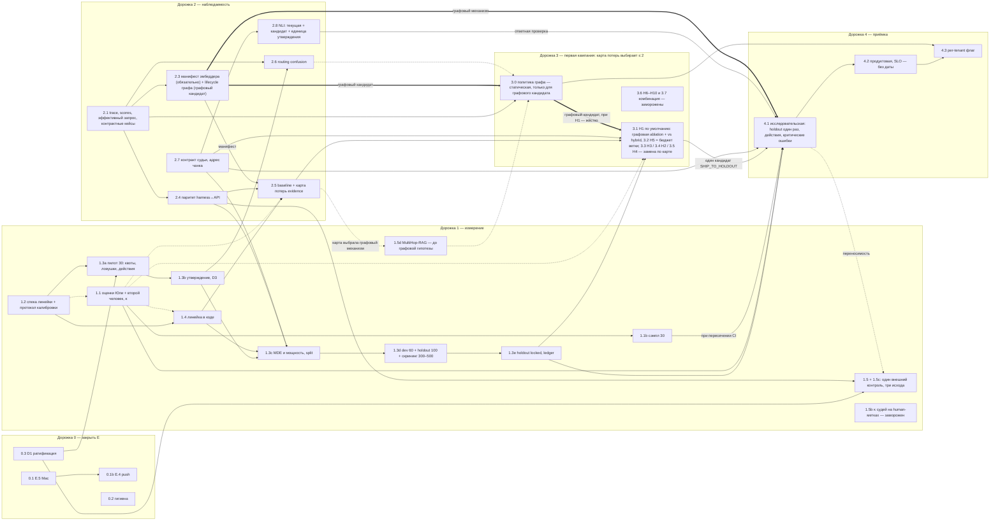

# Финальный план повышения качества RAG_new — 30.09.2026

> **Заменён 03.10.2026.** Действующий план —
> [`plan_03_10_26.md`](plan_03_10_26.md): обязательный текст §0–§5 и §7 перенесён
> туда, изменённые места перечислены в его §6. Решения D1–D10 (§2) перенесены
> слово в слово; затем решение Юли D11 от 03.10 («люди участвовать в процессе не
> будут») изменило там D2, D3 и D10 — здесь они в редакции 30.09. Этот файл
> остаётся историей: шапка с редакциями и аудитами 30.09 и хроника сессии в §6.
> Ниже текст не правился.

**Статус:** составлен по итогам оценки [аудита Asta](../audits/audit_asta_30_09_26.md)
и его [черновика плана](plan_30_09_26.md); редакция Fable 5.1, HEAD `32b526b`.
**Принят 2026-09-30** по делегированию Юли («сделай работу за меня и прими все
решения за меня»); решения D1–D5 ниже приняты исполнителем и подлежат пересмотру
Юлей до первого эксперимента дорожки 3. Дополняет
[`plan_06_09_26.md`](../../plan_06_09_26.md) как нить после фазы E; стоп-лист
его §7 сохраняется целиком.

**Цель:** один проверенный механизм, который поднимает смысловую точность
отправляемого контекста на locked holdout без потери обязательных фактов и без
роста задержки при равном бюджете кандидатов, доказанный через реальный `/api/ask`.

**Пересмотрен 2026-09-30 (вечер)** по делегированию Юли («прими решения сам;
исходи из того, что нужен очень качественный результат»): внесены решения
консультации Astra по закрытию дыр G1–G21 и предложений R0-Sol / R0-GLM
(i)–(xvi) — D3, D6, D7 пересмотрены, добавлены D8 (состав первой кампании) и
D9 (мощность и margin), слайсы 1.1–1.5d, 2.1, 2.4, 2.5, 2.7, 2.8, 3.0–3.7, 4.1 и
граф зависимостей исправлены, календарь §3 заменён условными этапами и
очередью Mac, §4 расширен границами кампании, спека 1.2 и runbook GLM
дополнены. Сводка — §6, «Консультация Astra». **Пересмотрен ещё раз поздно
вечером 30.09** после второго прохода по пробелам (G22–G35, D10) и двух
аудитов финала — GLM 5.3 (№1–№29) и Astra (№1–№26), оба применены по
делегированию, перечень правок — §6, «Аудиты финального плана»; ключевые
следствия: H1 — графовый кандидат с двумя сравнениями, H5 — настройка
бюджета, манифест эмбеддера обязателен до 2.5, закрытая таблица решающих
метрик и правило валидности интервала в спеке, ночи 17–22. **Ратифицирован 30.09 (поздно вечером) по делегированию Юли** («прими все
решения за меня из позиции — лучшее качество конечного продукта»): шаг 0.3
выполнен агентом, коммит локальный, push — отдельный gate; Юля вправе
пересмотреть любое решение до первого эксперимента дорожки 3.

## 0. Что зафиксировано и не пересматривается

- Baseline с production expansion (P1b, `d1adbbb`): H 0.5768 / 0.9800, FULL 97/100;
  Hm 0.3263 / 0.7333, FULL 7/15. Baseline без expansion (GR3, `32de532`):
  H 0.5067 / 0.9050; Hm 0.2527 / 0.5000. Не смешивать.
- Линейка `context_precision` лексическая. P2: α 0.8566, τ_b 0.1561
  [0.0197; 0.2880] → `RULER_DOES_NOT_TRACK`. Порог 0.63 остаётся порогом старой
  линейки до отдельного решения.
- Уже измерено и не повторяется без новой гипотезы: top-k 3, adaptive-k (P1/P1b),
  seed reservation, чистый expansion, query-only control, category prefilter по
  tags (0 совпадений), G1/G2 как третий список (GR3: Hm recall 0.5 → 0.4,
  FULL 4 → 1, p95 +8765 мс).
- `RAG_GRAPH_RETRIEVAL` = `off`. `auto` не подключает projection
  (`vectordb/manager.py:996`, только `on`); пороги auto 20 000 чанков / 0.15
  не выполнены на 5589.
- Стоп-лист: Neo4j/LightRAG/MS GraphRAG, смена vector DB, смена reranker-модели,
  refactor четырёх крупных модулей, новые fixture-кейсы «под гейт».

## 1. Порядок: четыре дорожки, одна нить

WIP = 1. Фаза E — активная нить. Слайсы дорожек 1–2 стартуют **только пока E
заблокирована ожиданием** (очередь Mac, Actions до октября) и уступают ей,
как только блокировка снята; иное — явное решение Юли. Переключение нити явное:
строка `active: Q-<слайс> while E waits on <что>` в `CURRENT_STATE.md` при входе
и её снятие при возврате к E; ожидание результата незакрытого слайса не
открывает второй слайс той же нити (A11). Дорожка 3 начинается после закрытия E
или раньше по решению Юли. Роли (GLM-аудит финала №22): *исполнитель* — GLM 5.3
по runbook, кодовые слайсы (2.1–2.4, 2.7, ingestion, 4.3); *агент* — Claude-сессия
по делегированию: документы, черновики набора, карта потерь, аудит 2.6, капсулы
без изменения кода; *Юля* — владелец: утверждение, оценки, гейты. Таблицы дорожек
ниже — обзор; при расхождении действует таблица слайсов «Нарезка на слайсы».

### Дорожка 0 — закрыть текущее (дни)

| # | Действие | Проверка завершения | Правило слайса |
|---|---|---|---|
| 0.1 | E.5: полный suite на Mac, финальный history scan → капсула. E.4: push, публичность, Pages — когда вернутся Actions (начало октября) | Капсула E.5 в `EVIDENCE_INDEX.md`; зелёный CI на HEAD | E по плану 06.09 (E.5 — подготовка, не (c): числа качества не меняются — Astra-аудит финала №25) |
| 0.2 | Гигиена F9: `ruff check --fix` для I001 (`tests/test_docs_publication.py:3`); Mac-гейт закрепить на pre-commit-версии Ruff 0.15.11; в `docs/windows-test-workflow.md` указать интерпретатор `py -3.13` и правило «полный suite — Mac» | Ruff exit 0 на закреплённой версии | не слайс; в коммит с 0.1 |
| 0.3 | Ратификация Юлей: принять этот план как нить после E (D1 принят по делегированию) — снять пометку «ratification pending» в `ROADMAP.md` и `CURRENT_STATE.md`, закоммитить план и спеку 1.2 | Коммит Юли в `master` | — |

### Дорожка 1 — измерение (критический путь; ждёт Юлю)

| # | Действие | Проверка завершения | Правило |
|---|---|---|---|
| 1.1 | **Юля оценивает 10 кейсов / 50 документов** (`reports/p2/human-sample.html`, шкала 0–3, 1–2 часа). Импорт готовым `import_human_grades` через `scripts/p2_blinded_judge.py`. Опубликовать человеческий κ к GLM, Sonnet и [Opus-референсу](../evidence/p2-opus-reference-sample.md) (Opus к ним: 0.9133 / 0.8950, `8a1d3b6`) с кластерным bootstrap-CI по кейсам | Капсула P2 обновлена. Правило заранее: CI κ целиком ≥ 0.7 к консенсусу → judged precision допустима как рабочая линейка development; CI пересекает 0.7 → расширить сэмпл до 30 (1.1b) до заявления semantic gain и до приёмки 4.1 — инженерные прогоны и скрининг не ждут, их капсулы `provisional_ruler` (Astra-аудит финала №7); CI ниже → пересчёт | (c) |
| 1.2 | Спека метрик в `docs/specs/` ([`semantic-precision-metrics.md`](semantic-precision-metrics.md)): полный список метрик, ответных метрик (`faithfulness`, `answer_fact_coverage`, `citation_correctness`, `abstention_correct`, `action_correct`, `critical_errors`), правило принятия с тремя исходами, MUE/MDE, non-inferiority — по спеке, здесь не дублируется | Спека закоммичена до первого эксперимента дорожки 3 | подготовка |
| 1.3 | Диагностический dev-набор: агент пишет вопросы, evidence spans и обязательные факты по семействам документов; **Юля утверждает батчами** (как T-54). Пилот 30 кейсов (10 single-doc, 10 multi-doc, 4 aggregation, 6 требующих отказа/уточнения; квоты, флаги и поля — таблица слайсов 1.3a/1.3d) → оценка дисперсии → размер dev/holdout. Holdout запирается до дорожки 4. Явно: набор не разблокирует B.2/B.3/B.5 — это не shipment-bound данные | Проверка происхождения labels; split без пересечения семейств | (b) после утверждения |

### Дорожка 2 — наблюдаемость и сопоставимость (инженерия, без ожидания Юли)

| # | Действие | Проверка завершения | Правило |
|---|---|---|---|
| 2.1 | Trace каждого `/api/ask`: configured / selected / effective strategy с причиной выбора (в том числе при `unknown` и `simple`), класс и уверенность, `entities`, число кандидатов по источникам, численные rerank scores, документы, удалённые coherence-фильтром, с причиной, время этапов, `graph_version` (штамп corpus/index — в 2.3), токены отправленного контекста, причина fallback. Показать в Evidence tab. Передать `categories` в `get_graph_documents_with_path` (`agent/graph.py:1603`; сигнатура уже принимает) | E2E: ask → trace → admin HTTP; off/on/auto, неизвестный класс, чужой tenant | **(a)** |
| 2.2 | `_rerank` (`vectordb/_base_manager.py:828`) остаётся обёрткой над `_rerank_scored`, возвращающим пары `(Document, score)` с теми же объектами, без мутации metadata (§5); `RAG_RERANK_BATCH` читается при построении retriever (не при импорте модуля); runtime-смена действует после пересборки retriever — документируется; эффективный batch пишется в path | Unit + E2E из 2.1 | в 2.1 |
| 2.3 | Lifecycle графа (F4): штамп версии (corpus SHA + structural hash + entity snapshot id). `_replace_structural_graph` (`ingestion/pipeline.py:384`) не стирает entity-граф молча: либо переизвлечение для изменённых документов, либо сохранение старого снимка со статусом `mismatch` и откатом на structural graph (как сейчас делает загрузчик), не молчаливым hybrid. Покрыть add, update и delete документа, публикацию согласованного снимка corpus/index/entities одной версией и инвалидирование кэшей retriever | E2E: add / update / delete doc → restart → ask при `on` → trace показывает состояние ветки и версию; несовпадение hashes; чужой tenant | **(a)** |
| 2.4 | Паритет harness ↔ API на трёх уровнях: retrieval (id и порядок пула и reranked-списка), отправленный контекст (хэш текста после grading, до prompt и цитат) и эффективный запрос; harness уже переиспользует RRF, coherence и graph expansion, отдельно исполняет только rerank (§5). Baseline — отдельный слайс 2.5 | Паритет на H + Hm | подготовка |

### Дорожка 3 — эксперименты (Mac; один механизм за раз; после 2.1–2.5 и 1.3c; 1.1 — до приёмки)

Первая кампания (D8): карта потерь evidence из 2.5 выбирает **не более двух**
механизмов — по умолчанию 3.1 и 3.2; 3.3–3.5 *заменяют* их, если карта
указывает на entity-ранжирование, cross-ref или категорию, а не дополняют
очередь. Каждый: pre-registered спека в `docs/specs/` → скрининг без генерации
на `agent_labelled` вопросах из dev-семейств → парное сравнение на dev →
капсула `SHIP_TO_HOLDOUT` / `NO_SHIP` / `INCONCLUSIVE` с paired bootstrap по
семействам источников; внешний контроль — один, для итогового механизма
(D7). Порядок по умолчанию по отношению ожидаемой пользы к стоимости:

| # | Гипотеза | Почему в этом месте | Отклонить, если |
|---|---|---|---|
| 3.0 | Политика включения графа — не гипотеза, а pre-registered правило: когда ветка выбирается, какой у неё собственный гейт, ступени shadow → per-tenant → default и откат (детали — таблица слайсов) | Без неё 3.1–3.5 улучшают механизм, у которого нет условия включения; GR-3 показал NO-SHIP-to-default (Hm recall 0.5 → 0.4, FULL 4 → 1, p95 +8 765 мс) | — |
| 3.1 | H1 — сохранять evidence по подвопросам; coherence как мягкое предпочтение вместо удаления singleton при относительной силе ≤0.25 (`_apply_graph_coherence`, `vectordb/_base_manager.py:637`) | Прямо целится в измеренную потерю Hm FULL 4 → 1. Coherence вызывается только графовой веткой (`get_graph_documents_with_path`, `vectordb/_base_manager.py:764`), поэтому H1 — графовый кандидат по конструкции: регистрируются два сравнения — ablation на замороженном пуле графовой ветки (жёсткий отсев ↔ мягкое предпочтение; изолирует механизм) и графовая ветка с H1 против зарегистрированного контроля hybrid при равном бюджете 40 (решает SHIP и гейт ветки 3.0) (Astra-аудит финала №3) | уникальные факты всё ещё исчезают или all-evidence coverage не растёт |
| 3.2 | H5 — бюджет 40 кандидатов + дедупликация до rerank — **настройка бюджета графовой ветки, не самостоятельный механизм** (Astra-аудит финала №3): hybrid при дефолтах уже объединяет vector 20 + BM25 20 с дедупликацией (`config/settings.py:461`, `_rrf_merge`), так что H5 против контроля почти тождествен | Условие p95-гейта ветки 3.0: rerank ~50 с/кейс на i5-7500 при пуле 73–90 против 40 ([GR-3](../evidence/gr3-graph-lane-ab.md)); измеряется внутри графовой ablation (пул 40 против естественного) как равный бюджет кандидатов между руками; слот второго механизма не занимает | падает Recall@candidate по обязательному второму источнику |
| 3.3 | H3 — ранжирование entity-кандидатов: RU/EN aliases, штраф общим узлам, отбор по score вместо UUID до лимита 50; подпункт — exact-lookup редких сущностей (из черновика) | [GR-3](../evidence/gr3-graph-lane-ab.md): G1 − H = +0.0408 precision на H (структурная лента), G2 − G1 = +0.0012 (entity-лента, сработала на 6 из 100 кейсов) — гипотеза, не установленная причинность; подпункты H3 (aliases, штраф, ranking, exact-lookup) проверяются отдельными прогонами | entity linking ошибается чаще; прирост не воспроизводится на dev |
| 3.4 | H2 — один переход по явным `cross_ref` | Нужны размеченные цепочки из 1.3 | новые кандидаты не добавляют нужных evidence |
| 3.5 | H4 — категория из вопроса как мягкий prior | Только после измерения routing confusion классификатора | выигрыш существует лишь при подстановке dataset tags |
| 3.6 | Заморожена в первой кампании вместе с H9 (эмбеддер) и H10 (chunking) — D8. Вторая волна H6/H7/H8 — только если 3.1–3.5 не закрывают цель. H7 — вне стоп-листа «alternative rerankers» (D4, подтверждено по делегированию 30.09) | — | по критериям аудита §5 |

Комбинация победителей (3.7) в первой кампании заморожена (D8): цель — один
проверенный механизм; в 4.1 идёт один заранее названный кандидат.

### Дорожка 4 — приёмка (один раз)

Две приёмки, не одна (A3, A12). **4.1 исследовательская** на `deproject-mac`:
locked holdout из 1.3e, реальный `/api/ask`, ответы и цитаты, абсолютные
p50/p95, tenant isolation, streaming parity, регрессия на H/Hm. Контракт SHIP —
единый список в спеке 1.2, раздел «Acceptance contract»: первичная метрика
механизма +0.05 с CI95 > 0 на holdout; non-inferiority −0.02 по evidence recall,
fact coverage, faithfulness, полноте ответа и корректности цитат; ни одной
потери критического факта, включая PART-кейсы; delta p95 ≤ 200 мс при равном
бюджете; лексический `context_precision` на H не ниже контроля более чем на
0.02, порог 0.63 печатается рядом (D6); невалидный судья = `invalid`, вне
числителя и знаменателя. Результат — капсула `SHIP_RESEARCH` / `NO_SHIP`.
Дополнено 30.09 (Astra, GLM-аудит финала №10): вердиктов три —
`SHIP_RESEARCH` / `NO_SHIP` / `INCONCLUSIVE`; holdout открывается один раз для
одного заранее названного механизма (G7); обе руки на одном generator fingerprint (G19);
пустая история (G20); отдельно — результаты по `expected_action` и число/тип
критических ошибок, новая критическая ошибка запрещает SHIP (G17); внешний
контроль (D7) — отдельная строка «переносимость», не условие SHIP.
**4.2 продуктовая** — на deployment-цели с абсолютным SLO, которые называет
Юля (D5); без них продуктового SHIP нет. **4.3** — включение per-tenant флагом с
описанным откатом к hybrid, только после 4.2. Условие фазы C по faithfulness
(`ROADMAP.md`) остаётся отдельным гейтом.

### Нарезка на слайсы и граф зависимостей

Слайс — наименьшая единица с собственной проверкой завершения и правилом
(a)/(b)/(c) из `CLAUDE.md` или пометкой «подготовка». **Жёсткая зависимость**
A → B: B нельзя начать, пока A не принят. **Мягкая** A ⇢ B: B выполняется, но
его результат считается предварительным, пока A не закрыт. **Условно-жёсткая** (в графе —
толстая стрелка с подписью «графовый …»): становится жёсткой, когда выбран
графовый кандидат; при H1 по умолчанию — жёсткая (Astra-аудит финала №8).
Порядок внутри одного уровня задаёт WIP = 1, а не зависимость. Номера совпадают с таблицами
дорожек выше; новые слайсы, которых там не было: 1.4, 1.5/1.5b, 2.5, 2.6, 2.7,
2.8, 3.0, 4.2/4.3; 0.1b выделен из 0.1; 1.3e выделен из 1.3c.

| Слайс | Что | Правило | Кто / где | Жёсткие зависимости | Мягкие | Принят, когда |
|---|---|---|---|---|---|---|
| 0.1 | E.5: полный suite на Mac + history scan → капсула | гейт E.5 по правилу E плана 06.09 — подготовка, числа качества не меняются (Astra-аудит финала №25) | исполнитель, Mac | — | — | капсула E.5 в `EVIDENCE_INDEX.md` |
| 0.2 | Гигиена: I001, pin Ruff 0.15.11, `windows-test-workflow.md` | не слайс | Windows | — | — | `ruff check` exit 0; в коммит с 0.1 |
| 0.1b | E.4: push, публичность, Pages | E | Юля (gate) | 0.1; Actions доступны | — | зелёный CI на HEAD |
| 0.3 | D1: ратификация плана — по делегированию Юли, включая D8 (заморозки), D9 (margin), D3 (второй человек) и D10, — коммит плана, спеки 1.2, правок `ROADMAP`/`CURRENT_STATE`/`BACKLOG` и строки об исполнителе в `CLAUDE.md`; пометка «ratification pending» снята | не слайс (процессное) | выполнено агентом 30.09 по делегированию; ревью Юли — постфактум, любое решение можно пересмотреть до первого эксперимента дорожки 3 | — | — | коммит в `master` 30.09 (локальный; push — gate) |
| 1.1 | 10 слепых оценок Юли → `import_human_grades` → κ к GLM, Sonnet, Opus → капсула P2. До оценок действует зарегистрированный протокол калибровки в спеке 1.2 (рубрика, единица, ослепление, выборка, CI, ветвление после неопределённого κ, область переноса — G8, записан 30.09). Второй подготовленный человек (инструктаж по рубрике + 10 тренировочных пар вне выборки с разбором; не автор черновиков — G27) независимо размечает 50 relevance-пар из той же выборки: human–human κ с CI, матрица расхождений, adjudication после публикации согласия — ориентир согласованности, не математический потолок и не основание снижать пороги (G15) | (c) | Юля 1–2 ч; второй человек ≈ 1–2 ч; агент импорт | — (протокол в спеке 1.2 уже записан) | — | капсула с κ и кластерным CI; CI целиком ≥ 0.7 → линейка human-validated; CI пересекает 0.7 → 1.1b; CI ниже → пересчёт development-результатов; без второго человека — оговорка §4 в капсуле |
| 1.1b | Расширение человеческого сэмпла до 30 кейсов — при κ на 10 кейсах с кластерным CI пересечение 0.7 почти неизбежно, поэтому планируется как вероятный шаг (2–4 ч), не как исключение | (c) | Юля + агент | 1.1 (только если CI κ пересекает 0.7) | — | капсула с пересчитанным κ |
| 1.2 | Спека линейки development ([`semantic-precision-metrics.md`](semantic-precision-metrics.md)); дополнена 30.09 по консультации Astra: протокол калибровки (G8), адрес чанка + `text_sha256` и миграция меток (G16), три исхода и MDE (G13/D9), скрининг, ledger и holdout один раз (G7), контракт 4.1 — действия и критические ошибки (G17), generator fingerprint (G19), одноходовость (G20) | подготовка | готова, ждёт ревью | — | — | коммит (в 0.3) |
| 1.4 | Линейка в коде: модуль в `evaluation/` считает `precision_at_5`, `sent_precision`, `ndcg_at_5` по judged top-k из P2-артефакта; `evidence_recall_pool` и `all_evidence_coverage` на P2 — `N/A` (в P2 нет gold spans и групп — Astra-аудит финала №16), считаются с первого утверждённого gold 1.3b, до того — только unit-тесты на фикстурах; paired bootstrap по семействам с правилом вырожденных разностей (спека) | (c) | исполнитель; Windows focused + Mac-гейт | 1.2 | 1.1 | опубликованные числа development-baseline на P2-артефакте (corpus SHA + code SHA + config) |
| 1.3a | Пилот dev-набора: 30 черновиков (10 single-doc, 10 multi-doc, 4 aggregation, 6 требующих отказа/уточнения — G18) ⊂ будущих 60 dev; исходные секции выбираются случайно с seed, два стиля/генератора вопросов, ≥ 20 % adversarial/unanswerable, поля `question_origin` и `label_origin` (G6); у каждого кейса — evidence spans на источнике с адресом чанка и `text_sha256` (G16), обязательные и критические факты, gold `complexity` (`simple`/не-simple) для 2.6, `expected_action` (ответить / исправить посылку / уточнить / отказаться / передать специалисту), `as_of`, источник полномочий правила и тяжесть ошибки (G17); ловушки пяти типов — ложная посылка, вне корпуса, устаревшее правило, конфликт документов, опасные грузы; пересекающиеся флаги RU→EN, числовые факты, критичные для безопасности; статус `agent_labelled`; реальные support-вопросы включаются отдельно при наличии; здесь же регистрируется список документов, исключённых из отправки внешним судьям (по умолчанию пуст — G31, D10) | подготовка | агент | 0.3 (схема кейса в спеке 1.2 закоммичена); карта семейств документов зарегистрирована (G22: агент строит по источникам и `cross_ref` корпуса из 201 файла, Юля подтверждает вместе с первым батчем 1.3b) и резерв семейств под holdout — до генерации | предварительная карта потерь по архивам (2.5) — черновики не задерживает | файл набора + verify-скрипт зелёный: квоты, поля, отсутствие пересечения семейств |
| 1.3b | Утверждение батчей пилота (D3: Юля или назначенный ею человек; ловушки, критические и сложные кейсы — Юля) | (b) | Юля (+ второй человек) | 1.3a | — | статус `real_labelled` у 30 кейсов; темп утверждения замерен на первом батче |
| 1.3c | По пилоту: дисперсия парных разностей → сценарный диапазон мощности; для каждой решающей метрики регистрируются n, число кластеров (компоненты графа кейс–семейство), MDE и достижимая мощность — отдельно для MUE +0.05 и для каждой NI-проверки −0.02 (G13); margin −0.02 не ослабляется (D9): недостижимый n → больше независимых семейств или заявленный более крупный MDE, недоказанный NI = `INCONCLUSIVE`; абсолютные размеры dev и holdout назначаются здесь, до генерации 1.3d (ориентир Astra 60 + 100 — не догма); если по дисперсии пилота n ≈ 100 остаётся, до 4.1 регистрируется, что кампания проверяет только эффекты ≥ опубликованного MDE (при v = 0.10 и n = 100 мощность для +0.05 ≈ 0.35 — GLM-аудит финала №9); максимальный бюджет и решающие критерии фиксируются до результатов holdout; парная дисперсия выбранного механизма уточняется на dev до открытия holdout; разбиение семейств зарегистрировано до любой настройки; до генерации 1.3d — реестр семейств, уже использованных (H/Hm, P1b/P2, просмотренная карта потерь 2.5 — development по определению) и независимого резерва; holdout — только из семейств вне реестра (Astra-аудит финала №13) | подготовка (регистрация n и MDE, числа качества не меняются — Astra-аудит финала №25) | агент, Mac (часы) | 1.3b, 1.4, 2.4, 2.7 | — | капсула с размерами, MDE, мощностью и зарегистрированным split |
| 1.3d | Полный человеческий набор — состав задан **долями**, абсолютные n берутся из 1.3c (GLM-аудит финала №9): dev — 30 % single-doc / 33 % multi-doc / 17 % aggregation / 20 % отказ-уточнение, holdout — 24 % / 40 % / 16 % / 20 % (при ориентире 60 + 100 это 18/20/10/12 и 24/40/16/20); минимумы флагов при этом ориентире, масштабируются с n: RU→EN и числовые факты ≥ 12 в dev и ≥ 20 в holdout, ловушки ≥ 12 / ≥ 20 со всеми пятью типами, критичные для безопасности ≥ 10 в holdout, если корпус и компетентный проверяющий позволяют утвердить правильное поведение (G18); черновики агента, утверждение батчами по D3; отдельно — 300–500 `agent_labelled` вопросов скрининга только из dev-семейств, хранятся отдельно от человеческого набора и в holdout не переходят (G13); слепая проверка Юлей 5 % этих черновиков (≥ 25, ≈ 1 ч) до их использования, брак > 10 % → переписать генератор (G32, D10); невыполнимая квота сужает область вывода, а не заполняется фиктивными документами | (b) | агент + Юля + второй человек | 1.3c | — | verify: квоты, split без пересечения семейств; отчёт с реальными размерами и кластерами каждой страты |
| 1.3e | Holdout заперт после утверждения: список id + SHA в капсуле, ни один эксперимент его не читал; development-кейсы в holdout не переходят; holdout открывается ровно один раз — в 4.1 для одного заранее названного механизма; ledger всех dev-конфигураций, включая неудачные, ведётся с первого выбора по данным — с предварительной карты потерь 2.5, не с запирания (Astra-аудит финала №13) — таблица в `docs/evidence/` (дата, механизм, хэш конфига, набор — скрининг/dev/holdout, первичная метрика, CI, вердикт; G28); изменение механизма после просмотра результата требует нового независимого подтверждения (G7) | подготовка | агент | 1.3d | — | капсула с SHA; проверка в verify-скрипте; ledger заведён |
| 1.5 | Внешний бенчмарк (идея Юли 30.09), по [`external-benchmark-candidates.md`](external-benchmark-candidates.md) (рисерч Opus, 29 кандидатов × 10 критериев): **основной — ConditionalQA** (GitHub `haitian-sun/ConditionalQA`, `v1_0/`): retrieval по всем 652 документам gov.uk, вопросы train+dev (test-ответы скрыты), срез 500 = все 105 not-answerable + 395 отвечаемых стратифицированно с seed; `not_answerable` относится к назначенному документу — считается только документно-условный отказ, corpus-level `abstention_correct` не заявляется; evidence размечено людьми на уровне HTML-элементов, у 1 259 вопросов в двух и более секциях одного документа — аналога Hm между документами нет; невыбранные аннотаторами элементы — `unjudged`, не grade 0. Первичная метрика — `all_evidence_coverage` в отправленном контексте на отвечаемых при равном бюджете контекста между руками (иначе expansion поднимает coverage, отправляя почти весь документ); doc-conditioned результат — диагностика с пометкой oracle. Регистрация до прогонов: срез, seed, SHA-256 каждого исходного файла, ревизия Git, версия HTML-преобразования; 339 неоднозначных gold-строк (число подтвердить на закреплённых файлах) хранятся как альтернативы с проверкой секции и смысла, первое совпадение не выбирается; раздельно — разрешение исходного gold и сохранность evidence после ingestion (потеря текста — измеряемая ошибка, порога «≥ 99 %» нет, matching держит spans через границы чанков); gold-элементы, разрезанные чанкингом или поглощённые expansion, регистрируются. Дешёвая линейка на всех 2 623 вопросах (гибрид без rerank и генерации) — только диагностическая метрика candidate recall, не замена CI отправленного контекста; запертые вопросы и их документы (семейства) исключены из просмотра до итогового сравнения (A:267, (x)), полный набор — однократно после фиксации механизма. **Роль в первой кампании (D7): один запертый внешний retrieval-контроль итогового механизма вместе с 1.5c, три исхода; генерация на внешних базах не запускается.** Пилот внешнего контроля (GLM №14, Astra №14): ≈ 50 отвечаемых вопросов ConditionalQA + 40 WixQA (20 ExpertWritten / 20 Simulated) вне решающего среза, обе руки, retrieval-only (≈ 0,5 ночи); по нему до прогона регистрируются отдельно для каждой базы и страты n, кластеры (ConditionalQA — документ, WixQA — набор gold-статей), MDE и сценарная мощность; знаменатель первичной метрики ConditionalQA — 395 отвечаемых, не 500; вопросы пилота в контроль не входят. Ingestion на Mac штатным pipeline в **отдельный tenant / коллекцию**; verify: основной корпус, его SHA и индекс не изменились (№23). Капсула с provenance и лицензией | (c) | исполнитель ingestion; Mac — прогон двух рук после вердикта 4.1 (этап VI) | 0.3, 2.4 (harness принимает внешние датасеты); прогон контроля — после вердикта 4.1 | — | капсула контроля: подтверждение / убедительное противоречие / неопределённо; наружу — агрегаты, атрибуция и provenance без вопросов и текстов; лицензия BSD-2 и принятая оговорка «ONLY NLP research» |
| 1.5b | Валидация relevance-судей на человеческих метках ConditionalQA — **заморожена в первой кампании** (D8; Astra: главный выигрыш 6–12 ч Юли, внешние evidence-метрики считаются без relevance-судьи, внутренняя калибровка 1.1 сохраняется). При возврате с отдельным бюджетом: слепая выборка ≥ 300 пар «вопрос — точный текст чанка» вне сравнительного среза, обе стороны — человеческая оценка по той же шкале 0–3 (невыбранные аннотаторами элементы — `unjudged`; `evidences` — проверка обнаружения evidence, не оценки релевантности); первично quadratic-weighted κ 0–3, бинаризация ≥ 2 выбрана заранее, ≥ 3 — sensitivity, не второй гейт; кластерный CI по документу; контроли контаминации — малый заранее выбранный набор (без evidence / удалён span / подмена / дистрактор), считаются отдельно от естественного κ; 400–500 пар — только после оценки кластеров, CI и бюджета; RusBEIR wikifacts / MIRACL-ru / RuBQ 2.0 — не обязательны | (c), при возврате | агент, Mac; Юля 6–12 ч | 1.5; отдельное решение Юли о бюджете | — | капсула κ; при CI κ < 0.7 линейка на бенчмарке `provisional_ruler` |
| 1.5c | Вторая внешняя база — **WixQA** (HF `Wix/WixQA`, MIT): 400 вопросов — 200 ExpertWritten (реальные обращения, основная страта) + 200 Simulated (синтетические, отдельная страта; R0 §3.2, R0-Sol §2), база знаний 6 221 статья целиком (индексировать `html_content`; сохранность заголовков проверяется относительно закреплённого исходного HTML с публикацией фактических counts, без порога «≥ 3 800»; `feature_request`-статьи остаются в основном индексе, пересчёт без них — отдельная помеченная задача), у 79 вопросов ответ на нескольких статьях. Первичная метрика — хотя бы одна gold-статья в top-5; **решающая страта — ExpertWritten**, Simulated печатается диагностически и в свёртку D7 не входит (Astra-аудит финала №14); все article-id — диагностически, «все статьи обязательны» только после ручного подтверждения необходимости каждой; генерация baseline не запускается. Роль: вторая половина внешнего контроля 1.5 — перенос на реальные вопросы поддержки; ingestion в отдельный tenant / коллекцию, как 1.5 (№23) | (c) | исполнитель ingestion; Mac — по очереди §3 | 1.5 (harness и формат уже есть) | — | капсула контроля WixQA с provenance |
| 1.5d | Третья база, совещательная — **MultiHop-RAG** (609 документов, 2 255 вопросов на 2–4 документа, 301 null; метки GPT-4, половина ответов yes/no → `llm_labelled`; лицензия ODC-BY, тексты СМИ — R0 [S2, S3]; не единственный cross-doc набор — R0-Sol §3) — **заморожена до выбора графовой гипотезы по карте потерь 2.5** (D8); вето на SHIP не имеет, расхождение фиксируется. При возврате: подсрез — inference + null; coverage только на отвечаемых cross-doc кейсах, пустой gold у null ≠ FULL; `title`/`source`/`published_at` вливаются в текст чанка зарегистрированным преобразованием; без генерации `abstention_correct` не считается; наличие обеих статей не доказывает пользу ребра графа — нужна локальная ablation на соответствующих фактах (viii) | (c), совещательный | исполнитель ingestion; Mac | 1.5; карта потерь выбрала графовый механизм | — | капсула baseline с пометкой `llm_labelled` |
| 2.1 | Наблюдаемость маршрута + 2.2 rerank scores и runtime batch — спека §5. Дополнено 30.09 (Astra): исходный и эффективный запрос, тип трансформации (HyDE / rewrite / none) и хэш её config/prompt — по trace воспроизводим фактический вход retrieval, изменение запроса нельзя выдать за эффект coherence или rerank (G4); routing — `configured / selected / effective`, `confidence: null`, пока калибровки нет (G9); 10 контрактных кейсов с фейковым LLM в focused-наборе — источник, цитаты, действие отказа, числовые поля, streaming: детерминированная проверка контракта ответа, не evidence качества модели (G12) | (a) | исполнитель; Windows focused + Mac-гейт | — (0.2 желательно раньше) | — | HTTP-тест ask → trace → evidence зелёный; контрактные кейсы зелёные; Mac-гейт |
| 2.3 | Две части (Astra-аудит финала №4). **Обязательная, до 2.5:** манифест эмбеддера в индексе — id, HF-ревизия (сегодня `SentenceTransformer(model_name)` создаётся без revision, `vectordb/_base_manager.py:333`), размерность, промпты query/doc, нормализация — сверяется при загрузке, совпадение одной размерности не считается совпадением модели (G25, Opus R1 §4.1); несовпадение → отказ загрузки с причиной в trace, прогон на таком индексе — `NOT_EVIDENCE`; нужна и hybrid-руке. **Условная, при графовом кандидате (при H1 — да):** lifecycle графа — спека §5, штамп версии (corpus SHA + structural hash + entity snapshot id) | (a) | исполнитель | 2.1 | — | манифест: подмена эмбеддера той же размерности отвергается тестом, поля манифеста в trace; lifecycle: E2E add doc → restart → ask, статус ветки в trace |
| 2.4 | Паритет harness ↔ API — спека §5; плюс одинаковый эффективный запрос и тип трансформации между harness и API (G4), контрактные кейсы 2.1 проходят и через harness-путь (G12) | подготовка | исполнитель | 2.1 | — | тест паритета на H (100) + Hm (15) с детерминированными фейковыми embedder/reranker из тестового набора (GLM №21); реальное сравнение на 30 кейсах H на Mac до открытия holdout (Astra №21) |
| 2.5 | Новый baseline с production expansion на H + Hm: лексическая и development линейки, тайминги из trace, provenance. **Карта потерь evidence** (G14): для каждого из 100 исторических кейсов — первая наблюдаемая потеря по стадиям индекс → исходный пул → caps/dedup → rerank → coherence/expansion → grading/packing → ответ, либо `unknown` (причину не приписывать); знаменатели и ссылки на артефакты публикуются; предварительная версия по архивам — только стадии индекс → исходный пул → caps/dedup → отправленный контекст (rerank и coherence в архивах не наблюдаемы → `unknown`, №20), до 1.3a, часы агента, не ночи Mac; полная — после 2.1/2.4 с gold. Отдельные строки: RU→EN-страта на текущем эмбеддере (G2) и потери при parent/section expansion (G3). Доказанная потеря на стадии ingestion/индекса (текст gold-span отсутствует в индексе или разрезан так, что matching его не находит) исправляется **до** baseline отдельной кодовой правкой с тестом, baseline затем перезапускается — механизмы не измеряются поверх известной потери ingestion (Astra: G3, консультация A:51). Карта выбирает ≤ 2 механизма дорожки 3 по устранимым потерям и стоимости; доминирование генератора закрывает retrieval-кампанию этим выводом (G1). Provenance фиксирует generator fingerprint (G19) и снимок ingestion / `chunker_version` (G3). Смысловые инварианты реальной модели на dev-кейсах (факт, цитата, действие) — здесь и в 4.1, без точного сравнения строк (G12) | (c) | Mac (baseline); агент (карта) | 2.4, 1.4, 2.3 (манифест) | 1.1 | капсула baseline + карта потерь с выбранными механизмами и обоснованием; обновляется после 1.3d |
| 2.6 | **Условный** (Astra-аудит финала №22): выполняется, если карта выбрала H4 (3.5) или политика 3.0 опирается на класс `simple`; иначе отложен, вердикта нет. Аудит вердиктов маршрутизации при включённом `MODEL_ROUTING_ENABLED`: матрица класс × разметка и `complexity` (`simple`/не-simple) × gold по trace на H + Hm + пилот; цена ошибки `simple` (vector без BM25/rerank, `llm_fast`, пропуск grading) — отдельной строкой; по умолчанию routing выключен и вердикта нет — зафиксировать | (c) | агент, Mac | 2.1, 1.3b | — | капсула confusion matrix по классу и по `complexity` |
| 2.7 | Контракт судей (F8) для обоих потребителей — relevance-судья `evaluation.blinded_judge` (запрос v2 на 1–10 документов, хэш текста в request hash) и generation-судья `scripts/generator_benchmark.py` (~346): строгий парсер; обрезка контекста до 3 000 и ответа до 2 000 символов (~369) снимается либо считается явно — число обрезанных запросов в капсуле, обрезанный запрос помечен `truncated` и вне решающего κ (Astra-аудит финала №20); raw replies с хэшами запросов, различение parse-fail / absent / low; невалидный ответ = `invalid` — вне числителя и знаменателя, считается отдельно, никогда не 0; unit-тесты на архивных ответах P2 (`reports/p2/p2-blinded-judge-glm`, `reports/p2/opus-reference/replies.jsonl`) и GR3 (`reports/gr/gr3-graph-lane-ab.json`; `'Score: 1.0'`). Схема меток — JSON-строки файла набора 1.3a с полями по спеке 1.2 (№21). В схеме запроса и меток — адрес чанка `source_id + source_revision + section_path/offsets + chunker_version` и `text_sha256`, grade дополнительно привязан к `case_id/question_hash`, рубрике и версии судьи; правила миграции меток — спека 1.2 (G16) | подготовка | исполнитель; Windows focused | — | — | оба парсера под тестами; потребители их используют; схема меток с адресом и хэшем |
| 2.8 | Валидация NLI-судьи (запрос Юли 30.09), по рисерчу R2 [`research-nli-judges.md`](research-nli-judges.md): 200 утверждений (80 из C.1b, 120 из C.1a, стратификация по баллу NLI и лексическому пересечению, квоты по типу и языку); сравнить текущий NLI (`MoritzLaurer/mDeBERTa-v3-base-mnli-xnli`, порог 0.5; обрезка до 512 токенов на C.1 не срабатывает — чанки ≤ 313 токенов), LLM-судью и разметку Юли (все 200 четырьмя метками + ретест 40); первая очередь (G10, Astra): текущая модель, основной кандидат и гипотеза H1 о единице утверждения — остальные модели резерв по конкретному диагностическому результату, полная сетка не прогоняется; кандидаты на тех же утверждениях: `MoritzLaurer/mDeBERTa-v3-base-xnli-multilingual-nli-2mil7` (основной, RU в дообучении, замена id+revision), `cointegrated/rubert-base-cased-nli-threeway` (запасной, другая семья, лицензия в карточке не указана), `KRLabsOrg/lettucedect-v2-mmbert-base` (слот «детектор», zero-shot для RU); «mDeBERTa large-xnli» не существует — при ≤ 4 GiB на Mac `joeddav/xlm-roberta-large-xnli`; MiniCheck/AlignScore/HHEM — только EN, T5-токенизатор даёт 19 % `<unk>` на кириллице; отдельно гипотеза H1 — единица утверждения (склейка вводной строки и вопрос к фрагменту: в C.1a 58 из 81 «не подтверждено» — фрагменты ≤ 3 слов); κ Коэна с кластерным бутстрепом по кейсу, порог — 5-fold GroupKFold, выбор по κ, при ничьей текущая модель. Насыщение 1.0000 на C.1b как дефект судьи не доказано: ответы Qwen3 короткие, 50 из 140 утверждений — дословная подстрока контекста, а опорный LLM-судья — тот же Qwen3-8B с окном 3 000 символов (76 из 100 контекстов длиннее). Второй подготовленный человек независимо размечает 50 утверждений из той же выборки — отдельная рубрика, κ с relevance не объединять, human–human κ как ориентир (G15); если генератор приёмки отличается от архивного Qwen3, 40 из 200 единиц заменяются утверждениями этого генератора на dev без роста объёма (G19). Результат — вход ответной проверки 4.1; retrieval-скрининг 3.x он не блокирует | (c) | агент, Mac (≤ 1 ночь); Юля — 200 разметок + ретест 40 (≈ 4,2 ч); второй человек ≈ 1–2 ч | 2.7 | — | капсула κ и порога; выбранная модель, revision и порог зарегистрированы в спеке 1.2 до дорожки 4; судья принят по критериям R2 §5: out-of-fold κ ≥ 0.6 **и** нижняя CI ≥ 0.4 **и** recall «не поддержано» ≥ 0.7 **и** системная \|Δ\| ≤ 0.05 на C.1a и C.1b; объединение с LLM-судьёй — по правилу R2 (L становится основной метрикой faithfulness при Δκ ≥ 0.10 и P(Δκ > 0) ≥ 0.95, NLI — скрининг); иначе NLI остаётся `provisional_judge` (Astra-аудит финала №20) |
| 3.0 | Политика включения графа (запрос Юли 30.09): pre-registered документ `docs/specs/graph-enablement-policy.md` — правило выбора ветки по классу вопроса и `reason_code` (уверенности у классификатора сегодня нет — её добавление часть спеки), поведение при `unknown`/`simple` (пока accuracy `simple` не доказана в 2.6, `simple` меняет только генератор, не retrieval — отдельная гипотеза), судьба `auto` (пороги 20 000 / 0.15 на корпусе 5 589 недостижимы — переопределить per-tenant или убрать), собственный гейт ветки отдельно от механизмов (recall Hm не ниже hybrid, ни одной потери FULL, p95 в пределах 200 мс при бюджете 40), ступени shadow (граф считает, ответ не меняет, расхождения в trace) → per-tenant → default с критериями перехода и откатом, поведение при `entity_graph_status ≠ matched`. Первая кампания (Astra): статическая политика, model routing выключен (при нём selector даёт `unknown`, `entities=[]` и graph не выбирает — `agent/graph.py:1295`; ветка эксперимента включается явным `RAG_RETRIEVAL_STRATEGY=graph` / параметром harness, не подстановкой gold-класса), `confidence: null` без калибровки — обучаемый routing и R4 вне кампании (G9); ветка рассматривается только для установленной по карте потерь 2.5 группы кейсов, где нужный второй источник или связь отсутствует у контроля, литература (R6) это не заменяет (G11) | подготовка; shadow — (a) с HTTP-тестом | агент спека; исполнитель shadow — только если карта выбрала графовый механизм | 2.1; 2.3 — если карта потерь выбрала графовый механизм; 3.2 (H5) — условие по задержке для ступени per-tenant | 2.6 | спека закоммичена до первого графового эксперимента; shadow-режим под E2E |
| 3.1 | H1 — coherence как мягкое предпочтение (по умолчанию — механизм кампании, если карта потерь 2.5 не указывает иное; второй слот — только по карте). Графовый кандидат по конструкции (coherence только в графовой ветке — Astra-аудит финала №3): регистрируются два сравнения — (1) ablation на замороженном пуле графовой ветки: жёсткий отсев singleton ↔ мягкое предпочтение, изолирует механизм; (2) графовая ветка с H1 против контроля hybrid при бюджете 40 (H5 как настройка) — решает SHIP и гейт ветки 3.0; ветка в руке эксперимента включается явным `RAG_RETRIEVAL_STRATEGY=graph` / параметром harness, не классификатором и не gold-классом | (c); (a) при SHIP | Mac | 2.5 (с картой потерь), 1.3e, 2.3 (манифест и lifecycle), 3.0 (спека) | 1.1 | капсула `SHIP_TO_HOLDOUT` / `NO_SHIP` / `INCONCLUSIVE` по правилу 1.2 — по сравнению (2), результат (1) рядом |
| 3.2 | H5 — бюджет 40 кандидатов + дедупликация до rerank: **настройка бюджета графовой ветки, не механизм и не слот кампании** (№3: hybrid при дефолтах уже даёт пул ≤ 40 с дедупликацией). Измеряется внутри 3.1 как условие гейта 3.0: пул 40 против естественного 73–90 — recall Hm, потери FULL, p95 по протоколу (прогрев исключён, руки чередуются, ≥ 3 повтора на кейс, p95 с bootstrap-CI по кейсам; порог 200 мс сравнивается с верхней границей CI, не с точкой — Astra-аудит финала №21) | (c) внутри 3.1 | Mac | 2.5, 1.3e, 3.0 | 1.1 | строка бюджета в капсуле 3.1: recall Hm не ниже hybrid, ни одной потери FULL, delta p95 ≤ 200 мс при 40 |
| 3.3 | H3 — ранжирование entity-кандидатов — **только по карте потерь** (заменяет 3.1, не дополняет) | (c); (a) при SHIP | Mac | 2.3, 2.5, 1.3e, 3.0 | 1.1 | то же |
| 3.4 | H2 — один переход по `cross_ref` — **только по карте потерь** | (c); (a) при SHIP | Mac | 2.3, 2.5, 1.3e (размеченные цепочки в dev), 3.0 | 1.1 | то же |
| 3.5 | H4 — категория из вопроса как мягкий prior — **только по карте потерь** | (c); (a) при SHIP | Mac | 2.6, 2.5, 1.3e | 1.1 | то же |
| 3.6 | Вторая волна H6/H7/H8, а также H9 (эмбеддер, R1) и H10 (chunking, R5) — **заморожены в первой кампании** (D8); возврат только с отдельным бюджетом и измеренной причиной по карте потерь | (c) | Mac | первая кампания закрыта (4.1) | — | капсулы |
| 3.7 | Комбинация победителей — **заморожена** (D8): цель кампании — один проверенный механизм; в 4.1 идёт один заранее названный кандидат; комбинация — новая кампания с новым независимым подтверждением | (c) | Mac | новая кампания | — | капсула комбинации |
| 4.1 | Исследовательская приёмка на locked holdout (открывается один раз — G7): реальный `/api/ask` на `deproject-mac`, пустая история (G20), один заранее названный механизм против контроля на одном generator fingerprint (G19); ответы, цитаты, абсолютные p50/p95, tenant isolation, streaming parity, регрессия H/Hm; проверка ответов человеком — вслепую к руке, в перемешанном порядке (G34); отдельно — результаты по `expected_action` и число/тип критических ошибок: новая критическая ошибка запрещает SHIP, среднее качество её не компенсирует (G17); смысловые инварианты (факт, цитата, действие) вместо точного сравнения строк (G12); контракт — спека 1.2 «Acceptance contract»; повторный прогон на просмотренном holdout — регрессия, не новое подтверждение, включая повтор ответных проверок после смены generator fingerprint (№13) | (c) | Mac (≈ 3 ночи с локальной генерацией); Юля ≈ 3–7 ч проверки ответов | один кандидат `SHIP_TO_HOLDOUT`, 1.3e, 1.1 и 1.1b при пересечении CI (калибровка завершена — №7), 2.7, 2.8 (ответная проверка); 2.3 и 3.0 — для графового механизма, то есть при H1 | — | капсула `SHIP_RESEARCH` / `NO_SHIP` / `INCONCLUSIVE` (последний — «не доказано, не опровергнуто»: дефолт не меняется, кампания закрывается по G26/D9); внешний контроль 1.5 + 1.5c — отдельная строка «переносимость» |
| 4.2 | Продуктовая приёмка на deployment-цели с абсолютным SLO (D5); в план с датой возвращается только после доказанного результата, названной цели и SLO (D8) | (c) | Юля называет цель; исполнитель | 4.1 = `SHIP_RESEARCH`; внешний контроль 1.5 + 1.5c завершён, строка «переносимость» в капсуле (при противоречии — документированное решение Юли после разбора по карте потерь, D7); deployment-цель и SLO названы (Astra-аудит финала №9) | — | капсула с абсолютными p50/p95 против SLO |
| 4.3 | Включение per-tenant флагом с описанным откатом к hybrid — последняя ступень политики 3.0 | (a) | исполнитель; Юля gate | 4.2 = SHIP; 3.0 | — | E2E флаг on/off; гейт 0.63 не тронут |

**Фронт готовности сегодня** (Astra-аудит финала №15 — три состояния:
подготовить / начать / принять):

| Слайс | Подготовить | Начать | Принять |
|---|---|---|---|
| 0.1, 0.2 | сейчас | сейчас (0.1 — Mac) | капсула E.5; `ruff check` |
| 0.3 | план готов | ревью Юли | коммит |
| 1.1 | протокол в спеке | сейчас (Юля) | капсула κ |
| 2.1 | сейчас | сейчас, после 0.2 | Windows focused + Mac-гейт |
| 2.7 | сейчас | после приёмки 2.1 (одна нить, WIP = 1) | Windows focused + Mac-гейт |
| 2.3 манифест, 2.4 | каркас тестов сейчас | после приёмки 2.1 | Mac-гейт; 2.4 — плюс реальное сравнение на 30 кейсах |
| 2.5 карта по архивам | сейчас (агент) | сейчас | предварительная версия, `unknown` по ненаблюдаемым стадиям |
| 2.5 baseline | — | после 2.3 манифеста, 2.4 и 1.4 | Mac |
| 1.3a | — | коммит 0.3 + реестр семейств | 1.3b |

Исполнитель GLM получает контекст в запросе; репозиторий читает и патч
применяет ведущий агент (runbook). Ожидание Mac-гейта не открывает второй WIP.

**Критический путь инженерии:** 2.1 → 2.4 → 2.5 с картой потерь → один–два
механизма дорожки 3 → 4.1 → 4.2 (за Юлей, без даты) → 4.3; 2.3 (манифест эмбеддера — всегда, до 2.5;
lifecycle — при графовом кандидате) и 3.0 — при графовом кандидате, то есть уже
при H1 по умолчанию (Astra-аудит финала №3, №4).
**Критический путь Юли:** 0.3 → 1.3a → 1.3b → 1.3c → 1.3d → 1.3e (открывает
дорожку 3) и 1.1 (открывает 4.1); часы — §3. Задержка D2/D3 сдвигает дорожку
3, но не инженерию 2.1, 2.3, 2.4, 2.7 и карту по архивам; 2.5 baseline ждёт 1.4,
а 1.4 — коммита спеки 1.2 в 0.3 (Astra-аудит финала №15); 2.6 ждёт 1.3b.

**Что считается semantic gain:** только результат 3.x или 4.1 на линейке 1.4
после закрытия 1.1 с CI κ целиком ≥ 0.7. До этого капсулы 3.x помечаются
`provisional_ruler`. Скрининг на `agent_labelled` вопросах ранжирует кандидатов
и semantic gain не даёт. Лексическая линейка и гейт 0.63 ни одним слайсом не
меняются.

## 2. Точки решения — приняты 2026-09-30 по делегированию

| # | Вопрос | Решение | Что осталось за Юлей |
|---|---|---|---|
| D1 | Принять план как нить после E | **Принят по делегированию**; ратификация Юлей — шаг 0.3 до старта дорожки 3; в `ROADMAP.md` и `CURRENT_STATE.md` стоит пометка «ratification pending» | — (ратифицировано по делегированию 30.09; пересмотр возможен до первого эксперимента дорожки 3) |
| D2 | Человеческая оценка 10 кейсов P2 | Оценка **не делегируется** — модельная оценка не становится человеческой. Рабочая линейка development до её получения: зарегистрированный P2 lower-median консенсус GLM + Sonnet (α 0.8566), Opus-референс (κ 0.91 / 0.90 к ним) как контроль. Правило (уточнено по GLM-1): публикуется quadratic-κ человек ↔ консенсус с кластерным bootstrap-CI по кейсам; CI целиком ≥ 0.7 → линейка human-validated; CI пересекает 0.7 → расширение сэмпла до 30 кейсов (1.1b); CI ниже 0.7 → все development-результаты на этой линейке пересчитываются, ни один не считается semantic gain. Область human-validated — данные сэмпла (классы вопросов, невыделенные контексты P2); для новых классов и expanded-контекстов — человеческая подвыборка ≥ 10 кейсов на класс до любого semantic gain; повторно неопределённый κ после 1.1b оставляет линейку `provisional_ruler`, дальше — решение Юли (A1). Продуктовый gate 0.63 не тронут | Оценить 50 документов в `reports/p2/human-sample.html` (1–2 часа) |
| D3 | Утверждение батчей dev-набора | Черновики пишет агент со статусом `agent_labelled`; утверждение остаётся человеческим, как T-54. **Уточнено 30.09 по консультации Astra:** утверждает Юля **или назначенный ею подготовленный человек** (≈ 120 обычных кейсов); Юля — ловушки, критические и сложные кейсы (≈ 40) и аудит ≥ 20 % делегированных; тот же второй человек даёт human–human κ на 50 relevance-пар и 50 утверждений (G15). Модель человеком не становится. Разбиение по семействам регистрируется до любого использования данных для настройки (1.3c); кейсы, которые видел development, в holdout не переходят; holdout запирается после утверждения (1.3e) и открывается один раз (G7). Без второго человека при 3 ч/нед разметка первой кампании — 9–16 недель, капсулы несут оговорку об одном эксперте (§4) | Утверждать батчи; второй человек на 30.09 не назван — действует оговорка одного эксперта (D10), слот открыт до 1.1 |
| D4 | H7 и стоп-лист «alternative rerankers» | H7 — правило отбора по scores существующего reranker, не смена модели → **вне стоп-листа**; остаётся во второй волне (3.6) | — (подтверждено по делегированию 30.09: H7 вне стоп-листа, вторая волна) |
| D5 | Целевое железо и абсолютный SLO | `deproject-mac` — единственный измеренный хост, **не** объявляется целевым железом (решение владельца); абсолютные p50/p95 публикуются в каждой капсуле. Абсолютный SLO **не регистрируется** до появления deployment-цели (условие разморозки «a real deployment» в `ROADMAP.md`); действует относительный gate delta p95 ≤ 200 мс при равном бюджете, плюс поэтапные тайминги из trace — для исследовательской приёмки 4.1; продуктовая приёмка 4.2 без deployment-цели и SLO невозможна (A12) | Назвать deployment-цель и SLO — условие 4.2 (на 30.09 цели нет: 4.2 без даты, решено по делегированию) |
| D6 | Нужен ли проход 0.63 на лексической линейке для продуктового SHIP | **Не требуется**: ни одна измеренная рука его не прошла, а линейка не отслеживает смысл (P2); в контракт входит non-inferiority −0.02 к контролю на ней, порог печатается рядом. Условие фазы C по faithfulness (≥ 0.90, `ROADMAP.md`) остаётся отдельным гейтом и в 4.1 входит как NI плюс абсолютное значение. При недостаточной мощности NI не «проходит по умолчанию» — исход `INCONCLUSIVE`, включение не разрешается (D9) | — (подтверждено по делегированию 30.09: 0.63 не условие SHIP, печатается рядом, NI −0.02 к контролю остаётся) |
| D7 | Внешний академический бенчмарк (идея Юли 30.09) | **Принят как второй, не главный, набор** — все три базы с ролями (ConditionalQA 1.5: структурный evidence-контроль, отказы, многосекционность; WixQA 1.5c: перенос на реальные вопросы поддержки; MultiHop-RAG 1.5d, `llm_labelled`, совещательная: cross-doc диагностика). **Правило пересмотрено 30.09 по консультации Astra (принято предложение Sol (iv)):** SHIP решается по нашему holdout; вместо «−0.02 и знак на каждом эксперименте» — **один запертый внешний retrieval-контроль итогового механизма** на ConditionalQA + WixQA с тремя исходами: *подтверждение* — точечный эффект ≥ 0 и нижняя CI95 ≥ −0.02; *убедительное противоречие* — верхняя CI95 < −0.02; иначе *неопределённо*. Свёртка двух баз (GLM-аудит финала №11, Astra №14): базы печатаются раздельно, у каждой своя первичная метрика, знаменатель, кластер и сценарий мощности; для WixQA решает страта ExpertWritten; *подтверждение* — на обеих; *убедительное противоречие* хотя бы на одной запрещает заявление о переносимости; иначе — неопределённо. Неопределённость ≠ внутренний NO_SHIP; противоречие переводит переход к 4.2/4.3 в явное решение Юли после обязательного разбора по карте потерь (оговорка GLM-аудита к D7) с объяснением в капсуле; настройка по внешнему результату расходует контроль. Внутренние обязательные NI сохраняются; n и MDE внешнего контроля назначаются по пилоту ≈ 50 вопросов ConditionalQA (слайс 1.5), до прогона. Из принятия трёх баз не следует три прогона на каждый эксперимент: генерация на внешних базах не запускается, 1.5d заморожена до графовой гипотезы, 1.5b — до отдельного бюджета. Graph-лента на внешних базах может не иметь смысла — оговаривается в капсуле. Стоимость: ingestion 1–2 ночи один раз, две retrieval-руки на 500 + 400 вопросов ≈ 6 ночей. Лицензия ConditionalQA: BSD-2 в репозитории, README требует «ONLY NLP research» — оговорка принята Юлей 2026-09-30 (исследовательское использование внутри приватного репозитория; наружу — агрегаты, атрибуция и provenance без вопросов, evidence-строк, срезов, чанков и эмбеддингов; согласие рецензентов — не юридическое подтверждение) | — |
| D8 | Состав первой кампании (консультация Astra 30.09; по делегированию Юли «прими решения сам, нужен очень качественный результат») | Новых слайсов нет — все 21 дыра закрыты правками слайсов, спеки 1.2, §3 и §4. Схема: широкий retrieval-скрининг без генерации на 300–500 `agent_labelled` вопросах из dev-семейств → карта потерь evidence (2.5) выбирает ≤ 2 механизма → один заранее названный кандидат → holdout один раз (4.1) → один внешний контроль. **Заморожено в первой кампании:** 3.3–3.5 как обязательная последовательность (заменяют по карте потерь, не дополняют), 3.6 (H6–H8), H9 эмбеддер (R1 — справочно) и H10 chunking (R5), 3.7 комбинация, полная 1.5b и RusBEIR/MIRACL/RuBQ, 1.5d до графовой гипотезы, генерация на внешних базах, R3/R4/R6 как обязательные рисерчи и обучаемый routing, полная сетка моделей 2.8, HyDE-ablation, большой closed-book прогон Qwen3, 4.2/4.3 как обещание даты. **Не урезается:** provenance, gold критических фактов, проверка точного отправленного контекста, изоляция holdout, проверки критических ошибок. Возврат замороженного — отдельный бюджет и измеренная причина по карте потерь | — (подтверждено по делегированию 30.09, D10) |
| D9 | Мощность и margin −0.02 на малом наборе (G13) | **−0.02 не ослабляется.** MUE остаётся +0.05; MDE и достижимая мощность публикуются отдельно для каждой решающей метрики и дизайна (n, число кластеров, CI); если MDE выше MUE, исследование рассчитано на обнаружение более крупных эффектов; широкий CI не доказывает ни равенства, ни провала; недоказанный обязательный NI → `INCONCLUSIVE`, включение механизма не разрешается. Перенос мощности между стадиями (скрининг → отправленный контекст → ответ) запрещён — они измеряют разные величины. Иллюстрация Astra/Sol: при n = 100 и дисперсии парной разности 0.10–0.20 MDE ≈ 0.09–0.125; +0.05 при v = 0.10 требует ≈ 314 независимых пар, NI −0.02 при истинном нуле ≈ 1 960. Кластеры — компоненты графа кейс–семейство, не произвольный коэффициент. После `INCONCLUSIVE` или `NO_SHIP` в 4.1 (G26): капсула с полным ledger, кампания закрывается записью в `ROADMAP.md`, дефолт не меняется; вторая кампания — новые независимые семейства и новый holdout, просмотренный holdout остаётся регрессионным набором | — (подтверждено по делегированию 30.09, D10) |
| D10 | Остаток второго прохода — пауза (G30), внешние судьи (G31), проверка черновиков скрининга (G32), второй человек (D3/G15); подтверждение D8/D9 | **Принято 30.09 по делегированию Юли** («все решения сделай за меня, исходя из максимального качества финального продукта»). *Пауза (G30):* 4 недели после коммита 0.3 без старта 1.3b → строка `paused` в `ROADMAP.md`; зарегистрированные спеки, семейства и заморозки остаются в силе; при возобновлении сверяется corpus SHA — изменился → карта семейств и зависимые метки `needs_review`; пауза ничего не размораживает. *Внешние судьи (G31):* консенсус GLM 5.3 + Sonnet остаётся, как в P2 (качество линейки важнее экономии); наружу уходят только тексты чанков и вопросы — без tenant-метаданных, путей и имён файлов; список документов, исключённых из отправки, регистрируется в 1.3a (по умолчанию пуст, пополняет Юля); объём вызовов и число текстов публикуются в капсуле, сырые тексты в капсулы не попадают. *Черновики скрининга (G32):* слепая проверка Юлей 5 % (≥ 25 вопросов, ≈ 1 ч) до использования скрининга; брак > 10 % → генератор переписывается, проверка повторяется; час добавлен в §3. *Второй человек (D3/G15):* нужен для human–human κ и делегирования утверждений; если к моменту 1.1 не назван — кампания идёт в темпе Юли, капсулы несут оговорку об одном эксперте (§4), G15 остаётся открытым в §7 и блокирует только заявление о межэкспертной воспроизводимости, не кампанию. *D8 и D9* подтверждены как окончательные | — (решено по делегированию 30.09: второй человек не назван, список исключений пуст; оба можно изменить позже без пересмотра плана) |

## 3. Этапы вместо календаря (пересмотрено 30.09 по консультации Astra, G5/G21)

Календарь 05.10–22.11 снят: возврат Actions в начале октября не гарантирован,
часы Юли и ночи Mac не помещались в семь недель. Этапы условные — следующий
начинается по факту закрытия предыдущего, не по дате.

| Этап | Условие входа | Нить (Mac / исполнитель) | Параллельно (другие руки: Юля, агент, Windows focused) |
|---|---|---|---|
| I. Закрыть E | — | 0.1 E.5 Mac + 0.2 гигиена; 0.1b при возврате Actions | 0.3 и 1.1 (Юля; протокол уже в спеке); 2.1 → 2.7 последовательно на Windows focused (одна нить, WIP = 1); предварительная карта потерь по архивам (2.5, агент) |
| II. Инфраструктура измерения | E.5 прогнан на Mac; E.4 push/Pages не блокирует — Actions вернутся в октябре (решено по делегированию 30.09) | 2.3 манифест → 2.4 → 1.4 → 2.5 baseline + полная карта потерь (Mac); 2.3 lifecycle и 3.0 — при графовом кандидате (H1 по умолчанию) | 1.3a черновики (агент) → 1.3b утверждение (Юля / второй человек); 2.6 после 1.3b |
| III. Набор и мощность | 1.3b, 1.4, 2.4, 2.7 | 1.3c → 1.3d (60 dev + 100 holdout + 300–500 скрининга) → 1.3e locked | 2.8 сокращённая программа (≤ 1 ночь; Юля ≈ 4,2 ч); 3.0 спека и 2.3 lifecycle, если кандидат графовый (при H1 — да) |
| IV. Первая кампания | 1.3e, 2.5 с картой | ≤ 2 механизма по карте (по умолчанию 3.1 H1 — графовая ablation + сравнение с hybrid при бюджете 40, H5 как настройка; второй слот и замена на 3.3/3.4/3.5 — только по карте): скрининг на `agent_labelled` → парное сравнение на dev → один кандидат `SHIP_TO_HOLDOUT` | ingestion ConditionalQA + WixQA (1–2 ночи, один раз) |
| V. Приёмка | один кандидат, 1.1, 2.7, 2.8 | 4.1 на holdout (≈ 3 ночи с локальной генерацией; Юля ≈ 3–7 ч) | — |
| VI. Внешний контроль и остальное | 4.1 закрыт | 1.5 + 1.5c две retrieval-руки (≈ 6 ночей) → строка «переносимость» в капсуле | 4.2/4.3 — после строки «переносимость» и только при deployment-цели и SLO (D5), без даты; замороженное (D8) — отдельным решением |

**Очередь Mac** (один приоритетный список; конкуренция решается им, не
датами): E.5 и обязательные гейты → измерительная инфраструктура и пилот →
внутренний baseline и выбранный механизм → 2.8 / 4.1 → внешний итоговый
контроль → всё остальное. Ночь = 8 часов. До собственного профиля на
закреплённом конфиге планировать ≤ 300–400 rerank-проходов или 80–100 полных
проходов (retrieve + rerank + локальная генерация) за ночь, каждую руку
отдельно (консервативная оценка Sol; rerank ≈ 50 с/кейс, генерация Qwen3
≈ 176 с/кейс — 200 полных проходов ≈ 12,8 ч, больше одной ночи). Ingestion,
rerank, генерация и обязательные проверки считаются раздельно; 600 вопросов —
не одна ночь. Первая кампания при 350 rerank- и 90 полных проходах за ночь:

| Работа | Ночи, оценка |
|---|---:|
| 2.5 baseline с expansion на H + Hm: retrieval + rerank + grading, без генерации (режим закреплён — Astra №23) | 0,5 |
| 2.4 реальное сравнение harness ↔ API на 30 кейсах (Astra №21) | 0,5–1 |
| 1.3c пилот дисперсии: 30 кейсов × 2 руки | 0,25 |
| 2.6 аудит routing по trace (условный) | 0–0,25 |
| Скрининг 300–500 вопросов: baseline + ≤ 2 варианта | 3–5 |
| Парное сравнение на dev с генерацией для итогового кандидата (≈ 60 × 2 руки × 226 с) | 1–1,5 |
| 4.1: 100 holdout × две руки с локальной генерацией + регрессия H/Hm retrieval-only (≈ 0,7) | 3,7 |
| 2.8 сокращённая | ≤ 1 |
| Пилот внешнего контроля: 90 вопросов × 2 руки (№14) | 0,5 |
| ConditionalQA 500 + WixQA 400: две retrieval-руки | 6 |
| Их ingestion | 1–2 |
| **Итого сверх E.5 и инженерных Mac-гейтов** | **17–22** [расч.: 17,5–21,7; пересчёт после GLM №26 и Astra №23; уточняется после 1.3c, когда назначен n] |

При двух ночах Mac в неделю — 9–11 недель плюс обязательные гейты; этапы
III–IV делят один Mac, колонка «параллельно» эту очередь не сокращает.
Замороженные пулы (постфильтры H1/H7) и закреплённый облачный генератор
сокращают бюджет — оба выигрыша сначала измерить. Условия валидности прогона:
пиковый RSS и состояние всего хоста в капсуле; поэтапная резидентность (одна
модель в памяти) допустима для offline-оценивания, приёмочные p50/p95 — только
штатным `/api/ask` при одинаковом режиме резидентности и без конкурирующих
задач; неполный прогон — не evidence, медленный завершённый — результат
качества с отдельной оценкой пригодности latency. Превышение бюджета снимает
следующий необязательный эксперимент, не проверки.

**Бюджет вызовов судьи** (G24): скрининг 300–500 вопросов × две руки × до 10
документов — до 10 000 оценок на механизм на каждого из двух судей консенсуса;
оценки кэшируются по хэшу полного запроса — `(question_hash, упорядоченный
список text_sha256 предъявленного набора, версия рубрики, версия судьи)`:
судья оценивает 5–10 документов совместно, соседи и порядок влияют на оценку,
поэтому повторно не оценивается только тот же набор в том же порядке
(Astra-аудит финала №19) — экономия меньше, чем при кэше по документу, верхняя
граница бюджета остаётся; перед прогоном публикуется ожидаемое число новых
запросов; недельный лимит GLM
5.3 (`1310`) и цена Sonnet считаются до запуска, при исчерпании лимита скрининг
ждёт, а не переходит на одного судью — прогон с одним судьёй помечается
`single_judge` и не входит в консенсус; тексты корпуса уходят внешним судьям
так же, как в P2 (G31, D10). Приёмка 4.1 добавляет ≈ 100 кейсов × 2 руки × до 10
документов = до 2 000 оценок на судью сверх скрининга плюс ответные
судьи (№24) — считается в том же бюджете.

**Часы Юли** (оценка Astra на 160 уникальных кейсов, пересчитана после
GLM-аудита финала №16/№27; допущения: утверждение кейса 5–8 мин,
relevance-пара 1,2–2,4 мин, проверка ответа 1–2 мин): 1.1 — 1–2 ч; 1.1b — 2–4 ч
(вероятен); проверка новых классов и expanded-контекстов (30 кейсов × 5
текстов) — 3–6 ч; 1.3b/1.3d утверждение 160 кейсов — 13,3–21,3 ч; 2.8 — 4,2 ч;
разбор расхождений со вторым аннотатором — 1–2 ч; экспертная проверка карты
потерь — 0,5–1 ч; слепая проверка 5 % черновиков скрининга — ≈ 1 ч (G32, D10);
4.1 проверка ответов — 3,3–6,7 ч. Итого первая кампания без полной 1.5b —
**29–48 ч** [расч.: 29,3–48,2]. С делегированием 120 обычных кейсов второму
человеку (D3): утверждение 40 кейсов Юлей — 3,3–5,3 ч, аудит 20 % делегированных
(24 кейса) — 2–3,2 ч → **21–35 ч Юли** [расч.: 21,3–35,4] **+ 13–20 ч второго**. Без второго человека при
3 ч/нед — 9–16 недель разметки. Темп проверить на первом батче. Бюджет часов и ночей пересчитывается после
1.3c, где назначается n, — включая повторную калибровку и исправление брака
(Astra-аудит финала №23).

**Исполнитель и сбои** (G21): у каждого задания Mac/GLM — приоритет, бюджет,
run-id, признак завершения и артефакт; `.partial` не применяется. Сбой GLM: устранимый
(исчерпание окна вывода, обрыв соединения) → одна суженная попытка → замена
исполнителя на Codex (профиль `cw`); квота (`1308`/`1310`) → ожидание reset
либо сразу fallback, повтор до reset не делается (Astra-аудит финала №24);
замена — после завершения прежнего процесса и проверки дерева, раскрывается в коммите, независимые
проверки сохраняются (runbook
[`direct-glm-5.3.md`](../operations/direct-glm-5.3.md)). Основание: разрешение
владельца от 24.09 на замену при `1310`, расширенное 30.09 по делегированию;
чтобы не противоречить правилу «Executor: GLM 5.3» в `CLAUDE.md` (GLM-аудит
финала №28), соответствующая строка добавлена в `CLAUDE.md` и входит в коммит
ратификации 0.3. Недельный лимит GLM
5.3 учитывается при планировании. Дорожка 3 не начинается без 1.3e и без
закрытия E (или явного решения Юли). Ничего из неё не заявляется как semantic
gain по лексической линейке.

## 4. Чего план не делает

Новые графовые framework, смена БД или reranker-модели, refactor четырёх больших
модулей, новые fixture-кейсы под гейт, включение графа по умолчанию до
дорожки 4, перенос порога 0.63 на judged precision.

**Границы первой кампании** (внесены 30.09 по консультации Astra, D8; каждая —
готовая формулировка для капсул):

- Кампания не гарантирует получение SHIP. При ограниченном числе независимых
  семейств обязательный non-inferiority −0.02 может остаться недоказанным;
  исход `INCONCLUSIVE` завершает зарегистрированное исследование, но не
  разрешает включение механизма (D9).
- Широкая автоматическая оценка на `agent_labelled` вопросах — скрининг на
  нашем корпусе; она не заменяет человеческую проверку gold, калибровку судьи
  и оценку ответов (G13).
- Первая кампания не оптимизирует prompt, генератор и порядок контекста:
  фиксирует их и проверяет ответы. Если карта потерь показывает доминирование
  генератора, retrieval-кампания заканчивается этим выводом, а не перебором
  всех H (G1).
- Смена эмбеддера (H9, R1), chunking (H10, R5), генератора, prompt и обучаемой
  маршрутизации (R4) в первую кампанию не входит; их версии фиксируются в
  provenance, изменение начинает новый измерительный контракт для затронутых
  стадий. RU→EN проверяется отдельной стратой текущего эмбеддера; R1 —
  справочно (G2, G3, G9). HyDE / query transform фиксируется в текущей
  настройке, ablation — вне первой волны (G4).
- Кампания оценивает одноходовые запросы с пустой историей. Разрешение ссылок
  на прошлые реплики, переписывание запроса по истории и накопление ошибок
  диалога не проверяются; MTRAG не добавляется (G20).
- Граф испытывается только при локальной проверяемой причине — группе кейсов
  карты потерь, где нужный второй источник или связь отсутствует у контроля;
  литература (R6) её не заменяет (G11).
- Вопросы, созданные агентом и утверждённые человеком, остаются
  синтетическими по происхождению; результат не оценивает распределение
  реального трафика и не разблокирует shipment-bound задачи (G6).
- При отсутствии второго аннотатора reference labels отражают суждение одного
  эксперта; межэкспертная воспроизводимость не установлена, ретест оценивает
  только внутреннюю согласованность (G15).
- Отсутствие критических ошибок на проверенном наборе — не сертификация
  безопасности: 0 ошибок из 100 независимых наблюдений дают одностороннюю
  верхнюю 95 %-границу ≈ 3 %, из 20 — ≈ 14 % (`1 − 0.05^(1/n)`); для зависимых
  и отобранных кейсов это не оценка риска реального трафика (G17).
- Ответные результаты относятся к указанному generator fingerprint и периоду
  измерения; при изменяемом provider alias полная воспроизводимость не
  гарантирована (G19).
- Повторный прогон на уже просмотренном holdout — регрессионная проверка, не
  новое независимое подтверждение (G7).
- Внешние базы проверяют ограниченную переносимость; их язык, структура gold
  и происхождение вопросов не подтверждают качество русскоязычной грузовой
  поддержки и не доказывают отсутствие контаминации моделей (D7).
- Продуктовая приёмка не проводится без deployment-цели и абсолютного SLO (D5).

## 5. Первые слайсы для исполнителя

Исполнитель — GLM 5.3 напрямую ([runbook](../operations/direct-glm-5.3.md)).
Каждый слайс: красный тест → правка → фокусные тесты на Windows
(`py -3.13 -m pytest … -p no:schemathesis`) → Mac-гейт (ruff, mypy strict,
полный suite) → локальный коммит. Ссылки на строки — по HEAD `32b526b`.

### 0.2 Гигиена (не слайс)

`ruff check --fix tests/test_docs_publication.py` закрывает подтверждённый I001
(Ruff 0.15.1; pre-commit закрепляет 0.15.11 — указать версию прогона).
`docs/windows-test-workflow.md` уже обновлён 30.09: интерпретатор `py -3.13`,
полный suite только на Mac.

### 2.1/2.2 Наблюдаемость графового маршрута — правило (a)

Контракт. Три понятия (A7): `configured` — настройка `RAG_RETRIEVAL_STRATEGY`;
`selected` — результат `_select_retrieval_strategy` с причиной (класс,
уверенность, `simple → vector`, `unknown`); `effective` — что реально
исполнилось, с причиной fallback. Решение классификатора пишется в trace-запись
каждого `/api/ask` (через `retrieval_paths` в `resolution/evidence_view.py`), а
не в legacy-state; новые ключи state появляются **только** когда selected =
`graph`; состояние hybrid-маршрута не меняется
(`tests/test_graph_retrieval_path.py::test_default_hybrid_retrieve_state_keeps_legacy_shape`).
`categories` сегодня — жёсткий фильтр источников (`$in`,
`vectordb/_base_manager.py:584`), не мягкий prior: 2.1 лишь прокидывает его;
источник категорий из вопроса появляется в 3.5, dataset tags runtime-входом не
становятся.

| Файл | Изменение |
|---|---|
| `agent/state.py` | Поля `categories: list[str]`, `retrieval_strategy_requested: str`, `retrieval_fallback_reason: str`, `generation_context_tokens: int` — считается в точке сборки контекста генерации после grading (`agent/graph.py` ~1904), не после retrieval expansion (A8), тем счётчиком, которым агент считает бюджет prompt |
| `agent/graph.py` ~1596–1636 (`make_retrieve_node`) | Передавать `categories=` из state (strip, пустые отбросить, `or None`) в `get_graph_documents_with_path`. Причина fallback — одно из `graph_projection_missing` (retriever вернул path `None`), `retriever_without_graph_lane` (нет метода), `retriever_error` (исключение, docs `[]`). Писать `retrieval_strategy_requested` (= selected) и причину только при selected `graph`; решение выбора — в trace для всех классов |
| `vectordb/_base_manager.py` | `_rerank` → обёртка над `_rerank_scored(query, docs) -> list[tuple[Document, float \| None]]`, возвращающим **те же объекты** (тесты сравнивают `==` и `is`); `None` только при ошибке reranker; NaN/Inf сериализуются как `null` с `rerank_status: partial`. Параметр конструктора `rerank_batch`; `predict(pairs, batch_size=…)` только когда задан (фейки в тестах принимают `predict(pairs)`). `_apply_graph_coherence` → обёртка над `_graph_coherence_split`, возвращающим также список удалённых `{rank, source, chunk_index, section, reason: weak_singleton_section \| beyond_rerank_k \| duplicate_key, relative_strength}` |
| `vectordb/_base_manager.py::get_graph_documents_with_path` | К существующим ключам добавить `categories`, `candidates{vector,bm25,entity,merged}`, `rerank_status` (`ok` \| `fallback:reranker_error` \| `not_configured`), `rerank_scores` (только по retained seeds после coherence, не по всему пулу; относятся к seed-тексту до expansion; для настройки H5/H7 полного материала здесь нет — это harness), `rerank_batch_effective`, `dropped`, `timings_ms{pools,rerank,coherence_expand,total}`, `graph_version`, `entity_graph_status`. Существующие ключи и их значения не меняются |
| hybrid-маршрут (`HybridRetriever`, контрольная рука) | Тот же path-словарь, что у графовой ветки — `candidates{vector,bm25}`, `rerank_status`, `rerank_scores`, `rerank_batch_effective`, `timings_ms{pools,rerank,total}`, `graph_version: null`, `entity_graph_status: null` — пишется туда же, куда graph-path (`retrieval_paths`), без новых legacy-ключей state: тест legacy-shape остаётся зелёным, место записи исполнитель выбирает под это ограничение. Без общего trace руки 4.1 несравнимы (Astra-аудит финала №16) |
| `ingestion/entity_graph_loading.py` | `load_matching_entity_graph_with_status → (graph, status)` со статусами `matched \| no_database \| unavailable \| absent \| mismatch \| invalid`; старая функция — обёртка |
| `vectordb/manager.py` ~996 | Использовать статус; `projection.graph["entity_graph_status"]`, `projection.graph["digest"] = structure_graph_digest(...)`; `HybridRetriever` читает их из `graph_projection.graph` |
| `config/settings.py` | `rerank_batch: Optional[int]` из `RAG_RERANK_BATCH` (только положительное целое, иначе ошибка конфигурации; unset = поведение библиотеки); обе фабрики передают его; эффективное значение пишется в path как `rerank_batch_effective` — иначе runtime и harness несравнимы |
| `resolution/evidence_view.py` ~313 | Запись в `retrieval_paths` и без path, если есть `retrieval_strategy_requested`: `{strategy, path: None, requested, fallback_reason}` |
| `static/admin.js::setEvidence` | Строки requested strategy, fallback reason, graph version, entity graph, categories, candidates, rerank status/scores, dropped, timings, context tokens (`definitionList` пропускает `null`) |

Дополнения 30.09 (Astra, G4/G9/G12). В trace — `query_original`,
`query_effective`, `query_transform` (`none` \| `hyde` \| `rewrite` \| …) и
`query_transform_hash` (хэш config/prompt трансформации): фактический вход
retrieval воспроизводим по trace, изменение запроса нельзя выдать за эффект
coherence или rerank. У классификатора — `confidence: null`, пока калибровки
нет: вероятность из произвольного score не выводить. Отдельно — 10 контрактных
кейсов с фейковым LLM в focused-наборе: источник, цитаты, действие отказа,
числовые поля, streaming — детерминированная проверка контракта ответа;
фейковый ответ evidence качества модели не является.

Тесты. Новый `tests/test_graph_route_observability.py` (кандидаты/scores/drops/
timings/provenance; fallback при отсутствии проекции и при ошибке; `categories`
доходят до prefilter с фильтром `{"source": {"$in": [...]}}`; `rerank_batch`
доходит до `predict` при сохранении идентичности документов; фабрика пишет
`entity_graph_status` = `no_database` и 64-hex digest). Правки существующих:
`tests/test_entity_retrieval.py` — сравнивать path без `timings_ms`, kwargs теперь
содержат `categories: None`; `tests/integration/test_graph_lane_e2e.py` — при
`off`/`auto` `retrieval_paths == [{strategy: hybrid, path: None, requested: graph,
fallback_reason: retriever_without_graph_lane}]` (в этой фикстуре фабрика строит
простой vector-retriever), при `on` — `requested == graph`, `entity_graph_status`
`matched`/`no_database`, digest 64 hex, `rerank_status == not_configured`;
`tests/test_entity_graph_loading.py` — статусы. HTTP-тесты дополнительно:
`unknown`/`simple` при configured graph, `retriever_error`, обе причины
отсутствия ветки (`retriever_without_graph_lane`, `graph_projection_missing`),
legacy `get_graph_documents` без path; браузерная проверка новых строк Evidence —
на Mac.

Приёмка. Фокусный набор (graph_retrieval_path, graph_retriever, entity_retrieval,
entity_graph_loading, base_manager, reranker_deadline, parent_expansion,
admin_trace_evidence, resolution_stepwise_judge, gr3_harness,
ab_remote_contextual_entity_arm, graph_lane_e2e, tenant/streaming/shadow) зелёный;
ruff по репозиторию чист; Mac-гейт с mypy strict по `agent/graph.py`, `ingestion`,
`resolution`, `config/settings.py` и изменяемым модулям `vectordb`. Черновой патч этой сессии — **частичная
заготовка** более ранней редакции спеки (фокусный набор прошёл на Windows
30.09 — лог не сохранён, не evidence; Mac-гейт **не** запускался): в нём нет
`generation_context_tokens`, защиты digest, правила `duplicate_key`, NaN/Inf,
`rerank_batch_effective`, трёх понятий стратегии и HTTP-тестов unknown/simple
(A8). Лежит вне git в `.tmp/quality-slice-2.1-observability.patch` и
`.tmp/test_graph_route_observability.py`; исполнителю `.tmp` недоступен —
содержимое прикладывается к заданию как приложение либо исполнитель начинает с
нуля по этой спеке (№19); в git патч не коммитится. Исполнитель вправе взять его
за основу или переписать, приёмка от этого не меняется.

**Риски и оговорки** (аудит GLM, GLM-11/12) — исполнитель закрывает при
реализации, приёмка их проверяет:

- `import time` в `_base_manager.py` добавлять только если модуля там ещё нет;
  тайминги — `time.perf_counter`.
- Кэши фабрик retriever не инвалидируются сменой `RAG_RERANK_BATCH` в рантайме:
  значение читается при построении retriever; так и документировать в
  `config/settings.py`, отдельный тест не нужен.
- `structure_graph_digest(...)` на фабрике оборачивать: исключение →
  `graph_version: None`, `entity_graph_status: invalid`, фабрика не падает.
- Ключи `rerank_scores` — по `_rrf_document_key`; при дубле ключа сохраняется
  максимальный score, дубль пишется в `dropped` с reason `duplicate_key`.
- Новые ключи попадают в persisted `retrieval_path`: потребители `gr3_harness`,
  `ab_remote_*`, `evidence_view` входят в фокусный набор; старые артефакты без
  новых ключей читаются (все новые ключи optional).
- `retriever_error`: effective strategy остаётся `graph` с `docs == []` и
  причиной — не маскировать под hybrid; `RequestDeadlineExceeded`
  пробрасывается, как сейчас.
- Hunk I001 (`tests/test_docs_publication.py`) в черновом патче принадлежит
  0.2, не 2.1 — коммитить отдельно.

### 2.3 Lifecycle графа — правило (a)

Штамп версии `{corpus_sha256, structural_digest, entity_snapshot_id}` в trace и в
`StructuralGraphRepository`; `ingestion/pipeline.py::_replace_structural_graph`
(~384) не удаляет entity-узлы молча: либо переизвлечение для изменённых
документов, либо сохранение старого entity-снимка со статусом `mismatch` и
причиной, с откатом на structural graph — как сейчас делает загрузчик
(`ingestion/entity_graph_loading.py`), а не молчаливый hybrid (A14). Состояния
покрывают add, update и delete документа; снимок corpus/index/entities
публикуется согласованно одной версией; кэши retriever инвалидируются сменой
версии. E2E: add / update / delete doc → restart → ask при `on` → trace
показывает состояние ветки и версию; несовпадение hashes; чужой tenant
недоступен.

### 2.4 Паритет harness ↔ API — подготовка (числа — в 2.5)

`scripts/ab_remote_contextual.py` уже переиспользует `_rrf_merge`,
`_apply_graph_coherence` и graph expansion (строки 452, 468); отдельно, с явным
batch, он исполняет только rerank (~843) — прежняя формулировка «повторяет
expansion сам» была неверна (A9). Паритет на трёх уровнях: (1) retrieval —
одинаковые id и порядок пула и reranked-списка на N кейсах между harness и
`HybridRetriever.get_graph_documents_with_path` при фейковых embedder/reranker;
(2) отправленный контекст — хэш текста, который получает генерация после
grading (`agent/graph.py` ~1648–1904), совпадает с harness при закреплённых
настройках expansion и `rerank_batch_effective`; (3) эффективный запрос и тип
трансформации совпадают между harness и API (G4), контрактные кейсы 2.1
проходят и через harness-путь (G12). Паритет на фейках не доказывает совпадение
exact-cosine поиска harness (`_MatrixStore`, `scripts/ab_remote_contextual.py:625`)
с поиском API: до открытия holdout — ограниченное реальное сравнение на Mac
(30 кейсов H, реальные embedder/reranker: id и порядок, хэш контекста;
расхождения публикуются, ≈ 0,5–1 ночь — Astra-аудит финала №21). Затем новый baseline с production
expansion на H + Hm на Mac с закреплённой provenance и картой потерь evidence
(2.5).

## 6. Итог сессии 30.09.2026

Хроника сессии: не предмет ратификации; при расхождении с §1–§5 действуют
§1–§5 (GLM-аудит финала, раздел «лишнее»: вынос хроники в `docs/audits/`
отклонён — на неё ссылаются строки §7).

Сделано: этот план с решениями D1–D5, нарезкой на слайсы и графом зависимостей (§1); спека линейки
[`semantic-precision-metrics.md`](semantic-precision-metrics.md); обновлены
`CURRENT_STATE.md`, `ROADMAP.md`, `BACKLOG.md`, `docs/windows-test-workflow.md`.
Код не менялся по указанию Юли (черновой патч вне git, см. §5). Mac-гейт не
запускался; ничего не закоммичено — на проверку Юле. Аудит Astra поверх плана:
[`docs/audits/audit_astra_30_09_26_plan.md`](../audits/audit_astra_30_09_26_plan.md).

**Реакция на аудит GLM 5.3**
([`audit_glm_30_09_26_plan.md`](../audits/audit_glm_30_09_26_plan.md), вердикт
«принять с правками»). Принято и внесено: GLM-1 κ с кластерным CI и граничным
правилом (D2, спека 1.2); GLM-2 первичная метрика по механизму (спека);
GLM-3 расчёт мощности из пилота (1.3c, спека); GLM-4 `evidence_recall_pool` по
пулу после caps и дедупа (спека); GLM-5 слайс 2.7 «контракт судьи»; GLM-6
«принят по делегированию, ратификация Юлей — 0.3» вместо «adopted» (D1,
`CURRENT_STATE.md`, `ROADMAP.md`); GLM-7 в 2.1 только `graph_version`, штамп
corpus/index явно в 2.3; GLM-8 `context_tokens` в 2.1; GLM-9 provenance для
+0.0408 ([GR-3](../evidence/gr3-graph-lane-ab.md), лента на 6 из 100 кейсов) и
`8a1d3b6` ([Opus-референс](../evidence/p2-opus-reference-sample.md)), «261
тестов» заменено на «лог не сохранён — не evidence»; GLM-10 правило запуска
2.x только в паузах E; GLM-11/12 подраздел рисков патча и hunk I001 отдельно;
GLM-13 exact-lookup в 3.3, support-вопросы в 1.3a, исполнитель 2.6 назван.
Не принято: `corpus_sha256` «доступен фабрике» — в `vectordb/` такого значения
нет (`grep corpus_sha`), штамп остаётся задачей 2.3. D5: формулировка «целевое
железо» снята, абсолютные p50/p95 обязательны в каждой капсуле; SLO — за Юлей.

**Реакция на аудит Astra**
([`audit_astra_30_09_26_plan.md`](../audits/audit_astra_30_09_26_plan.md),
вердикт «принять с правками»; проверялась редакция после реакции на GLM).
Принято и внесено: A1 область human-validated и повторно неопределённый κ (D2,
спека); A2 защита holdout — 1.3c размер и split, 1.3e запирание после
утверждения, дорожка 3 после 1.3e (D3, слайсы, граф, календарь); A3 контракт
приёмки с метриками ответа, невалидный судья вне знаменателя, D6 о 0.63 (спека
«Acceptance contract», дорожка 4); A4 единица оценки = хэш текста, запрос судьи
v2 на 1–10 документов в 2.7 (спека); A5 gold spans, группы доказательств с
альтернативами, применимость, `abstention_correct`, числовой `fact_coverage`,
критические факты включая PART (спека); A6 кластер = компоненты графа
кейс–семейство, «same pool» только для постфильтров, +0.05/−0.02 названы
выбранными критериями (спека); A7 configured/selected/effective, решение
классификатора в trace каждого запроса, HTTP-тесты unknown/simple (2.1, §5);
A8 патч назван частичной заготовкой с перечнем недостающего, `duplicate_key` в
причинах dropped, NaN/Inf, `rerank_batch_effective`,
`generation_context_tokens` в точке сборки контекста, scores только по retained
seeds, 2.2 синхронизирована с §5, mypy strict на `vectordb` (§5); A9 описание
harness исправлено — expansion переиспользуется, отдельно только rerank,
паритет на двух уровнях (2.4, §5); A10 2.7 покрывает обоих судей; A11 явное
переключение нити, 1.3a после 0.3, 2.6 зависит от 1.3b (§1, слайсы); A12
приёмка разделена на 4.1 исследовательскую (Mac) и 4.2 продуктовую
(deployment-цель + SLO, за Юлей), флаг — 4.3 (D5, дорожка 4, слайсы); A13
G1−H / G2−G1 / охват 6 из 100 разделены, H5 — гипотеза, подпункты H3 по одному
(3.2, 3.3); A14 lifecycle: update/delete, согласованный снимок, инвалидирование
кэшей, откат на structural graph (2.3, §5); A15 Q-строка `ROADMAP.md` под
линейку, абзац E в `CURRENT_STATE.md` различает проверенное дерево `c81de77` и
HEAD, Windows-команда integration заменена точечной. Отклонено: ничего. За
Юлей остаются D5 (deployment-цель, SLO) и D6 (0.63 в контракте продуктового
SHIP).

**Политика включения графа (запрос Юли 30.09):** слайс 3.0 добавлен — правило
выбора ветки, собственный гейт, ступени shadow → per-tenant → default, откат;
4.3 стал его последней ступенью.

**Вердикт `simple` и NLI-судья (вопросы Юли 30.09):** 2.6 расширен до аудита
`complexity` при включённом routing (по умолчанию `MODEL_ROUTING_ENABLED=false`
и вердикта нет); gold `complexity` в схему 1.3a; новый слайс 2.8 — валидация
NLI-судьи против человека и LLM-судьи с выбором модели и порога до дорожки 4;
2.8 — вход 4.1.
Рисерч R2 (Opus, 30.09, [`research-nli-judges.md`](research-nli-judges.md), только
чтение артефактов C.1a/C.1b и токенизаторов кандидатов) внесён в 2.8: насыщение
1.0000 на C.1b не доказано как дефект судьи — ответы Qwen3 почти дословные, а
опорный LLM-судья («0.90») — тот же Qwen3-8B с окном 3 000 символов, то есть две
шкалы несравнимы; обрезка premise на C.1 не срабатывает; главный дефект —
единица «утверждения» (фрагменты ≤ 3 слов дают случайные баллы). «mDeBERTa
large-xnli» из прежней строки 2.8 не существует; кандидаты заменены на
проверенные по карточкам (RU-поддержка, ≤ 2,1 ГБ). Нагрузка на Юлю: 200
разметок + ретест 40 — ждёт подтверждения вместе с 1.1.

**Внешний бенчмарк (идея Юли 30.09, D7):** слайсы 1.5/1.5b добавлены; рисерч Opus
30.09 — [`external-benchmark-candidates.md`](external-benchmark-candidates.md)
(29 кандидатов, 51 источник; числа с пометкой [расч.] агент посчитал на скачанных
во временную папку наборах, папка удалена): основной ConditionalQA, запасной
WixQA, резерв MultiHop-RAG; русского набора на роль основного нет. Решение
30.09 после обсуждения: используются все три с ролями (1.5, 1.5c, 1.5d) и
правилом «SHIP по holdout, внешние базы — non-inferiority и знак» (D7 в
редакции дня; вечером 30.09 заменено одним внешним контролем с тремя исходами —
см. D7); лицензионная оговорка ConditionalQA принята Юлей 30.09.

**R0-Sol — второе мнение по базам (30.09, `gpt-6-sol`, effort `xhigh`, Codex-companion
с чтением репозитория, без сети):**
[`research-benchmarks-sol.md`](research-benchmarks-sol.md). Роли трёх баз Sol
подтвердил; новых кандидатов не нашёл (сети нет, дата та же, что у R0) и ни один
пункт R0 §7 закрыть не смог — арифметика R0 (652/2 338/285, 200+200, 52+27=79,
1 169+774+312) сходится. Сверка с R0 и реакция:

- *Внесено сразу (фактические поправки):* 1.5c — «400 реальных обращений» было
  неверно по самому R0: реальные — 200 ExpertWritten, Simulated — отдельная
  страта; 1.5b — невыбранные аннотатором элементы ConditionalQA не являются
  человеческими отрицательными метками, это неявные отрицательные; 1.5d —
  MultiHop-RAG не «единственный» cross-doc набор.
- *Предложения Sol (решены 30.09 по консультации Astra §5, внесены по
  делегированию; итог — ниже):*
  (i) 1.5b: слепая выборка ≥ 300 пар «вопрос — точный текст чанка» вне
  сравнительного среза, отрицательные подтверждает человек; кластерный CI по
  документу; контроль контаминации судей — перефразированные вопросы и страты
  «без evidence / подменённое evidence / правдоподобный дистрактор»; русский κ
  отдельно на RusBEIR wikifacts после проверки лицензии HF-карточки (R0 §7).
  (ii) 1.5c: первичная метрика — хотя бы одна gold-статья в top-5; «все статьи
  обязательны» только на вручную подтверждённых multi-article кейсах; KB целиком,
  срез по gold-id запрещён. (iii) 1.5: первично `all_evidence_coverage` на
  отвечаемых, `abstention_correct` отдельно; в капсуле — SHA-256 каждого исходного
  файла, ревизия HF/Git и версия HTML-преобразования (339 неоднозначных
  gold-строк хранить как альтернативы, не привязывать к первому совпадению).
  (iv) D7: «−0.02 и совпадение знака» на *каждый* эксперимент при 200 кейсах на
  базу мощности не имеет (иллюстрация Sol: ~314 пар на эффект +0.05 при
  дисперсии 0.10, ~1 960 пар на non-inferiority −0.02); заменить на один
  запертый внешний контроль итогового механизма с тремя исходами —
  подтверждение / убедительное противоречие / неопределённо — и назначением
  мощности после пилота; «неопределённо» ≠ NO_SHIP. (v) §3 бюджет Mac: 600
  кейсов ≈ 8,3 ч rerank на одну руку, полный baseline 1 100 кейсов ≈ 15,3 ч, с
  локальной генерацией ≈ 127 полных кейсов за 8 ч — внешние baseline'ы
  занимают несколько ночей, календарь §3 это не учитывает.
- *Лицензия:* по Sol публикация агрегатов без перепечатки вопросов/текстов
  обычно согласуется с «ONLY NLP research», но это не юридическое подтверждение;
  в капсуле — только агрегаты, атрибуция и provenance.
- *Прогон 2 Sol (по просьбе Юли, тот же промпт, снова без сети)* подтвердил
  прогон 1 и добавил: внесено сразу — `not_answerable` ConditionalQA относится к
  документу, отказ при корпусном поиске проверяется отдельно (1.5); решены 30.09 (итог ниже)
  — (vi) 1.5b: κ к шкале 0–3 требует человеческой оценки точных текстов чанков по
  той же шкале, `evidences` — отдельная проверка обнаружения evidence, не оценки
  релевантности; (vii) 1.5: равный бюджет отправленного контекста между руками,
  иначе parent/section expansion поднимает coverage, отправляя почти весь
  документ; регистрировать gold-элементы, разрезанные чанкингом или поглощённые
  expansion; (viii) 3.0/1.5d: для графовой ленты показывать, что ребро связывает
  требуемые факты, а не ведёт к тому же документу другим маршрутом; (ix) §3:
  ночная квота Mac до пилота — ≤ 300–400 rerank-кейсов или 80–100 полных.

**R0-GLM — третье мнение по базам (30.09, GLM 5.3 напрямую, effort `max`, без
репозитория и сети, два вызова):**
[`research-benchmarks-glm.md`](research-benchmarks-glm.md). Роли трёх баз
подтверждены; семь новых кандидатов (ContractNLI, DUDE, GraphRAG-Bench,
HRBench, RAGTruth, BioASQ, SHARC) — все с блокерами, конфигурацию не меняют;
грубых ошибок в R0 нет, расхождения по памяти с пометкой «не уверен»
(FinanceBench ~48 PDF vs 84, FRAMES 824 вопроса, MuSiQue test 2 417). Что
добавляет к R0 и Sol (все — предложения; решены 30.09, итог ниже):

- (x) 1.5: **дешёвая полная линейка** — гибридный поиск + evidence recall на
  всех 2 623 вопросах без реранка и генерации (минуты–часы CPU) для baseline и
  каждого механизма 3.x; знак эффектов < 0.03 признаётся только на ней;
  exploration-стратум 300 вопросов вне среза 500, срез 500 — one-shot;
  offline-аудит locateability ≥ 99 % из 10 284 evidence до любых метрик;
  doc-conditioned подметрика (фильтр выдачи по gold-документу).
- (xi) спека: **композитный хэш** `SHA-256(doc_id + section_path + chunk_ordinal
  + normalized_text)` вместо голого text hash — бойлерплейт gov.uk даёт
  коллизии между документами; нормализатор HTML — версионируемая часть
  протокола.
- (xii) 1.5b: регистрировать оба отображения шкалы судьи 0–3 → бинарную (≥ 2 и
  ≥ 3) и обе бинаризации wikifacts; 400–500 пар вместо 300 (при κ̂ ≈ 0.78 и
  n = 300 нижняя граница CI касается 0.7); канарейки контаминации — 30
  маскированных спанов; 50–100 человеческих пар из неголдовых документов.
- (xiii) 1.5c: первичная — all-articles doc-recall; ingestion-assertion
  «заголовки извлечены ≥ 3 800 из 6 221 статей»; генерация на baseline не
  запускается; диагностический пересчёт без 2 049 `feature_request`-статей.
- (xiv) 1.5d: первичный подсрез inference + null; comparison/temporal только
  при вливании `title`/`source`/`published_at` в текст чанка; ответные метрики
  не считаются вовсе; baseline не раньше старта работ 3.x по графу.
- (xv) Mac: поэтапная residency (одна модель в памяти), `OMP_NUM_THREADS=4`,
  page-out ≈ 0 как условие валидности прогона; baseline трёх баз ≈ 4–5 ночей,
  каждый механизм 3.x ≈ 2 ночи; закрытая проба Qwen3 на 50 вопросах без
  контекста — пометка о параметрической памяти.
- (xvi) лицензия: агрегаты публиковать можно; нельзя вопросы, evidence-строки,
  срезы, выгрузки чанков и эмбеддинги корпуса; портфолио — только агрегаты в
  исследовательском контексте, без продуктовых заявлений.

*Разногласия трёх голосов* (решены 30.09 консультацией Astra §5, внесены по
делегированию Юли):
Sol — невыбранные элементы ConditionalQA не являются человеческими
отрицательными метками, GLM — являются (аннотаторы читали документ целиком);
Sol — три исхода вместо жёсткого −0.02 на каждый эксперимент, GLM — оставить
D7 дословно, но при широком CI переносить решение на дешёвую полную линейку;
GLM — композитный хэш, спека — text hash.

*Итог по (i)–(xvi)* (решения Astra §5, внесены 30.09): (i) частично — обе
стороны оценивает человек, невыбранные элементы `unjudged`, контроли
контаминации отдельно от κ, RusBEIR не обязателен, сама 1.5b заморожена (D8);
(ii) принято — WixQA «хотя бы одна gold-статья в top-5»; (iii) принято —
`all_evidence_coverage` первична, SHA/ревизии/версия HTML, 339 строк как
альтернативы; (iv) принято — один запертый внешний контроль с тремя исходами
(D7); (v) принято — бюджет ночей в §3; (vi) принято; (vii) принято — равный
бюджет контекста, регистрация разрезанных/поглощённых gold-элементов;
(viii) принято — локальная ablation на фактах для рёбер графа (1.5d);
(ix) принято — ночная квота в §3; (x) частично — дешёвая линейка только как
диагностическая метрика, правило «малые эффекты только на полной линии»
отклонено, locateability разделён на разрешение gold и сохранность после
ingestion без порога 99 %, doc-conditioned — oracle-диагностика;
(xi) частично — хранятся оба назначения: адрес чанка и `text_sha256`, gold на
спанах источника, изменённый документ → `needs_review`; (xii) частично —
бинаризация ≥ 2 первична, ≥ 3 sensitivity, 400–500 пар не заранее, канарейки —
малый набор контролей; (xiii) частично — any-gold первична, counts заголовков
без порога, `feature_request` остаётся, генерации нет; (xiv) принято, причём
1.5d заморожена до графовой гипотезы; (xv) частично — резидентность для
offline, бюджет Sol, closed-book прогон Qwen3 убран; (xvi) принято.

**R1 — три голоса по эмбеддеру (30.09):** Opus с сетью
([`research-embedders.md`](research-embedders.md)) — основной кандидат
`ai-sage/Giga-Embeddings-instruct-480M-0826` @`1763d60` (единственная модель
≤ 2 GB выше bge-m3 в ruMTEB v1.1 retrieval: 0.762 против 0.752; MIT; цена —
`trust_remote_code`, инструкция в запросе, transformers ≥ 4.51), запасной
`ai-forever/FRIDA` только как офлайн-пробник потолка (3.29 GB), первичная
метрика `sent_precision`, ожидаемый исход — NO_SHIP: по лексической прокси
нужный чанк уже в пуле в 93 кейсах из 100, реранкер пересортировывает весь
пул, эмбеддер может достать ≤ 5 кейсов ≈ +0.01…0.015; рычаг precision —
селекция и гранулярность, не эмбеддер. Sol (два прогона, без сети) —
e5-base, затем gte-multilingual-base; GLM (без сети) — `deepvk/USER-bge-m3`.
Три разных ответа на один вопрос — сам по себе довод в пользу заморозки H9
(D8). Один вывод Opus действует уже сейчас и не зависит от H9: код не
передаёт эмбеддеру ни промпт, ни ревизию, а защита Chroma проверяет только
размерность — модель той же размерности 1024 молча смешает векторы; закрыто
как G25 (штамп индекса в 2.3 и provenance).

**Консультация Astra по закрытию дыр (30.09, `gpt-6-astra`, effort `max`, чтение
репозитория; по просьбе Юли):**
[`astra_gaps_30_09_26.md`](../audits/astra_gaps_30_09_26.md). **Внесено 30.09 по
делегированию Юли** («прими решения сам; исходи из того, что нужен очень
качественный результат»): D3, D6, D7 пересмотрены, добавлены D8 (состав первой
кампании) и D9 (мощность); правки слайсов 1.1–1.5d, 2.1, 2.4, 2.5, 2.7, 2.8,
3.0–3.7, 4.1, графа зависимостей, §3 (этапы, очередь Mac, часы Юли,
исполнитель), §4 (границы), §5 (2.1/2.4), спеки 1.2 и runbook GLM. Главное:

- *Новых слайсов не нужно*: все 21 дыра закрываются правками существующих спек
  (1.2, 1.3a–e, 2.1, 2.4, 2.5, 2.7, 2.8, 4.1, §3) и явными исключениями в §4
  (G1 генерация, G2 эмбеддер/H9, G3 chunking/H10, G20 диалог, R4/R6, обучаемый
  routing). Схема: широкий скрининг без генерации на 300–500 `agent_labelled`
  вопросах из dev-семейств → один выбранный механизм → один раз holdout.
- *−0.02 не ослаблять*: недостаточная мощность = `INCONCLUSIVE`, включение
  механизма не разрешено; MUE +0.05 остаётся, MDE и достижимая мощность
  публикуются отдельно (при n = 100 и дисперсии 0.10–0.20 MDE ≈ 0.09–0.125).
- *Человеческий набор*: 30 пилот ⊂ 60 dev + 100 holdout по четырём классам
  (single-doc / multi-doc / aggregation / отказ) с пересекающимися флагами
  RU→EN, числа, ловушки пяти типов, критичные для безопасности (≥ 10 в
  holdout); новая критическая ошибка запрещает SHIP.
- *Часы Юли*: полный объём 32–59 ч (без полной 1.5b — 26–47 ч; после D10 и
  пересчёта по GLM-аудиту финала — 29–48 ч, см. §3); с делегированием
  120 обычных кейсов второму человеку — 17–33 ч Юли (пересчёт: 21–35) + 13–20 ч второго (нужна
  правка D3: «утверждает назначенный человек; Юля — критические случаи и
  аудит»). Без второго человека при 3 ч/нед — 9–16 недель разметки.
- *Второй аннотатор* (G15): 50 relevance-пар + 50 утверждений, human–human κ как
  ориентир, не математический потолок и не основание снижать пороги.
- *Очередь Mac*: E.5 и обязательные проверки → инфраструктура и пилот →
  внутренний baseline и выбранный механизм → 2.8/4.1 → внешний итоговый контроль
  → остальное; первая кампания ≈ 14–17 ночей, при двух ночах в неделю 7–9
  недель (оценка дня; после аудитов финала — 17–22 ночей и 9–11 недель, §3);
  календарь 05.10–22.11 заменить условными этапами.
- *Вырезать в первой кампании*: 3.3–3.5 как обязательную последовательность
  (карта ошибок выбирает ≤ 2 механизма), 3.6/H9/H10, 3.7 комбинацию, полную
  1.5b и RusBEIR/MIRACL/RuBQ как обязательные, 1.5d до выбора графовой
  гипотезы, генерацию на внешних базах и три базы на каждом 3.x, R4/R6, полную
  сетку моделей 2.8, 4.2/4.3 как обещание даты.
- *Разногласия трёх голосов*: невыбранные элементы ConditionalQA — `unjudged`, не
  grade 0 (принят Sol); внешние базы — один запертый контроль с тремя исходами
  (Sol), внутренние NI сохраняются; дешёвая линейка на 2 623 вопросах — только
  диагностическая метрика, правило «малые эффекты только на полной линии»
  отклонено; хэш — хранить оба назначения: адрес `source_id + source_revision +
  section_path/offsets + chunker_version` и точный `text_sha256`; gold остаётся
  на спанах источника, изменённый документ → `needs_review`; WixQA — «хотя бы
  одна gold-статья в top-5» (Sol); MultiHop-RAG — без генерации
  `abstention_correct` не считать; большой closed-book прогон Qwen3 убрать.
- *Граф зависимостей требует правки*: 4.1 не должен жёстко зависеть от 2.3, 3.0
  — от 2.6; 2.8 — вход ответной проверки 4.1, не блокер retrieval-скрининга.

**Аудиты финального плана (30.09, поздно вечером; запуск по просьбе Юли,
правки — по делегированию «все решения сделай за меня»).**

*GLM 5.3, effort `max`, план и спека вложены целиком* →
[`audit_glm_final_30_09_26.md`](../audits/audit_glm_final_30_09_26.md).
Вердикт: «не готов — один блокер и шесть major, все закрываются текстом».
Внесено: №9 (блокер) — квоты 1.3d стали долями, абсолютные n назначает 1.3c,
при n ≈ 100 регистрируется «проверяются эффекты ≥ MDE»; №10 — третий вердикт
`INCONCLUSIVE` в 4.1 и в контракте спеки; №11 — свёртка двух внешних баз
(подтверждение на обеих, противоречие хотя бы на одной); №1/№7/№29 — таблицы
дорожек синхронизированы со слайсами (2.4 — подготовка, три уровня, 1.2 — по
спеке, 2.2 — batch при построении retriever, 0.3 — не слайс) и объявлены
обзорными; №2 — 1.2 ⇢ 1.1 пунктиром; №3 — внешний контроль после вердикта 4.1;
№4/№5 — устаревшие формулировки §6 помечены; №6 — 2.1 → 2.7 последовательно;
№8 — 1.5d «карта выбрала графовый механизм»; №12 — определение новой
критической ошибки; №13 — порог `invalid` > 10 % и нулевые цитаты; №14 —
пилот внешнего контроля 50 вопросов; №15 — правило выбора между двумя
`SHIP_TO_HOLDOUT`; №16 — 1.1b как вероятный шаг, 2–4 ч; №17 — снимок корпуса
кампании закреплён, смена корпуса = новая кампания; №18 — при `provisional_judge`
решающая проверка faithfulness — человеческая проверка ответов 4.1; №19 —
доставка черновика 2.1 исполнителю; №20 — предварительная карта потерь
ограничена наблюдаемыми стадиями; №21 — множество кейсов паритета, пути
архивных ответов, формат схемы меток; №22 — роли «исполнитель / агент / Юля»;
№23 — внешние базы в отдельный tenant; №24 — судейский бюджет 4.1; №25 —
лицензия MultiHop-RAG (ODC-BY); №26 — ночи 15–19, 8–10 недель; №27 — часы
Юли 29–48, с делегированием 21–35 (+ аудит 20 % делегированных); №28 —
строка об исполнителе-fallback в `CLAUDE.md` (в коммит 0.3). Отклонено с
обоснованием: вынос §6 из плана (на него ссылается §7), удаление таблиц
дорожек (оставлены как обзор с правилом первичности слайсов), слияние 1.1b с
1.1 (структура D2 сохранена). Согласие GLM с D3/D7/D8/D9 и решениями по
делегированию — с оговорками, которые внесены (№9, №11, №14, разбор по карте
потерь при внешнем противоречии).

*Astra (`gpt-6-astra`, effort `max`, чтение репозитория; читала редакцию уже с
правками GLM)* →
[`audit_astra_final_30_09_26.md`](../audits/audit_astra_final_30_09_26.md).
Вердикт: «не готов — четыре блокера», все закрыты текстом; 15 привязок к коду
подтверждены. Внесено: №3 (блокер) — H1 живёт только в графовой ветке, поэтому
3.1 регистрирует два сравнения (ablation на замороженном пуле ветки + ветка с H1
против hybrid при бюджете 40), H5 переведён из механизма в настройку бюджета
ветки, второй слот кампании — только по карте потерь, 2.3 и 3.0 стали жёсткими
для H1; №4 (блокер) — манифест эмбеддера и проверка при загрузке обязательны
для всех рук до 2.5 (2.3 разделён на обязательную и условную части), поля
provenance вне руки — `N/A`; №5 (блокер) — закрытая таблица решающих метрик в
контракте 4.1 (направление, знаменатель, проверка, интервал), nDCG и
`abstention_rate` — диагностика; №11 (блокер) — правило валидности интервала:
вырожденный bootstrap NI не доказывает, печатается граница Клоппера–Пирсона,
исход `INCONCLUSIVE`, если инвариантность не зарегистрирована заранее; №6 —
одна популяция для nDCG (seeds); №7 — калибровка «до заявления semantic gain и
приёмки 4.1», 1.1b — жёсткая зависимость 4.1; №8 — условно-жёсткие связи
толстой стрелкой; №9 — 4.2 после строки «переносимость»; №10 — обзорная 2.2 и
заголовок §5 2.4; №12 — сценарная мощность (против нуля, NI, полное правило);
№13 — реестр использованных семейств, ledger с первого выбора по данным,
повтор после смены fingerprint — регрессия; №14 — пилот на обеих базах,
ExpertWritten решает, знаменатель ConditionalQA 395; №15 — фронт готовности в
трёх состояниях, тезис «2.1–2.5 не зависят от Юли» исправлен; №16 — общий trace
hybrid-руки, `N/A` для gold-метрик на P2; №17 — общая маска пар, пропуски по
рукам, worst-case, `citation_presence`; №18 — числовой факт как утверждение с
субъектом и полярностью, критические факты — только человеком, цитаты —
связь claim↔source вручную, пока API перечисляет все документы; №19 — кэш
судьи по хэшу полного запроса; №20 — критерии R2 для приёмки NLI, обрезка
LLM-судьи учитывается; №21 — реальное сравнение harness ↔ API на 30 кейсах,
протокол p95; №22 — 2.6 условный, nDCG не гейт; №23 — ночи 17–22, пересчёт
после 1.3c; №24 — `ROADMAP.md` синхронизирован (≤ 2 механизма вместо цепочки
H1 → H5 → H3 → H2 → H4), runbook и `CLAUDE.md`: при квоте — reset или fallback,
суженный retry только для устранимого сбоя; №25 — 0.1 и 1.3c — подготовка;
№26 — «потолок» H9 снят, заморозка — решение о приоритете; поправки таблицы
№1: G3 (потеря ingestion исправляется до baseline), (x) (запертые вопросы
вместе с документами). Отклонено: вынос §6 в `docs/audits/` (№22) — та же
причина, что для GLM. Astra согласна с D3, D8, D9 и с сохранением
`SHIP_RESEARCH` при внешнем противоречии; пару 3.1/3.2 не поддержала — снята
правкой №3.

**Ратификация (30.09, поздно вечером).** По делегированию Юли («прими все
решения за меня из позиции — лучшее качество конечного продукта») шаг 0.3
выполнен агентом: D1 — план ратифицирован; D4 (H7 вне стоп-листа) и D6 (0.63
не условие SHIP) подтверждены; D3/D10 — второй человек не назван, действует
оговорка одного эксперта, слот открыт до 1.1, список документов, исключённых
из отправки судьям, пуст; D5 — deployment-цели нет, 4.2 без даты; вход в этап
II — E.5 прогнан, E.4 не блокирует. Коммит локальный, push — отдельный gate.
Юля вправе пересмотреть любое решение до первого эксперимента дорожки 3;
пересмотр D8/D9/D10 после начала кампании — новая регистрация, не правка.

## 7. Открытые пробелы после аудитов — анализ сессии 30.09 (не аудировано)

Что не покрыто ни аудитами, ни слайсами §1 на момент анализа. Столбец
«Статус» обновлён 30.09 вечером: все закрытия внесены по делегированию Юли
(консультация Astra, D8/D9); «рисерч» — очередь ниже. **Второй проход 30.09**
(по просьбе Юли «ещё раз проанализируй, что упустили», после внесения
решений): G22–G35 — все закрыты: десять сразу, G30–G32 и второй человек — решением
D10 по делегированию («все решения сделай за меня»). Находки аудитов
финального плана (GLM №1–№29, Astra №1–№26) внесены прямо в слайсы, спеку и
§3–§5 — перечень в §6 «Аудиты финального плана», в таблицу G не дублируются.

| # | Пробел | Почему важно | Предложение | Статус |
|---|---|---|---|---|
| G1 | Сторона генерации вне плана: prompt, сборка контекста, порядок документов, цитирование, поведение отказа измеряются только в приёмке 4.1 | Пользователь видит ответ, не retrieval; C.4 выбирал Qwen3 по faithfulness/NLI, не по полноте ответа | Дорожка 5 после 4.1 или параллельно по (c): один эксперимент по сборке контекста (порядок, дедуп, лимит токенов) на замороженных пулах; answer-метрики уже в спеке | исключение §4 (внесено 30.09); карта потерь 2.5 может закрыть кампанию выводом о генераторе |
| G2 | Эмбеддер и cross-lingual: дефолт `BAAI/bge-m3`; RU-вопросы к EN-документам не измерены отдельно; смена эмбеддера не в стоп-листе | Может быть главный рычаг precision и дешевле графа | Рисерч R1 (multilingual MTEB 2025–26, модели ≤ 2 GB под 8 GiB Intel Mac) → H9 «эмбеддер» по (c) с переиндексацией | R1 закрыт тремя голосами (Opus [`research-embedders.md`](research-embedders.md): `ai-sage/Giga-Embeddings-instruct-480M-0826`, оценка по лексической прокси ≈ +0.01…0.015 — довод о приоритете, не измеренный потолок (Astra-аудит финала №26); Sol: e5-base / gte-base; GLM: USER-bge-m3) — результат справочный, H9 заморожен (D8); RU→EN и «латиница ↔ термин» — страта в 2.5 (внесено 30.09); риск смешения векторов → G25 |
| G3 | Chunking/ingestion: `chunk_size`/`chunk_overlap`, секционность, parent expansion не измерялись как рычаг | Precision контекста часто задаётся нарезкой, не ранжированием | Рисерч R5 (section-aware / contextual / late chunking) → H10 с переингестом | H10/R5 заморожены (D8); pin chunking в provenance, потери expansion — строка карты 2.5 (внесено 30.09) |
| G4 | Query-сторона: `RAG_HYDE`, query transform, `search_query` — эффект не измерен, в trace 2.1 не виден | Изменённый запрос меняет пул до всех механизмов | В 2.1: эффективный запрос и флаг трансформации в path; ablation HyDE on/off на замороженных вопросах | внесено 30.09 в 2.1/2.4 и §5; HyDE-ablation — вне первой волны (§4) |
| G5 | Compute-бюджет: `deproject-mac` = Intel i5-7500, 8 GiB, macOS 13.7.8; rerank ~50 с/кейс, генерация Qwen3 ~176 с/кейс → 3 × 100 кейсов ≈ 15 ч | Календарь §3 не считает часы Mac; 8 GiB исключают large-модели (эмбеддер, NLI, MiniCheck-7B) | Колонка «часы Mac» в §3 по слайсам; замороженные пулы для H1/H7; H5 раньше ради стоимости; кандидаты моделей только ≤ 2 GB | внесено 30.09 в §3: очередь Mac, ночи, раздельный счёт проходов |
| G6 | Синтетичность данных: H/Hm и dev-набор — вопросы агента, утверждённые человеком; реальных пользовательских запросов нет | Оценка на «удобных» вопросах, переобучение к стилю агента | 1.3a: генерация от случайных секций, квота adversarial/unanswerable ≥ 20 %, второй генератор с другим стилем; 1.5 как внешняя проверка; трафик — приоритет при появлении | внесено 30.09 в 1.3a; оговорка о синтетичности — §4 |
| G7 | Множественные сравнения: 5–8 экспериментов и комбинация → инфляция ложных `SHIP_TO_HOLDOUT` | Holdout можно «переиспользовать» незаметно | Правило: holdout читается ровно один раз (4.1); dev-результаты exploratory; фиксировать в спеке | внесено 30.09 в спеку 1.2, 1.3e и 4.1: holdout один раз, ledger |
| G8 | Методика калибровки LLM-судей для 1.1/1.5b и v2-запроса 2.7 не выбрана | Ошибка судьи = ошибка линейки | Рисерч R3 (UMBRELA, TREC RAG 2024–25, human–LLM agreement, bias-протоколы) → протокол 1.1/1.5b | протокол калибровки записан в спеке 1.2 и 1.1 (внесено 30.09); R3 вне обязательного пути (D8) |
| G9 | Маршрутизация: 3.0 задаёт политику, но у вердикта `simple`/`complex` нет источника уверенности | Adaptive-RAG-подходы дают дешёвые классификаторы с confidence | Рисерч R4 (Adaptive-RAG, routing confidence, cost-aware routing) → вход 3.0 | внесено 30.09 в 3.0 и 2.1: статическая политика, `confidence: null`; R4 исключён (D8) |
| G10 | 2.8 без списка кандидатов NLI/faithfulness-судей | 8 GiB и RU-поддержка сужают выбор | Рисерч R2 (MiniCheck, AlignScore, LettuceDetect, FactCG; RU; CPU) → вход 2.8 | R2 готов 30.09, внесён в 2.8 |
| G11 | Внешних критериев «когда граф вообще помогает» нет; GR-3 NO-SHIP | Стоп-лист запрещает фреймворки, не знание | Рисерч R6 (HippoRAG 2, GraphRAG-bench 2025, entity-графы на корпоративных доках) → 3.0 и решение «оставить/заморозить ветку» | R6 исключён из обязательной очереди (D8); условие испытания графа — в 3.0 и §4 (внесено 30.09) |
| G12 | Нет регрессионного снапшота ответов (golden answers) | Слайс может сломать ответы незаметно; Actions недоступны | Снапшот-тест на 10 кейсах с фейковым LLM в focused-наборе; реальный — на Mac | внесено 30.09 в 2.1/2.4 (контрактные кейсы с фейковым LLM) и 2.5/4.1 (смысловые инварианты) |
| G13 | Мощность на собственном наборе: ~100 кейсов различают только эффект ~+0.1; NI −0.02 из D6 внутри недоказуема | Большинство H1–H9 закончатся «неопределённо» | Заявить минимально различимый эффект; двухъярусная оценка — дешёвый широкий скрининг retrieval-only с судьёй на нашем корпусе + малый человеческий набор для подтверждения | внесено 30.09: 1.3c/1.3d, D9, спека 1.2 (три исхода, MDE, скрининг); закрытие — [Astra](../audits/astra_gaps_30_09_26.md) |
| G14 | Нет анализа ошибок на 100 кейсах фазы C до экспериментов | Порядок H-гипотез выбран по правдоподобию, а не по отказам | Разложить промахи: документ не найден / потерян при expansion / понижен реранкером / проигнорирован генератором; часы, не ночи Mac | внесено 30.09: карта потерь evidence в 2.5, предварительная — до 1.3a |
| G15 | Один аннотатор: все κ — к Юле, ретест 2.8 меряет согласие с собой | У κ нет потолка, пороги 0.6/0.7 не обоснованы | Второй человек на подвыборке ~50 элементов; inter-human κ как потолок | внесено 30.09: второй человек в 1.1, 2.8 и D3; оговорка §4; остаётся открытым, пока второй человек не назван — блокирует только заявление о межэкспертной воспроизводимости (D10) |
| G16 | Жизненный цикл разметки: единица — text hash чанка | Смена chunk_size (R5/H5) или обновление документов обнуляет метки | Проверить привязку gold к спанам исходного документа; правило миграции меток; композитный хэш (R0-GLM xi) | внесено 30.09: адрес чанка + `text_sha256` и миграция `needs_review` в спеке 1.2, 1.3a, 2.7 |
| G17 | Нет набора ловушек для системы (ложная посылка, вне корпуса, устаревшее правило, противоречия, критичные для безопасности вопросы) | `abstention_correct` кормить нечем; ошибки не взвешены по вреду | Подсрез-ловушки в 1.3a; harm-взвешивание критичных фактов | внесено 30.09: поля и пять типов ловушек в 1.3a, квоты в 1.3d, действия и критические ошибки в 4.1 и спеке |
| G18 | Состав набора по стратам: multi-doc 15 из 100 | Решение по графовой ленте структурно недоказуемо | Минимумы по стратам в 1.3a (multi-doc, отказ, RU→EN, числовые) | внесено 30.09: квоты 60 dev / 100 holdout и пилот 10/10/4/6 в 1.3a/1.3d |
| G19 | Генератор приёмки не закреплён: ответные метрики на Qwen3, который C.4 не пустил в дефолт | faithfulness не переносится на облачную модель, дрейфует с провайдером | Пин генератора (id + версия) в provenance; правило перепрогона при смене | внесено 30.09: generator fingerprint в спеке (provenance, контракт 4.1), 2.5, 2.8 |
| G20 | Оценка одноходовая; переписывание запроса в диалоге не проверяется | Многоходовые отказы невидимы | Явное исключение в §4 или малая подвыборка в стиле MTRAG | исключение §4 (внесено 30.09); пустая история в 4.1 |
| G21 | Mac — единственный ресурс без приоритетов; исполнитель GLM упирается в окно вывода и сбросы (30.09) | Конкуренция баз, рисерчей и 3.x за ночи; срыв кодовых слайсов | Очередь Mac с приоритетами в §3; fallback на Codex как политика в runbook | внесено 30.09: очередь Mac и политика сбоев в §3, runbook GLM дополнен |
| G22 | «Семейство документов» — единица кластеров, split и резерва holdout — нигде не определено и не зарегистрировано | Без карты семейств split и кластерный bootstrap нельзя проверить; утечка между dev и holdout через связанные документы незаметна | Карта семейств по источникам и `cross_ref` корпуса (201 файл) строится агентом до 1.3a, подтверждается Юлей с первым батчем; в спеке — определение и правило «multi-hop кейс соединяет все семейства, которых касается» | внесено 30.09 (второй проход): 1.3a, спека 1.2 |
| G23 | Как проверяется «факт присутствует» для `fact_coverage` / `answer_fact_coverage`: числа, единицы, даты, синонимы термина | Матчер по подстроке даёт ложные MISS на «150 кг» / «150kg» и ложные FULL на совпадении числа в другом контексте; метрика без матчера не воспроизводима | Зарегистрированный матчер по типу факта: числовой — нормализованное число + единица + допуск; текстовый — нормализованное вхождение, при неоднозначности слепой судья с рубрикой; версия матчера в provenance | внесено 30.09 (второй проход): спека 1.2 |
| G24 | Бюджет вызовов LLM-судей для скрининга: до 10 000 оценок на механизм на судью; недельный лимит GLM 5.3 (`1310`) и цена Sonnet | Скрининг упрётся в лимит на первом же механизме; соблазн перейти на одного судью | Кэш оценок по `(question_hash, text_sha256, рубрика, судья)`, публикация числа новых текстов до прогона, ожидание при лимите, `single_judge` вне консенсуса | внесено 30.09 (второй проход): §3, спека 1.2 |
| G25 | Смешение векторов разных эмбеддеров (Opus R1 §4.1): код не передаёт промпт и ревизию, защита Chroma проверяет только размерность | Дрейф ревизии bge-m3 на HF или случайная подмена модели той же размерности молча портит индекс и все сравнения — независимо от заморозки H9 | Штамп индекса в 2.3: id, ревизия, размерность, промпты, нормализация; несовпадение → отказ загрузки; тест на подмену той же размерности; в provenance | внесено 30.09 (второй проход): 2.3, спека 1.2 |
| G26 | Что происходит после `INCONCLUSIVE` / `NO_SHIP` в 4.1 — план заканчивался вердиктом | Без процедуры закрытия кампании holdout «переиспользуют», а заморозки тихо снимают | Капсула с ledger, запись в `ROADMAP.md`, дефолт не меняется; вторая кампания = новые семейства + новый holdout | внесено 30.09 (второй проход): D9 |
| G27 | Второй аннотатор без инструктажа и без правила независимости | κ human–human меряет разницу подготовки, не рубрики; автор черновиков как «второй человек» — не независим | Инструктаж по рубрике, 10 тренировочных пар вне выборки с разбором, не автор черновиков | внесено 30.09 (второй проход): 1.1 |
| G28 | Ledger конфигураций (G7) не имел места и формата | Нельзя проверить, что holdout открыт один раз и что все dev-прогоны учтены | Таблица в `docs/evidence/`: дата, механизм, хэш конфига, набор, первичная метрика, CI, вердикт | внесено 30.09 (второй проход): 1.3e |
| G29 | Ратификация 0.3 не называла D8/D9/D3 — заморозки и отказ от расширения margin могли пройти «по умолчанию» | Самые тяжёлые решения сессии должны быть подтверждены явно | 0.3 перечисляет D3, D8, D9 | внесено 30.09 (второй проход): 0.3 |
| G30 | Нет правила приостановки: если часы Юли (26–47 ч) не появляются, план висит «ратифицирован, не начат» | Нить E и другие работы блокируются ожиданием; регистрации устаревают | Срок N недель после 0.3 без старта 1.3b → кампания переводится в `paused` в `ROADMAP.md`, зарегистрированные спеки не теряют силы; N называет Юля | решено 30.09 по делегированию: N = 4 недели после 0.3 без старта 1.3b → `paused` в `ROADMAP.md`; регистрации в силе (D10) |
| G31 | Тексты корпуса уходят внешним судьям (z.ai, Anthropic) в объёме скрининга — на порядок больше, чем в P2 | Прецедент P2 есть, но объём и состав документов другой; правило конфиденциальности данных клиента не записано | Подтвердить допустимость объёма и список исключённых документов до скрининга | решено 30.09 по делегированию: консенсус как в P2, только тексты чанков и вопросы, список исключений в 1.3a, объём в капсуле (D10) |
| G32 | Черновики скрининга (300–500 `agent_labelled`) никто не проверяет: систематическая ошибка агента (неверный evidence, вопрос не по документу) ранжирует механизмы на шуме | Скрининг выбирает, что пойдёт на dev; плохие черновики = плохой выбор | Слепая выборочная проверка Юлей 5 % (≈ 25 вопросов, ≈ 1 ч) до использования скрининга; > 10 % брака → переписать генератор | решено 30.09 по делегированию: слепая проверка 5 % (≈ 1 ч) до использования скрининга, брак > 10 % → переписать генератор; внесено в 1.3d и §3 (D10) |
| G33 | Контроль первой кампании назван «зарегистрированный», но не сказано какой | Спор «с чем сравнивали» после результата | Контроль = конфигурация baseline 2.5: hybrid + production expansion, граф `off`, routing выключен, тот же бюджет кандидатов | внесено 30.09 (второй проход): спека 1.2 |
| G34 | Проверка ответов holdout Юлей в 4.1 не была слепой к руке | Ожидания оценщика смещают проверку в пользу нового механизма | Ответы в перемешанном порядке без метки руки; метка раскрывается после ввода оценок | внесено 30.09 (второй проход): 4.1, спека 1.2 |
| G35 | Три голоса R1 назвали три разные модели; в план могло попасть «первое мнение» как решение | Выбор модели по одному рисерчу без прогона — не evidence | H9 заморожен; при возврате — pre-flight и паритет по Opus §4, а не выбор по рейтингу | внесено 30.09: D8, G2 |

**Очередь рисерчей** (Opus, по одному, отчёт в `docs/specs/research-<тема>.md`;
без изменений кода). R0 (внешний бенчмарк) и R2 (NLI-судьи,
[`research-nli-judges.md`](research-nli-judges.md), внесён в 2.8) завершены
30.09; R0 перепроверен двумя независимыми голосами — R0-Sol (`gpt-6-sol`,
`xhigh`, два прогона, [`research-benchmarks-sol.md`](research-benchmarks-sol.md))
и R0-GLM (GLM 5.3 напрямую, `max`,
[`research-benchmarks-glm.md`](research-benchmarks-glm.md)). R1 (эмбеддеры) —
три голоса: Opus [`research-embedders.md`](research-embedders.md) (готов 30.09 поздно
вечером, с сетью), Sol два прогона
[`research-embedders-sol.md`](research-embedders-sol.md) (первым e5-base, затем
gte-multilingual-base — Sol разошёлся сам с собой), GLM
[`research-embedders-glm.md`](research-embedders-glm.md) (`deepvk/USER-bge-m3`);
три голоса назвали три разных модели, а Opus по лексической прокси показал, что
нужный чанк по лексической прокси уже в пуле в 93 кейсах из 100 — довод о
приоритете, не измеренный потолок: другой эмбеддер меняет состав дистракторов
и ранжирование и внутри этих 93 (Astra-аудит финала №26); заморозка H9 —
решение о приоритете (D8), результат R1 справочный. Закрытие G13–G21 и предложений
(i)–(xvi) — консультация Astra (`gpt-6-astra`, effort профиля `max`, чтение
репозитория) 30.09 по просьбе Юли, отчёт
[`astra_gaps_30_09_26.md`](../audits/astra_gaps_30_09_26.md), внесено по
делегированию. **R3, R4, R5, R6 из обязательной очереди исключены** (D8): R3 —
протокол калибровки записан в спеке напрямую; R4/R6 — статическая политика и
локальная причина вместо литературы; R5 — вместе с H10. Возврат любого —
отдельное решение с бюджетом.
